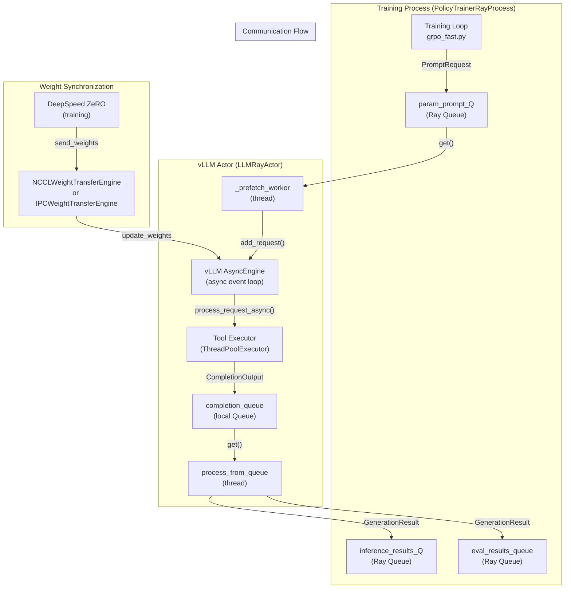

<!-- source: DeepWiki mcp.deepwiki.com · repo allenai/open-instruct · page 8.1 vLLM Integration · fetched 2026-10-26 -->

# vLLM Integration

<details>
<summary>Relevant source files</summary>

The following files were used as context for generating this wiki page:

- [AGENTS.md](AGENTS.md)
- [CHANGELOG.md](CHANGELOG.md)
- [open_instruct/benchmark_generators.py](open_instruct/benchmark_generators.py)
- [open_instruct/data_loader.py](open_instruct/data_loader.py)
- [open_instruct/data_types.py](open_instruct/data_types.py)
- [open_instruct/grpo_fast.py](open_instruct/grpo_fast.py)
- [open_instruct/test_data/generation_with_tools_expected.json](open_instruct/test_data/generation_with_tools_expected.json)
- [open_instruct/test_data/generation_without_tools_expected.json](open_instruct/test_data/generation_without_tools_expected.json)
- [open_instruct/test_data_loader.py](open_instruct/test_data_loader.py)
- [open_instruct/test_dpo_utils_gpu.py](open_instruct/test_dpo_utils_gpu.py)
- [open_instruct/test_grpo_fast.py](open_instruct/test_grpo_fast.py)
- [open_instruct/test_grpo_fast_gpu.py](open_instruct/test_grpo_fast_gpu.py)
- [open_instruct/test_streaming_data_loader_gpu.py](open_instruct/test_streaming_data_loader_gpu.py)
- [open_instruct/test_vllm_utils.py](open_instruct/test_vllm_utils.py)
- [open_instruct/vllm_utils.py](open_instruct/vllm_utils.py)

</details>


This document describes the vLLM integration layer used for high-throughput, asynchronous text generation during RLHF training. The integration enables efficient generation across multiple GPU nodes with tool support, weight synchronization via native vLLM engines, and queue-based decoupling of training and inference.

For details on how vLLM is used within GRPO training, see [GRPO Implementation (2.3.1)](). For tool-augmented training details, see [Tool-Augmented Training (2.3.4)]().

## Architecture Overview

The vLLM integration implements a Ray-based actor system that decouples training from generation. Training processes submit prompts to queues, vLLM engines generate responses asynchronously, and results are collected back through output queues. This architecture enables overlapping computation and supports multi-node distributed training.

Following a consolidation effort, the core logic previously spread across `vllm_utils2.py`, `vllm_utils3.py`, and `vllm_utils_workerwrap.py` is now unified in `vllm_utils.py`. [open_instruct/vllm_utils.py:1-71]()

### System Components



Sources: [open_instruct/vllm_utils.py:511-760](), [open_instruct/grpo_fast.py:613-787](), [open_instruct/data_types.py:1-125]()

## LLMRayActor Class

The `LLMRayActor` is the core Ray actor that wraps vLLM's `AsyncEngine` and manages request processing, tool execution, and weight updates. [open_instruct/vllm_utils.py:511-519]()

### Initialization and Threading Architecture

The actor creates four key threads to maintain high throughput and avoid blocking the main event loop:
1. **Event loop thread**: Runs the vLLM `AsyncEngine` in an asyncio event loop. [open_instruct/vllm_utils.py:564-579]()
2. **Prefetch worker thread**: Pulls `PromptRequest` objects from the global `param_prompt_Q` and submits them to the engine via `add_request`. [open_instruct/vllm_utils.py:585-599]()
3. **Process completion thread**: Monitors a local `completion_queue`, aggregates sub-requests (for $n > 1$), and pushes final `GenerationResult` objects to the output queues. [open_instruct/vllm_utils.py:605-612]()
4. **Tool executor thread pool**: A `ThreadPoolExecutor` dedicated to running blocking environment/tool calls during generation. [open_instruct/vllm_utils.py:561-562]()

Sources: [open_instruct/vllm_utils.py:511-613]()

## Request Processing

### PromptRequest and GenerationResult

Requests are submitted to vLLM using the `PromptRequest` dataclass. [open_instruct/data_types.py:83-102]() Results are returned via the `GenerationResult` dataclass, which includes `RequestInfo` for tool-specific metadata. [open_instruct/data_types.py:47-61]()

```python
@dataclass
class PromptRequest:
    prompt: list[int]
    generation_config: Any
    index: int
    prompt_id: str
    is_eval: bool = False
    env_config: EnvConfig = field(default_factory=EnvConfig)
    ground_truth: Any = None  # Override for evolving rubrics
```

### Tool-Augmented Generation

When tools are enabled, the actor uses `process_request_async` to iteratively generate text and execute tools. [open_instruct/vllm_utils.py:276-301]()
- **Token Processing**: `process_tool_tokens` handles formatting and tokenization of tool outputs, including truncation logic to fit within `max_model_len`. [open_instruct/vllm_utils.py:169-210]()
- **Masking**: Tool outputs can be masked to prevent gradient updates during the training phase. [open_instruct/vllm_utils.py:177]()

Sources: [open_instruct/vllm_utils.py:169-301](), [open_instruct/data_types.py:83-102]()

## Weight Synchronization

The integration has migrated to vLLM's native weight transfer API, replacing custom NCCL process-group code. [CHANGELOG.md:36]()

### Transfer Engines

The system supports two primary transfer engines based on the hardware topology:
1. **NCCLWeightTransferEngine**: Used for distributed weight transfer across different GPUs or nodes. It utilizes `NCCLTrainerSendWeightsArgs` to coordinate the transfer. [open_instruct/vllm_utils.py:48](), [open_instruct/vllm_utils.py:81]()
2. **IPCWeightTransferEngine**: Optimized for single-node transfers using CUDA Inter-Process Communication, utilizing `IPCTrainerSendWeightsArgs`. [open_instruct/vllm_utils.py:47]()

The training process (e.g., in `grpo_fast.py`) initiates the sync by calling `send_weights` on the trainer side, which the vLLM actors receive and apply via `WeightTransferUpdateRequest`. [open_instruct/vllm_utils.py:46](), [open_instruct/grpo_fast.py:1260-1280]()

Sources: [open_instruct/vllm_utils.py:45-48](), [open_instruct/vllm_utils.py:760-780](), [CHANGELOG.md:36]()

## Factory and Utility Functions

### create_vllm_engines

The `create_vllm_engines` function serves as the primary factory for initializing a pool of `LLMRayActor` instances. [open_instruct/vllm_utils.py:785-800]() It handles:
- Resource allocation via Ray `PlacementGroup`. [open_instruct/vllm_utils.py:820-835]()
- Configuration of tensor parallelism and GPU memory utilization. [open_instruct/vllm_utils.py:805-815]()
- Setup of the tool environments and verifiers. [open_instruct/vllm_utils.py:840-850]()

### Model Dimensions

`model_dims_from_vllm_config` extracts architectural metadata (hidden size, layers, vocab size) from the vLLM configuration to populate `ModelDims`, which is used for FLOP and memory calculations. [open_instruct/vllm_utils.py:100-123]()

Sources: [open_instruct/vllm_utils.py:100-123](), [open_instruct/vllm_utils.py:785-850]()

## Testing and Benchmarking

### GPU Integration Tests
- `test_grpo_fast_gpu.py`: Verifies deterministic generation and tool invocation using a real vLLM engine. [open_instruct/test_grpo_fast_gpu.py:73-161]()
- `test_streaming_data_loader_gpu.py`: Tests the end-to-end integration between the `StreamingDataLoader`, `DataPreparationActor`, and vLLM engines. [open_instruct/test_streaming_data_loader_gpu.py:45-172]()

### Performance Benchmarking
`benchmark_generators.py` provides a standalone script to measure generator throughput (tokens/sec) and Model Flop Utilization (MFU) by streaming results through the vLLM actors. [open_instruct/benchmark_generators.py:1-150]()

Sources: [open_instruct/test_grpo_fast_gpu.py:73-161](), [open_instruct/test_streaming_data_loader_gpu.py:45-172](), [open_instruct/benchmark_generators.py:1-150]()

---

