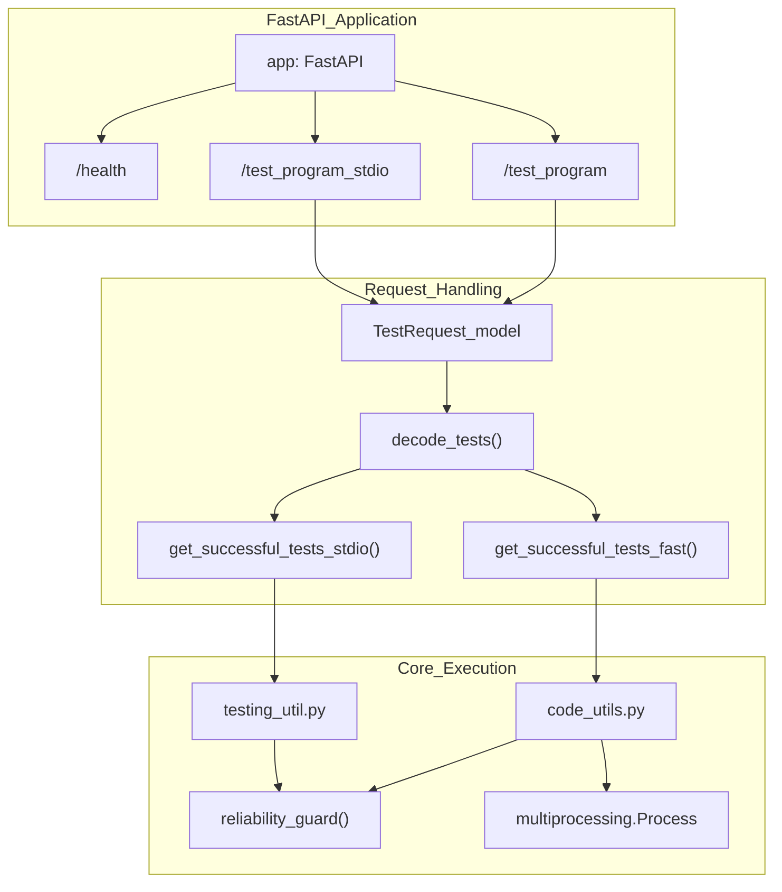
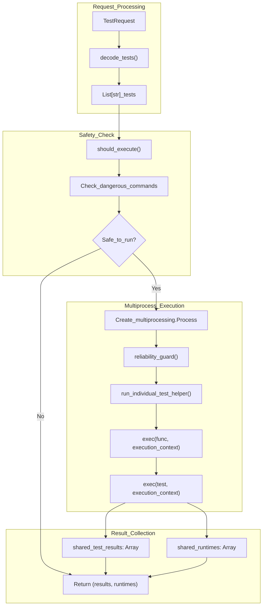
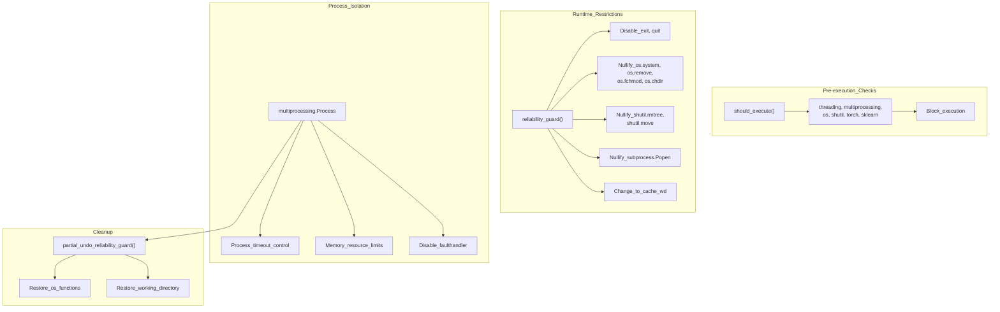
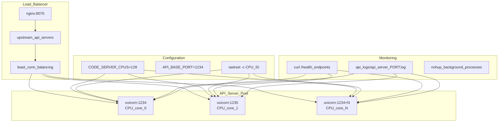

<!-- source: DeepWiki mcp.deepwiki.com · repo allenai/open-instruct · page 8.3 Code Execution API · fetched 2026-10-26 -->

# Code Execution API

<details>
<summary>Relevant source files</summary>

The following files were used as context for generating this wiki page:

- [configs/beaker_configs/code_api_setup.sh](configs/beaker_configs/code_api_setup.sh)
- [configs/judge_configs/general_verifier_judge.yaml](configs/judge_configs/general_verifier_judge.yaml)
- [docs/data/preference-data.md](docs/data/preference-data.md)
- [open_instruct/IFEvalG/instructions.py](open_instruct/IFEvalG/instructions.py)
- [open_instruct/code_utils/Dockerfile](open_instruct/code_utils/Dockerfile)
- [open_instruct/code_utils/__init__.py](open_instruct/code_utils/__init__.py)
- [open_instruct/code_utils/api.py](open_instruct/code_utils/api.py)
- [open_instruct/code_utils/code_utils.py](open_instruct/code_utils/code_utils.py)
- [open_instruct/code_utils/test_api.py](open_instruct/code_utils/test_api.py)
- [open_instruct/code_utils/test_code_utils.py](open_instruct/code_utils/test_code_utils.py)
- [open_instruct/code_utils/testing_util.py](open_instruct/code_utils/testing_util.py)
- [open_instruct/test_data/acecode_sample.jsonl](open_instruct/test_data/acecode_sample.jsonl)
- [scripts/data/preferences/helpsteer2.py](scripts/data/preferences/helpsteer2.py)
- [scripts/data/preferences/helpsteer2_nvidia.py](scripts/data/preferences/helpsteer2_nvidia.py)
- [scripts/data/preferences/nectar.py](scripts/data/preferences/nectar.py)
- [scripts/data/preferences/ultrafeedback_replications.py](scripts/data/preferences/ultrafeedback_replications.py)
- [scripts/train/rlvr/judge_general_verifier.sh](scripts/train/rlvr/judge_general_verifier.sh)

</details>


The Code Execution API provides a sandboxed REST service for testing Python programs against test cases. This system enables safe evaluation of generated code by executing programs in isolated environments with comprehensive safety measures. The API supports both assert-based and standard input/output testing formats, making it suitable for evaluating code generation models across various programming tasks.

For information about model verifiable rewards, see [Verifiable Rewards and Ground Truth](#2.3.2). For details on distributed training infrastructure, see [Job Orchestration and Infrastructure](#5).

## API Overview

The Code Execution API is implemented as a FastAPI application in [open_instruct/code_utils/api.py:34-75]() with two primary endpoints for code testing. The service can be deployed locally or in distributed configurations with load balancing.

### API Endpoints

| Endpoint | Method | Purpose | Input Format |
|----------|---------|---------|--------------|
| `/health` | GET | Health check | None |
| `/test_program` | POST | Assert-based testing | `TestRequest` with assert statements |
| `/test_program_stdio` | POST | Standard I/O testing | `TestRequest` with input/output pairs |

### Request Format

The `TestRequest` model defines the common request structure for both testing endpoints:

```python
class TestRequest(BaseModel):
    program: str
    tests: Any
    max_execution_time: float = 1.0
```

Sources: [open_instruct/code_utils/api.py:39-42]()

**API Architecture Diagram**



Sources: [open_instruct/code_utils/api.py:34-75](), [open_instruct/code_utils/code_utils.py:146-262]()

## Execution Modes

The API supports two distinct testing paradigms, each optimized for different types of programming problems and evaluation scenarios.

### Assert-Based Testing

The `/test_program` endpoint executes programs against assert statements using the `get_successful_tests_fast` function. This mode is ideal for function-based problems where correctness can be verified through assertions.

**Execution Flow for Assert-Based Testing**



Sources: [open_instruct/code_utils/code_utils.py:146-190](), [open_instruct/code_utils/api.py:50-61]()

### Standard I/O Testing

The `/test_program_stdio` endpoint handles programs that read from `stdin` and write to `stdout` using the `get_successful_tests_stdio` function [open_instruct/code_utils/code_utils.py:221-262](). This mode leverages testing utilities from LiveCodeBench for comprehensive I/O verification [open_instruct/code_utils/testing_util.py:1-4]().

The stdio testing process involves wrapping user code in a function via `make_function` [open_instruct/code_utils/testing_util.py:118-146](), mocking `stdin/stdout` using `MockStdinWithBuffer` [open_instruct/code_utils/testing_util.py:72-91](), and comparing outputs with expected results using both string matching and decimal comparison for numerical data via `grade_stdio` [open_instruct/code_utils/testing_util.py:216-324]().

Sources: [open_instruct/code_utils/code_utils.py:221-262](), [open_instruct/code_utils/testing_util.py:216-324]()

## Safety and Sandboxing

The code execution system implements multiple layers of security to prevent malicious code execution while maintaining functionality for legitimate testing scenarios.

### Reliability Guard Implementation

The `reliability_guard` function applies comprehensive restrictions to the execution environment by monkey-patching built-ins and dangerous modules.

**Safety Mechanisms Diagram**



The safety system blocks dangerous imports at the string level via `should_execute` [open_instruct/code_utils/code_utils.py:365-401]() and disables system functions at runtime. Each test runs in a separate `multiprocessing.Process` with timeout controls [open_instruct/code_utils/code_utils.py:180-188]().

Sources: [open_instruct/code_utils/code_utils.py:270-401](), [open_instruct/code_utils/code_utils.py:180-188]()

### Test Data Encoding

The API supports compressed test data encoding using `pickle`, `zlib`, and `base64` for efficient transfer of large test cases:

```python
def encode_tests(tests: list) -> str
def decode_tests(tests: Any) -> list
```

The `decode_tests` function handles multiple formats including JSON, compressed binary, and raw lists with streaming decompression for memory efficiency [open_instruct/code_utils/code_utils.py:68-83]().

Sources: [open_instruct/code_utils/code_utils.py:43-88]()

## Deployment and Infrastructure

The Code Execution API can be deployed as a distributed service with load balancing capabilities using the setup script in [configs/beaker_configs/code_api_setup.sh]().

### Distributed Deployment Architecture



The deployment script creates multiple uvicorn instances bound to specific CPU cores using `taskset` [configs/beaker_configs/code_api_setup.sh:86](), configures `nginx` as a load balancer [configs/beaker_configs/code_api_setup.sh:23-66](), and sets up monitoring. The `CODE_API_URL` environment variable points to the nginx frontend [configs/beaker_configs/code_api_setup.sh:109]().

Sources: [configs/beaker_configs/code_api_setup.sh:68-106](), [configs/beaker_configs/code_api_setup.sh:22-66]()

### Local Development Setup

For local development, the API can be launched using:

```bash
uv run nohup uvicorn open_instruct.code_utils.api:app --host 0.0.0.0 --port 1234 &
```

Or containerized using the provided `Dockerfile` in the `open_instruct/code_utils/` directory [open_instruct/code_utils/api.py:9-11]().

Sources: [open_instruct/code_utils/api.py:2-11]()

## Testing Framework Integration

The code execution system integrates with comprehensive testing infrastructure to validate the safety and correctness of the execution environment.

### Test Coverage Areas

The test suite in [open_instruct/code_utils/test_code_utils.py]() covers multiple security and functionality aspects:

| Test Category | Purpose | Example Tests |
|---------------|---------|---------------|
| Basic Functionality | Core execution correctness | `test_mixed_pass_and_fail`, `test_add_function_example` |
| Network Security | Socket operation behavior | `test_socket_operations_allowed` |
| File System Security | Sandboxed file operations | `test_file_operations_sandboxed` |
| Process Security | Subprocess blocking | `test_subprocess_blocked` |
| Resource Protection | Resource limits | `test_cpu_intensive_timeout` |
| Module Control | Dangerous import blocking | `test_dangerous_imports_blocked` |

Sources: [open_instruct/code_utils/test_code_utils.py:31-210]()

### LiveCodeBench Integration

The stdio testing functionality leverages the LiveCodeBench testing utilities [open_instruct/code_utils/testing_util.py:1-4]() with enhancements for stdin/stdout mocking and decimal number comparison:

```python
def grade_stdio(code: str, all_inputs: list, all_outputs: list, timeout: int)
def make_function(code: str) -> str
def clean_if_name(code: str) -> str
```

The integration includes custom `MockStdinWithBuffer` support [open_instruct/code_utils/testing_util.py:72-91]() and comprehensive output comparison including decimal precision handling [open_instruct/code_utils/testing_util.py:201-206]().

Sources: [open_instruct/code_utils/testing_util.py:1-325](), [open_instruct/code_utils/code_utils.py:16-17]()

---

