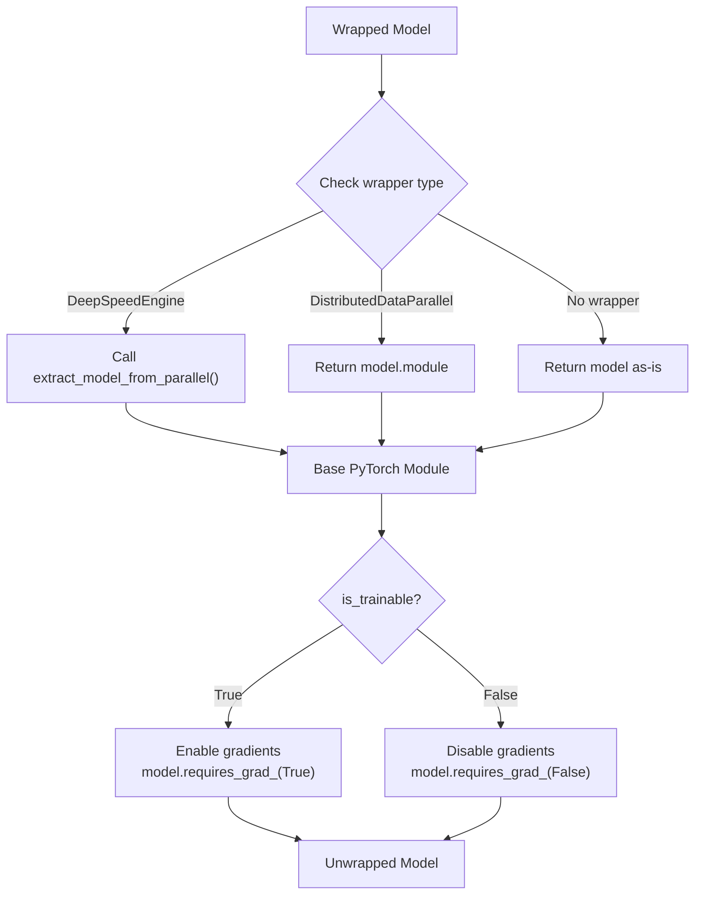
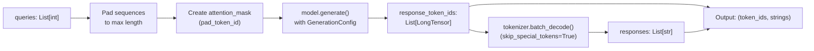
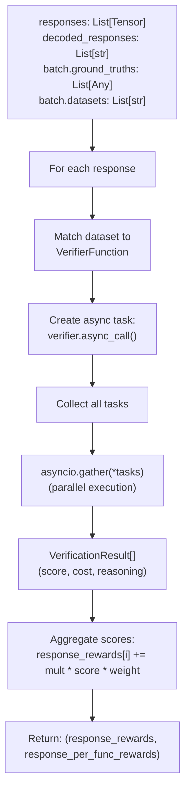
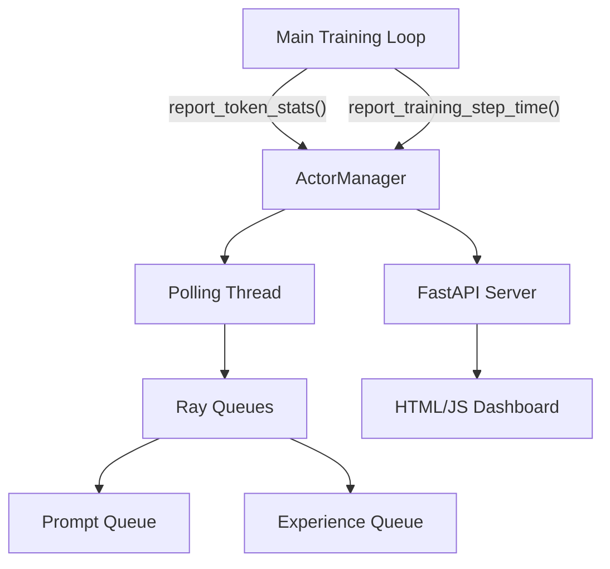

<!-- source: DeepWiki mcp.deepwiki.com · repo allenai/open-instruct · page 8.4 Model Utilities and Helpers · fetched 2026-10-26 -->

# Model Utilities and Helpers

<details>
<summary>Relevant source files</summary>

The following files were used as context for generating this wiki page:

- [configs/beaker_configs/default_eval.yaml](configs/beaker_configs/default_eval.yaml)
- [open_instruct/actor_manager.py](open_instruct/actor_manager.py)
- [open_instruct/dataset_transformation.py](open_instruct/dataset_transformation.py)
- [open_instruct/dpo_tune_cache.py](open_instruct/dpo_tune_cache.py)
- [open_instruct/finetune.py](open_instruct/finetune.py)
- [open_instruct/launch_utils.py](open_instruct/launch_utils.py)
- [open_instruct/model_utils.py](open_instruct/model_utils.py)
- [open_instruct/static/dashboard.css](open_instruct/static/dashboard.css)
- [open_instruct/static/dashboard.html](open_instruct/static/dashboard.html)
- [open_instruct/test_model_utils.py](open_instruct/test_model_utils.py)
- [open_instruct/test_utils.py](open_instruct/test_utils.py)
- [open_instruct/utils.py](open_instruct/utils.py)
- [scripts/collect_eval_results.py](scripts/collect_eval_results.py)
- [scripts/eval/oe-eval.sh](scripts/eval/oe-eval.sh)
- [scripts/eval/truthfulqa.sh](scripts/eval/truthfulqa.sh)
- [scripts/eval/tulu3_baselines.sh](scripts/eval/tulu3_baselines.sh)
- [scripts/submit_eval_jobs.py](scripts/submit_eval_jobs.py)
- [scripts/submit_eval_jobs_old.py](scripts/submit_eval_jobs_old.py)
- [scripts/wait_beaker_dataset_model_upload_then_evaluate_model.py](scripts/wait_beaker_dataset_model_upload_then_evaluate_model.py)

</details>


## Purpose and Scope

This page documents the utility functions and helper classes in `model_utils.py`, `launch_utils.py`, and `actor_manager.py` that support model operations across all training pipelines. These utilities handle model wrapping/unwrapping for distributed training, text generation, reward computation, model persistence, and computational resource estimation. It also covers the `ActorManager` dashboard used for monitoring RLHF training performance.

For reward verification logic and ground truth evaluation, see [Verifiable Rewards and Ground Truth (2.3.2)](). For vLLM-specific generation used in RLHF training, see [vLLM Integration (8.1)](). For dataset preprocessing utilities, see [Dataset Transformation and Tokenization (4.1)]().

---

## Data Structures

### Batch Container

The `Batch` dataclass serves as a container for batch data used during training and evaluation, particularly in RLHF and GRPO workflows. It centralizes tokenized inputs, ground truths, and metadata.

**Structure**:
```python
@dataclass
class Batch:
    queries: list[list[int]]           # Tokenized queries
    ground_truths: list[list[int]]     # Ground truth labels/token IDs
    datasets: list[str]                # Dataset identifiers for verifier mapping
    raw_queries: list[str] | None      # Original query strings
    decoded_responses: list[str] | None# Decoded model outputs
    indices: list[int] | None          # Dataset indices for caching
    scores: list[float] | None         # Computed reward scores
    active_tools: list[list[str] | None] | None = None # Tool call tracking
    model_steps: list[int]             # Tracking training steps per sample
```

The `Batch` class supports indexing and slicing operations (`batch[5]`, `batch[start:end]`, or `batch[[1,3,5]]`), enabling flexible subsetting during training iterations [open_instruct/model_utils.py:124-177]().

**Sources**: [open_instruct/model_utils.py:124-177]()

### TensorCache

The `TensorCache` class provides an atomic disk-backed storage for tensors indexed by dataset indices. This is primarily used in DPO training to cache reference model log-probabilities, preventing redundant forward passes [open_instruct/model_utils.py:98-121]().

**Sources**: [open_instruct/model_utils.py:98-121](), [open_instruct/dpo_tune_cache.py:50-71]()

---

### ModelDims: FLOPs and Memory Calculations

The `ModelDims` class (defined in `utils.py`) estimates computational requirements and memory usage for transformer models based on architectural parameters.

**Key Methods**:

| Method | Returns | Description |
|--------|---------|-------------|
| `flops_fwd_pass()` | int | Forward pass FLOPs [open_instruct/utils.py:1173-1176]() |
| `flops_bwd_pass()` | int | Backward pass FLOPs (≈2× forward) [open_instruct/utils.py:1178-1181]() |
| `flops_per_token()` | int | FLOPs per token generation [open_instruct/utils.py:1183-1186]() |
| `params()` | int | Total parameter count [open_instruct/utils.py:1159-1162]() |
| `memory_params_bytes()` | int | Memory for parameters (16-bit) [open_instruct/utils.py:1197-1200]() |
| `memory_activations_bytes()` | int | Memory for activations [open_instruct/utils.py:1202-1216]() |
| `memory_optimizer_bytes()` | int | Memory for optimizer (Adam: 8 bytes/param) [open_instruct/utils.py:1218-1221]() |

**Sources**: [open_instruct/utils.py:1126-1247](), [open_instruct/test_utils.py:43-74]()

---

## Model Wrapping and Unwrapping

### prepare_deepspeed()

Prepares a model for DeepSpeed training by wrapping it in a `DeepSpeedEngine`. This function extracts optimizer and scheduler from an `Accelerator` instance and initializes DeepSpeed's distributed training infrastructure [open_instruct/model_utils.py:496-540]().

**Function Signature**:
```python
def prepare_deepspeed(
    model: torch.nn.Module,
    per_device_train_batch_size: int,
    mixed_precision: str,
    accelerator: Accelerator,
) -> DeepSpeedEngine
```

**Workflow**:


**Sources**: [open_instruct/model_utils.py:496-540]()

---

### unwrap_model_for_generation()

Unwraps a model from DeepSpeed or DDP (DistributedDataParallel) wrappers to obtain the raw PyTorch module. This is necessary because DeepSpeed's partitioned weights (ZeRO-3) or wrapper interfaces are often incompatible with standard `model.generate()` calls [open_instruct/model_utils.py:433-494]().

**Unwrapping Logic**:



**Sources**: [open_instruct/model_utils.py:433-494]()

---

## Generation and Reward Functions

### generate()

Generates text from a single prompt using the model's native `generate()` method. It handles padding, attention masking, and decoding. It uses `detect_hf_attn_implementation()` to automatically select the most efficient attention backend (e.g., Flash Attention 2/3/4 or SDPA) [open_instruct/model_utils.py:705-849]().

**Process Flow**:



**Sources**: [open_instruct/model_utils.py:705-849](), [open_instruct/model_utils.py:64-94]()

---

### apply_verifiable_reward()

Applies ground truth verification rewards to generated responses using dataset-specific verifier functions. This is a core component of verifiable RLHF training (GRPO), where rewards come from programmatic correctness checks [open_instruct/model_utils.py:261-342]().

**Async Parallel Verification**:



**Sources**: [open_instruct/model_utils.py:261-342](), [open_instruct/ground_truth_utils.py:105-168]()

---

## Infrastructure and Launch Utilities

### launch_utils.py

Provides low-level utilities for interacting with storage backends (Weka, Google Storage) and managing model downloads [open_instruct/launch_utils.py:1-114]().

- **`download_from_hf`**: Wraps `huggingface-cli` to download models to the local cache [open_instruct/launch_utils.py:63-70]().
- **`gs_folder_exists` / `upload_to_gs_bucket`**: Interface for Google Cloud Storage (GCS) operations using `gsutil` [open_instruct/launch_utils.py:90-101]().
- **`live_subprocess_output`**: Executes commands and streams output to the console in real-time [open_instruct/launch_utils.py:47-60]().
- **`WEKA_CLUSTERS`**: List of AI2 clusters supporting Weka mounts (jupiter, saturn, etc.) [open_instruct/launch_utils.py:8-17]().

**Sources**: [open_instruct/launch_utils.py:1-114]()

---

## ActorManager Dashboard

The `ActorManager` class provides a centralized dashboard for monitoring RLHF training (GRPO). It tracks queue sizes, token throughput, and training step times [open_instruct/actor_manager.py:43-182]().

### Monitoring Architecture



### Key Components:
- **`_poll_queue_sizes`**: A background thread that periodically checks the size of Ray queues (e.g., experience buffers) to detect bottlenecks [open_instruct/actor_manager.py:83-89]().
- **FastAPI Dashboard**: Serves a real-time UI at a dynamically allocated port using `static/dashboard.html` [open_instruct/actor_manager.py:91-140]().
- **Metric Tracking**:
    - **Token Stats**: Tracks prefill and decode tokens per second [open_instruct/actor_manager.py:151-175]().
    - **Timing Stats**: Computes moving averages for training step duration and batch generation time [open_instruct/actor_manager.py:179-182]().

**Sources**: [open_instruct/actor_manager.py:15-182](), [open_instruct/static/dashboard.html:1-160]()

---

## Model Persistence

### save_with_accelerate()

Saves a model using Accelerate's distributed saving mechanism, handling DeepSpeed ZeRO stages and DDP. It also performs checkpoint cleanup to manage disk space [open_instruct/model_utils.py:542-582]().

**Key Features**:
1. **LoRA Support**: If `args.use_lora=True`, it saves the adapter weights or merged weights depending on configuration [open_instruct/model_utils.py:554-555]().
2. **README Generation**: Automatically generates a `README.md` containing training arguments and metadata [open_instruct/model_utils.py:566-574]().
3. **Completion Marker**: Writes a `COMPLETED` file to signal that the checkpoint is ready for evaluation or upload [open_instruct/model_utils.py:576-578]().

**Sources**: [open_instruct/model_utils.py:542-582](), [open_instruct/finetune.py:57-70]()

---

