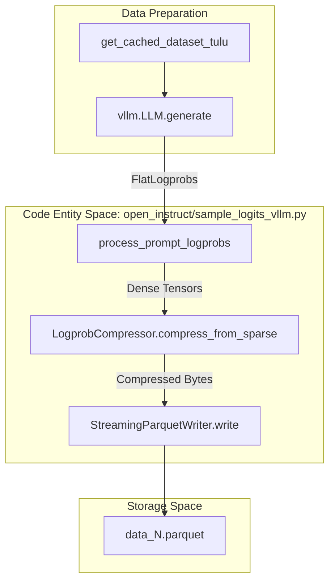
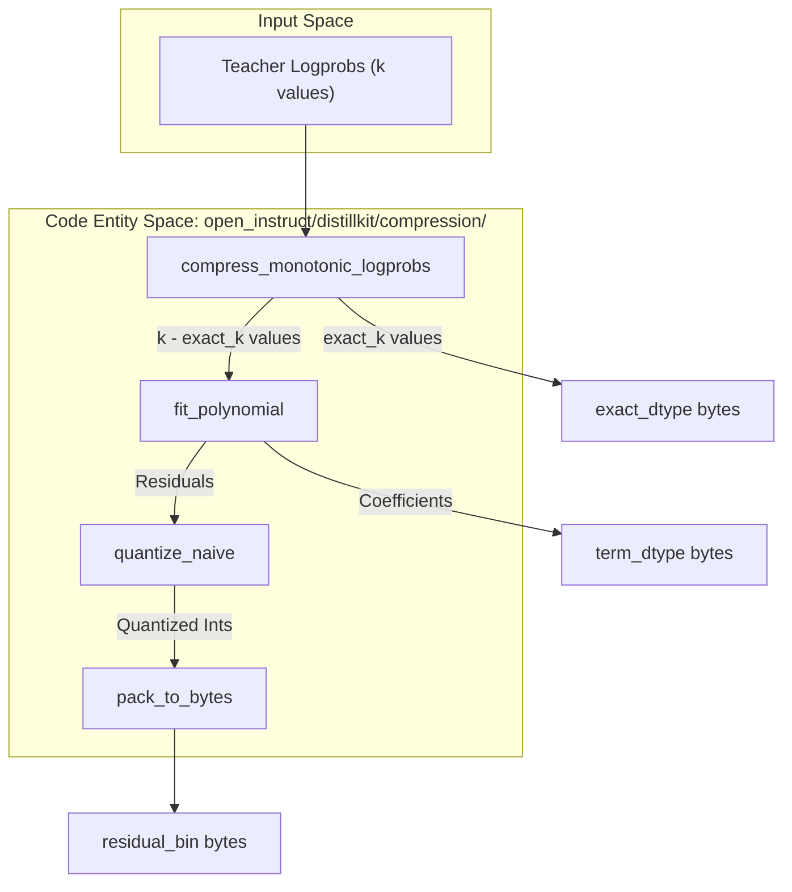
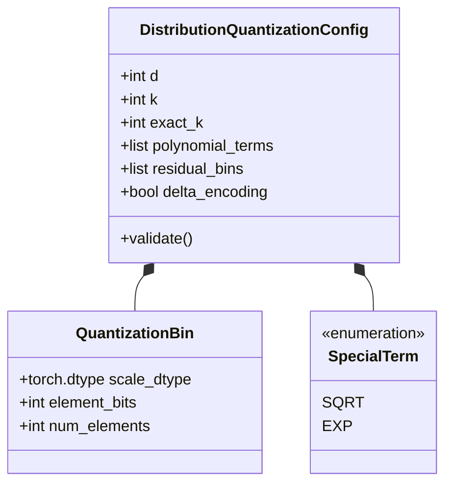

<!-- source: DeepWiki mcp.deepwiki.com · repo allenai/open-instruct · page 8.5 Model Compression and Distillation · fetched 2026-10-26 -->

# Model Compression and Distillation

<details>
<summary>Relevant source files</summary>

The following files were used as context for generating this wiki page:

- [configs/compression/default.yml](configs/compression/default.yml)
- [open_instruct/distillkit/__init__.py](open_instruct/distillkit/__init__.py)
- [open_instruct/distillkit/compression/__init__.py](open_instruct/distillkit/compression/__init__.py)
- [open_instruct/distillkit/compression/bitpack.py](open_instruct/distillkit/compression/bitpack.py)
- [open_instruct/distillkit/compression/compressor.py](open_instruct/distillkit/compression/compressor.py)
- [open_instruct/distillkit/compression/config.py](open_instruct/distillkit/compression/config.py)
- [open_instruct/distillkit/compression/monotonic_logprobs.py](open_instruct/distillkit/compression/monotonic_logprobs.py)
- [open_instruct/distillkit/compression/test_compression.py](open_instruct/distillkit/compression/test_compression.py)
- [open_instruct/distillkit/sample_common.py](open_instruct/distillkit/sample_common.py)
- [open_instruct/distillkit/test_sample_common.py](open_instruct/distillkit/test_sample_common.py)
- [open_instruct/sample_logits_vllm.py](open_instruct/sample_logits_vllm.py)
- [scripts/train/distill/olmo3_32b_teacher_sample_logits.sh](scripts/train/distill/olmo3_32b_teacher_sample_logits.sh)

</details>


This section documents the `distillkit` subsystem located in `open_instruct/distillkit/`. This module provides tools for compressing model outputs (specifically logprobs) to facilitate efficient large-scale distillation. It includes implementations for bit-packing, polynomial approximation of probability distributions, and quantization configurations. Note that the `quantize/` directory for GPTQ quantization has been removed from the repository.

## Overview of DistillKit

The `distillkit` module is designed to handle the high storage and memory overhead associated with storing teacher model distributions during distillation. Instead of storing full dense tensors, it employs a combination of sparse selection (top-k), polynomial fitting for the distribution tail, and bit-level packing.

### Key Components

| Component | File Path | Description |
| :--- | :--- | :--- |
| `LogprobCompressor` | [open_instruct/distillkit/compression/compressor.py:14-14]() | High-level interface for compressing and decompressing sparse logprobs. |
| `bitpack` | [open_instruct/distillkit/compression/bitpack.py:7-7]() | Utilities for packing arbitrary bit-width integers into `uint8` byte tensors. |
| `monotonic_logprobs` | [open_instruct/distillkit/compression/monotonic_logprobs.py:114-114]() | Algorithms for fitting polynomials to sorted logprobs and managing residuals. |
| `DistributionQuantizationConfig` | [open_instruct/distillkit/compression/config.py:59-59]() | Configuration class defining the compression strategy (k, exact_k, bits, etc.). |
| `StreamingParquetWriter` | [open_instruct/distillkit/distillkit/sample_common.py:26-26]() | Background writer with batched row buffering and file rotation for saving logits. |

Sources: [open_instruct/distillkit/compression/__init__.py:4-13](), [open_instruct/distillkit/compression/compressor.py:14-34](), [open_instruct/distillkit/sample_common.py:26-48]()

---

## Teacher Logit Sampling with vLLM

To perform distillation, one must first sample logits from a teacher model. The script `open_instruct/sample_logits_vllm.py` facilitates this by using vLLM for high-throughput inference and `LogprobCompressor` for storage efficiency.

### Logit Sampling Data Flow
The sampling process involves tokenizing a dataset, running it through a teacher model (e.g., Olmo-3-32B), extracting top-k logprobs, and writing them to Parquet shards.

**Teacher Logit Sampling Pipeline**

Sources: [open_instruct/sample_logits_vllm.py:82-129](), [open_instruct/sample_logits_vllm.py:171-180](), [open_instruct/distillkit/sample_common.py:58-75]()

### Key Functions for Sampling
*   **`process_prompt_logprobs`**: Extracts dense top-k token IDs and logprobs from vLLM's `FlatLogprobs` output. It specifically handles vLLM's internal padding by detecting and skipping empty first slots [open_instruct/sample_logits_vllm.py:82-129]().
*   **`StreamingParquetWriter`**: Manages a background thread to write rows asynchronously. It uses a `queue.Queue` to buffer rows and rotates files once `file_max_rows` is reached [open_instruct/distillkit/sample_common.py:26-48]().
*   **`compressed_logit_schema`**: Defines the PyArrow schema for the output, including `input_ids`, `compressed_logprobs`, and `bytepacked_indices` [open_instruct/distillkit/sample_common.py:13-23]().

Sources: [open_instruct/sample_logits_vllm.py:82-129](), [open_instruct/distillkit/sample_common.py:13-75]()

---

## Logprob Compression Architecture

The compression pipeline transforms raw logprobs into a compact byte stream. It treats the distribution as a sorted sequence (monotonic) to leverage polynomial approximation.

### Data Flow: Compression to Byte Stream

**Logprob Compression Logic**

Sources: [open_instruct/distillkit/compression/compressor.py:19-26](), [open_instruct/distillkit/compression/monotonic_logprobs.py:114-149]()

### Bit-Packing Implementation
The `pack_to_bytes` function allows storing integers using only the minimum required bits (e.g., 11 bits for a 2048-size vocabulary) rather than full 16-bit or 32-bit types.

*   **Logic**: It expands elements to big-endian bit values [open_instruct/distillkit/compression/bitpack.py:15-16](), flattens them into a bitstream [open_instruct/distillkit/compression/bitpack.py:19-19](), and pads to the nearest byte boundary [open_instruct/distillkit/compression/bitpack.py:21-21]().
*   **Unpacking**: The `unpack_from_bytes` function reverses this by slicing the bitstream based on `original_num_elements` and reconstructing the integers using powers of 2 [open_instruct/distillkit/compression/bitpack.py:29-52]().

Sources: [open_instruct/distillkit/compression/bitpack.py:7-52]()

---

## Compression Configuration

Compression is governed by the `DistributionQuantizationConfig` class, which defines how the top-k logprobs are partitioned.

### Configuration Parameters
A typical configuration (e.g., `configs/compression/default.yml`) includes:
*   **`d`**: Total vocabulary size (e.g., 128256 for Llama 3) [configs/compression/default.yml:7-7]().
*   **`k`**: Total number of top logprobs to track [configs/compression/default.yml:8-8]().
*   **`exact_k`**: Number of values stored with full precision (e.g., top 16) [configs/compression/default.yml:9-9]().
*   **`polynomial_terms`**: A list of terms like `[0, 1, 2, "sqrt"]` used to approximate the remaining `k - exact_k` values [configs/compression/default.yml:11-11]().

### Polynomial Fitting
The system uses a least-squares solver with Singular Value Decomposition (SVD) to fit basis coefficients to the sorted logprob curve [open_instruct/distillkit/compression/monotonic_logprobs.py:22-31](). This allows the tail of the top-k distribution to be represented by a few floating-point coefficients rather than individual values.

**Compression Strategy Mapping**

Sources: [open_instruct/distillkit/compression/config.py:10-139](), [open_instruct/distillkit/compression/monotonic_logprobs.py:34-57]()

---

## Quantization and Bit-width Utilities

The `distillkit` module provides several helpers to manage PyTorch dtypes during the compression process:

1.  **Dtype Mapping**: `DTYPE_NAME_TO_TORCH` maps string identifiers (from YAML configs) to `torch.dtype` objects [open_instruct/distillkit/compression/config.py:16-21]().
2.  **Bit Width Calculation**: `torch_dtype_bit_width` dynamically retrieves the bit width of a tensor type using `torch.finfo(dtype).bits` [open_instruct/distillkit/compression/config.py:41-45]().
3.  **Symmetric Quantization**: `quantize_naive` implements per-row scaling for symmetric integer quantization [open_instruct/distillkit/compression/monotonic_logprobs.py:91-103](). It calculates a `scale_factor` based on the maximum absolute value in the row [open_instruct/distillkit/compression/monotonic_logprobs.py:97-98]().

### Error Diffusion
When using `delta_encoding`, the system can optionally apply `error_diffusion` [open_instruct/distillkit/compression/monotonic_logprobs.py:74-88](). This technique carries over the quantization error from one element to the next, which helps maintain the integrity of the cumulative sum (the original logprob values) during decompression.

Sources: [open_instruct/distillkit/compression/config.py:16-45](), [open_instruct/distillkit/compression/monotonic_logprobs.py:74-103]()

---

## Usage Example: LogprobCompressor

The `LogprobCompressor` class provides the primary entry point for integration into training loops or data processing scripts.

```python
# Initialization from config
config = DistributionQuantizationConfig.from_dict(yaml_data)
compressor = LogprobCompressor(config)

# Compression
# indices: [batch, seq, k], logprobs: [batch, seq, k]
compressed_data = compressor.compress_from_sparse(indices, logprobs)

# Decompression
# row contains "compressed_logprobs" and "bytepacked_indices"
out_indices, out_logprobs = compressor.decompress_to_sparse(compressed_data)
```

The `vocab_index_bits` is automatically calculated during initialization based on the vocabulary size `d` [open_instruct/distillkit/compression/compressor.py:17-17](), ensuring the bit-packer uses the most efficient representation for vocabulary indices.

Sources: [open_instruct/distillkit/compression/compressor.py:14-34](), [open_instruct/distillkit/compression/test_compression.py:73-97]()

---

