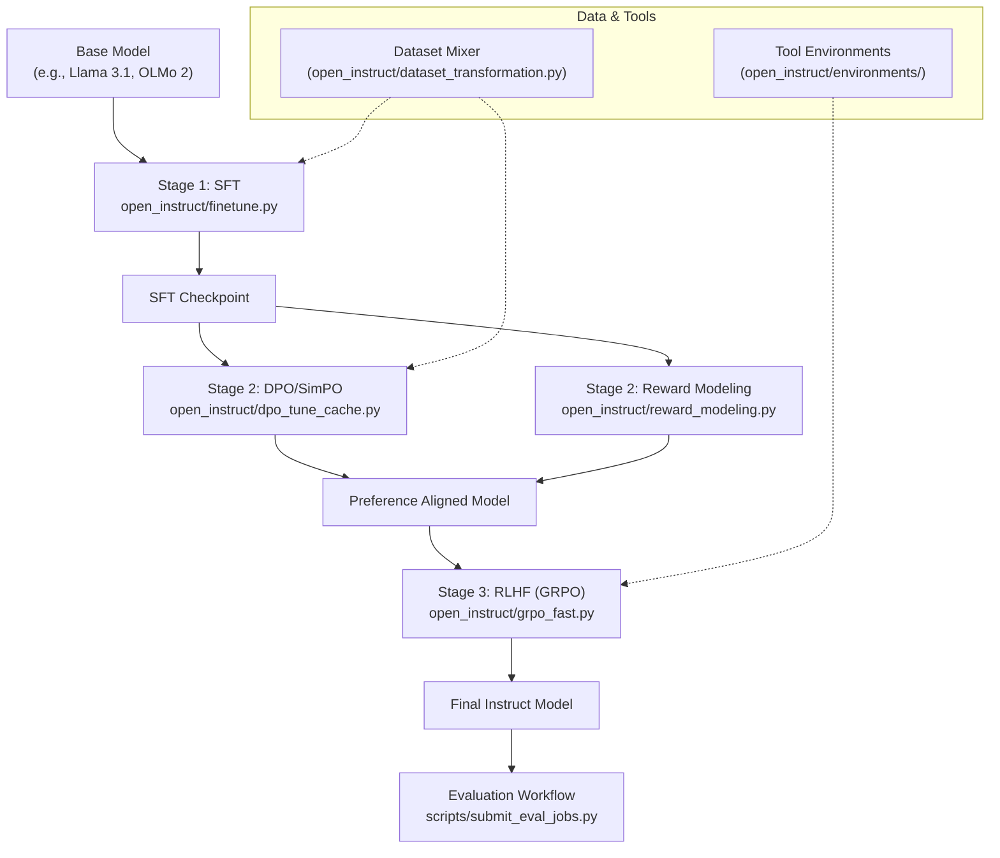
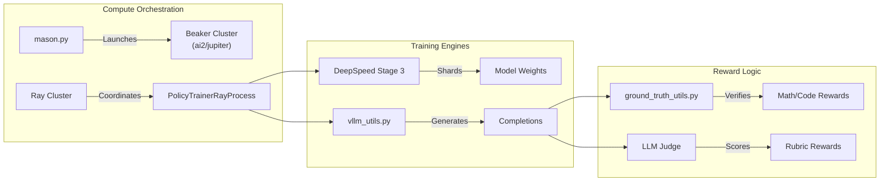

<!-- source: DeepWiki mcp.deepwiki.com · repo allenai/open-instruct · page 9 End-to-End Workflows · fetched 2026-10-26 -->

# End-to-End Workflows

Relevant source files

The following files were used as context for generating this wiki page:

- [docs/ai2_internal.md](docs/ai2_internal.md)
- [docs/archived_dev_scripts/olmo2_1124.sh](docs/archived_dev_scripts/olmo2_1124.sh)
- [docs/archived_dev_scripts/olmoe_0125.sh](docs/archived_dev_scripts/olmoe_0125.sh)
- [docs/get_started/ai2_internal_setup.md](docs/get_started/ai2_internal_setup.md)
- [docs/tulu3.md](docs/tulu3.md)
- [scripts/benchmarking/olmo3_infra.sh](scripts/benchmarking/olmo3_infra.sh)
- [scripts/cache_hf.py](scripts/cache_hf.py)
- [scripts/train/debug/full_integration_test.sh](scripts/train/debug/full_integration_test.sh)
- [scripts/train/olmo3/32b_think_dpo.sh](scripts/train/olmo3/32b_think_dpo.sh)
- [scripts/train/olmo3/32b_think_rl.sh](scripts/train/olmo3/32b_think_rl.sh)
- [scripts/train/olmo3/7b_instruct_dpo.sh](scripts/train/olmo3/7b_instruct_dpo.sh)
- [scripts/train/olmo3/7b_instruct_rl.sh](scripts/train/olmo3/7b_instruct_rl.sh)
- [scripts/train/olmo3/7b_rlzero_code.sh](scripts/train/olmo3/7b_rlzero_code.sh)
- [scripts/train/olmo3/7b_rlzero_general.sh](scripts/train/olmo3/7b_rlzero_general.sh)
- [scripts/train/olmo3/7b_rlzero_instruction_following.sh](scripts/train/olmo3/7b_rlzero_instruction_following.sh)
- [scripts/train/olmo3/7b_rlzero_math.sh](scripts/train/olmo3/7b_rlzero_math.sh)
- [scripts/train/olmo3/7b_rlzero_mix.sh](scripts/train/olmo3/7b_rlzero_mix.sh)
- [scripts/train/olmo3/7b_think_dpo.sh](scripts/train/olmo3/7b_think_dpo.sh)
- [scripts/train/olmo3/7b_think_rl.sh](scripts/train/olmo3/7b_think_rl.sh)
- [scripts/train/olmo3/7b_think_rl_no_pipeline.sh](scripts/train/olmo3/7b_think_rl_no_pipeline.sh)

This page provides practical, high-level guides for complete training and evaluation workflows within the `open-instruct` repository. It serves as a bridge between individual component documentation and real-world model development cycles, such as those used for the Tulu 3 and OLMo model families.

## Workflow Overview

A typical end-to-end workflow in `open-instruct` follows a multi-stage progression from a base language model to a fully aligned instruction-following agent. The framework is designed to handle each transition with specialized scripts and optimized configurations.

### The Standard Alignment Pipeline

Sources: [open_instruct/finetune.py:1-60](), [open_instruct/grpo_fast.py:1-50](), [open_instruct/dpo_tune_cache.py:1-40](), [open_instruct/reward_modeling.py:164-182]()

## Key Workflow Components

### 1. Complete Training Pipeline
The training pipeline supports both standard HuggingFace-based paths and high-performance distributed paths.
*   **SFT:** Uses `finetune.py`. It supports multi-node execution via `accelerate launch` and DeepSpeed ZeRO-3 configurations [docs/tulu3.md:22-31]().
*   **DPO:** Implemented via `dpo_tune_cache.py` (which uses a reference model caching strategy) or `dpo_tune.py`. It supports various loss types like `dpo_norm` and `beta` scaling [docs/tulu3.md:158-159]().
*   **RLHF (GRPO):** The `grpo_fast.py` script is the primary RL engine, replacing older PPO implementations. It features a queue-based architecture and integrates vLLM for high-throughput generation [scripts/train/debug/full_integration_test.sh:31-35]().

For details, see [Complete Training Pipeline](#9.1).

### 2. Model Evaluation Workflow
Evaluation is integrated into the training lifecycle. Scripts like `submit_eval_jobs.py` allow users to launch comprehensive benchmark suites (MMLU, GSM8K, IFEval) on Beaker or local clusters. The system supports "verifiable rewards" where code execution or math parsers validate model outputs during RL and Eval [scripts/train/olmo3/7b_think_rl.sh:49-50]().

For details, see [Model Evaluation Workflow](#9.2).

### 3. Tulu 3 and OLMo Case Studies
The development processes for Tulu 3 and OLMo 3 serve as the primary references for these workflows. 
*   **Tulu 3:** Detailed commands for 8B and 70B SFT and DPO stages, including exact dataset mixer lists like `allenai/tulu-3-sft-mixture` [docs/tulu3.md:49-49]().
*   **OLMo 3:** Specialized scripts for "Thinker" models using GRPO with long response lengths (up to 32k) and complex verifiable rewards [scripts/train/olmo3/7b_think_rl.sh:34-35]().

For details, see [Tulu3 Case Study](#9.3).

## Technical Infrastructure

The workflows rely on a robust infrastructure layer to manage distributed resources:

### Code-to-System Mapping

Sources: [scripts/train/olmo3/7b_rlzero_math.py:22-35](), [open_instruct/grpo_fast.py:1-100](), [scripts/train/debug/full_integration_test.sh:71-77]()

### Key Code Entities

| Component | Code Entity | Role |
| :--- | :--- | :--- |
| **Job Launcher** | `mason.py` | CLI for submitting jobs to Beaker with image/cluster/env management [scripts/cache_hf.py:13-19](). |
| **RL Trainer** | `grpo_fast.py` | Main entry point for GRPO training, handling Ray setup and training loops [scripts/train/olmo3/7b_think_rl.sh:18-18](). |
| **Inference Engine** | `vllm_utils.py` | Factory for vLLM engines used in rollouts [open_instruct/grpo_fast.py:59-60](). |
| **Reward Verifier** | `ground_truth_utils.py` | Logic for checking math answers and code correctness [scripts/train/debug/full_integration_test.sh:62-62](). |
| **Data Mixer** | `dataset_mixer_list` | Argument used across scripts to define multi-dataset proportions [docs/tulu3.md:49-49](). |

Sources: [scripts/cache_hf.py:13-19](), [open_instruct/grpo_fast.py:59-60](), [docs/tulu3.md:49-49]()

---

