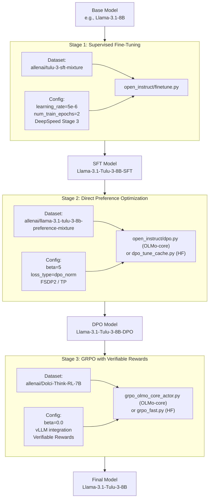
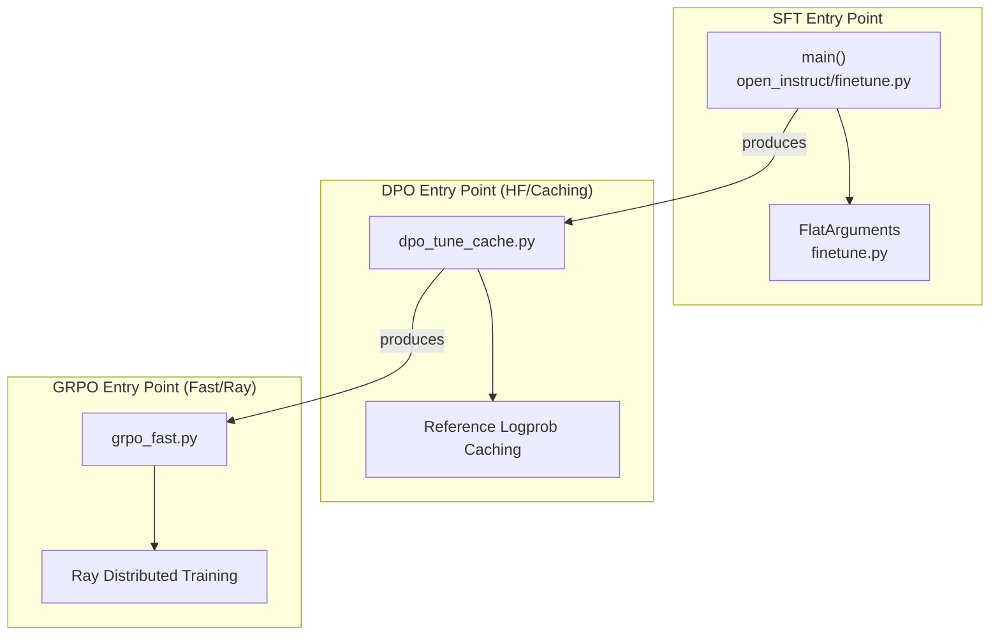

<!-- source: DeepWiki mcp.deepwiki.com · repo allenai/open-instruct · page 9.1 Complete Training Pipeline · fetched 2026-10-26 -->

# Complete Training Pipeline

<details>
<summary>Relevant source files</summary>

The following files were used as context for generating this wiki page:

- [configs/train_configs/dpo/default.yaml](configs/train_configs/dpo/default.yaml)
- [configs/train_configs/sft/default.yaml](configs/train_configs/sft/default.yaml)
- [configs/train_configs/sft/tulu3_8b_preview_mix_v3.0.yaml](configs/train_configs/sft/tulu3_8b_preview_mix_v3.0.yaml)
- [configs/train_configs/sft/tulu3_8b_preview_mix_v3.1.yaml](configs/train_configs/sft/tulu3_8b_preview_mix_v3.1.yaml)
- [configs/train_configs/sft/tulu3_8b_preview_mix_v3.2.yaml](configs/train_configs/sft/tulu3_8b_preview_mix_v3.2.yaml)
- [docs/ai2_internal.md](docs/ai2_internal.md)
- [docs/archived_dev_scripts/olmo2_1124.sh](docs/archived_dev_scripts/olmo2_1124.sh)
- [docs/archived_dev_scripts/olmoe_0125.sh](docs/archived_dev_scripts/olmoe_0125.sh)
- [docs/get_started/ai2_internal_setup.md](docs/get_started/ai2_internal_setup.md)
- [docs/tulu3.md](docs/tulu3.md)
- [scripts/benchmarking/olmo3_infra.sh](scripts/benchmarking/olmo3_infra.sh)
- [scripts/cache_hf.py](scripts/cache_hf.py)
- [scripts/train/debug/full_integration_test.sh](scripts/train/debug/full_integration_test.sh)
- [scripts/train/olmo3/32b_think_dpo.sh](scripts/train/olmo3/32b_think_dpo.sh)
- [scripts/train/olmo3/32b_think_rl.sh](scripts/train/olmo3/32b_think_rl.sh)
- [scripts/train/olmo3/7b_instruct_dpo.sh](scripts/train/olmo3/7b_instruct_dpo.sh)
- [scripts/train/olmo3/7b_instruct_rl.sh](scripts/train/olmo3/7b_instruct_rl.sh)
- [scripts/train/olmo3/7b_rlzero_code.sh](scripts/train/olmo3/7b_rlzero_code.sh)
- [scripts/train/olmo3/7b_rlzero_general.sh](scripts/train/olmo3/7b_rlzero_general.sh)
- [scripts/train/olmo3/7b_rlzero_instruction_following.sh](scripts/train/olmo3/7b_rlzero_instruction_following.sh)
- [scripts/train/olmo3/7b_rlzero_math.sh](scripts/train/olmo3/7b_rlzero_math.sh)
- [scripts/train/olmo3/7b_rlzero_mix.sh](scripts/train/olmo3/7b_rlzero_mix.sh)
- [scripts/train/olmo3/7b_think_dpo.sh](scripts/train/olmo3/7b_think_dpo.sh)
- [scripts/train/olmo3/7b_think_rl.sh](scripts/train/olmo3/7b_think_rl.sh)
- [scripts/train/olmo3/7b_think_rl_no_pipeline.sh](scripts/train/olmo3/7b_think_rl_no_pipeline.sh)

</details>


This page provides a step-by-step guide for training instruction-following language models using the three-stage pipeline: Supervised Fine-Tuning (SFT) → Direct Preference Optimization (DPO) → Group Relative Policy Optimization (GRPO). It covers both the standard HuggingFace-based path and the high-performance **OLMo-core** path.

## Pipeline Overview

The complete training pipeline consists of three sequential stages. Each stage uses the output model from the previous stage as its starting point. This progression moves from basic instruction-following capability through preference alignment to sophisticated reasoning with verifiable rewards.

### Three-Stage Training Architecture



**Sources:** [docs/tulu3.md:8-161](), [scripts/train/olmo3/7b_think_rl.py:18-68](), [configs/train_configs/sft/tulu3_8b_preview_mix_v3.1.yaml:1-30]()

### Code Entry Points and Key Classes

The pipeline supports two primary implementation paths: the standard HuggingFace/DeepSpeed path and the newer OLMo-core path utilizing FSDP2 and native PyTorch 2.0 features.



**Sources:** [docs/tulu3.md:31-32](), [docs/tulu3.md:191-192](), [scripts/train/olmo3/7b_think_rl.sh:17-18]()

---

## Stage 1: Supervised Fine-Tuning (SFT)

SFT adapts a base model to follow instructions using instruction-response pairs. The Tulu 3 reproduction uses a mixture of high-quality datasets.

### Dataset Preparation
SFT requires datasets in the messages format. The repository uses `dataset_mixer_list` to combine multiple sources with specific sampling ratios [docs/tulu3.md:49-49]().

### Training Execution
Standard SFT is performed via `finetune.py`. It supports DeepSpeed ZeRO-3 for efficient parameter distribution [docs/tulu3.md:29-30]().

**Example Command (8B Model):**
```bash
accelerate launch \
    --num_machines 8 \
    --num_processes 64 \
    --use_deepspeed \
    --deepspeed_config_file configs/ds_configs/stage3_no_offloading_accelerate.conf \
    open_instruct/finetune.py \
    --model_name_or_path meta-llama/Llama-3.1-8B \
    --dataset_mixer_list allenai/tulu-3-sft-mixture 1.0 \
    --learning_rate 5e-06 \
    --num_train_epochs 2 \
    --max_seq_length 4096 \
    --output_dir output/sft_8b
```
**Sources:** [docs/tulu3.md:12-53](), [configs/train_configs/sft/tulu3_8b_preview_mix_v3.1.yaml:1-27]()

---

## Stage 2: Direct Preference Optimization (DPO)

DPO aligns the SFT model with human preferences using (chosen, rejected) pairs.

### Reference Logprob Caching
For large models like Llama-3.1-70B, reference logprobs are pre-computed and cached using `dpo_tune_cache.py` to reduce VRAM requirements during the optimization phase [docs/tulu3.md:191-191]().

### Loss Variants
The pipeline supports multiple preference loss types. Tulu 3 specifically utilized `dpo_norm` with a `beta` of 5 [docs/tulu3.md:158-159]().

**Example Command (70B with Caching):**
```bash
accelerate launch \
    --use_deepspeed \
    --deepspeed_config_file configs/ds_configs/stage3_offloading_accelerate.conf \
    open_instruct/dpo_tune_cache.py \
    --model_name_or_path allenai/Llama-3.1-Tulu-3-70B-SFT \
    --dpo_loss_type dpo_norm \
    --dpo_beta 5 \
    --output_dir output/dpo_70b
```
**Sources:** [docs/tulu3.md:126-161](), [docs/tulu3.md:191-193]()

---

## Stage 3: Group Relative Policy Optimization (GRPO)

GRPO is the final stage, focusing on reasoning and verifiable rewards. It replaces the traditional PPO pipeline for better efficiency in reasoning tasks.

### Implementation Details
The `grpo_fast.py` script manages the distributed training loop using Ray [scripts/train/debug/full_integration_test.sh:31-31]().

- **vLLM Integration:** Generation is offloaded to vLLM engines (e.g., 56 engines for 7B models) to maximize throughput [scripts/train/olmo3/7b_rlzero_math.sh:60-60]().
- **Verifiable Rewards:** Integrates verifiable rewards for math and code correctness [scripts/train/olmo3/7b_think_rl.sh:49-50]().
- **Async Steps:** Supports asynchronous rollout and training steps to hide generation latency [scripts/train/olmo3/7b_rlzero_instruction_following.sh:34-34]().

### Verifiers and Judges
GRPO uses a combination of:
1.  **Ground Truth Verifiers:** String matching or code execution for math/programming [scripts/train/olmo3/7b_think_rl.sh:62-64]().
2.  **LLM Judges:** Using models like `Qwen3-32B` to evaluate open-ended reasoning [scripts/train/debug/full_integration_test.sh:71-71]().

**Sources:** [scripts/train/olmo3/7b_think_rl.sh:17-68](), [scripts/train/olmo3/7b_rlzero_math.sh:35-77](), [scripts/train/debug/full_integration_test.sh:31-77]()

---

## Infrastructure and Checkpointing

### Mason Orchestration
All stages are typically launched via `mason.py`, which handles Beaker cluster selection (e.g., `ai2/jupiter`), Docker image management, and Ray node setup [scripts/train/olmo3/7b_think_rl.sh:4-17]().

### Checkpointing Strategy
- **SFT/DPO:** Standard HuggingFace checkpoints saved by epoch or step [docs/tulu3.md:50-50]().
- **GRPO:** Periodic saving of model weights and trainer state [scripts/train/olmo3/7b_rlzero_math.sh:66-67]().

### Hyperparameter Scaling
| Parameter | 8B Model (SFT) | 8B Model (DPO) | 7B Model (GRPO) |
| :--- | :--- | :--- | :--- |
| Learning Rate | 5e-6 [docs/tulu3.md:39]() | 5e-7 [docs/tulu3.md:144]() | 1e-6 [scripts/train/olmo3/7b_think_rl.sh:24]() |
| Batch Size (Eff) | 128 [docs/tulu3.md:65]() | 128 [docs/tulu3.md:142-143]() | Varies (Ray) |
| Seq Length | 4096 [docs/tulu3.md:35]() | 2048 [docs/tulu3.md:140]() | 32k-35k [scripts/train/olmo3/7b_think_rl.sh:34-35]() |

**Sources:** [docs/tulu3.md:12-161](), [scripts/train/olmo3/7b_think_rl.sh:18-68](), [configs/train_configs/sft/tulu3_8b_preview_mix_v3.1.yaml:1-27]()

---

