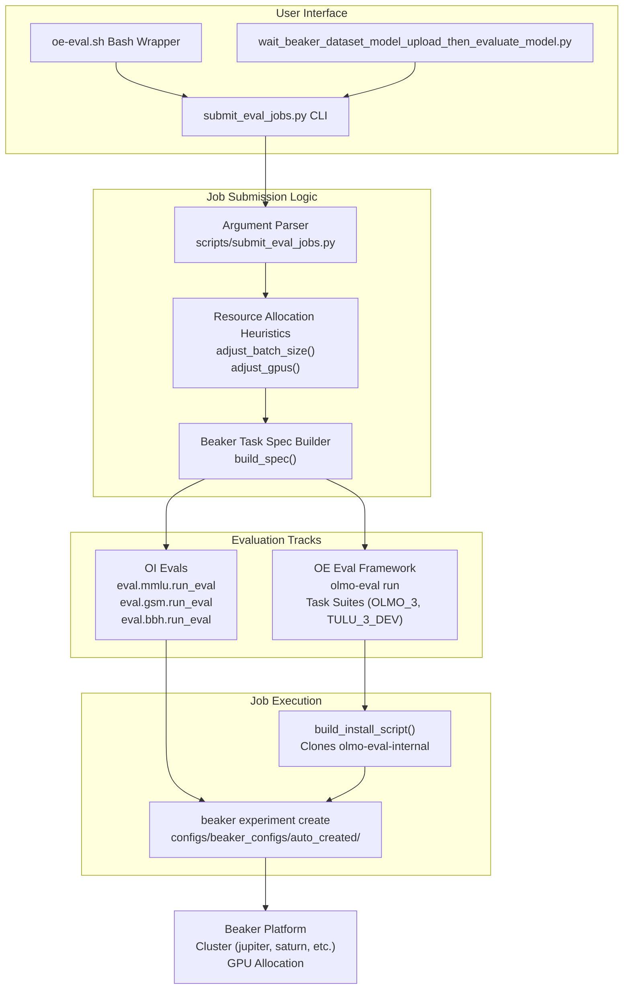
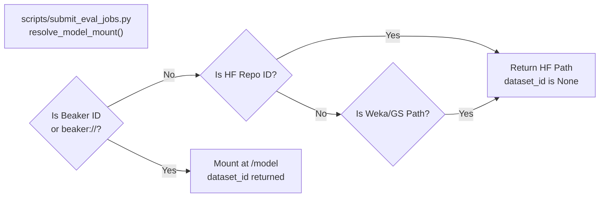

<!-- source: DeepWiki mcp.deepwiki.com · repo allenai/open-instruct · page 9.2 Model Evaluation Workflow · fetched 2026-10-26 -->

# Model Evaluation Workflow

Relevant source files

The following files were used as context for generating this wiki page:

- [configs/beaker_configs/default_eval.yaml](configs/beaker_configs/default_eval.yaml)
- [docs/algorithms/trained_model_location.md](docs/algorithms/trained_model_location.md)
- [docs/algorithms/trained_model_location/beaker_dataset.gif](docs/algorithms/trained_model_location/beaker_dataset.gif)
- [docs/algorithms/trained_model_location/gsc.png](docs/algorithms/trained_model_location/gsc.png)
- [docs/algorithms/trained_model_location/hf.png](docs/algorithms/trained_model_location/hf.png)
- [docs/algorithms/trained_model_location/hf2.png](docs/algorithms/trained_model_location/hf2.png)
- [docs/algorithms/trained_model_location/local.png](docs/algorithms/trained_model_location/local.png)
- [open_instruct/launch_utils.py](open_instruct/launch_utils.py)
- [scripts/collect_eval_results.py](scripts/collect_eval_results.py)
- [scripts/eval/oe-eval.sh](scripts/eval/oe-eval.sh)
- [scripts/eval/truthfulqa.sh](scripts/eval/truthfulqa.sh)
- [scripts/eval/tulu3_baselines.sh](scripts/eval/tulu3_baselines.sh)
- [scripts/submit_eval_jobs.py](scripts/submit_eval_jobs.py)
- [scripts/submit_eval_jobs_old.py](scripts/submit_eval_jobs_old.py)
- [scripts/wait_beaker_dataset_model_upload_then_evaluate_model.py](scripts/wait_beaker_dataset_model_upload_then_evaluate_model.py)

This page documents the complete workflow for evaluating trained models in the open-instruct repository, from submitting evaluation jobs to interpreting results. It covers the two-track evaluation system (OI Evals and OE Eval), resource allocation, result management, and automated post-training evaluation.

For information about the training pipeline that produces models to evaluate, see [Complete Training Pipeline](#9.1). For details on the individual evaluation benchmarks and their implementations, see [Open Instruct Benchmarks](#6.3) and [OE Eval Task Suites](#6.2).

## Overview of the Evaluation System

The open-instruct evaluation system operates on two parallel tracks:

1.  **OI Evals (Open Instruct Evals)**: Direct execution of standard benchmarks (MMLU, GSM8K, BBH, Codex, MBPP, IFEval, TruthfulQA, ToxiGen, XSTest, AlpacaEval) within the repository's `eval/` directory.
2.  **OE Eval (Internal Framework)**: Integration with the `oe-eval-internal` library for comprehensive task suites and advanced evaluation scenarios.

Both tracks are orchestrated through entry points like `scripts/submit_eval_jobs.py` and `scripts/eval/oe-eval.sh`, which handle job submission, resource allocation, and result management.

**Evaluation Entry Points and Job Flow**

Sources: [scripts/submit_eval_jobs.py:1-157](), [scripts/eval/oe-eval.sh:1-82](), [scripts/wait_beaker_dataset_model_upload_then_evaluate_model.py:28-90]()

## Submitting Evaluation Jobs

### Primary Interface: `submit_eval_jobs.py`

The modern interface for submitting evaluations is `scripts/submit_eval_jobs.py`. It submits a Beaker v2 experiment that runs `olmo-eval run` against a model [scripts/submit_eval_jobs.py:1-7]().

**Key Arguments:**

| Argument | Description | Example |
| :--- | :--- | :--- |
| `--model_name` | Human-readable run name for tracking | `qwen3_4b_base_dapo` |
| `--location` | Model location: Beaker ID, HF repo ID, Weka path, or gs:// URL | `01KPTSPMHGEZVYCDNR0XBVJCGZ` |
| `--tasks` | Comma-separated olmo-eval task specs | `aime_2025:pass_at_32` |
| `--cluster` | Target Beaker clusters (Weka support required) | `ai2/jupiter` |
| `--max_length` | Provider `max_model_len` | `32768` |
| `--olmo_eval_ref` | Git ref of `olmo-eval-internal` to install at start | `main` |

Sources: [scripts/submit_eval_jobs.py:58-111]()

### Model Location and Mount Resolution

The script resolves the `--location` into a path usable within the container. If the location is a Beaker dataset ID (26 uppercase alphanumerics) or prefixed with `beaker://`, it is mounted at `/model` [scripts/submit_eval_jobs.py:114-120]().

Sources: [scripts/submit_eval_jobs.py:60-69](), [scripts/submit_eval_jobs.py:114-120]()

## OE Eval: Internal Framework Integration

### Task Suite System

OE Eval uses predefined task suites specified via `--task-suite` in the `oe-eval.sh` wrapper. Available suites include `OLMO_3`, `TULU_3_DEV`, and `SAFETY_EVAL` [scripts/eval/oe-eval.sh:50-51]().

**Task Suite Definitions:**

*   **TULU_3_DEV**: Includes `gsm8k::tulu`, `bbh:cot-v1::tulu`, `ifeval::tulu`, `mmlu:mc::tulu`, and `truthfulqa::tulu` [scripts/eval/oe-eval.sh:175-184]().
*   **TULU_3_UNSEEN**: Includes `agi_eval_english:0shot_cot::tulu3`, `gpqa:0shot_cot::tulu3`, and `mmlu_pro:0shot_cot::tulu3` [scripts/eval/oe-eval.sh:37-46]().
*   **SAFETY_EVAL**: Focuses on safety benchmarks like WildGuard and Harmbench [scripts/eval/oe-eval.sh:51]().

Sources: [scripts/eval/oe-eval.sh:24-46](), [scripts/eval/oe-eval.sh:175-184]()

### Environment Setup and Installation

Since `olmo-eval-internal` is a separate library, the submission script builds an installation script that clones the repo and installs dependencies (vLLM, transformers) at job start to allow testing the latest code [scripts/submit_eval_jobs.py:41-54]().

**Installation Steps:**
1.  Clone `allenai/olmo-eval-internal` to `/opt/olmo-eval-internal`.
2.  Checkout specified git ref.
3.  Install with vLLM support using a shared PyPI cache on Weka: `/weka/oe-eval-default/olmo-eval-pypi-cache`.
4.  Upgrade `vllm` and `transformers` to required versions.

Sources: [scripts/submit_eval_jobs.py:41-54]()

## Resource Allocation and Heuristics

### GPU and Batch Size Adjustment

For older OI Evals (via `submit_eval_jobs_old.py`), heuristics are used to scale resources based on model size patterns (e.g., "13B", "70B") [scripts/submit_eval_jobs_old.py:27-78]().

*   **Batch Size Reduction**: Large models (30B+) have batch sizes reduced by a factor of 4 to prevent OOM [scripts/submit_eval_jobs_old.py:27-38]().
*   **GPU Multiplier**: Large models (70B+) double the GPU count. Codex tasks receive additional multipliers (up to 4x) due to high memory requirements [scripts/submit_eval_jobs_old.py:53-78]().

Sources: [scripts/submit_eval_jobs_old.py:17-78]()

## Result Management and Interpretation

### Collection of Metrics

The script `scripts/collect_eval_results.py` aggregates metrics from Beaker jobs. It maps raw metrics to summary values for standard tasks [scripts/collect_eval_results.py:72-89]().

| Task | Summary Metric | Rescaling |
| :--- | :--- | :--- |
| `mmlu_0shot` | `average_acc` | 0-1 |
| `gsm_cot` | `exact_match` | 0-1 |
| `ifeval` | `loose:Accuracy` | 0-1 |
| `alpaca_eval` | `win_rate` | Rescaled / 100 |
| `tydiqa` | `average:f1` | Rescaled / 100 |

Sources: [scripts/collect_eval_results.py:72-110]()

### Redundant Model Storage

Models are uploaded to multiple locations for redundancy and ease of evaluation access [docs/algorithms/trained_model_location.md:1-9]():
*   **Hugging Face**: Accessible via `huggingface-cli download` with a revision matching the run name [docs/algorithms/trained_model_location.md:12-24]().
*   **Google Cloud Storage**: Uploaded to buckets (e.g., `gs://ai2-llm/post-training/`) using `gsutil` [docs/algorithms/trained_model_location.md:55-71]().
*   **Beaker Datasets**: Models produced by training jobs are stored as Beaker datasets, which can be mounted directly for evaluation [scripts/submit_eval_jobs.py:6-7]().

Sources: [docs/algorithms/trained_model_location.md:1-71](), [scripts/submit_eval_jobs.py:114-120]()

## Automated Post-Training Evaluation

The `scripts/wait_beaker_dataset_model_upload_then_evaluate_model.py` script bridges the gap between training and evaluation [scripts/wait_beaker_dataset_model_upload_then_evaluate_model.py:1-16]().

1.  **Polling**: It polls a Beaker workload ID until the training experiment succeeds [scripts/wait_beaker_dataset_model_upload_then_evaluate_model.py:32-33]().
2.  **Dataset Retrieval**: It identifies the dataset ID containing the model [scripts/wait_beaker_dataset_model_upload_then_evaluate_model.py:38]().
3.  **Triggering Evals**: It automatically launches standard and safety evaluation jobs using the retrieved dataset ID [scripts/wait_beaker_dataset_model_upload_then_evaluate_model.py:39-84]().

Sources: [scripts/wait_beaker_dataset_model_upload_then_evaluate_model.py:28-90]()

---

