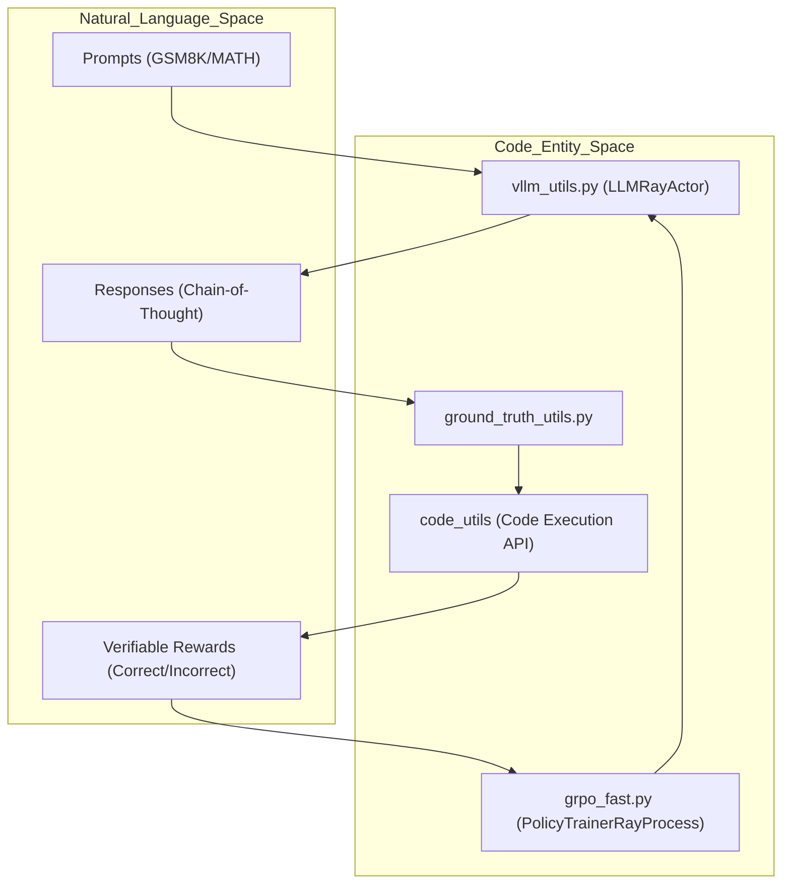
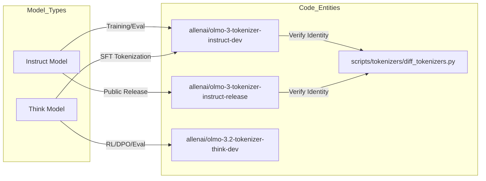

<!-- source: DeepWiki mcp.deepwiki.com · repo allenai/open-instruct · page 9.3 Tulu3 Case Study · fetched 2026-10-26 -->

# Tulu3 Case Study

<details>
<summary>Relevant source files</summary>

The following files were used as context for generating this wiki page:

- [configs/ds_configs/stage2_no_offloading_accelerate.conf](configs/ds_configs/stage2_no_offloading_accelerate.conf)
- [docs/ai2_internal.md](docs/ai2_internal.md)
- [docs/archived_dev_scripts/olmo2_1124.sh](docs/archived_dev_scripts/olmo2_1124.sh)
- [docs/archived_dev_scripts/olmoe_0125.sh](docs/archived_dev_scripts/olmoe_0125.sh)
- [docs/get_started/ai2_internal_setup.md](docs/get_started/ai2_internal_setup.md)
- [docs/olmo2.md](docs/olmo2.md)
- [docs/olmo3.md](docs/olmo3.md)
- [docs/tulu3.md](docs/tulu3.md)
- [scripts/cache_hf.py](scripts/cache_hf.py)
- [scripts/train/olmo-hybrid/7b_instruct_dpo.sh](scripts/train/olmo-hybrid/7b_instruct_dpo.sh)
- [scripts/train/olmo-hybrid/7b_instruct_dpo_sweep.sh](scripts/train/olmo-hybrid/7b_instruct_dpo_sweep.sh)
- [scripts/train/olmo-hybrid/7b_instruct_sft.sh](scripts/train/olmo-hybrid/7b_instruct_sft.sh)
- [scripts/train/olmo-hybrid/7b_release_evals.sh](scripts/train/olmo-hybrid/7b_release_evals.sh)
- [scripts/train/olmo-hybrid/7b_think_sft.sh](scripts/train/olmo-hybrid/7b_think_sft.sh)
- [scripts/train/olmo-hybrid/7b_think_sft_tokenization.sh](scripts/train/olmo-hybrid/7b_think_sft_tokenization.sh)
- [scripts/train/olmo-hybrid/README.md](scripts/train/olmo-hybrid/README.md)
- [scripts/train/olmo-hybrid/convert_instruct_sft_sweep.sh](scripts/train/olmo-hybrid/convert_instruct_sft_sweep.sh)
- [scripts/train/olmo-hybrid/convert_think_sft.sh](scripts/train/olmo-hybrid/convert_think_sft.sh)
- [scripts/train/olmo2/grpo_fast_13b_zero.sh](scripts/train/olmo2/grpo_fast_13b_zero.sh)
- [scripts/train/olmo2/grpo_fast_32b.sh](scripts/train/olmo2/grpo_fast_32b.sh)
- [scripts/train/olmo2/grpo_fast_32b_tulu.sh](scripts/train/olmo2/grpo_fast_32b_tulu.sh)
- [scripts/train/olmo2/grpo_fast_7b_zero.sh](scripts/train/olmo2/grpo_fast_7b_zero.sh)
- [scripts/train/olmo3/32b_instruct_dpo.sh](scripts/train/olmo3/32b_instruct_dpo.sh)
- [scripts/train/olmo3/32b_instruct_rl.sh](scripts/train/olmo3/32b_instruct_rl.sh)
- [scripts/train/olmo3/32b_instruct_sft.sh](scripts/train/olmo3/32b_instruct_sft.sh)
- [scripts/train/olmo3/32b_think_sft.sh](scripts/train/olmo3/32b_think_sft.sh)
- [scripts/train/olmo3/7b_instruct_sft.sh](scripts/train/olmo3/7b_instruct_sft.sh)
- [scripts/train/olmo3/7b_think_sft.sh](scripts/train/olmo3/7b_think_sft.sh)
- [scripts/train/qwen/grpo_fast_32b.sh](scripts/train/qwen/grpo_fast_32b.sh)
- [scripts/train/qwen/grpo_fast_3b_single_node.sh](scripts/train/qwen/grpo_fast_3b_single_node.sh)
- [scripts/train/qwen/grpo_fast_7b.sh](scripts/train/qwen/grpo_fast_7b.sh)
- [scripts/train/qwen/grpo_fast_7b_code.sh](scripts/train/qwen/grpo_fast_7b_code.sh)
- [scripts/train/qwen/grpo_fast_7b_orz.sh](scripts/train/qwen/grpo_fast_7b_orz.sh)
- [scripts/train/rlvr/grpo_qwen_fast_2.5_7B_best.sh](scripts/train/rlvr/grpo_qwen_fast_2.5_7B_best.sh)
- [scripts/train/tulu3/grpo_fast_8b.sh](scripts/train/tulu3/grpo_fast_8b.sh)
- [scripts/train/tulu3/grpo_fast_8b_single_node.sh](scripts/train/tulu3/grpo_fast_8b_single_node.sh)

</details>


## Purpose and Scope

This page documents the complete development workflow for the Tulu3 model family, providing a concrete example of how to use the `open-instruct` training pipeline end-to-end. It covers the three-stage training process (SFT → DPO → GRPO), dataset configurations, hyperparameter choices, and specific scripts for OLMo-2, OLMo-3, and Qwen models.

For general information about each training method, see [Supervised Fine-Tuning (SFT)](./2.1), [Direct Preference Optimization (DPO)](./2.2), and [Reinforcement Learning (RLHF)](./2.3).

---

## Overview

Tulu3 is a family of instruction-following language models developed using the `open-instruct` framework. The development follows a standard three-stage paradigm:

1.  **Supervised Fine-Tuning (SFT)**: Initial training on instruction-response pairs.
2.  **Direct Preference Optimization (DPO)**: Alignment with human preferences.
3.  **Reinforcement Learning (GRPO/RLVR)**: Optimization for verifiable objectives (math, code, reasoning).

The Tulu3 project also served as the testing ground for integrating the `OLMo-core` training stack for improved GPU efficiency.

**Sources:**
- [docs/tulu3.md:1-53]()
- [docs/olmo2.md:10-14]()

---

## Stage 1: Supervised Fine-Tuning (SFT)

### Tulu3 SFT Reproduction
The Tulu3 SFT stage utilized a balanced mixture of datasets, including Tulu V2 and new V3 components like `no_robots`, `metamath-qa`, and `codefeedback`.

#### Training Configuration (Llama-3.1-Tulu-3-8B-SFT)
The model was trained using `open_instruct/finetune.py` across 8 machines (64 H100 GPUs) [docs/tulu3.md:8-10]().

| Parameter | Value |
| :--- | :--- |
| `model_name_or_path` | `meta-llama/Llama-3.1-8B` |
| `dataset_mixer_list` | `allenai/tulu-3-sft-mixture 1.0` |
| `learning_rate` | `5e-06` |
| `max_seq_length` | `4096` |
| `num_train_epochs` | `2` |
| `effective_batch_size` | `128` (64 GPUs * 1 BS * 2 Grad Accum) |

**Sources:**
- [docs/tulu3.md:8-55]()
- [docs/tulu3.md:58-68]()

### OLMo and Qwen SFT (OLMo-core)
For OLMo-3 and newer models, the pipeline shifted to `OLMo-core SFT` for better efficiency. For example, OLMo-Hybrid 7B uses a specific SFT script from the `OLMo-core` repository [scripts/train/olmo-hybrid/7b_think_sft.sh:3-4]().

#### OLMo-Hybrid 7B Think SFT
Executed via `scripts/train/olmo-hybrid/7b_think_sft.sh` using the `Olmo-3-Hybrid-7B-SFT.py` launcher [scripts/train/olmo-hybrid/7b_think_sft.sh:8-9]().

```bash
# Example OLMo-core SFT command structure
uv run python src/scripts/train/sft/Olmo-3-Hybrid-7B-SFT.py launch \
    TEST_HYBRIC_SFT_LARGER_LR2.5e-5 $BASE_CKPT \
    ai2/jupiter \
    --train_module.optim.lr=2.5e-5 \
    --seq_len=32768 \
    --num_nodes=8
```

**Sources:**
- [scripts/train/olmo-hybrid/7b_think_sft.sh:1-20]()
- [scripts/train/olmo-hybrid/7b_think_sft_tokenization.sh:21-45]()

---

## Stage 2: Direct Preference Optimization (DPO)

### Tulu3 DPO Reproduction
Tulu3 utilized `open_instruct/dpo_tune_cache.py` or `open_instruct/dpo_tune.py`. The 8B model used a preference mixture specific to Llama 3.1 [docs/tulu3.md:126-163]().

| Parameter | Value |
| :--- | :--- |
| `dpo_loss_type` | `dpo_norm` |
| `dpo_beta` | `5` |
| `learning_rate` | `5e-07` |
| `dataset_mixer_list` | `allenai/llama-3.1-tulu-3-8b-preference-mixture 1.0` |

**Sources:**
- [docs/tulu3.md:126-163]()
- [docs/tulu3.md:182-200]()

### OLMo-2 1B DPO Case
The OLMo-2 1B model was aligned using a learning rate of `2.5e-6` and `dpo_beta 5` on 8 GPUs [docs/olmo2.md:96-132]().

**Sources:**
- [docs/olmo2.md:96-132]()
- [docs/olmo2.md:137-180]()

---

## Stage 3: GRPO Reinforcement Learning

### GRPO Implementation Details
Tulu3.1 8B was the first model released using the Grouped Relative Policy Optimization (GRPO) recipe. The implementation uses a queue-based architecture to decouple generation (vLLM) from training (DeepSpeed) [scripts/train/tulu3/grpo_fast_8b.sh]().



**Sources:**
- [scripts/train/tulu3/grpo_fast_8b.sh]()
- [scripts/train/qwen/grpo_fast_7b.sh]()
- [scripts/train/olmo2/grpo_fast_32b_tulu.sh]()

### Model-Specific RL Scripts
The repository contains specialized GRPO configurations for various architectures:
*   **Qwen**: `scripts/train/qwen/grpo_fast_7b.sh` and `scripts/train/qwen/grpo_fast_32b.sh`.
*   **OLMo-2**: `scripts/train/olmo2/grpo_fast_13b_zero.sh` and `scripts/train/olmo2/grpo_fast_32b.sh`.
*   **Tulu3**: `scripts/train/tulu3/grpo_fast_8b.sh`.

---

## Lessons Learned: Tokenizer and Chat Templates

A critical finding during Tulu3 and OLMo-3 development was the impact of `<think>` token masking and system prompt identity [docs/olmo3.md:9-12]().

### The `<think>` Masking Issue
In early "Think" models, the training code incorrectly masked the first `<think>` token as part of the prompt. This prevented the model from learning to initiate reasoning properly [docs/olmo3.md:39-40]().

**Workaround implemented for OLMo-3.2:**
1.  **SFT**: Tokenize with the Instruct template (e.g., `allenai/olmo-3-tokenizer-instruct-dev`) which does not include `<think>`, preventing it from being masked out [docs/olmo3.md:28]().
2.  **RL/DPO**: Use the Think template (e.g., `allenai/olmo-3.2-tokenizer-think-dev`) which adds `<think>` to `add_generation_prompt` [docs/olmo3.md:29]().

### Tokenizer Flow


**Sources:**
- [docs/olmo3.md:14-31]()
- [docs/olmo3.md:43-45]()
- [docs/olmo3.md:49-51]()

---

## Model Performance and Artifacts

The Tulu3 series demonstrated that combining SFT, DPO, and GRPO leads to the best overall performance.

| Model | SFT Stage | DPO Stage | RL Stage |
| :--- | :--- | :--- | :--- |
| Llama-3.1-Tulu-3-8B | `finetune.py` | `dpo_tune.py` | RLVR (Legacy) |
| Llama-3.1-Tulu-3.1-8B | `finetune.py` | `dpo_tune_cache.py` | `grpo_fast.py` |
| OLMo-2-1B-Instruct | `finetune.py` | `dpo_tune_cache.py` | RLVR [docs/olmo2.md:13]() |
| OLMo-3-7B-Instruct | `OLMo-sft.py` | `dpo.py` | `grpo.py` |

**Sources:**
- [docs/tulu3.md:8-53]()
- [docs/olmo2.md:10-13]()
- [docs/olmo3.md:1-7]()

---

