# Page: Overview

# Overview

<details>
<summary>Relevant source files</summary>

The following files were used as context for generating this wiki page:

- [CHANGELOG.md](CHANGELOG.md)
- [CLAUDE.md](CLAUDE.md)
- [CONTRIBUTING.md](CONTRIBUTING.md)
- [Dockerfile](Dockerfile)
- [README.md](README.md)
- [mason.py](mason.py)
- [open_instruct/benchmark_generators.py](open_instruct/benchmark_generators.py)
- [open_instruct/data_loader.py](open_instruct/data_loader.py)
- [open_instruct/data_types.py](open_instruct/data_types.py)
- [open_instruct/grpo_fast.py](open_instruct/grpo_fast.py)
- [open_instruct/test_grpo_fast.py](open_instruct/test_grpo_fast.py)
- [open_instruct/test_vllm_utils.py](open_instruct/test_vllm_utils.py)
- [open_instruct/vllm_utils.py](open_instruct/vllm_utils.py)
- [pyproject.toml](pyproject.toml)
- [requirements.txt](requirements.txt)
- [test_mason.py](test_mason.py)
- [uv.lock](uv.lock)

</details>


## Purpose and Scope

Open Instruct is a research codebase for training instruction-following language models through a multi-stage pipeline combining supervised fine-tuning (SFT), preference alignment (DPO), and reinforcement learning (RLHF/RLVR). The repository provides production-ready implementations of training methods, along with infrastructure for distributed training on Beaker clusters and comprehensive evaluation systems.

The codebase is designed to support the development of models like **TÜLU 3**, focusing on open post-training techniques including GRPO for reinforcement learning with verifiable rewards [README.md:3-17]().

This overview introduces the core architecture, training stages, and infrastructure components. For detailed information on specific topics:
- Installation and environment setup: see [Installation and Setup](#1.1)
- Individual training methods: see [Core Training Systems](#2)
- Job submission and cluster management: see [Job Orchestration and Infrastructure](#5)
- Evaluation workflows: see [Evaluation System](#6)

**Sources:** [pyproject.toml:1-4](), [README.md:3-17](), [open_instruct/grpo_fast.py:83-100]()

---

## High-Level Architecture

The repository is organized around a training pipeline where each stage builds on the previous one. The architecture consists of training systems, orchestration infrastructure, data processing pipelines, and evaluation frameworks, all coordinated through Beaker cluster management via `mason.py`.

### System Components and Data Flow

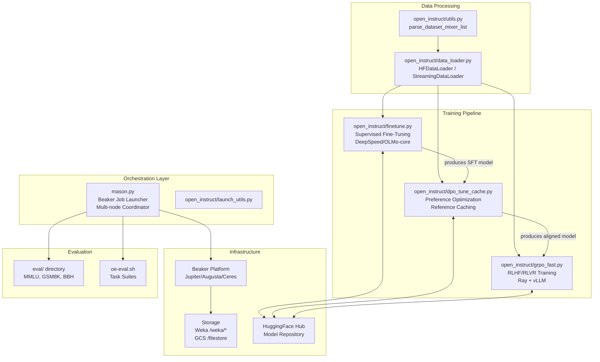

**Sources:** [mason.py:27-33](), [README.md:7-13](), [open_instruct/data_loader.py:72-100](), [CHANGELOG.md:16-17]()

---

## Three-Stage Training Pipeline

### Stage 1: Supervised Fine-Tuning (SFT)

The first stage adapts a base language model to follow instructions. The primary script is `open_instruct/finetune.py`. Additionally, `olmo_core_finetune.py` provides a specialized path for OLMo-core models using FSDP2 [CHANGELOG.md:27-28]().

**Key Features:**
- DeepSpeed ZeRO-2/ZeRO-3 optimization for memory efficiency [mason.py:41-46]().
- Support for LoRA and QLoRA via `peft` integration [README.md:40]().
- Efficient dataset conversion to numpy artifacts for OLMo-core paths [CHANGELOG.md:33]().

**Sources:** [open_instruct/finetune.py:1-50](), [CHANGELOG.md:27-33]()

### Stage 2: Direct Preference Optimization (DPO)

The second stage aligns the model with human preferences using paired data. The implementation in `open_instruct/dpo_tune_cache.py` optimizes memory by caching reference model logprobs [mason.py:32]().

**Key Features:**
- Reference model caching strategy to reduce compute during preference optimization.
- Support for multiple loss variants including DPO, SimPO, and WPO [CHANGELOG.md:8-11]().
- Integration with FSDP/TP for large-scale preference tuning.

**Sources:** [mason.py:29-36](), [CHANGELOG.md:8-11]()

### Stage 3: Reinforcement Learning (RLHF/RLVR)

The final stage uses reinforcement learning to optimize for verifiable rewards (RLVR). The primary implementation is `open_instruct/grpo_fast.py`, which utilizes Ray for distributed coordination and vLLM for high-throughput generation [open_instruct/grpo_fast.py:65-83]().

**Key Features:**
- **GRPO (Group Relative Policy Optimization)**: Efficient RL that computes rewards relative to a group of samples, eliminating the need for a separate value function [CHANGELOG.md:8-11]().
- **vLLM Integration**: High-performance generation using `vllm_utils.py` and native weight transfer via `NCCLWeightTransferEngine` [open_instruct/vllm_utils.py:45-48](), [CHANGELOG.md:36]().
- **Verifiable Rewards**: Built-in verifiers for math and code execution via `ground_truth_utils.py` [open_instruct/grpo_fast.py:100-101]().

**Sources:** [open_instruct/grpo_fast.py:1-130](), [open_instruct/vllm_utils.py:1-125](), [CHANGELOG.md:12-15]()

---

## Infrastructure and Cluster Management

### Beaker Integration via Mason

The repository uses Beaker as the primary job orchestration platform, managed through `mason.py`. It handles cluster selection, environment configuration, and multi-node setup.

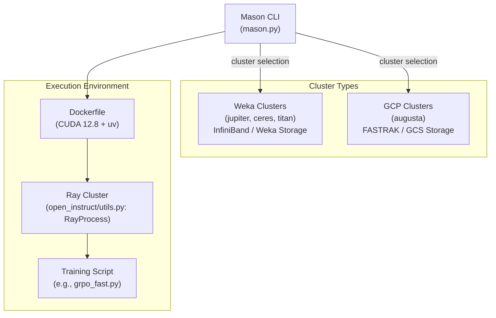

**Key Orchestration Features:**
- **Resumable Jobs**: `mason.py` tracks resumable commands like `grpo_fast.py` to handle preemptions [mason.py:38]().
- **Resource Planning**: `grpo_fast_resource_plan.py` manages GPU allocation between trainers and vLLM inference engines [open_instruct/grpo_fast.py:83-84]().
- **Storage Management**: Automated paths for Weka and GCS checkpointing [mason.py:165-176]().

**Sources:** [mason.py:1-188](), [open_instruct/grpo_fast.py:160-187](), [CHANGELOG.md:17-18]()

### Docker Environment

Training jobs run in containerized environments built from the repository's `Dockerfile`.

**Key Components:**
- **Base**: `nvidia/cuda:12.8.1-devel-ubuntu22.04` [Dockerfile:1]().
- **Drivers**: DOCA OFED user-space drivers for InfiniBand networking [Dockerfile:23-38]().
- **Package Manager**: `uv` for fast, reproducible dependency resolution [Dockerfile:61](), [pyproject.toml:105-117]().
- **Cloud Tools**: Google Cloud CLI and Beaker CLI [Dockerfile:40-59]().

**Sources:** [Dockerfile:1-89](), [pyproject.toml:1-48]()

---

## Data Processing Pipeline

The pipeline handles dataset loading, mixing, tokenization, and caching.

**Data Loading Components:**
- `HFDataLoader`: Wraps HuggingFace datasets for `olmo-core` compatibility [open_instruct/data_loader.py:72-100]().
- `StreamingDataLoader`: Handles asynchronous data preparation for RL training [open_instruct/data_loader.py:38-46]().
- `parse_dataset_mixer_list`: Shared utility for parsing proportional dataset mixtures [CHANGELOG.md:16]().

**Sources:** [open_instruct/data_loader.py:1-158](), [CHANGELOG.md:16-25]()

---

## Repository Structure

The codebase is organized into functional directories:

- `open_instruct/`: Core training logic, model utilities, and dataset transformation [open_instruct/grpo_fast.py](), [open_instruct/vllm_utils.py]().
- `scripts/`: Entry points for training, data preparation, and benchmarking [CHANGELOG.md:12]().
- `configs/`: YAML configurations for DeepSpeed and specific training runs [Dockerfile:77]().
- `eval/`: Implementation of standard benchmarks (MMLU, GSM8K, etc.) [Dockerfile:81]().
- `docs/`: Technical documentation and case studies [README.md:13-17]().
- `decontamination/`: Tools for detecting train/test overlap.

**Sources:** [Dockerfile:76-81](), [README.md:11-17](), [pyproject.toml:54-55]()

---

## Next Steps

For detailed information on specific components:
- **Environment Setup**: See [Installation and Setup](#1.1) for dependency installation and configuration.
- **Training Methods**: See [Core Training Systems](#2) for detailed documentation of SFT, DPO, and RLHF.
- **Job Orchestration**: See [Mason: Beaker Job Launcher](#5.1) for cluster configuration and job submission.
- **Data Processing**: See [Dataset Transformation and Tokenization](#4.1) for data pipeline details.
- **Evaluation**: See [Evaluation Orchestration](#6.1) for evaluation system usage.

---

# Page: Installation and Setup

# Installation and Setup

<details>
<summary>Relevant source files</summary>

The following files were used as context for generating this wiki page:

- [.claude/commands/run-gpu-tests.md](.claude/commands/run-gpu-tests.md)
- [.pre-commit-config.yaml](.pre-commit-config.yaml)
- [Dockerfile](Dockerfile)
- [README.md](README.md)
- [mason.py](mason.py)
- [pyproject.toml](pyproject.toml)
- [requirements.txt](requirements.txt)
- [test_mason.py](test_mason.py)
- [uv.lock](uv.lock)

</details>


This document provides comprehensive guidance for setting up the `open-instruct` development environment, covering dependency management via `uv`, containerization with Docker, and environment configuration for training instruction-following language models.

The `open-instruct` framework integrates several high-performance ML libraries including PyTorch, Hugging Face Transformers, vLLM, and Ray. Due to the complexity of these dependencies and their hardware requirements (specifically CUDA), this page details the recommended paths for local and containerized setup.

## Installation Overview

The repository uses `uv` as its primary package manager to ensure reproducible environments across different platforms. The setup process involves resolving Python dependencies, configuring CUDA support for GPU-accelerated training, and setting up development tools for linting and testing.

### Training Pipeline Flow
The installation supports a multi-stage training pipeline from Supervised Fine-Tuning (SFT) to Direct Preference Optimization (DPO) and Reinforcement Learning from Human Feedback (RLHF/GRPO).

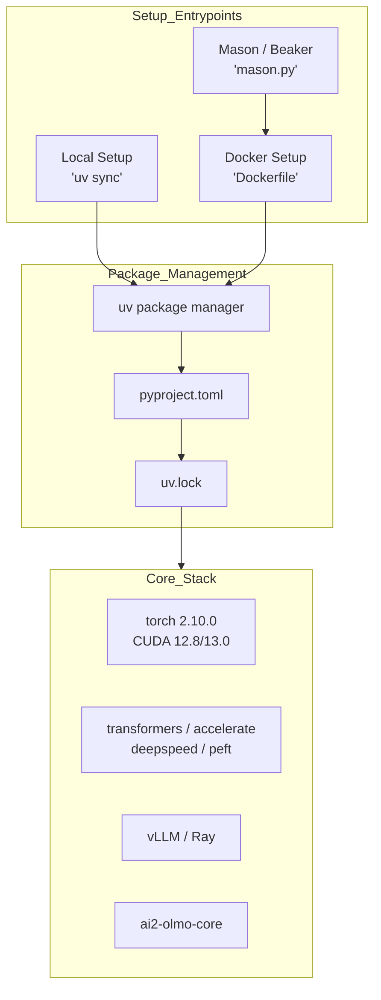

**Installation Method Selection:**
- **Local Installation**: Best for code exploration and lightweight testing.
- **Docker Installation**: Recommended for consistent training environments across clusters.
- **Mason/Beaker**: Used for large-scale distributed training at AI2, automating image building and job submission [mason.py:112-155]().

Sources: [pyproject.toml:1-48](), [Dockerfile:61-73](), [mason.py:29-36]()

## Prerequisites

### System Requirements

| Component | Requirement | Notes |
|-----------|-------------|-------|
| **Python** | `==3.12.*` | Strict versioning enforced in [pyproject.toml:6](). |
| **CUDA** | 12.8 or 13.0 | Required for GPU training; see [pyproject.toml:79-87](). |
| **Platform** | Linux / macOS | Linux (x86_64/aarch64) is required for `vllm` and `flash-attn` [pyproject.toml:32-41](). |

### Key Dependencies

The project relies on a specific set of libraries for its training pipeline:
- **Accelerate & DeepSpeed**: For distributed training and memory optimization [pyproject.toml:8-14]().
- **vLLM & Ray**: Used for fast inference and distributed resource management during RLHF/GRPO loops [pyproject.toml:27-32]().
- **ai2-olmo-core**: Integration for OLMo-specific training modules and FSDP2 support [pyproject.toml:21](), [pyproject.toml:70]().
- **Flash Attention**: Optimized attention kernels (v2, v3, and v4) for Linux systems [pyproject.toml:36-40]().

Sources: [pyproject.toml:1-48](), [requirements.txt:5-10]()

## Local Installation with uv

`uv` is the required tool for managing the virtual environment and dependencies.

### 1. Install uv
If not already installed, follow the [official instructions](https://github.com/astral-sh/uv):
```bash
curl -LsSf https://astral.sh/uv/install.sh | sh
```

### 2. Setup Environment
Clone the repository and synchronize the environment. `uv` will automatically download the correct Python version (3.12) and install dependencies into a `.venv` directory.

```bash
git clone https://github.com/allenai/open-instruct.git
cd open-instruct
uv sync --all-extras
```

The synchronization process respects the `uv.lock` file, ensuring every developer uses the same package versions across different architectures [uv.lock:1-13]().

### 3. Verification
Verify that the environment is correctly set up with GPU support:
```bash
uv run python -c "import torch; print(torch.cuda.is_available())"
```

Sources: [pyproject.toml:6-7](), [uv.lock:1-13](), [README.md:48-54]()

## Docker Installation

The `Dockerfile` provides a production-ready environment based on Ubuntu 22.04 and CUDA 12.8 [Dockerfile:1]().

### Docker Build Logic

The build process includes several optimizations for high-performance networking and AI2 infrastructure:
- **Driver Support**: Installs DOCA OFED user-space drivers for InfiniBand networking [Dockerfile:23-38]().
- **Tooling**: Includes `beaker` CLI and `google-cloud-sdk` for job management and data access [Dockerfile:40-59]().
- **Dependency Caching**: Uses Docker build mounts to cache the `UV_CACHE_DIR`, significantly speeding up subsequent builds [Dockerfile:71-74]().

### Natural Language to Code Entity Mapping: Docker Build

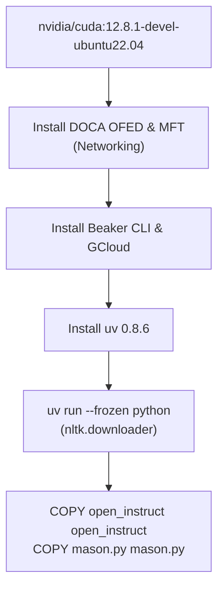

Sources: [Dockerfile:1-89](), [pyproject.toml:105-116]()

## Environment Variables

The codebase and orchestration scripts utilize several environment variables to control behavior:

| Variable | Default | Purpose |
|----------|---------|---------|
| `HF_HUB_ENABLE_HF_TRANSFER` | `1` | Enables fast downloads via `hf-transfer` [Dockerfile:66](). |
| `VLLM_DISABLE_COMPILE_CACHE` | `1` | Disables vLLM compilation cache to avoid corruption in multi-node setups [mason.py:103](). |
| `NCCL_DEBUG` | `ERROR` | Controls NCCL logging verbosity [mason.py:104](). |
| `RAY_CGRAPH_get_timeout` | `300` | Timeout for Ray Compiled Graph initialization [mason.py:102](). |

Sources: [mason.py:101-107](), [Dockerfile:65-68]()

## Development Workflow

### Code Quality and Linting
The project uses `ruff` for linting and formatting, with configurations defined in `pyproject.toml` [pyproject.toml:143-182](). Pre-commit hooks are also configured to enforce these standards before commits [ .pre-commit-config.yaml:1-44]().

```bash
# Run linting
uv run ruff check open_instruct/

# Run formatting
uv run ruff format open_instruct/
```

### Testing
Tests are managed via `pytest`. Some tests are ignored by default (e.g., internal evaluation suites) [pyproject.toml:131-136](). GPU tests can be launched manually on Beaker using specialized scripts [.claude/commands/run-gpu-tests.md:1-3]().

```bash
uv run pytest
```

Sources: [pyproject.toml:118-129](), [pyproject.toml:143-148](), [.pre-commit-config.yaml:20-29]()

## Getting Started with Training

Once installed, you can launch training jobs. The primary entry points for training are located in the `open_instruct/` directory and are tracked by the `mason` launcher [mason.py:29-36]().

### Command Mapping: Script to Entity

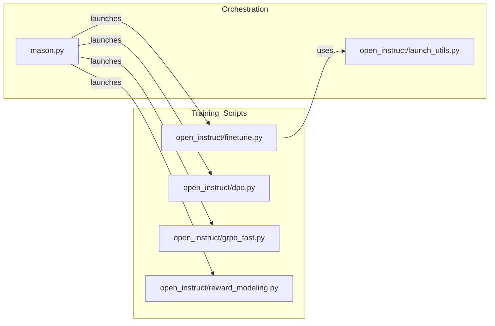

### Basic Training Commands

**Supervised Fine-Tuning (SFT):**
```bash
uv run python open_instruct/finetune.py \
    --model_name_or_path meta-llama/Llama-3.1-8B \
    --dataset_name allenai/tulu-3-sft-mixture \
    --output_dir ./output/sft_model \
    --with_tracking
```

**Direct Preference Optimization (DPO):**
```bash
uv run python open_instruct/dpo.py \
    --model_name_or_path ./output/sft_model \
    --dataset_name allenai/tulu-3-preference-mixture \
    --output_dir ./output/dpo_model
```

For large-scale jobs on Beaker, the `mason.py` script is used to wrap these commands and handle cluster-specific requirements like Weka mounting, multi-node setup, and resumability [mason.py:112-191]().

Sources: [mason.py:29-36](), [README.md:73-85](), [test_mason.py:45-61]()

---

# Page: Repository Structure

# Repository Structure

<details>
<summary>Relevant source files</summary>

The following files were used as context for generating this wiki page:

- [Dockerfile](Dockerfile)
- [README.md](README.md)
- [configs/beaker_configs/default_dpo_multinode.yaml](configs/beaker_configs/default_dpo_multinode.yaml)
- [configs/train_configs/sft/tulu3_L3.1_70b_preview_mix_v3.3.yaml](configs/train_configs/sft/tulu3_L3.1_70b_preview_mix_v3.3.yaml)
- [docs/algorithms/dpo.md](docs/algorithms/dpo.md)
- [docs/algorithms/finetune.md](docs/algorithms/finetune.md)
- [docs/algorithms/grpo.md](docs/algorithms/grpo.md)
- [docs/algorithms/olmo_core_sharding.md](docs/algorithms/olmo_core_sharding.md)
- [mason.py](mason.py)
- [mkdocs.yml](mkdocs.yml)
- [open_instruct/test_olmo_core_finetune.py](open_instruct/test_olmo_core_finetune.py)
- [pyproject.toml](pyproject.toml)
- [requirements.txt](requirements.txt)
- [scripts/README.md](scripts/README.md)
- [scripts/submit_dpo_job.py](scripts/submit_dpo_job.py)
- [scripts/submit_finetune_job.py](scripts/submit_finetune_job.py)
- [test_mason.py](test_mason.py)
- [uv.lock](uv.lock)

</details>


This document explains the organization of the open-instruct codebase, detailing the purpose of each directory, key files, and how different components interact.

## Top-Level Directory Organization

The open-instruct repository follows a flat module structure for core functionality, with separate directories for configuration, scripts, evaluation, and supporting utilities.

**Directory Structure Overview**
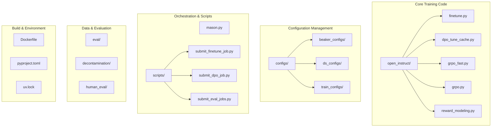

**Directory Purposes:**

| Directory | Purpose | Key Files |
|-----------|---------|-----------|
| `open_instruct/` | Core training implementations and utilities | `finetune.py`, `dpo_tune_cache.py`, `grpo_fast.py`, `reward_modeling.py` |
| `configs/` | Training and infrastructure configuration | `train_configs/sft/*.yaml`, `beaker_configs/*.yaml`, `ds_configs/*.conf` |
| `scripts/` | Job submission, data preparation, and evaluation orchestration | `submit_finetune_job.py`, `submit_eval_jobs.py`, `data/prepare_train_data.sh` |
| `eval/` | Evaluation harness and benchmark implementations | MMLU, GSM8K, BBH, etc. |
| `decontamination/` | Train-test overlap detection | N-gram and embedding matching scripts |
| `human_eval/` | Annotation interface for human evaluation | Web-based annotation tools |

**Sources:** [README.md:3-11](), [scripts/README.md:1-8](), [Dockerfile:75-81](), [pyproject.toml:191-194]()

## Core Source Code: `open_instruct/` Directory

The `open_instruct/` directory contains the primary training logic. It uses a flat module structure to simplify distributed execution and imports.

**Primary Training Modules**
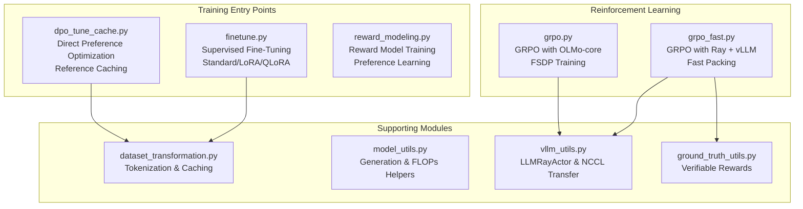

**Key Module Responsibilities:**

| Module | Implementation Detail | Purpose |
|--------|-----------------------|---------|
| `finetune.py` | Standard HF SFT | Supervised fine-tuning with support for DeepSpeed and LoRA [scripts/README.md:15-17](). |
| `dpo_tune_cache.py` | Reference Caching | DPO training that caches reference model logprobs to save VRAM [scripts/README.md:132-132](). |
| `grpo_fast.py` | `PolicyTrainerRayProcess` | RL training using Grouped Relative Policy Optimization with Ray and vLLM [docs/algorithms/grpo.md:86-92](). |
| `grpo.py` | OLMo-core Trainer | GRPO implementation built on the OLMo-core FSDP infrastructure [docs/algorithms/grpo.md:13-14](). |
| `vllm_utils.py` | `LLMRayActor` | Manages distributed vLLM engines for fast generation during RL [docs/algorithms/grpo.md:9-10](). |
| `ground_truth_utils.py` | Verifiable Rewards | Utilities for code and math verification used in RLVR [README.md:8-8](). |

**Sources:** [open_instruct/grpo.py:14-41](), [scripts/README.md:29-36](), [docs/algorithms/grpo.md:9-14]()

## Configuration Management: `configs/` Directory

Configurations are categorized by their role in the training pipeline:

| Directory | Purpose | Example Parameters |
|-----------|---------|-------------------|
| `beaker_configs/` | Infrastructure specs | `gpuCount`, `replicas`, `cluster`, `preemptible` [scripts/submit_finetune_job.py:75-80](). |
| `ds_configs/` | DeepSpeed optimization | `zero_stage`, `gradient_accumulation_steps` [configs/beaker_configs/default_dpo_multinode.yaml:25-27](). |
| `train_configs/` | ML hyperparameters | `learning_rate`, `dataset_mixer`, `model_name_or_path` [scripts/README.md:17-23](). |

**Configuration Flow**
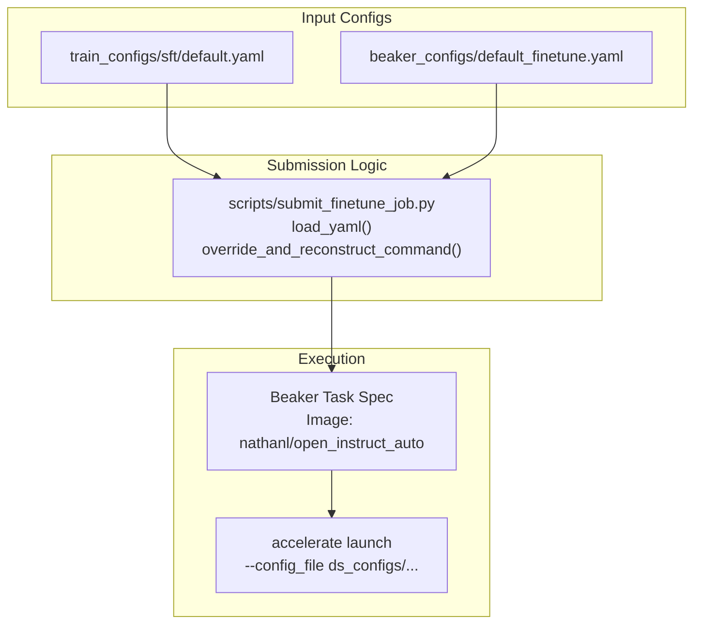

**Sources:** [scripts/submit_finetune_job.py:13-24](), [scripts/submit_finetune_job.py:90-119](), [scripts/README.md:75-82]()

## Scripts and Orchestration

The `scripts/` directory and `mason.py` are the primary interfaces for AI2 engineers.

### Beaker Submission Scripts
* `submit_finetune_job.py`: Core script for launching SFT jobs. It reconstructs the `accelerate launch` command based on YAML configs and CLI overrides [scripts/submit_finetune_job.py:90-151]().
* `submit_dpo_job.py`: Similar to SFT, but handles preference datasets and the `dpo_tune_cache.py` entry point [scripts/submit_dpo_job.py:132-159]().
* `submit_eval_jobs.py`: Automates the evaluation of checkpoints across various benchmarks like MMLU and GSM8K [scripts/README.md:61-64]().

### `mason.py`: Docker-less Execution
`mason.py` allows running jobs on Beaker using an existing Python environment on NFS, bypassing the need to build and push Docker images for every change [scripts/README.md:106-112]().

**Mason Task Creation**


**Sources:** [mason.py:29-36](), [mason.py:156-158](), [scripts/README.md:106-117]()

## Build System and Dependencies

The repository uses `uv` for dependency management and Python 3.12 [pyproject.toml:6-7]().

* **Dockerfile**: Builds a CUDA 12.8 environment with `uv` and installs necessary drivers for AI2 clusters (DOCA OFED, MFT) [Dockerfile:1-38]().
* **pyproject.toml**: Defines core dependencies including `torch`, `transformers`, `vllm`, `ray`, and `ai2-olmo-core` [pyproject.toml:7-48]().
* **uv.lock**: Ensures reproducible builds across different machines [uv.lock:1-8]().

**Sources:** [Dockerfile:1-61](), [pyproject.toml:1-48](), [uv.lock:1-13]()

---

# Page: Core Training Systems

# Core Training Systems

<details>
<summary>Relevant source files</summary>

The following files were used as context for generating this wiki page:

- [CHANGELOG.md](CHANGELOG.md)
- [open_instruct/benchmark_generators.py](open_instruct/benchmark_generators.py)
- [open_instruct/data_loader.py](open_instruct/data_loader.py)
- [open_instruct/data_types.py](open_instruct/data_types.py)
- [open_instruct/dataset_transformation.py](open_instruct/dataset_transformation.py)
- [open_instruct/dpo.py](open_instruct/dpo.py)
- [open_instruct/dpo_tune_cache.py](open_instruct/dpo_tune_cache.py)
- [open_instruct/dpo_utils.py](open_instruct/dpo_utils.py)
- [open_instruct/finetune.py](open_instruct/finetune.py)
- [open_instruct/grpo.py](open_instruct/grpo.py)
- [open_instruct/grpo_callbacks.py](open_instruct/grpo_callbacks.py)
- [open_instruct/grpo_fast.py](open_instruct/grpo_fast.py)
- [open_instruct/grpo_olmo_core_actor.py](open_instruct/grpo_olmo_core_actor.py)
- [open_instruct/grpo_utils.py](open_instruct/grpo_utils.py)
- [open_instruct/model_utils.py](open_instruct/model_utils.py)
- [open_instruct/olmo_core_train_modules.py](open_instruct/olmo_core_train_modules.py)
- [open_instruct/olmo_core_utils.py](open_instruct/olmo_core_utils.py)
- [open_instruct/test_grpo_fast.py](open_instruct/test_grpo_fast.py)
- [open_instruct/test_model_utils.py](open_instruct/test_model_utils.py)
- [open_instruct/test_utils.py](open_instruct/test_utils.py)
- [open_instruct/test_vllm_utils.py](open_instruct/test_vllm_utils.py)
- [open_instruct/test_vllm_utils_gpu.py](open_instruct/test_vllm_utils_gpu.py)
- [open_instruct/utils.py](open_instruct/utils.py)
- [open_instruct/vllm_utils.py](open_instruct/vllm_utils.py)

</details>


This page provides a high-level overview of the three primary training paradigms supported by the `open-instruct` repository: Supervised Fine-Tuning (SFT), Direct Preference Optimization (DPO), and Reinforcement Learning (RLHF). These systems form a progressive pipeline designed to transform base language models into aligned, instruction-following agents.

## Training Pipeline Overview

The standard model development lifecycle in this repository typically follows a three-stage progression. Each stage builds upon the artifacts of the previous one, sharing a common infrastructure for data loading, model utilities, and distributed orchestration.

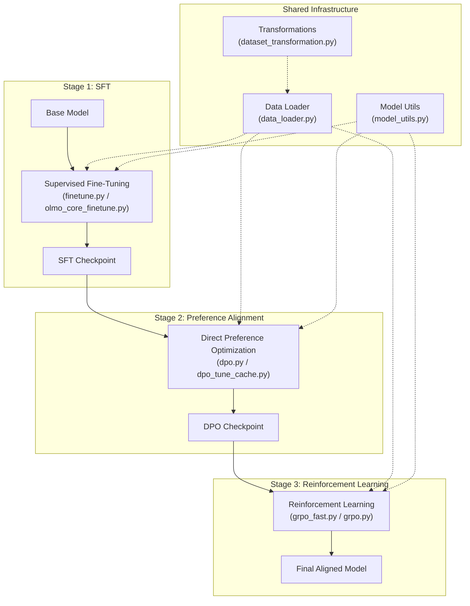
**Sources:** [open_instruct/finetune.py:88-150](), [open_instruct/dpo_tune_cache.py:15-17](), [open_instruct/grpo_fast.py:83-108](), [CHANGELOG.md:12-12]()

---

## 1. Supervised Fine-Tuning (SFT)
SFT is the foundational step where a base model is trained on (Instruction, Response) pairs. The repository provides two main paths for SFT:
*   **HuggingFace/Accelerate Path**: The `finetune.py` script uses `accelerate` and `deepspeed` for standard fine-tuning. It supports LoRA, QLoRA, and full parameter tuning [open_instruct/finetune.py:42-46]().
*   **OLMo-core Path**: The `olmo_core_finetune.py` script provides more robust FSDP2 support and utilizes numpy-based dataset conversion for high-performance training [CHANGELOG.md:27-33]().

**Key Components:**
*   **`FlatArguments`**: A centralized dataclass for managing all hyperparameters, from LoRA rank to dataset mixing ratios [open_instruct/finetune.py:76-180]().
*   **Dataset Mixing**: Supports proportional mixing of multiple datasets via `dataset_mixer_list` [open_instruct/finetune.py:126-127]().
*   **Ulysses Sequence Parallelism**: Enables training on extremely long contexts by sharding sequences across GPUs, now the default CP strategy in the OLMo-core path [CHANGELOG.md:27-27]().

For details, see **[Supervised Fine-Tuning (SFT)](#2.1)**.

---

## 2. Direct Preference Optimization (DPO)
DPO aligns models with human preferences using (Prompt, Chosen, Rejected) triplets. The system supports several loss variants and performance optimizations.

**Key Components:**
*   **Loss Variants**: Supports `DPO`, `DPO_NORM`, `SimPO`, `WPO`, and new variants like `DAPO` and `CISPO` [open_instruct/dpo_utils.py:76-81](), [open_instruct/grpo_utils.py:69-72]().
*   **Reference Caching**: `dpo_tune_cache.py` pre-computes and caches reference model logprobs to save memory and compute during training [open_instruct/dpo_tune_cache.py:191-193]().
*   **DPOTrainModule**: A specialized module for DPO training using FSDP and Tensor Parallelism (TP) for large-scale models [open_instruct/dpo_utils.py:129-131]().

For details, see **[Direct Preference Optimization (DPO)](#2.2)**.

---

## 3. Reinforcement Learning (RLHF)
The RLHF subsystem has transitioned to focus on **Group Relative Policy Optimization (GRPO)**, particularly for training on "Verifiable Rewards" (math/code). Traditional PPO scripts have been deprecated [CHANGELOG.md:12-12]().

**Core Implementations:**
*   **GRPO (grpo_fast.py)**: A memory-efficient RL algorithm that eliminates the critic model by computing advantages relative to a group of sampled responses [open_instruct/grpo_utils.py:102-145]().
*   **Distributed Orchestration**: Utilizes Ray for managing `PolicyTrainerRayProcess` actors and `vLLM` engines for high-throughput rollout generation [open_instruct/grpo_fast.py:65-83]().
*   **Weight Synchronization**: Features a native weight transfer API (`NCCLWeightTransferEngine`) for low-latency synchronization between the training policy and inference engines [open_instruct/grpo_fast.py:80-81](), [CHANGELOG.md:36-36]().

For details, see **[Reinforcement Learning (RLHF)](#2.3)**.

---

## 4. Reward Modeling
Reward Modeling is used to train models that can score completions based on preference data, often serving as a signal for RL or for rejection sampling.

**Key Components:**
*   **`reward_modeling.py`**: A script for training a reward head on top of a transformer.
*   **Preference Data**: Uses tokenized preference keys such as `chosen_input_ids` and `rejected_input_ids` [open_instruct/dpo_utils.py:42-47]().

For details, see **[Reward Modeling](#2.4)**.

---

## Code Entity Map: Training Orchestration

This diagram maps the high-level training concepts to the specific classes and files that implement them in the `open-instruct` codebase.

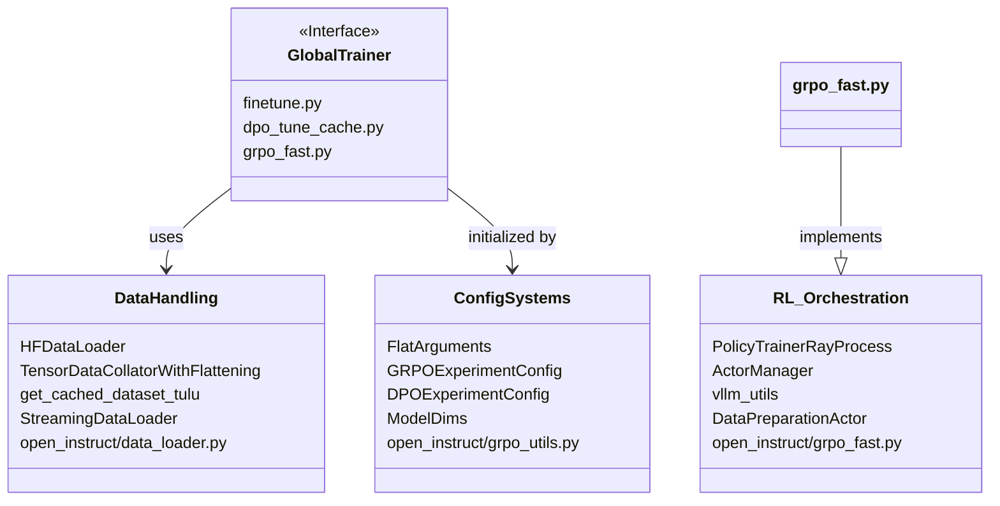
**Sources:** [open_instruct/data_loader.py:72-80](), [open_instruct/grpo_fast.py:134-163](), [open_instruct/grpo_utils.py:74-80](), [open_instruct/finetune.py:76-88](), [open_instruct/vllm_utils.py:100-123]()

---

## System Comparison Table

| Feature | SFT | DPO | RLHF (GRPO) |
| :--- | :--- | :--- | :--- |
| **Primary Script** | `finetune.py` | `dpo.py` / `dpo_tune_cache.py` | `grpo_fast.py` / `grpo.py` |
| **Data Format** | Instruction/Response | Chosen/Rejected Pairs | Prompts + Verifiers/RM |
| **Distributed Engine** | DeepSpeed / FSDP2 | FSDP / TP | Ray + vLLM + FSDP2 |
| **Key Optimization** | Ulysses SP | Logprob Caching | Group-based Advantage |
| **Weight Sync** | N/A | N/A | `NCCLWeightTransferEngine` |

**Sources:** [open_instruct/finetune.py:130-135](), [open_instruct/dpo_utils.py:96-114](), [open_instruct/grpo_utils.py:102-155](), [CHANGELOG.md:12-36]()

---

# Page: Supervised Fine-Tuning (SFT)

# Supervised Fine-Tuning (SFT)

<details>
<summary>Relevant source files</summary>

The following files were used as context for generating this wiki page:

- [docs/verify-tokenization.md](docs/verify-tokenization.md)
- [open_instruct/dataset_transformation.py](open_instruct/dataset_transformation.py)
- [open_instruct/dpo_tune_cache.py](open_instruct/dpo_tune_cache.py)
- [open_instruct/finetune.py](open_instruct/finetune.py)
- [open_instruct/model_utils.py](open_instruct/model_utils.py)
- [open_instruct/numpy_dataset_conversion.py](open_instruct/numpy_dataset_conversion.py)
- [open_instruct/olmo_core_finetune.py](open_instruct/olmo_core_finetune.py)
- [open_instruct/test_model_utils.py](open_instruct/test_model_utils.py)
- [open_instruct/test_numpy_dataset_conversion.py](open_instruct/test_numpy_dataset_conversion.py)
- [open_instruct/test_utils.py](open_instruct/test_utils.py)
- [open_instruct/utils.py](open_instruct/utils.py)
- [scripts/data/convert_sft_data_for_olmocore.py](scripts/data/convert_sft_data_for_olmocore.py)
- [scripts/data/rlvr_code/verify_qwq.py](scripts/data/rlvr_code/verify_qwq.py)
- [scripts/slurm/sft/README.md](scripts/slurm/sft/README.md)
- [scripts/slurm/sft/prepare_dolci_instruct_data.sh](scripts/slurm/sft/prepare_dolci_instruct_data.sh)
- [scripts/slurm/sft/prepare_dolci_think_data.sh](scripts/slurm/sft/prepare_dolci_think_data.sh)
- [scripts/slurm/sft/train_dolci_instruct.sh](scripts/slurm/sft/train_dolci_instruct.sh)
- [scripts/slurm/sft/train_dolci_think.sh](scripts/slurm/sft/train_dolci_think.sh)
- [scripts/train/convert_olmo_core_to_hf.py](scripts/train/convert_olmo_core_to_hf.py)
- [scripts/train/debug/finetune.sh](scripts/train/debug/finetune.sh)
- [scripts/train/debug/oc_sft.sh](scripts/train/debug/oc_sft.sh)
- [scripts/train/debug/oc_sft_cache.sh](scripts/train/debug/oc_sft_cache.sh)
- [scripts/train/debug/oc_sft_multinode.sh](scripts/train/debug/oc_sft_multinode.sh)
- [scripts/train/debug/oc_sft_olmo3_7b_full.sh](scripts/train/debug/oc_sft_olmo3_7b_full.sh)
- [scripts/train/olmo2/finetune_13b.sh](scripts/train/olmo2/finetune_13b.sh)
- [scripts/train/olmo2/finetune_32b.sh](scripts/train/olmo2/finetune_32b.sh)
- [scripts/train/olmo2/finetune_7b.sh](scripts/train/olmo2/finetune_7b.sh)
- [scripts/train/qwen/finetune_7b.sh](scripts/train/qwen/finetune_7b.sh)
- [scripts/train/tulu3/finetune_8b.sh](scripts/train/tulu3/finetune_8b.sh)

</details>


## Purpose and Scope

Supervised Fine-Tuning (SFT) is the first stage in the open-instruct training pipeline. It adapts a pre-trained base language model to follow instructions by training on supervised instruction-response pairs. The output is an instruction-following model that serves as the foundation for subsequent preference alignment stages like DPO or RLHF.

This page documents the primary `finetune.py` script and the specialized `olmo_core_finetune.py` path designed for OLMo-core models with FSDP2 support. It also covers the `numpy_dataset_conversion.py` utilities used to prepare high-throughput datasets for the OLMo-core path. [open_instruct/finetune.py:1-20](), [open_instruct/olmo_core_finetune.py:16-26]()

## System Architecture

The SFT system consists of two distinct implementation paths:
1.  **HuggingFace-based (`finetune.py`)**: The standard path using `transformers`, `accelerate`, and `deepspeed`.
2.  **OLMo-core-based (`olmo_core_finetune.py`)**: A high-performance path using `olmo-core` for FSDP2 training and numpy memory-mapped datasets.

### SFT Logic Flow: Natural Language to Code Entities
This diagram maps high-level training concepts to the specific code entities that implement them.

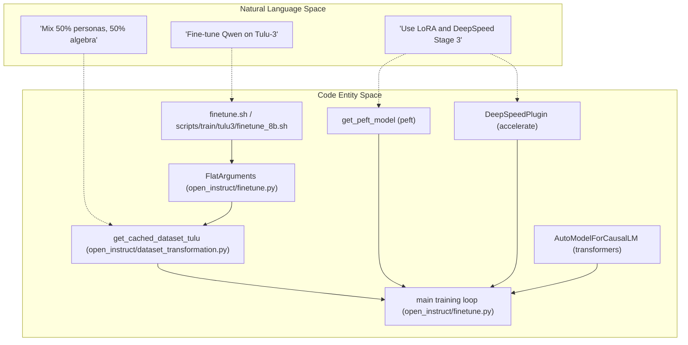
**Sources:** [open_instruct/finetune.py:77-110](), [open_instruct/dataset_transformation.py:152-172](), [scripts/train/tulu3/finetune_8b.sh:1-25]()

## Entry Point and Configuration (finetune.py)

### Main Script
The primary entry point `finetune.py` implements a standard supervised fine-tuning loop using HuggingFace Accelerate for distributed training coordination. [open_instruct/finetune.py:360-380]()

### Configuration Classes
Training is configured through the `FlatArguments` dataclass. [open_instruct/finetune.py:77-358]()

| Configuration Group | Key Parameters | Purpose |
|-------------------|---------------|---------|
| **Model** | `model_name_or_path`, `low_cpu_mem_usage` | Model loading and architecture initialization. [open_instruct/finetune.py:93-120]() |
| **Dataset** | `dataset_mixer_list`, `dataset_transform_fn` | Data mixing proportions and transformation sequence. [open_instruct/finetune.py:127-134]() |
| **Training** | `learning_rate`, `num_train_epochs`, `gradient_accumulation_steps` | Optimization hyperparameters. [open_instruct/finetune.py:179-206]() |
| **LoRA/QLoRA** | `use_lora`, `lora_rank`, `lora_alpha` | Parameter-efficient fine-tuning settings. [open_instruct/finetune.py:270-286]() |

**Sources:** [open_instruct/finetune.py:77-358]()

## Dataset Processing Pipeline

### Data Flow and Transformation
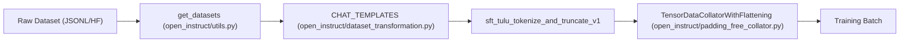
**Sources:** [open_instruct/dataset_transformation.py:152-180](), [open_instruct/padding_free_collator.py:58](), [open_instruct/utils.py:65]()

### Data Collation Strategies
SFT supports two primary collation strategies:
1.  **Standard Collation**: Uses `DataCollatorForSeq2Seq` for standard padding. [open_instruct/finetune.py:46]()
2.  **Padding-free (Packing)**: Uses `TensorDataCollatorWithFlattening` to concatenate sequences into a single tensor, removing padding tokens and improving throughput. [open_instruct/padding_free_collator.py:58]()

## Model Initialization and Optimization

### Loading Strategies
The system supports multiple loading strategies based on memory constraints:
-   **Standard**: `AutoModelForCausalLM.from_pretrained`. [open_instruct/finetune.py:560-569]()
-   **QLoRA**: 4-bit quantized loading via `BitsAndBytesConfig`. [open_instruct/finetune.py:522-541]()
-   **Liger Kernel**: Optimized fused kernels for cross-entropy. [open_instruct/finetune.py:542-558]()

### DeepSpeed Integration
DeepSpeed ZeRO-2 and ZeRO-3 are integrated via the Accelerate `DeepSpeedPlugin`. [open_instruct/finetune.py:37-40]() The configuration typically disables offloading for maximum speed on high-bandwidth clusters. [open_instruct/dpo_tune_cache.py:76-114]()

## OLMo-Core SFT Path

The `olmo_core_finetune.py` script is designed for training OLMo-2 and OLMo-3 models using `olmo-core`'s `Trainer`. This path is optimized for multi-node FSDP2 training and requires pre-tokenized numpy datasets. [open_instruct/olmo_core_finetune.py:16-26]()

### Numpy Dataset Conversion
Before training with OLMo-core, datasets must be converted to numpy memory-mapped format using `scripts/data/convert_sft_data_for_olmocore.py`. [scripts/data/convert_sft_data_for_olmocore.py:15-29]()

The conversion process creates:
-   `token_ids_part_XXXX.npy`: The raw token IDs. [open_instruct/numpy_dataset_conversion.py:4]()
-   `labels_mask_part_XXXX.npy`: Boolean mask indicating trainable tokens (responses). [open_instruct/numpy_dataset_conversion.py:5]()
-   `token_ids_part_XXXX.csv.gz`: Document boundaries (start/end indices). [open_instruct/numpy_dataset_conversion.py:6]()

### OLMo-Core Training Logic
The training loop is managed by `olmo_core.train.Trainer`. Key functions include:
-   `_tokenize_to_numpy_dir`: Handles on-the-fly tokenization if pre-tokenized data is missing. [open_instruct/olmo_core_finetune.py:85-110]()
-   `olmo_core_utils.setup_distributed_env`: Initializes the process group and seeds. [open_instruct/olmo_core_finetune.py:170-172]()

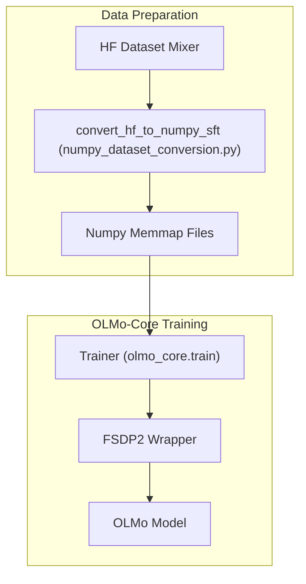
**Sources:** [open_instruct/olmo_core_finetune.py:93-109](), [open_instruct/numpy_dataset_conversion.py:1-9](), [scripts/data/convert_sft_data_for_olmocore.py:133-165]()

## Model Saving and Evaluation

### Checkpointing
In `finetune.py`, checkpoints are saved using `save_with_accelerate`, which unwraps the model and handles distributed state saving. [open_instruct/model_utils.py:57](), [open_instruct/finetune.py:896-924]()

### Automatic Evaluation
After training, the script can automatically trigger evaluation jobs on the Beaker platform using `launch_ai2_evals_on_weka` or `submit_eval_jobs.py` integration. [open_instruct/finetune.py:944-952](), [open_instruct/utils.py:66]()

**Sources:** [open_instruct/finetune.py:896-954](), [open_instruct/model_utils.py:57](), [open_instruct/utils.py:60-71]()

---

# Page: Direct Preference Optimization (DPO)

# Direct Preference Optimization (DPO)

<details>
<summary>Relevant source files</summary>

The following files were used as context for generating this wiki page:

- [open_instruct/dataset_transformation.py](open_instruct/dataset_transformation.py)
- [open_instruct/dpo.py](open_instruct/dpo.py)
- [open_instruct/dpo_tune_cache.py](open_instruct/dpo_tune_cache.py)
- [open_instruct/dpo_utils.py](open_instruct/dpo_utils.py)
- [open_instruct/finetune.py](open_instruct/finetune.py)
- [open_instruct/grpo.py](open_instruct/grpo.py)
- [open_instruct/grpo_callbacks.py](open_instruct/grpo_callbacks.py)
- [open_instruct/grpo_olmo_core_actor.py](open_instruct/grpo_olmo_core_actor.py)
- [open_instruct/grpo_utils.py](open_instruct/grpo_utils.py)
- [open_instruct/model_utils.py](open_instruct/model_utils.py)
- [open_instruct/olmo_core_callbacks.py](open_instruct/olmo_core_callbacks.py)
- [open_instruct/olmo_core_train_modules.py](open_instruct/olmo_core_train_modules.py)
- [open_instruct/olmo_core_utils.py](open_instruct/olmo_core_utils.py)
- [open_instruct/padding_free_collator.py](open_instruct/padding_free_collator.py)
- [open_instruct/test_data_loader_gpu.py](open_instruct/test_data_loader_gpu.py)
- [open_instruct/test_model_utils.py](open_instruct/test_model_utils.py)
- [open_instruct/test_utils.py](open_instruct/test_utils.py)
- [open_instruct/test_vllm_utils_gpu.py](open_instruct/test_vllm_utils_gpu.py)
- [open_instruct/utils.py](open_instruct/utils.py)
- [scripts/benchmarking/launch_benchmark_single_gpu.sh](scripts/benchmarking/launch_benchmark_single_gpu.sh)
- [scripts/benchmarking/launch_benchmark_single_node.sh](scripts/benchmarking/launch_benchmark_single_node.sh)
- [scripts/dpo_train_with_accelerate.sh](scripts/dpo_train_with_accelerate.sh)
- [scripts/dpo_train_with_accelerate_config.sh](scripts/dpo_train_with_accelerate_config.sh)
- [scripts/dpo_train_with_qlora.sh](scripts/dpo_train_with_qlora.sh)
- [scripts/train/debug/dpo/7b_instruct_dpo_olmo_core.sh](scripts/train/debug/dpo/7b_instruct_dpo_olmo_core.sh)
- [scripts/train/debug/dpo/checkpoint_integration_test.sh](scripts/train/debug/dpo/checkpoint_integration_test.sh)
- [scripts/train/debug/dpo/local.sh](scripts/train/debug/dpo/local.sh)
- [scripts/train/debug/dpo/multi_node.sh](scripts/train/debug/dpo/multi_node.sh)
- [scripts/train/debug/dpo/multi_node_cache.sh](scripts/train/debug/dpo/multi_node_cache.sh)
- [scripts/train/debug/dpo/single_gpu.sh](scripts/train/debug/dpo/single_gpu.sh)
- [scripts/train/debug/dpo_integration_test.sh](scripts/train/debug/dpo_integration_test.sh)
- [scripts/train/olmo2/dpo_13b.sh](scripts/train/olmo2/dpo_13b.sh)
- [scripts/train/olmo2/dpo_7b.sh](scripts/train/olmo2/dpo_7b.sh)
- [scripts/train/olmo3/7b_instruct_dpo_olmocore.sh](scripts/train/olmo3/7b_instruct_dpo_olmocore.sh)
- [scripts/train/tulu3/dpo_8b.sh](scripts/train/tulu3/dpo_8b.sh)

</details>


## Purpose and Scope

This document covers the Direct Preference Optimization (DPO) training systems within the `open-instruct` repository. It explains the standard implementation in [open_instruct/dpo_tune_cache.py]() and the high-performance OLMo-core variant in [open_instruct/dpo.py](). DPO is a preference alignment method that trains models to prefer "chosen" responses over "rejected" responses using a contrastive loss, typically bypassing the need for a separate reward model during the optimization phase.

**Sources:** [open_instruct/dpo_tune_cache.py:15-17](), [open_instruct/dpo.py:1-6]()

---

## DPO Training Architectures

The repository provides two primary paths for DPO training:

1.  **Standard (HF/Accelerate):** Uses `dpo_tune_cache.py` with Hugging Face `transformers` and `accelerate`. It features a reference caching strategy to save memory and supports LoRA/QLoRA.
2.  **OLMo-core (FSDP2/TP):** Uses `dpo.py` and the `DPOTrainModule`. This is optimized for large-scale training with native support for Fully Sharded Data Parallel (FSDP) and Tensor Parallelism (TP) via `olmo-core`.

### System Component Mapping

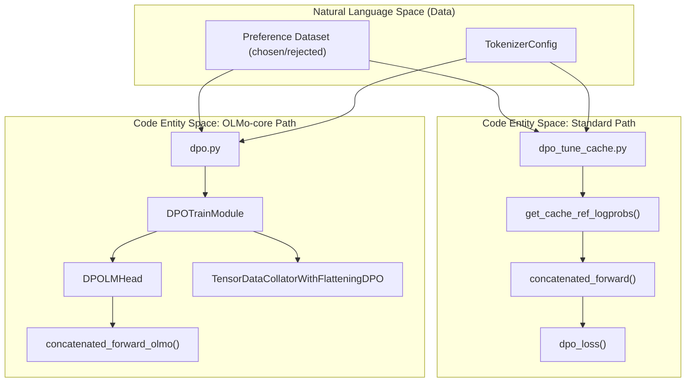

**Sources:** [open_instruct/dpo_tune_cache.py:117-147](), [open_instruct/dpo.py:25-30](), [open_instruct/olmo_core_train_modules.py:103-113](), [open_instruct/dpo_utils.py:111-114]()

---

## Reference Caching Strategy

To avoid running two models (Policy and Reference) simultaneously in GPU memory—which effectively doubles the VRAM requirement—the standard DPO script employs a caching strategy.

1.  **Initialization:** The script calls `get_cache_ref_logprobs()` [open_instruct/dpo_tune_cache.py:380]().
2.  **Execution:** It iterates through the dataset once using the base model. If using LoRA, it disables the adapters via `model.disable_adapter()` to represent the reference state [open_instruct/dpo_tune_cache.py:403]().
3.  **Storage:** Log probabilities for both chosen and rejected sequences are computed and stored as CPU tensors in a `TensorCache` [open_instruct/model_utils.py:98-111]().
4.  **Training:** During the actual optimization loop, these cached values are retrieved by index, eliminating the need for reference model forward passes [open_instruct/dpo_tune_cache.py:859-885]().

**Sources:** [open_instruct/dpo_tune_cache.py:380-418](), [open_instruct/model_utils.py:98-122]()

---

## Loss Variants and Algorithms

The `dpo_utils.py` module defines several preference optimization loss variants and the `DAPO`/`CISPO` variants used in RL contexts:

| Loss Variant | Description | Implementation Detail |
| :--- | :--- | :--- |
| `dpo` | Standard DPO with KL penalty. | Requires reference logprobs. |
| `dpo_norm` | DPO with length-normalized logprobs. | Reduces length bias in preference. |
| `simpo` | Simple Preference Optimization. | Reference-free; uses target reward margin `gamma`. |
| `wpo` | Weighted Preference Optimization. | Weights examples by reward differences. |
| `dapo` | Direct Alignment from Preference Optimization. | Used in GRPO context [open_instruct/grpo_utils.py:70](). |
| `cispo` | Contrastive Iterative Soft Preference Optimization. | Iterative variant [open_instruct/grpo_utils.py:71](). |

The `DPOLossType` enum manages these variants and tracks properties like whether they require a reference model [open_instruct/dpo_utils.py:76-93]().

**Sources:** [open_instruct/dpo_utils.py:76-93](), [open_instruct/grpo_utils.py:69-71]()

---

## OLMo-core DPO (High Performance)

The `DPOTrainModule` [open_instruct/olmo_core_train_modules.py:103]() integrates DPO into the `olmo-core` trainer. This version is designed for massive scale and utilizes specialized components for FSDP and TP.

### The DPOLMHead
The `DPOLMHead` [open_instruct/olmo_core_train_modules.py:38]() is a custom layer that replaces the standard language modeling head.
- It calculates per-token log-probabilities internally using `calculate_per_token_logps` [open_instruct/olmo_core_train_modules.py:75]().
- It is compatible with `torch.compile` and handles `DTensor` sharding for Tensor Parallelism (TP) by redistributing logprobs across the TP mesh [open_instruct/olmo_core_train_modules.py:76-81]().

### Concatenated Forward Pass
Both implementations support `concatenated_forward`. This combines the chosen and rejected sequences into a single batch for the model, effectively halving the number of forward passes required.
- **Standard:** Controlled by `DPOConfig.concatenated_forward` [open_instruct/dpo_utils.py:111]().
- **OLMo-core:** Implemented via `concatenated_forward_olmo` or `separate_forward_olmo` logic in the training module [open_instruct/olmo_core_train_modules.py:170-174]().

### Data Flow in DPOTrainModule

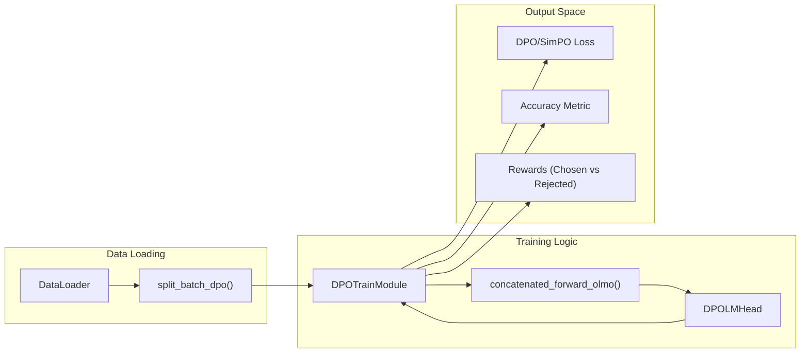

**Sources:** [open_instruct/olmo_core_train_modules.py:38-85](), [open_instruct/olmo_core_train_modules.py:87-101](), [open_instruct/olmo_core_train_modules.py:163-174]()

---

## Training Configuration

### Experiment Configuration
DPO training is governed by the `DPOExperimentConfig` dataclass [open_instruct/dpo_utils.py:199](). Key hyperparameters include:
- `beta`: Controls the strength of the KL penalty (default 5.0) [open_instruct/dpo_utils.py:99]().
- `loss_type`: Selection of DPO/SimPO/WPO [open_instruct/dpo_utils.py:101]().
- `packing`: Whether to use padding-free collation [open_instruct/dpo_utils.py:113]().

### Distributed Support
The OLMo-core variant supports advanced distributed features:
- **FSDP Sharding:** Controlled via `fsdp_shard_degree` [open_instruct/dpo_utils.py:135]().
- **Tensor Parallelism:** Configured via `tensor_parallel_degree` [open_instruct/dpo_utils.py:129]().
- **Optimizer Options:** Supports `muon` or `adamw` optimizers [open_instruct/dpo_utils.py:125]().

**Sources:** [open_instruct/dpo_utils.py:96-140](), [open_instruct/dpo_utils.py:199-206]()

---

## Data Preparation and Collation

DPO requires a specific collator to handle pairs of sequences (chosen and rejected).

- **Standard Collation:** Uses `DataCollatorForSeq2Seq` modified for preference pairs.
- **Padding-Free Collation:** `TensorDataCollatorWithFlatteningDPO` [open_instruct/padding_free_collator.py]() is used when `packing=True`. This flattens the batch to remove padding tokens, significantly increasing throughput on sequences of varying lengths [open_instruct/olmo_core_train_modules.py:134-138]().

The dataset is typically processed using `get_cached_dataset_tulu` with the `preference_tulu_tokenize_and_truncate_v1` transform function to ensure correct formatting of chosen/rejected pairs [open_instruct/dpo_tune_cache.py:537-542]().

**Sources:** [open_instruct/dpo_tune_cache.py:57](), [open_instruct/olmo_core_train_modules.py:134-138](), [open_instruct/dpo_utils.py:42-47]()

---

# Page: Reinforcement Learning (RLHF)

# Reinforcement Learning (RLHF)

<details>
<summary>Relevant source files</summary>

The following files were used as context for generating this wiki page:

- [CHANGELOG.md](CHANGELOG.md)
- [open_instruct/benchmark_generators.py](open_instruct/benchmark_generators.py)
- [open_instruct/data_loader.py](open_instruct/data_loader.py)
- [open_instruct/data_types.py](open_instruct/data_types.py)
- [open_instruct/dpo.py](open_instruct/dpo.py)
- [open_instruct/dpo_utils.py](open_instruct/dpo_utils.py)
- [open_instruct/grpo.py](open_instruct/grpo.py)
- [open_instruct/grpo_callbacks.py](open_instruct/grpo_callbacks.py)
- [open_instruct/grpo_fast.py](open_instruct/grpo_fast.py)
- [open_instruct/grpo_olmo_core_actor.py](open_instruct/grpo_olmo_core_actor.py)
- [open_instruct/grpo_utils.py](open_instruct/grpo_utils.py)
- [open_instruct/olmo_core_train_modules.py](open_instruct/olmo_core_train_modules.py)
- [open_instruct/olmo_core_utils.py](open_instruct/olmo_core_utils.py)
- [open_instruct/rl_utils.py](open_instruct/rl_utils.py)
- [open_instruct/test_dataset_processor.py](open_instruct/test_dataset_processor.py)
- [open_instruct/test_grpo_fast.py](open_instruct/test_grpo_fast.py)
- [open_instruct/test_rl_utils.py](open_instruct/test_rl_utils.py)
- [open_instruct/test_vllm_utils.py](open_instruct/test_vllm_utils.py)
- [open_instruct/test_vllm_utils_gpu.py](open_instruct/test_vllm_utils_gpu.py)
- [open_instruct/vllm_utils.py](open_instruct/vllm_utils.py)

</details>


## Purpose and Scope

This page provides an overview of Reinforcement Learning from Human Feedback (RLHF) training methods in the `open-instruct` repository. The codebase primarily focuses on **GRPO (Group Relative Policy Optimization)**, which has become the standard RL algorithm in this repository following the removal of legacy PPO scripts [CHANGELOG.md:12](). Both methods leverage verifiable rewards (code execution, math verification, LLM judges) to train instruction-following models, significantly reducing reliance on static human preference data.

For detailed implementation specifics:
- **GRPO Implementation**: see [GRPO Implementation](#2.3.1) for `grpo_fast.py`, queue-based architecture, and OLMo-core FSDP2 support.
- **Verifiable Rewards and Ground Truth**: see [Verifiable Rewards and Ground Truth](#2.3.2) for `ground_truth_utils.py` and reward computation.
- **Tool-Augmented Training**: see [Tool-Augmented Training](#2.3.3) for RL environments and tool integration.

## RLHF Training Paradigm

The RLHF systems are designed for high-throughput training using **vLLM** for generation and **DeepSpeed** or **OLMo-core (FSDP2)** for policy optimization. The primary algorithm, GRPO, eliminates the need for a separate value model, reducing VRAM requirements while maintaining performance through group-relative advantage estimation [grpo_utils.py:101-110]().

### Algorithm Logic: GRPO

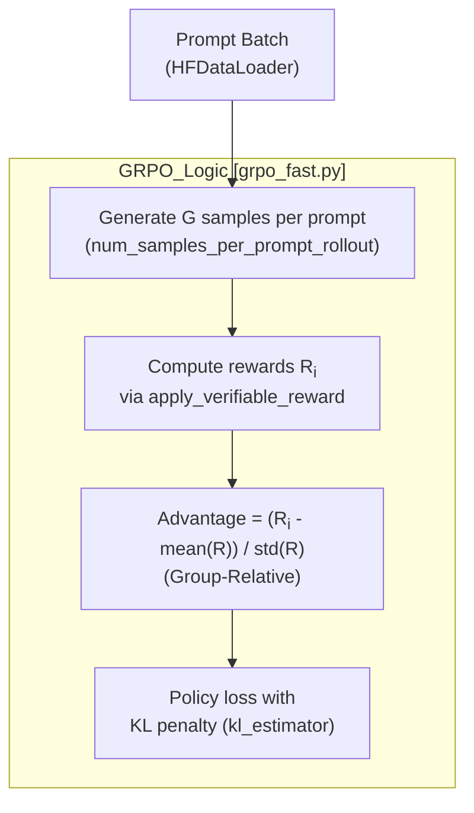

| Aspect | GRPO (`grpo_fast.py`) | PPO (Legacy) |
|--------|------|-----|
| **Advantage Estimation** | Group-relative (within prompt group) | GAE using Value Function |
| **Value Function** | Not required (lower VRAM) | Required (Removed) |
| **Samples per Prompt** | Multiple (G ≥ 2) required | Single sample supported |
| **KL Penalty** | Integrated in Policy Loss [grpo_utils.py:104-105]() | Added to Reward or Loss |
| **Status** | **Primary RL Algorithm** | **Removed from Codebase** [CHANGELOG.md:12]() |

**Sources:** [open_instruct/grpo_fast.py:1-40](), [open_instruct/grpo_utils.py:101-110](), [CHANGELOG.md:12]()

## Async Training Architecture

The repository utilizes an asynchronous architecture to overlap generation and training. This is coordinated via **Ray** and specialized actor classes that communicate through distributed queues.

### System Entity Mapping

This diagram maps the logical RLHF components to specific code entities and their communication channels.

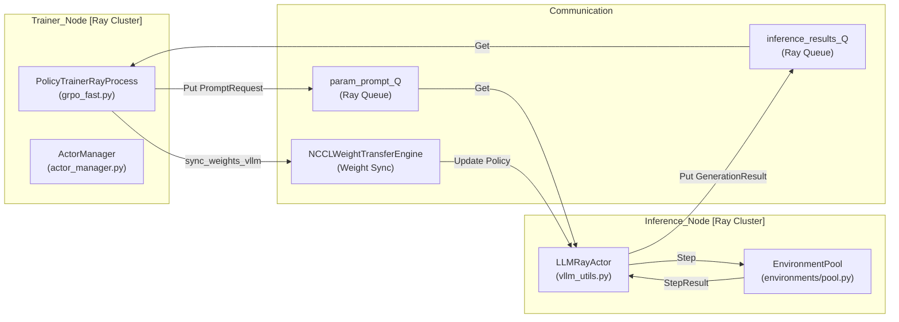

**Key Coordination Components:**
- **`PolicyTrainerRayProcess`**: Manages the training loop, gradient updates, and checkpointing [open_instruct/grpo_fast.py:1013-1040]().
- **`LLMRayActor`**: Wraps the vLLM engine to process `PromptRequest` objects from a queue [open_instruct/vllm_utils.py:532-550]().
- **`NCCLWeightTransferEngine`**: Migrated from custom code to vLLM's native weight transfer API for efficient trainer-to-inference synchronization [CHANGELOG.md:36](), [open_instruct/vllm_utils.py:48-50]().

**Sources:** [open_instruct/grpo_fast.py:1013-1040](), [open_instruct/vllm_utils.py:532-550](), [CHANGELOG.md:36](), [open_instruct/data_types.py:47-61]()

## Verifiable Rewards

A distinguishing feature of this RL framework is the verifiable reward system. Instead of relying solely on a Reward Model (RM), the system evaluates model outputs against ground truth data using programmatic verifiers.

### Reward Flow and Data Entities

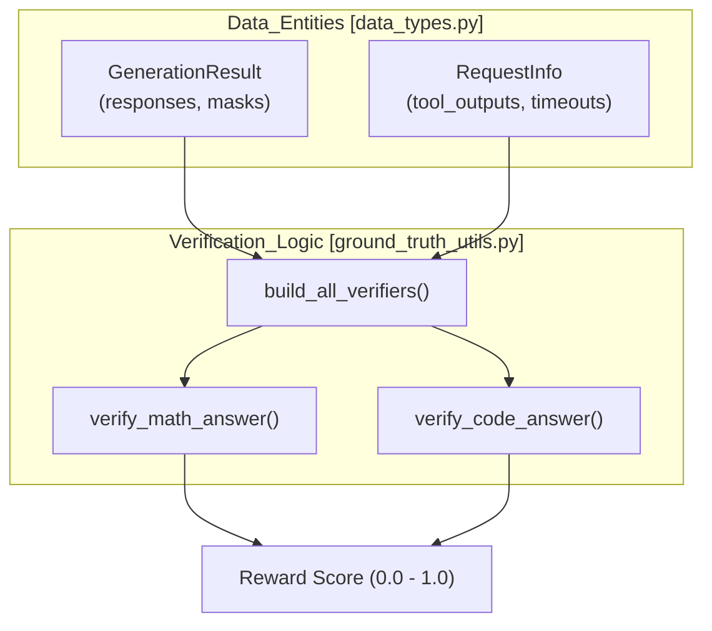

**Reward Configuration:**
- **Verifiable Reward**: Scalar rewards derived from `ground_truth_utils.py` verifiers [open_instruct/grpo_fast.py:100-105]().
- **Format Reward**: Rewards for adhering to specific tag-based reasoning formats (e.g., R1-style XML tags) [open_instruct/grpo_fast.py:47-48]().
- **Rho Correction**: Unified interface for `use_rho_correction` (clamping and masking) to handle train/infer engine mismatch in GRPO loss [CHANGELOG.md:20](), [grpo_utils.py:110-120]().

**Sources:** [open_instruct/grpo_fast.py:47-105](), [open_instruct/ground_truth_utils.py:100-110](), [CHANGELOG.md:20](), [open_instruct/grpo_utils.py:110-120]()

## Implementation Variants

| Implementation | Description | File |
|----------------|-------------|------|
| **GRPO Fast** | High-performance, async, queue-based GRPO using DeepSpeed ZeRO-3. | `open_instruct/grpo_fast.py` |
| **OLMo-core GRPO** | Variant using OLMo-core for FSDP2 training, supporting universal checkpointing. | `open_instruct/grpo_olmo_core_actor.py` |
| **GRPO Utils** | Shared utilities for loss computation (DAPO/CISPO), metrics, and resource planning. | `open_instruct/grpo_utils.py` |

**Sources:** [open_instruct/grpo_fast.py:1-40](), [open_instruct/grpo_olmo_core_actor.py:1-10](), [open_instruct/grpo_utils.py:1-30]()

---

**Next Steps:**
- For detailed GRPO implementation and queue mechanics: see [GRPO Implementation](#2.3.1)
- For verifier setup and reward computation: see [Verifiable Rewards and Ground Truth](#2.3.2)
- For tool-augmented training details: see [Tool-Augmented Training](#2.3.3)

---

# Page: GRPO Implementation

# GRPO Implementation

<details>
<summary>Relevant source files</summary>

The following files were used as context for generating this wiki page:

- [.gitignore](.gitignore)
- [CHANGELOG.md](CHANGELOG.md)
- [open_instruct/benchmark_generators.py](open_instruct/benchmark_generators.py)
- [open_instruct/data_loader.py](open_instruct/data_loader.py)
- [open_instruct/data_types.py](open_instruct/data_types.py)
- [open_instruct/dpo.py](open_instruct/dpo.py)
- [open_instruct/dpo_utils.py](open_instruct/dpo_utils.py)
- [open_instruct/grpo.py](open_instruct/grpo.py)
- [open_instruct/grpo_callbacks.py](open_instruct/grpo_callbacks.py)
- [open_instruct/grpo_fast.py](open_instruct/grpo_fast.py)
- [open_instruct/grpo_fast_resource_plan.py](open_instruct/grpo_fast_resource_plan.py)
- [open_instruct/grpo_olmo_core_actor.py](open_instruct/grpo_olmo_core_actor.py)
- [open_instruct/grpo_utils.py](open_instruct/grpo_utils.py)
- [open_instruct/olmo_core_train_modules.py](open_instruct/olmo_core_train_modules.py)
- [open_instruct/olmo_core_utils.py](open_instruct/olmo_core_utils.py)
- [open_instruct/test_grpo_fast.py](open_instruct/test_grpo_fast.py)
- [open_instruct/test_grpo_fast_resource_plan.py](open_instruct/test_grpo_fast_resource_plan.py)
- [open_instruct/test_olmo_core_train_modules.py](open_instruct/test_olmo_core_train_modules.py)
- [open_instruct/test_vllm_utils.py](open_instruct/test_vllm_utils.py)
- [open_instruct/test_vllm_utils_gpu.py](open_instruct/test_vllm_utils_gpu.py)
- [open_instruct/vllm_utils.py](open_instruct/vllm_utils.py)
- [scripts/train/debug/envs/wordle_8gpu.sh](scripts/train/debug/envs/wordle_8gpu.sh)
- [scripts/train/debug/envs/wordle_sandbox_lm_8gpu.sh](scripts/train/debug/envs/wordle_sandbox_lm_8gpu.sh)
- [scripts/train/debug/grpo.sh](scripts/train/debug/grpo.sh)
- [scripts/train/debug/grpo_fast.sh](scripts/train/debug/grpo_fast.sh)
- [scripts/train/debug/large_test_script.sh](scripts/train/debug/large_test_script.sh)
- [scripts/train/debug/multi_node_grpo.sh](scripts/train/debug/multi_node_grpo.sh)
- [scripts/train/debug/qwen35_4b_dapo_math.sh](scripts/train/debug/qwen35_4b_dapo_math.sh)
- [scripts/train/debug/single_gpu_on_beaker.sh](scripts/train/debug/single_gpu_on_beaker.sh)
- [scripts/train/qwen/qwen3_4b_dapo_math_32k.sh](scripts/train/qwen/qwen3_4b_dapo_math_32k.sh)
- [scripts/train/qwen/qwen3_4b_dapo_math_oc.sh](scripts/train/qwen/qwen3_4b_dapo_math_oc.sh)

</details>


## Purpose and Scope

This page provides a technical deep dive into the GRPO (Group Relative Policy Optimization) implementation in `grpo_fast.py`. GRPO is a variant of REINFORCE that optimizes policies by comparing multiple samples from the same prompt, making it particularly effective for tasks with verifiable rewards like math and coding.

This document covers:
- Queue-based architecture for decoupling generation from training.
- Ray distributed training with `PolicyTrainerRayProcess`.
- vLLM integration for fast inference and tool execution.
- Weight synchronization between training and inference engines.
- Inflight updates for pausing/resuming generation.
- Resource planning and allocation via `grpo_fast_resource_plan.py`.
- The OLMo-core GRPO variant (`grpo_olmo_core_actor.py`) with FSDP2 support.

**Sources:** [open_instruct/grpo_fast.py:1-48](), [open_instruct/grpo_olmo_core_actor.py:1-20]()

## Architecture Overview

GRPO uses a queue-based architecture to decouple policy training from response generation. This design enables asynchronous training where generation can run ahead of training by `async_steps`.

### System Component Diagram

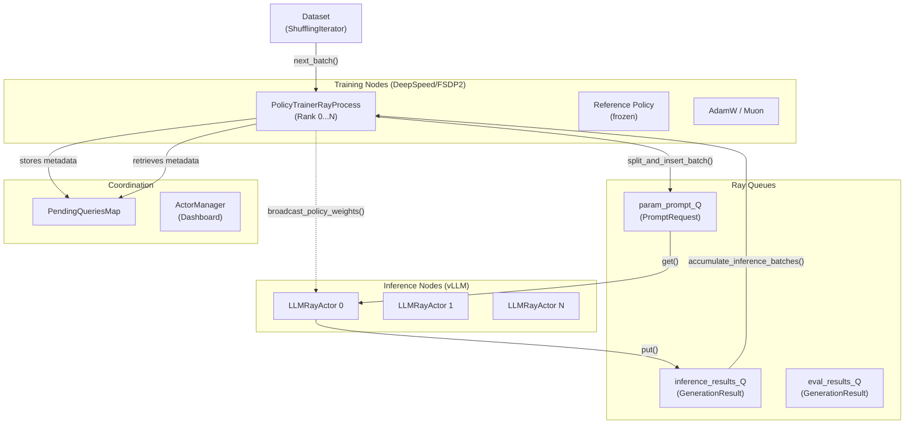

**Key Design Decisions:**

1.  **Individual Prompt Batching**: Each prompt is sent as a separate `PromptRequest` [open_instruct/data_types.py:100-112]() rather than batching prompts. This allows vLLM to handle variable-length sequences efficiently.
2.  **Dataset Index Tracking**: Each prompt retains its original dataset index via `PendingQueriesMap` [open_instruct/grpo_fast.py:583-611](), enabling correct reassembly even when processed out-of-order.
3.  **Inflight Updates**: Supports immediate pausing of generation for weight synchronization via `inflight_updates` flag [open_instruct/grpo_fast.py:253]().
4.  **Weight Transfer**: Migrated to vLLM 0.16.0's native `NCCLWeightTransferEngine` for trainer-to-vLLM weight sync [CHANGELOG.md:36]().

**Sources:** [open_instruct/grpo_fast.py:613-787](), [open_instruct/data_types.py:100-112](), [open_instruct/vllm_utils.py:468-505](), [CHANGELOG.md:36]()

## Configuration: ExperimentConfig

The `GRPOExperimentConfig` dataclass in `grpo_utils.py` defines the hyperparameters and algorithmic switches.

| Parameter | Type | Default | Description |
| :--- | :--- | :--- | :--- |
| `beta` | `float` | 0.05 | KL coefficient for regularization [open_instruct/grpo_utils.py:104](). |
| `clip_higher` | `float` | 0.272 | Upper clip range [open_instruct/grpo_utils.py:108](). |
| `use_rho_correction` | `bool` | `True` | Master switch for the train/infer ratio $\rho$ correction [open_instruct/grpo_utils.py:110](). |
| `rho_mask_tv_divergence`| `bool` | `False` | Applies TV divergence masking from VACO [open_instruct/grpo_utils.py:129](). |
| `loss_fn` | `GRPOLossType` | `dapo` | Choice between `dapo` or `cispo` [open_instruct/grpo_utils.py:150](). |
| `alpha` | `float` | 0.6 | Polyak update value for reference policy updates [open_instruct/grpo_utils.py:141](). |

**Sources:** [open_instruct/grpo_utils.py:75-156](), [CHANGELOG.md:8](), [CHANGELOG.md:20]()

## Core Components

### PolicyTrainerRayProcess

`PolicyTrainerRayProcess` is a Ray actor running on training GPUs. It manages the trainable policy and the reference policy.

*   **Initialization**: Loads models and prepares DeepSpeed configurations [open_instruct/grpo_fast.py:139-178]().
*   **Token Counting**: Aggregates prompt/response lengths across all DP ranks, deduplicating SP groups for accurate utilization metrics [CHANGELOG.md:25]().
*   **Loss Computation**: Returns the final policy loss and clip fraction directly from `compute_grpo_loss` [CHANGELOG.md:10]().
*   **Weight Sync**: Orchestrates weight broadcasting to vLLM workers using the `NCCLWeightTransferEngine` [open_instruct/grpo_fast.py:80-81]().

**Sources:** [open_instruct/grpo_fast.py:139-178](), [CHANGELOG.md:10](), [CHANGELOG.md:25](), [CHANGELOG.md:36]()

### vLLM Integration (`LLMRayActor`)

The `LLMRayActor` in `vllm_utils.py` wraps the vLLM engine to handle generation and tool calls.

*   **Async Processing**: Uses `process_request_async` to handle multi-turn tool interactions [open_instruct/vllm_utils.py:507-550]().
*   **Weight Transfer**: Uses `NCCLWeightTransferEngine` or `IPCWeightTransferEngine` for receiving policy updates from the trainer [open_instruct/vllm_utils.py:45-48]().
*   **Model Dims**: Extracts model architecture metadata via `model_dims_from_vllm_config` [open_instruct/vllm_utils.py:100-123]().

**Sources:** [open_instruct/vllm_utils.py:100-123](), [open_instruct/vllm_utils.py:507-550](), [CHANGELOG.md:36]()

## Resource Planning

The `grpo_fast_resource_plan.py` module handles the complex logic of allocating Ray resources (CPUs, GPUs, and memory) for the various actors.

*   **Planning Logic**: Calculates the number of trainer actors, vLLM actors, and data preparation actors based on the cluster resource snapshot [open_instruct/grpo_fast_resource_plan.py:1-50]().
*   **Resource Tracking**: Monitors Ray cluster and available resources to ensure the experiment fits within the allocation [open_instruct/grpo_fast.py:175-187]().

**Sources:** [open_instruct/grpo_fast_resource_plan.py:1-50](), [open_instruct/grpo_fast.py:175-187]()

## Weight Synchronization

Weight synchronization ensures the inference engine generates samples using the most recent policy parameters.

```mermaid
sequenceDiagram
    participant PT as PolicyTrainerRayProcess (Rank 0)
    participant NCCL as NCCLWeightTransferEngine
    participant VLLM as LLMRayActor (vLLM Worker)
    
    Note over PT, VLLM: After Optimizer Step
    
    PT->>PT: Set should_stop=True (Pause Inference)
    PT->>VLLM: Request Weight Update via collective_rpc
    
    PT->>NCCL: Initialize WeightTransferInitRequest
    NCCL->>VLLM: Broadcast Policy Weights
    
    VLLM->>VLLM: update_weights()
    VLLM->>PT: Acknowledge Completion
    
    PT->>PT: Set should_stop=False (Resume Inference)
```

**Sources:** [open_instruct/grpo_fast.py:1100-1150](), [open_instruct/vllm_utils.py:666-693](), [CHANGELOG.md:36]()

## OLMo-core GRPO Actor

The `PolicyTrainerOLMoCoreProcess` in `grpo_olmo_core_actor.py` provides an alternative training path using OLMo-core and FSDP2.

*   **Feature Parity**: Brought to parity with `grpo_fast.py`, including `EvalCallback`, `ConstantWithWarmup` scheduler, and `StepTimingCallback` [CHANGELOG.md:11]().
*   **Checkpointing**: Wired with `CheckpointerCallback` and `DataPreparationActorCheckpointCallback` for resumable Beaker jobs [CHANGELOG.md:17]().
*   **FSDP2 Integration**: Uses `GRPOTrainModule` which inherits from `TransformerTrainModule` for native OLMo-core training [open_instruct/olmo_core_train_modules.py:103-157]().

**Sources:** [open_instruct/grpo_olmo_core_actor.py:48-161](), [open_instruct/olmo_core_train_modules.py:103-157](), [CHANGELOG.md:11](), [CHANGELOG.md:17]()

## Data Flow and Queues

The system relies on several queues and data structures to manage the flow of prompts and results.

| Entity | Role | Location |
| :--- | :--- | :--- |
| `param_prompt_Q` | Holds `PromptRequest` objects for vLLM workers. | [open_instruct/grpo_fast.py:75]() |
| `inference_results_Q` | Holds `GenerationResult` objects for the trainer. | [open_instruct/grpo_fast.py:75]() |
| `PendingQueriesMap` | Thread-safe map for prompt metadata (ground truth, raw query). | [open_instruct/grpo_fast.py:583]() |
| `DataPreparationActor` | Resamples on filtered batches to unify consumer paths and prevent empty batches. | [CHANGELOG.md:21]() |

**Sources:** [open_instruct/grpo_fast.py:75-611](), [CHANGELOG.md:21]()

## Loss Computation and Metrics

GRPO computes advantages relative to the group mean of rewards.

1.  **Reward Computation**: Verifiable rewards are applied based on the `apply_verifiable_reward` flag [open_instruct/grpo_fast.py:270]().
2.  **Advantage Normalization**: Advantages are normalized within the sample group [open_instruct/grpo_utils.py:34-66]().
3.  **Rho Correction**: Implements a unified interface for clamping and masking $\rho$ to handle train/infer engine mismatch [CHANGELOG.md:20]().
4.  **Logging**: Per-Group generation timing (`time/group_generation_mean`) and filtered prompt statistics (`batch/filtered_prompts_pct`) are logged to wandb [CHANGELOG.md:15](), [CHANGELOG.md:24]().

**Sources:** [open_instruct/grpo_utils.py:34-66](), [CHANGELOG.md:15](), [CHANGELOG.md:20](), [CHANGELOG.md:24]()

---

# Page: Verifiable Rewards and Ground Truth

# Verifiable Rewards and Ground Truth

<details>
<summary>Relevant source files</summary>

The following files were used as context for generating this wiki page:

- [open_instruct/context_window_checker.py](open_instruct/context_window_checker.py)
- [open_instruct/environments/generic_sandbox.py](open_instruct/environments/generic_sandbox.py)
- [open_instruct/environments/tools/servers/python_server/tool_server.py](open_instruct/environments/tools/servers/python_server/tool_server.py)
- [open_instruct/ground_truth_utils.py](open_instruct/ground_truth_utils.py)
- [open_instruct/if_functions.py](open_instruct/if_functions.py)
- [open_instruct/judge_utils.py](open_instruct/judge_utils.py)
- [open_instruct/math_utils.py](open_instruct/math_utils.py)
- [open_instruct/olmo_adapter/__init__.py](open_instruct/olmo_adapter/__init__.py)
- [open_instruct/rejection_sampling/synthetic_preference_dataset.py](open_instruct/rejection_sampling/synthetic_preference_dataset.py)
- [open_instruct/reward_modeling_eval.py](open_instruct/reward_modeling_eval.py)
- [open_instruct/rubrics/__init__.py](open_instruct/rubrics/__init__.py)
- [open_instruct/rubrics/evolving_rubric_step.py](open_instruct/rubrics/evolving_rubric_step.py)
- [open_instruct/rubrics/metrics.py](open_instruct/rubrics/metrics.py)
- [open_instruct/rubrics/prompts.py](open_instruct/rubrics/prompts.py)
- [open_instruct/rubrics/rubric_utils.py](open_instruct/rubrics/rubric_utils.py)
- [open_instruct/rubrics/run_utils.py](open_instruct/rubrics/run_utils.py)
- [open_instruct/rubrics/test_rubrics.py](open_instruct/rubrics/test_rubrics.py)
- [open_instruct/test_ground_truth_utils.py](open_instruct/test_ground_truth_utils.py)
- [open_instruct/test_if_functions.py](open_instruct/test_if_functions.py)
- [open_instruct/test_math_utils.py](open_instruct/test_math_utils.py)
- [scripts/train/debug/evolving_rubric_mini_test.sh](scripts/train/debug/evolving_rubric_mini_test.sh)
- [scripts/train/debug/judge.sh](scripts/train/debug/judge.sh)

</details>


## Purpose and Scope

This document describes the **verifiable reward system** used in reinforcement learning training (specifically GRPO, as PPO scripts have been removed) to provide automated, objective feedback signals for model outputs. Verifiable rewards enable training on tasks with programmatically checkable correctness, such as math problems, code generation, instruction following, and criteria-based evaluation.

The system is primarily implemented in [open_instruct/ground_truth_utils.py:1-1150](), with integration into the RL training loop via [open_instruct/model_utils.py:261-342]() and specialized rubric logic in the `open_instruct/rubrics/` directory.

## System Architecture

The verifiable reward system follows a plugin-based architecture where different verifier types inherit from a common base class and are automatically registered for use during training.

### Core Components Diagram

```mermaid
graph TB
    subgraph "Base Architecture"
        VF["VerifierFunction (ABC)"]
        VC["VerifierConfig (Base)"]
        VR["VerificationResult (score/cost/reasoning)"]
    end
    
    subgraph "Deterministic Verifiers"
        GSM["GSM8KVerifier"]
        Math["MathVerifier"]
        StrictMath["StrictMathVerifier"]
        StringMatch["StringMatcherVerifier"]
        F1["F1Verifier"]
        IFEval["IFEvalVerifier"]
        Puzzle["PuzzleMatcherVerifier"]
    end
    
    subgraph "LLM-Based Verifiers"
        LMJudge["LMJudgeVerifier"]
        RubricV["RubricVerifier"]
        LMJudgeConfig["LMJudgeVerifierConfig"]
    end
    
    subgraph "Code Execution Verifiers"
        CodeExec["CodeExecutionVerifier"]
        CodeConfig["CodeVerifierConfig"]
    end
    
    subgraph "Integration Layer"
        BuildAll["build_all_verifiers"]
        ApplyReward["apply_verifiable_reward"]
        RewardMap["REWARD_FN_MAPPING"]
    end
    
    VF -->|inherits| GSM
    VF -->|inherits| Math
    VF -->|inherits| IFEval
    VF -->|inherits| Puzzle
    VF -->|inherits| LMJudge
    VF -->|inherits| RubricV
    VF -->|inherits| CodeExec
    
    VC -->|extends| LMJudgeConfig
    VC -->|extends| CodeConfig
    
    BuildAll -->|creates| RewardMap
    RewardMap -->|lookup| ApplyReward
    ApplyReward -->|calls| VF
    VF -->|returns| VR
```
**Sources:** [open_instruct/ground_truth_utils.py:108-152](), [open_instruct/ground_truth_utils.py:53-101](), [open_instruct/model_utils.py:261-342]()

### VerifierFunction Base Class

All verifiers implement the `VerifierFunction` abstract base class, which defines the contract for evaluation functions.

```python
class VerifierFunction(ABC):
    def __init__(self, name: str, weight: float = 1.0, verifier_config: VerifierConfig | None = None)
    
    @abstractmethod
    def __call__(self, tokenized_prediction: list[int], prediction: str, label: Any, query: str | None = None, rollout_state: dict | None = None) -> VerificationResult
    
    async def async_call(self, tokenized_prediction: list[int], prediction: str, label: Any, query: str | None = None, rollout_state: dict | None = None) -> VerificationResult
```

Key features:
- **Synchronous `__call__`**: Main evaluation method, must be implemented by subclasses. [open_instruct/ground_truth_utils.py:131-152]()
- **Asynchronous `async_call`**: Default implementation runs `__call__` in a thread pool to avoid blocking the event loop. [open_instruct/ground_truth_utils.py:154-180]()
- **Rollout State**: Supports passing state from environments for tool-augmented verifiers. [open_instruct/ground_truth_utils.py:148-149]()

**Sources:** [open_instruct/ground_truth_utils.py:108-181]()

## Deterministic Verifiers

Deterministic verifiers use rule-based or programmatic checks to evaluate correctness. They execute locally with no external API costs.

### Math Verifiers

#### GSM8KVerifier
Designed for grade-school math. Extracts the last number from the prediction and compares it to the label. It handles signed numbers, decimals, and normalized whitespace. [open_instruct/ground_truth_utils.py:199-242]()

#### MathVerifier
For competition-level math problems. It uses multiple extraction strategies:
1. **Boxed extraction**: Finds `\boxed{answer}` using `last_boxed_only_string`. [open_instruct/math_utils.py:13-37]()
2. **Minerva normalization**: Uses `normalize_final_answer` to strip units, LaTeX formatting, and shorthand TeX. [open_instruct/math_utils.py:123-158]()
3. **Equivalence checking**: Uses `sympy` to check if two LaTeX expressions are mathematically identical. [open_instruct/math_utils.py:177-209]()

**Sources:** [open_instruct/ground_truth_utils.py:245-296](), [open_instruct/math_utils.py:1-209]()

### String and Text Verifiers

| Verifier | Extraction/Logic | Key Function |
|----------|-------------------|--------------|
| `StringMatcherVerifier` | Extracts text between `<answer>` tags. | `extract_final_answer` [open_instruct/utils.py]() |
| `F1Verifier` | Token-level overlap (Precision/Recall). | `F1Verifier.__call__` [open_instruct/ground_truth_utils.py:488-513]() |
| `PuzzleMatcherVerifier` | Removes thinking tags, normalizes whitespace/punctuation, and removes articles. | `PuzzleMatcherVerifier.__call__` [open_instruct/ground_truth_utils.py:516-532]() |
| `IFEvalVerifier` | Checks 25 instruction-following constraints (e.g., word count, keywords). | `IF_FUNCTIONS_MAP` [open_instruct/if_functions.py:1-220]() |

**Sources:** [open_instruct/ground_truth_utils.py:415-532](), [open_instruct/if_functions.py:1-220]()

## LLM-Based Verifiers

LLM judges use models (e.g., GPT-4o) to evaluate open-ended responses where programmatic checking is insufficient.

### LMJudgeVerifier
Uses the `LiteLLM` library to call external APIs. It maps task types (factuality, creative writing, etc.) to specific prompt templates defined in `judge_utils.py`. [open_instruct/ground_truth_utils.py:699-813]()

**Context Window Management:**
Before calling the API, the system checks the token count of the prompt against the model's limit using `context_window_checker`. If the prompt is too long, it truncates the user message while preserving system instructions. [open_instruct/context_window_checker.py:75-127]()

### Evolving Rubrics System
The `RubricVerifier` implements a more sophisticated "evolving" reward system. Instead of static labels, it can use rubrics generated dynamically or stored in a buffer. [open_instruct/ground_truth_utils.py:1012-1046]()

**Rubric Data Flow:**
```mermaid
graph LR
    subgraph "Natural Language Space"
        PR["Persistent Rubrics (Human Defined)"]
        AR["Active Rubrics (Model Generated)"]
        IR["Inactive Rubrics (Pruned)"]
    end
    
    subgraph "Code Entity Space"
        RM["RubricManager"]
        Init["initialize_rubric_buffer"]
        Filt["filter_rubric_buffer"]
        RunLLM["run_litellm_async"]
    end
    
    PR --> Init
    AR --> Filt
    Filt --> IR
    Init --> RunLLM
    RM --> Init
```
**Sources:** [open_instruct/rubrics/rubric_utils.py](), [open_instruct/rubrics/metrics.py:79-149](), [open_instruct/rubrics/run_utils.py:122-178]()

**Rubric Filtering:**
To prevent reward hacking, the system prunes the rubric buffer by deactivating "zero-variance" rubrics (those that give the same score to all responses in a group) and capping the number of active rubrics per query. [open_instruct/rubrics/metrics.py:85-144]()

## Code Execution Verifiers

### CodeExecutionVerifier
Evaluates code by sending it to a sandboxed execution API. It parses the model's output to find code blocks and runs them against provided test cases. [open_instruct/ground_truth_utils.py:916-1009]()

**Reward Calculation:**
- **Pass Rate**: `passed_tests / total_tests`. [open_instruct/ground_truth_utils.py:968-969]()
- **Threshold**: Only provides reward if the pass rate exceeds `code_pass_rate_reward_threshold`. [open_instruct/ground_truth_utils.py:972-973]()
- **Performance Penalty**: Optionally reduces reward if the code execution is slow via `code_apply_perf_penalty`. [open_instruct/ground_truth_utils.py:976-981]()

**Sources:** [open_instruct/ground_truth_utils.py:916-1009](), [open_instruct/ground_truth_utils.py:89-94]()

## Integration with Training

### apply_verifiable_reward
This function is called during the RL rollout phase. It orchestrates the parallel execution of verifiers across a batch of responses. [open_instruct/model_utils.py:261-342]()

**Execution Logic:**
1. **Mapping**: Identifies the correct `VerifierFunction` for each sample based on the dataset name or a remap dictionary. [open_instruct/model_utils.py:277-285]()
2. **Async Gathering**: Creates a list of `async_call` tasks for the entire batch and executes them using `asyncio.gather`. [open_instruct/model_utils.py:302-315]()
3. **Aggregation**: Sums the weighted scores from multiple verifiers if an instance has more than one reward signal. [open_instruct/model_utils.py:317-328]()

**Sources:** [open_instruct/model_utils.py:261-342](), [open_instruct/grpo_fast.py:72-117]()

### Configuration via CLI
Training scripts configure these rewards using flags like `--apply_verifiable_reward true` and `--remap_verifier`.

```bash
uv run python open_instruct/grpo_fast.py \
    --apply_verifiable_reward true \
    --remap_verifier general_rubric=rubric \
    --apply_evolving_rubric_reward true
```
**Sources:** [scripts/train/debug/evolving_rubric_mini_test.sh:72-117](), [open_instruct/ground_truth_utils.py:1075-1137]()

---

# Page: Tool-Augmented Training

# Tool-Augmented Training

<details>
<summary>Relevant source files</summary>

The following files were used as context for generating this wiki page:

- [docs/algorithms/grpo/wordle_curves.png](docs/algorithms/grpo/wordle_curves.png)
- [docs/algorithms/tool_training.md](docs/algorithms/tool_training.md)
- [open_instruct/environments/__init__.py](open_instruct/environments/__init__.py)
- [open_instruct/environments/base.py](open_instruct/environments/base.py)
- [open_instruct/environments/examples.py](open_instruct/environments/examples.py)
- [open_instruct/environments/pool.py](open_instruct/environments/pool.py)
- [open_instruct/environments/tools/parsers.py](open_instruct/environments/tools/parsers.py)
- [open_instruct/environments/tools/tests/test_parsers.py](open_instruct/environments/tools/tests/test_parsers.py)
- [open_instruct/environments/tools/tools.py](open_instruct/environments/tools/tools.py)
- [open_instruct/environments/tools/utils.py](open_instruct/environments/tools/utils.py)
- [scripts/data/create_test_env_datasets.py](scripts/data/create_test_env_datasets.py)
- [scripts/train/debug/envs/guess_number_1gpu.sh](scripts/train/debug/envs/guess_number_1gpu.sh)
- [scripts/train/debug/envs/guess_number_beaker.sh](scripts/train/debug/envs/guess_number_beaker.sh)
- [scripts/train/debug/envs/sandbox_lm_8gpu.sh](scripts/train/debug/envs/sandbox_lm_8gpu.sh)
- [scripts/train/debug/tools/dr_tulu_parser_debug.sh](scripts/train/debug/tools/dr_tulu_parser_debug.sh)
- [scripts/train/debug/tools/legacy_parser_debug.sh](scripts/train/debug/tools/legacy_parser_debug.sh)
- [scripts/train/debug/tools/mcp_weather_debug.sh](scripts/train/debug/tools/mcp_weather_debug.sh)
- [scripts/train/debug/tools/olmo_3_parser_multigpu.sh](scripts/train/debug/tools/olmo_3_parser_multigpu.sh)
- [scripts/train/debug/tools/qwen3_vllm_hermes_parser_debug.sh](scripts/train/debug/tools/qwen3_vllm_hermes_parser_debug.sh)
- [scripts/train/debug/tools/tool_regression_beaker.sh](scripts/train/debug/tools/tool_regression_beaker.sh)
- [scripts/train/dr-tulu/dr_tulu_adjusted.txt](scripts/train/dr-tulu/dr_tulu_adjusted.txt)
- [scripts/train/dr-tulu/dr_tulu_qwen35.sh](scripts/train/dr-tulu/dr_tulu_qwen35.sh)
- [tests/test_generic_sandbox.py](tests/test_generic_sandbox.py)

</details>


## Purpose and Scope

Tool-augmented training enables language models to interact with external systems—such as Python interpreters, search engines, or specialized RL environments—during the reinforcement learning (GRPO) rollout phase. The framework supports both stateless tools (e.g., a search API) and stateful environments (e.g., a Wordle game or a Docker sandbox). This integration allows models to learn complex reasoning paths where intermediate steps are verified or augmented by external data.

---

## RL Environments Framework

The core of tool integration lies in the `open_instruct.environments` module, which provides a unified interface for different interaction paradigms.

### Environment Types

| Class | Description | Usage |
|-------|-------------|-------|
| `Tool` | A stateless environment that performs a single action. | Python execution, web search, API calls. [open_instruct/environments/tools/utils.py:17-18]() |
| `RLEnvironment` | Abstract base class for stateful interactions requiring `reset` and `step`. | Games (Wordle, GuessNumber), Sandboxes. [open_instruct/environments/base.py:43-49]() |
| `TextRLEnvironment` | A stateful environment that receives the model's raw text instead of parsed arguments. | Simulated users, chat-based games. [open_instruct/environments/base.py:85-98]() |

**Sources:** [open_instruct/environments/base.py:43-121](), [open_instruct/environments/tools/utils.py:17-18]()

### Environment Configuration (`EnvsConfig`)

Tool and environment settings are managed via the `EnvsConfig` dataclass, which maps command-line arguments to internal environment instances.

| Parameter | Code Entity | Description |
|-----------|-------------|-------------|
| `--tools` | `self.tools` | List of environment/tool names (e.g., `python`, `jina_browse`). [open_instruct/environments/tools/utils.py:38-39]() |
| `--tool_call_names` | `self.tool_call_names` | The XML tag names the model uses (e.g., `<code>`, `<search>`). [open_instruct/environments/tools/utils.py:41-43]() |
| `--tool_configs` | `self.tool_configs` | JSON strings for per-tool settings (API keys, endpoints). [open_instruct/environments/tools/utils.py:45-46]() |
| `--max_steps` | `self.max_steps` | Maximum interaction turns per rollout (default: 5). [open_instruct/environments/tools/utils.py:51-52]() |
| `--tool_parser_type` | `self.tool_parser_type` | Parser strategy (e.g., `legacy`, `vllm_hermes`). [open_instruct/environments/tools/utils.py:48-49]() |

**Sources:** [open_instruct/environments/tools/utils.py:35-108]()

---

## Tool Parsers

Parsers are responsible for extracting `EnvCall` objects from model-generated text and formatting tool outputs back into the conversation.

### Parser Implementations

1.  **`OpenInstructLegacyToolParser`**: Uses regex to find `<tool_name>content</tool_name>` tags. It maps the content to the first required parameter of the tool definition. [open_instruct/environments/tools/parsers.py:64-125]()
2.  **`VllmToolParser`**: Wraps vLLM's native parsers (Hermes, Llama3, Qwen) to support standard JSON-based function calling. [open_instruct/environments/tools/parsers.py:127-182]()
3.  **`DRTuluToolParser`**: Specifically designed for the `<call_tool name="...">query</call_tool>` format. [open_instruct/environments/tools/parsers.py:8-9]()

```mermaid
graph TD
    subgraph "Natural Language Space"
        ML_OUT["Model Output Text<br/>'...I will check the weather.<br/>&lt;python&gt;print(get_weather('NYC'))&lt;/python&gt;...'"]
    end

    subgraph "Code Entity Space"
        TP["ToolParser.get_tool_calls()"]
        EC["EnvCall(name='python', args={'code': '...'})"]
        RL_ENV["RLEnvironment.step(call)"]
        SR["StepResult(result='72F', reward=0.0)"]
    end

    ML_OUT -->|Regex/VllmNative| TP
    TP --> EC
    EC --> RL_ENV
    RL_ENV --> SR
    SR -->|format_tool_outputs| ML_OUT
```

**Sources:** [open_instruct/environments/tools/parsers.py:31-182](), [open_instruct/environments/base.py:13-26]()

---

## Supported Tool APIs

### Code Execution API
The `PythonCodeTool` executes code by sending a POST request to a FastAPI endpoint. It returns the combined standard output and error. [open_instruct/environments/tools/tools.py:42-93]()
- **Config**: `PythonCodeToolConfig` [open_instruct/environments/tools/tools.py:95-105]()
- **Default Timeout**: 3 seconds.

**Sources:** [open_instruct/environments/tools/tools.py:42-106]()

### Search and Browsing APIs
- **`JinaBrowseTool`**: Uses the Jina Reader API to convert URLs into clean markdown. [open_instruct/environments/tools/tools.py:107-184]()
- **`S2SearchTool`**: Queries Semantic Scholar for academic papers. [open_instruct/environments/tools/tools.py:197-202]()
- **`DrAgent` Integration**: Supports `google_search`, `massive_serve`, and `crawl4ai` through the `dr_agent` package. [open_instruct/environments/tools/tools.py:22-40]()

**Sources:** [open_instruct/environments/tools/tools.py:107-184](), [open_instruct/environments/tools/tools.py:22-40]()

### MCP (Model Context Protocol) Integration
The `GenericMCPTool` allows the model to interact with any MCP-compliant server. This enables a standardized way to plug in local or remote tools without writing custom environment wrappers.

**Sources:** [open_instruct/environments/tools/tools.py:16-17](), [docs/algorithms/tool_training.md:19-23]()

---

## Sandbox Environments

For complex, stateful tasks, the `GenericSandboxEnv` provides a persistent environment using either `DockerBackend` or `SandboxBackend`. [open_instruct/environments/generic_sandbox.py:5-21]()

### Tools Provided:
1.  **`execute_bash`**: A stateful bash shell where environment variables and the current working directory persist across tool calls.
2.  **`str_replace_editor`**: A file manipulation tool supporting `view`, `create`, `str_replace`, and `insert` commands.

```mermaid
sequenceDiagram
    participant M as Model (Policy)
    participant E as GenericSandboxEnv
    participant B as DockerBackend
    
    M->>E: step(EnvCall(name='execute_bash', args={'command': 'mkdir src'}))
    E->>B: run_command("bash /tmp/.sandbox_bash_wrapper.sh 'mkdir src'")
    B-->>E: ExecutionResult(exit_code=0)
    E-->>M: StepResult(result="Exit code: 0")
    
    M->>E: step(EnvCall(name='str_replace_editor', args={'command': 'create', 'path': 'src/main.py'}))
    E->>B: write_file("src/main.py", "print('hello')")
    B-->>E: Success
    E-->>M: StepResult(result="File created at src/main.py")
```

**Sources:** [open_instruct/environments/generic_sandbox.py:5-21](), [open_instruct/environments/backends.py:3-19]()

---

## Training and Data Flow

### Multi-turn Rollouts
During GRPO rollouts, the system enters a loop:
1.  **Generate**: The model generates a turn.
2.  **Parse**: `ToolParser` checks for tool calls.
3.  **Execute**: The `EnvironmentPool` dispatches the call to a worker actor. [open_instruct/environments/pool.py:6-15]()
4.  **Feedback**: `StepResult.result` is formatted and appended to the conversation history. [docs/algorithms/tool_training.md:49-50]()
5.  **Repeat**: Continues until `max_steps` is reached or the environment returns `done=True`. [docs/algorithms/tool_training.md:50]()

**Sources:** [docs/algorithms/tool_training.md:41-54](), [open_instruct/environments/pool.py:6-15]()

### Tool Output Masking
To prevent the model from learning to predict the deterministic outputs of tools (like bash results or search snippets), these tokens are masked during loss calculation.
- **Model tokens**: Mask set to `1` (Loss applied).
- **Tool tokens**: Mask set to `0` (Loss ignored).

This is enforced in `vllm_utils.py` by tracking token origins during the generation loop and passed to the trainer as a `masks` tensor.

**Sources:** [open_instruct/vllm_utils.py:148-151](), [open_instruct/vllm_utils.py:186-190](), [open_instruct/grpo_fast.py:523-529]()

### Reward Aggregation
Per-step rewards from the environment (e.g., a penalty for a failed bash command or a reward for a correct Wordle guess) are combined using the `--reward_aggregator`.
- **`sum`**: Adds all intermediate rewards to the final verifier reward.
- **`last`**: Only uses the reward from the final interaction step.

**Sources:** [docs/algorithms/tool_training.md:39-40](), [open_instruct/environments/base.py:21-26]()

---

# Page: Reward Modeling

# Reward Modeling

<details>
<summary>Relevant source files</summary>

The following files were used as context for generating this wiki page:

- [configs/ds_configs/deepspeed_zero2.yaml](configs/ds_configs/deepspeed_zero2.yaml)
- [configs/ds_configs/deepspeed_zero3.yaml](configs/ds_configs/deepspeed_zero3.yaml)
- [docs/algorithms/online_dpo.md](docs/algorithms/online_dpo.md)
- [docs/algorithms/reward_modeling.md](docs/algorithms/reward_modeling.md)
- [docs/algorithms/reward_modeling_colored_tokens.png](docs/algorithms/reward_modeling_colored_tokens.png)
- [docs/algorithms/reward_modeling_ds.png](docs/algorithms/reward_modeling_ds.png)
- [docs/algorithms/reward_modeling_hf_repo.png](docs/algorithms/reward_modeling_hf_repo.png)
- [docs/algorithms/reward_modeling_hf_viz.png](docs/algorithms/reward_modeling_hf_viz.png)
- [docs/algorithms/reward_modeling_preference_sample_texts.png](docs/algorithms/reward_modeling_preference_sample_texts.png)
- [docs/algorithms/reward_modeling_token.png](docs/algorithms/reward_modeling_token.png)
- [docs/algorithms/reward_modeling_token_wandb.png](docs/algorithms/reward_modeling_token_wandb.png)
- [open_instruct/dataset_processor.py](open_instruct/dataset_processor.py)
- [open_instruct/environments/generic_sandbox.py](open_instruct/environments/generic_sandbox.py)
- [open_instruct/environments/tools/servers/python_server/tool_server.py](open_instruct/environments/tools/servers/python_server/tool_server.py)
- [open_instruct/if_functions.py](open_instruct/if_functions.py)
- [open_instruct/olmo_adapter/__init__.py](open_instruct/olmo_adapter/__init__.py)
- [open_instruct/rejection_sampling/synthetic_preference_dataset.py](open_instruct/rejection_sampling/synthetic_preference_dataset.py)
- [open_instruct/reward_modeling.py](open_instruct/reward_modeling.py)
- [open_instruct/reward_modeling_eval.py](open_instruct/reward_modeling_eval.py)

</details>


This page documents the reward modeling system in `open-instruct`, which trains neural networks to score the quality of language model responses. Reward models are essential components for reinforcement learning from human feedback (RLHF) and preference optimization methods like GRPO and Online DPO.

## Overview

The reward modeling system trains sequence classification models to predict scalar reward scores for language model responses. These models learn to distinguish between preferred ("chosen") and non-preferred ("rejected") responses in human preference datasets, enabling automated quality assessment during reinforcement learning training.

```mermaid
graph TD
    subgraph "Natural Language Space"
        PrefData["Preference Dataset<br/>(chosen/rejected pairs)"]
        Prompt["Prompt/Context"]
    end

    subgraph "Code Entity Space: Data Flow"
        PrefData --> TokenProc["preference_tokenize_v1<br/>preference_filter_v1"]
        TokenProc --> TrainData["Tokenized Training Data<br/>CHOSEN_INPUT_IDS_KEY<br/>REJECTED_INPUT_IDS_KEY"]
        
        BaseModel["Base Model<br/>AutoModelForSequenceClassification"] --> RMTrain["reward_modeling.py<br/>main()"]
        TrainData --> RMTrain
        
        RMTrain --> TrainedRM["Trained Reward Model<br/>num_labels=1"]
        
        subgraph "Evaluation"
            EvalData["Evaluation Dataset"] --> RMEval["reward_modeling_eval.py<br/>evaluate()"]
            TrainedRM --> RMEval
            RMEval --> Metrics["Accuracy, Loss<br/>Reward Margins"]
        end
    end
    
    subgraph "Usage in RLHF"
        TrainedRM --> OnlineDPO["online_dpo_vllm_thread.py<br/>reward_model_path"]
        TrainedRM --> GRPO["grpo_fast.py<br/>reward_model"]
    end
```

**Sources:** [open_instruct/reward_modeling.py:1-42](), [open_instruct/reward_modeling_eval.py:33-42](), [open_instruct/dataset_transformation.py:24-32]()

## Core Training System

The reward modeling training is orchestrated by the `main()` function in `reward_modeling.py`, which implements a Bradley-Terry preference learning objective.

### Training Configuration

The training process is configured through the `Args` dataclass [open_instruct/reward_modeling.py:56-158](), which specifies dataset mixing, model parameters, and training hyperparameters:

| Parameter | Type | Default | Description |
|-----------|------|---------|-------------|
| `dataset_mixer_list` | `list[str]` | `["allenai/tulu-3-wildchat-reused-on-policy-8b", "1.0"]` | Training datasets and mixing ratios |
| `max_token_length` | `int` | `512` | Maximum sequence length for responses |
| `max_prompt_token_length` | `int` | `256` | Maximum length for prompt portion |
| `learning_rate` | `float` | `2e-5` | AdamW optimizer learning rate |
| `per_device_train_batch_size` | `int` | `1` | Batch size per GPU device |
| `gradient_accumulation_steps` | `int` | `8` | Steps to accumulate gradients |

**Sources:** [open_instruct/reward_modeling.py:56-158]()

### Model Architecture and Initialization

The reward model uses `AutoModelForSequenceClassification` with a single output head (`num_labels=1`) to produce scalar reward scores. Specific OLMo adapters are registered for sequence classification to support `Olmo2` and `Olmoe` architectures [open_instruct/reward_modeling.py:166-167]().

```mermaid
graph LR
    subgraph "Natural Language Space"
        Text["Response Text"]
    end

    subgraph "Code Entity Space: Model Logic"
        Input["Input Token IDs<br/>query_responses"] --> LM["Language Model<br/>AutoModelForSequenceClassification"]
        LM --> ScoreHead["Score Head<br/>model.score"]
        ScoreHead --> Reward["Scalar Reward<br/>predicted_reward"]
    end
    
    subgraph "Initialization Details"
        LayerInit["layer_init()<br/>std=1/sqrt(hidden_size+1)"] --> ScoreHead
        DropoutDisable["disable_dropout_in_model()"] --> LM
    end
```

Key implementation details for stability:
1. **Layer Initialization**: The score head weights are initialized using `layer_init()` with `std=1 / np.sqrt(model.config.hidden_size + 1)` [open_instruct/reward_modeling.py:160-162]().
2. **Dropout**: Dropout is disabled throughout the model using `disable_dropout_in_model()` to ensure deterministic reward scoring [open_instruct/reward_modeling.py:305]().
3. **Padding**: The tokenizer pads from the right [docs/algorithms/reward_modeling.md:22-22]().
4. **OLMo Support**: Custom classes `Olmo2ForSequenceClassification` and `OlmoeForSequenceClassification` provide the classification head and pooling logic for OLMo-based reward models [open_instruct/olmo_adapter/__init__.py:9-110]().

**Sources:** [open_instruct/reward_modeling.py:160-167](), [open_instruct/reward_modeling.py:305-320](), [docs/algorithms/reward_modeling.md:20-25](), [open_instruct/olmo_adapter/__init__.py:9-110]()

### Training Loop and Loss Function

The training implements pairwise preference learning using the Bradley-Terry model with logsigmoid loss:

```python
# Logic used in main() training loop
query_responses = torch.cat((data[CHOSEN_INPUT_IDS_KEY], data[REJECTED_INPUT_IDS_KEY]), dim=0)
_, predicted_reward, _ = get_reward(model, query_responses, tokenizer.pad_token_id, 0)
chosen_rewards = predicted_reward[: data[CHOSEN_INPUT_IDS_KEY].shape[0]]
rejected_rewards = predicted_reward[data[CHOSEN_INPUT_IDS_KEY].shape[0] :]
loss = -F.logsigmoid(chosen_rewards - rejected_rewards).mean()
accuracy = (chosen_rewards > rejected_rewards).float().mean()
```

The training loop processes batches of chosen/rejected response pairs, computing rewards for both and optimizing the model to maximize the margin between them [open_instruct/reward_modeling.py:358-375]().

**Sources:** [open_instruct/reward_modeling.py:358-375](), [open_instruct/reward_modeling_eval.py:48-53]()

## Dataset Processing Pipeline

Preference datasets are processed through a specialized pipeline that tokenizes chosen/rejected pairs and applies filtering based on length constraints.

```mermaid
graph TD
    subgraph "Dataset Transformation Pipeline"
        RawData["Raw Preference Dataset<br/>chosen/rejected fields"] --> Transform["dataset_transform_fn<br/>['preference_tokenize_v1', 'preference_filter_v1']"]
        
        Transform --> TokenizeStep["preference_tokenize_v1<br/>apply_chat_template()"]
        TokenizeStep --> FilterStep["preference_filter_v1<br/>length filtering"]
        
        FilterStep --> OutputData["Processed Dataset<br/>CHOSEN_INPUT_IDS_KEY<br/>REJECTED_INPUT_IDS_KEY"]
    end
    
    subgraph "Data Collation"
        OutputData --> Collator["SimplePreferenceCollator<br/>pad_token_id"]
        Collator --> Batches["Padded Batches<br/>for training"]
    end
```

The system uses `get_cached_dataset_tulu` to handle loading and transformation [open_instruct/reward_modeling.py:246-260](). The `SimplePreferenceCollator` handles batch padding for the dual-input structure [open_instruct/dataset_transformation.py:28-29]().

**Sources:** [open_instruct/reward_modeling.py:24-32](), [open_instruct/dataset_transformation.py:41-62](), [open_instruct/dataset_processor.py:41-62]()

## Evaluation Framework

Reward model evaluation is handled by `reward_modeling_eval.py`, which assesses performance on held-out preference pairs.

### Evaluation Metrics

The `evaluate()` function [open_instruct/reward_modeling_eval.py:33-98]() computes:
* `eval/rm/accuracy`: Percentage of pairs where `chosen_reward > rejected_reward`.
* `eval/rm/loss`: The logsigmoid loss on the evaluation set.
* `eval/rm/chosen_rewards` & `eval/rm/rejected_rewards`: Mean scalar scores for each category.
* `eval/rm/reward_margin`: The mean difference (`chosen - rejected`).

### Qualitative Analysis
The evaluation script also identifies "shared prompt text" [open_instruct/reward_modeling_eval.py:24-30]() to isolate the model's response-specific scoring and prints a rich table of sampled predictions including correct/incorrect predictions and reward values [open_instruct/reward_modeling_eval.py:61-90]().

**Sources:** [open_instruct/reward_modeling_eval.py:33-98](), [open_instruct/reward_modeling.py:405-424]()

## Integration with RLHF Training

Trained reward models are integrated into reinforcement learning workflows (GRPO) or Online DPO.

* **Scoring Generation**: In RLHF, the reward model provides the scalar signal for policy updates.
* **Online DPO**: In `online_dpo_vllm_thread.py`, the reward model scores model generations to create on-policy preference data [docs/algorithms/online_dpo.md:39-39]().
* **Verifiable Rewards**: While `reward_modeling.py` trains neural rewards, the codebase also supports verifiable rewards (e.g., IFEval taxonomy) via `if_functions.py` for tasks like keyword frequency or word count constraints [open_instruct/if_functions.py:1-220]().

**Sources:** [docs/algorithms/online_dpo.md:31-42](), [open_instruct/if_functions.py:1-220](), [open_instruct/reward_modeling.py:33-41]()

---

# Page: Parameter-Efficient Fine-Tuning

# Parameter-Efficient Fine-Tuning

<details>
<summary>Relevant source files</summary>

The following files were used as context for generating this wiki page:

- [Makefile](Makefile)
- [configs/beaker_configs/run_weight_diff.sh](configs/beaker_configs/run_weight_diff.sh)
- [open_instruct/merge_lora.py](open_instruct/merge_lora.py)
- [scripts/finetune_lora_with_accelerate.sh](scripts/finetune_lora_with_accelerate.sh)
- [scripts/finetune_qlora_with_accelerate.sh](scripts/finetune_qlora_with_accelerate.sh)
- [scripts/finetune_with_accelerate.sh](scripts/finetune_with_accelerate.sh)

</details>


This page provides an overview of parameter-efficient fine-tuning (PEFT) capabilities in the open-instruct framework. PEFT techniques enable fine-tuning large language models with significantly reduced memory requirements by training only a small subset of parameters while keeping the majority of pretrained weights frozen.

The framework implements two primary PEFT approaches:
- **LoRA (Low-Rank Adaptation)**: Trainable low-rank matrices added to transformer layers.
- **QLoRA (Quantized LoRA)**: LoRA combined with 4-bit quantization of the base model.

Both methods integrate with the standard supervised fine-tuning pipeline through `finetune.py` [open_instruct/finetune.py:18-18]() and support merging adapters back into the base model via `merge_lora.py` [open_instruct/merge_lora.py:1-100]().

**Related Pages:**
- [LoRA and QLoRA Training](#3.1) — Detailed training configuration and scripts.
- [Adapter Merging](#3.2) — Merging adapters with base models and model merging via mergekit.

## PEFT in the Training Pipeline

Parameter-efficient fine-tuning occupies the same position in the training pipeline as standard supervised fine-tuning (SFT), serving as the first stage in the multi-stage training workflow. The key difference is the dramatically reduced memory footprint and number of trainable parameters.

**PEFT Position in Overall Training Flow**

```mermaid
graph LR
    subgraph "Stage 1: Base Model Training"
        Base["Base Model<br/>Llama/OLMo/Qwen"]
    end
    
    subgraph "Stage 1a: Supervised Fine-Tuning"
        FullSFT["Full Fine-Tuning<br/>finetune.py<br/>All Parameters"]
        LoRASFT["LoRA Fine-Tuning<br/>finetune.py --use_lora<br/>Adapter Parameters"]
        QLoRASFT["QLoRA Fine-Tuning<br/>finetune.py --use_qlora<br/>Quantized + Adapters"]
    end
    
    subgraph "Stage 1b: Adapter Processing"
        Merge["merge_lora.py<br/>Merge Adapters to Base"]
    end
    
    subgraph "Stage 2: Preference Alignment"
        DPO["dpo_tune_cache.py<br/>Preference Optimization"]
    end
    
    subgraph "Stage 3: RLHF"
        GRPO["grpo_fast.py<br/>Reinforcement Learning"]
    end
    
    Base --> FullSFT
    Base --> LoRASFT
    Base --> QLoRASFT
    
    LoRASFT --> Merge
    QLoRASFT --> Merge
    
    FullSFT --> DPO
    Merge --> DPO
    
    DPO --> GRPO
```

**Sources:** [scripts/finetune_lora_with_accelerate.sh:11-47](), [scripts/finetune_qlora_with_accelerate.sh:11-46](), [scripts/finetune_with_accelerate.sh:13-36]()

## Memory Efficiency Comparison

PEFT methods achieve significant memory savings by reducing the number of trainable parameters and employing quantization techniques.

| Method | Trainable Parameters | Memory Optimization | Typical Use Case |
|--------|---------------------|---------------------|------------------|
| Full Fine-Tuning | 100% of model | None | Models up to 13B on multi-GPU |
| LoRA | ~0.1-1% of model | Low-rank adapters | Models up to 70B on multi-GPU |
| QLoRA | ~0.1-1% of model | 4-bit quantization + adapters | 70B+ models on limited GPUs |

**Memory Reduction Mechanisms**

```mermaid
graph TB
    subgraph "Full Fine-Tuning"
        FullParams["All Parameters<br/>Trainable"]
        FullGrad["Full Gradient<br/>Storage"]
        FullOpt["Optimizer States<br/>All Parameters"]
    end
    
    subgraph "LoRA"
        FrozenBase["Base Model<br/>Frozen (bf16)"]
        LoRAParams["LoRA Adapters<br/>Trainable"]
        LoRAGrad["Gradient Storage<br/>Adapters Only"]
        LoRAOpt["Optimizer States<br/>Adapters Only"]
    end
    
    subgraph "QLoRA"
        QuantBase["Base Model<br/>Frozen (4-bit)"]
        QLoRAParams["LoRA Adapters<br/>Trainable (bf16)"]
        QLoRAGrad["Gradient Storage<br/>Adapters Only"]
        QLoRAOpt["Optimizer States<br/>Adapters Only"]
    end
    
    FullParams --> FullGrad
    FullGrad --> FullOpt
    
    FrozenBase --> LoRAParams
    LoRAParams --> LoRAGrad
    LoRAGrad --> LoRAOpt
    
    QuantBase --> QLoRAParams
    QLoRAParams --> QLoRAGrad
    QLoRAGrad --> QLoRAOpt
```

**Sources:** [scripts/finetune_lora_with_accelerate.sh:11-40](), [scripts/finetune_qlora_with_accelerate.sh:11-38]()

## LoRA Overview

LoRA (Low-Rank Adaptation) injects trainable low-rank decomposition matrices into transformer layers while keeping the base model frozen. This approach dramatically reduces the number of trainable parameters from billions to millions.

**LoRA Architecture and Training Flow**

```mermaid
graph TB
    subgraph "finetune.py Execution"
        Args["--use_lora<br/>--lora_rank 64<br/>--lora_alpha 16<br/>--lora_dropout 0.1"]
        
        BaseLoad["Load Base Model<br/>AutoModelForCausalLM"]
        
        LoRAWrap["PEFT Wrapper<br/>get_peft_model()"]
        
        Training["Training Loop<br/>Accelerate + DeepSpeed"]
        
        Checkpoint["Save Checkpoint<br/>adapter_model.bin<br/>adapter_config.json"]
    end
    
    Args --> BaseLoad
    BaseLoad --> LoRAWrap
    LoRAWrap --> Training
    Training --> Checkpoint
    
    subgraph "LoRA Layer Structure"
        Frozen["Frozen Weights<br/>W ∈ R^(d×k)"]
        LowRankA["LoRA Matrix A<br/>∈ R^(d×r)"]
        LowRankB["LoRA Matrix B<br/>∈ R^(r×k)"]
        
        LowRankA --> Combine["h = Wx + (α/r)BAx"]
        LowRankB --> Combine
        Frozen --> Combine
    end
    
    LoRAWrap --> Frozen
    LoRAWrap --> LowRankA
    LoRAWrap --> LowRankB
```

**Key LoRA Parameters:**

The training script `finetune_lora_with_accelerate.sh` defines standard hyperparameters for LoRA:

| Parameter | Typical Value | Function |
|-----------|---------------|----------|
| `lora_rank` | 64 | Bottleneck dimension (r) of low-rank matrices [scripts/finetune_lora_with_accelerate.sh:21-21]() |
| `lora_alpha` | 16 | Scaling factor (α) for LoRA updates [scripts/finetune_lora_with_accelerate.sh:22-22]() |
| `lora_dropout` | 0.1 | Dropout probability on LoRA layers [scripts/finetune_lora_with_accelerate.sh:23-23]() |

The effective LoRA scaling is `α/r`. For detailed training configuration and scripts, see [LoRA and QLoRA Training](#3.1).

**Sources:** [scripts/finetune_lora_with_accelerate.sh:20-23](), [open_instruct/merge_lora.py:115-115]()

## QLoRA Overview

QLoRA combines LoRA with 4-bit quantization of the base model, enabling fine-tuning of 70B+ parameter models on consumer hardware. The base model is stored in 4-bit NormalFloat (NF4) format while LoRA adapters remain in `bfloat16`.

**QLoRA Memory Architecture**

```mermaid
graph TB
    subgraph "finetune.py with QLoRA"
        Args["--use_qlora<br/>--use_lora<br/>--gradient_checkpointing"]
        
        QuantConfig["BitsAndBytesConfig<br/>load_in_4bit=True<br/>bnb_4bit_quant_type='nf4'<br/>bnb_4bit_compute_dtype=bf16<br/>bnb_4bit_use_double_quant=True"]
        
        QuantLoad["Load Quantized Base<br/>4-bit storage<br/>bf16 compute"]
        
        LoRAAttach["Attach LoRA Adapters<br/>bf16 parameters"]
        
        Training["Training Loop<br/>4-bit base (frozen)<br/>bf16 adapters (trainable)"]
    end
    
    Args --> QuantConfig
    QuantConfig --> QuantLoad
    QuantLoad --> LoRAAttach
    LoRAAttach --> Training
    
    subgraph "Memory Breakdown"
        Base4bit["Base Model: 4-bit<br/>~70B params → 35GB"]
        LoRABF16["LoRA Adapters: bf16<br/>~100M params → 200MB"]
        Gradients["Gradients: bf16<br/>Adapters only"]
        Optimizer["Optimizer States<br/>Adam for adapters only"]
    end
    
    QuantLoad --> Base4bit
    LoRAAttach --> LoRABF16
    Training --> Gradients
    Training --> Optimizer
```

**Quantization Configuration:**

The `BitsAndBytesConfig` in `merge_lora.py` specifies:
- `load_in_4bit=True`: Store weights in 4-bit format [open_instruct/merge_lora.py:119-119]()
- `bnb_4bit_compute_dtype=torch.bfloat16`: Compute in bf16 precision [open_instruct/merge_lora.py:120-120]()
- `bnb_4bit_use_double_quant=True`: Quantize quantization constants [open_instruct/merge_lora.py:121-121]()
- `bnb_4bit_quant_type="nf4"`: Use NormalFloat 4-bit data type [open_instruct/merge_lora.py:122-122]()

For detailed QLoRA training and resource requirements, see [LoRA and QLoRA Training](#3.1).

**Sources:** [scripts/finetune_qlora_with_accelerate.sh:17-22](), [open_instruct/merge_lora.py:118-123]()

## Adapter Merging

After training, LoRA adapters must be merged back into the base model to create a standard deployable model. The `merge_lora.py` utility handles this process for both LoRA and QLoRA checkpoints.

**Merge Process Overview**

```mermaid
graph LR
    subgraph "Inputs"
        LoRACheckpoint["LoRA Checkpoint<br/>adapter_model.bin<br/>adapter_config.json"]
        BaseModel["Base Model<br/>Original Weights"]
    end
    
    subgraph "merge_lora.py"
        LoadConfig["PeftConfig.from_pretrained()"]
        LoadBase["AutoModelForCausalLM.from_pretrained()"]
        
        QuantCheck{"--qlora flag?"}
        Dequant["dequantize_model()<br/>4-bit → bf16"]
        
        LoadAdapters["PeftModel.from_pretrained()"]
        MergeOp["lora_model.merge_and_unload()"]
        
        ResizeEmbed["resize_token_embeddings()<br/>if vocab expanded"]
        
        Save["merged_model.save_pretrained()"]
    end
    
    subgraph "Output"
        MergedModel["Merged Model<br/>Full bf16 weights<br/>No adapters"]
    end
    
    LoRACheckpoint --> LoadConfig
    BaseModel --> LoadBase
    
    LoadConfig --> LoadBase
    LoadBase --> QuantCheck
    
    QuantCheck -->|Yes| Dequant
    QuantCheck -->|No| LoadAdapters
    Dequant --> LoadAdapters
    
    LoadAdapters --> MergeOp
    MergeOp --> ResizeEmbed
    ResizeEmbed --> Save
    Save --> MergedModel
```

**Key Operations:**

1. **Dequantization** (QLoRA only): The `dequantize_model()` function converts 4-bit `bnb.nn.Linear4bit` layers back to standard `torch.nn.Linear` layers using `dequantize_4bit()` from `bitsandbytes` [open_instruct/merge_lora.py:32-62]().
2. **Adapter Loading**: `PeftConfig.from_pretrained()` loads adapter weights and configuration [open_instruct/merge_lora.py:115-115]().
3. **Merging**: The logic involves loading the `PeftModel` and calling `merge_and_unload()` (implied by the standard PEFT workflow integrated in the script) [open_instruct/merge_lora.py:113-136]().
4. **Vocabulary Handling**: `resize_token_embeddings()` adjusts embedding layers if the tokenizer vocabulary was expanded during training [open_instruct/merge_lora.py:160-160]().

For detailed merge configuration and usage, see [Adapter Merging](#3.2).

**Sources:** [open_instruct/merge_lora.py:32-62](), [open_instruct/merge_lora.py:115-161]()

## Integration with Training Pipeline

### End-to-End Workflow

```mermaid
graph LR
    subgraph "Training Stage"
        Data["Training Data<br/>JSONL Format"] --> Finetune["finetune.py<br/>--use_lora"]
        Finetune --> LoRAOut["LoRA Checkpoint<br/>adapter_model.bin"]
    end
    
    subgraph "Merge Stage"
        LoRAOut --> MergeScript["merge_lora.py<br/>Merge Process"]
        BaseModel["Base Model<br/>Frozen Weights"] --> MergeScript
        MergeScript --> FinalModel["Merged Model<br/>Full Fine-tuned Model"]
    end
    
    subgraph "Deployment"
        FinalModel --> HFHub["Hugging Face Hub<br/>Model Distribution"]
        FinalModel --> LocalEval["Local Evaluation<br/>Benchmark Testing"]
    end
```

**Sources:** [scripts/finetune_lora_with_accelerate.sh:42-46](), [scripts/finetune_qlora_with_accelerate.sh:40-45]()

### Training Script Integration

Both LoRA and QLoRA training scripts follow the same pattern:

1. **Training Phase**: Execute `finetune.py` with PEFT-specific flags like `--use_lora` [scripts/finetune_lora_with_accelerate.sh:20-20]() or `--use_qlora` [scripts/finetune_qlora_with_accelerate.sh:18-18]().
2. **Merge Phase**: Call `merge_lora.py` to create a deployable model [scripts/finetune_lora_with_accelerate.sh:42-46]().
3. **Output**: A full fine-tuned model ready for evaluation or deployment.

The merge step is typically automated within the training scripts, ensuring a complete end-to-end workflow from raw adapters to deployable models.

**Sources:** [scripts/finetune_lora_with_accelerate.sh:11-47](), [scripts/finetune_qlora_with_accelerate.sh:11-46]()

---

# Page: LoRA and QLoRA Training

# LoRA and QLoRA Training

<details>
<summary>Relevant source files</summary>

The following files were used as context for generating this wiki page:

- [configs/beaker_configs/alpaca_7B.yaml](configs/beaker_configs/alpaca_7B.yaml)
- [configs/beaker_configs/alpaca_7B_lora.yaml](configs/beaker_configs/alpaca_7B_lora.yaml)
- [configs/beaker_configs/default_finetune_lora_multinode.yaml](configs/beaker_configs/default_finetune_lora_multinode.yaml)
- [configs/beaker_configs/default_finetune_multinode.yaml](configs/beaker_configs/default_finetune_multinode.yaml)
- [configs/beaker_configs/default_finetune_qlora_multinode.yaml](configs/beaker_configs/default_finetune_qlora_multinode.yaml)
- [configs/beaker_configs/run_weight_diff.sh](configs/beaker_configs/run_weight_diff.sh)
- [scripts/finetune_lora_with_accelerate.sh](scripts/finetune_lora_with_accelerate.sh)
- [scripts/finetune_qlora_with_accelerate.sh](scripts/finetune_qlora_with_accelerate.sh)
- [scripts/finetune_with_accelerate.sh](scripts/finetune_with_accelerate.sh)

</details>


## Purpose and Scope

This document covers parameter-efficient fine-tuning (PEFT) methods using Low-Rank Adaptation (LoRA) and Quantized LoRA (QLoRA) in the `open-instruct` repository. These techniques enable training of large language models with significantly reduced memory requirements by training only a small set of adapter parameters. This page focuses on the training scripts, hyperparameter configuration, and adapter merging process. For the general supervised fine-tuning pipeline, see [Supervised Fine-Tuning (SFT)](2.1). For adapter merging specifically, see [Adapter Merging](3.2).

---

## Overview

LoRA and QLoRA reduce training memory requirements by freezing the base model weights and training low-rank decomposition matrices instead of updating all parameters. The repository implements both techniques through the `open_instruct/finetune.py` script with specific flags and configurations [open_instruct/finetune.py:18-45]().

### Training Approaches

| Approach | Base Model Precision | Trainable Parameters | Memory Usage | Training Speed |
|----------|---------------------|---------------------|--------------|----------------|
| Standard | BF16 | All parameters | ~7GB per 1B params | Fastest |
| LoRA | BF16 | Low-rank adapters | ~4GB per 1B params | Fast |
| QLoRA | 4-bit NF4 | Low-rank adapters | ~1GB per 1B params | Slower |

**When to use LoRA**: Training models up to 13B on limited GPU resources, or when full fine-tuning is unnecessary.

**When to use QLoRA**: Training very large models (70B+) on consumer hardware, or maximizing batch size on limited memory.

Sources: [scripts/finetune_lora_with_accelerate.sh:1-47](), [scripts/finetune_qlora_with_accelerate.sh:1-46]()

---

## LoRA Training Configuration

### Training Flow

```mermaid
graph LR
    subgraph "Input"
        BaseModel["Base Model<br/>(e.g., Llama-7B)"]
        Dataset["Training Dataset<br/>(JSONL format)"]
        Config["LoRA Config<br/>rank, alpha, dropout"]
    end
    
    subgraph "finetune.py Execution"
        Accelerate["accelerate launch<br/>--num_processes<br/>--use_deepspeed"]
        LoadBase["Load Base Model<br/>Freeze weights"]
        AddLoRA["Add LoRA Adapters<br/>to target modules"]
        TrainLoop["Training Loop<br/>Update adapters only"]
    end
    
    subgraph "Output"
        Adapters["LoRA Adapters<br/>adapter_model.bin"]
        Config2["adapter_config.json"]
    end
    
    subgraph "merge_lora.py"
        Merge["Merge Adapters<br/>with Base Model"]
        MergedModel["Merged Model<br/>Full weights"]
    end
    
    BaseModel --> LoadBase
    Dataset --> TrainLoop
    Config --> AddLoRA
    
    Accelerate --> LoadBase
    LoadBase --> AddLoRA
    AddLoRA --> TrainLoop
    
    TrainLoop --> Adapters
    TrainLoop --> Config2
    
    Adapters --> Merge
    Config2 --> Merge
    BaseModel --> Merge
    Merge --> MergedModel
```

**Diagram: LoRA Training and Merging Pipeline**

Sources: [scripts/finetune_lora_with_accelerate.sh:11-40](), [scripts/finetune_lora_with_accelerate.sh:42-46]()

### Script Execution

The primary LoRA training script demonstrates the key configuration:

[scripts/finetune_lora_with_accelerate.sh:11-40]()

Key components:
- **Accelerate launcher**: Manages multi-GPU distribution with `--num_processes $NUM_GPUS` [scripts/finetune_lora_with_accelerate.sh:15]().
- **DeepSpeed integration**: Uses `stage3_no_offloading_accelerate.conf` for memory optimization [scripts/finetune_lora_with_accelerate.sh:17]().
- **LoRA flags**: `--use_lora` enables adapter training [scripts/finetune_lora_with_accelerate.sh:20]().
- **LoRA hyperparameters**: `--lora_rank`, `--lora_alpha`, `--lora_dropout` [scripts/finetune_lora_with_accelerate.sh:21-23]().

### LoRA Hyperparameters

| Parameter | Purpose | Typical Values | Example Value |
|-----------|---------|----------------|---------------|
| `lora_rank` | Rank of decomposition matrices | 8, 16, 32, 64 | 64 |
| `lora_alpha` | Scaling factor (α/r controls magnitude) | 8, 16, 32, 64 | 16 |
| `lora_dropout` | Dropout probability for adapters | 0.0, 0.05, 0.1 | 0.1 |

**Rank selection**: Higher rank = more expressive but more parameters. The script uses rank 64 with alpha 16, giving a scaling factor of 16/64 = 0.25 [scripts/finetune_lora_with_accelerate.sh:21-22](). In some multinode configs, alpha is set to 64 to match the rank [configs/beaker_configs/default_finetune_lora_multinode.yaml:33-34]().

Sources: [scripts/finetune_lora_with_accelerate.sh:20-23](), [configs/beaker_configs/default_finetune_lora_multinode.yaml:32-35]()

### Training Configuration

The LoRA script uses specific training hyperparameters optimized for adapter training:

| Setting | Value | Rationale |
|---------|-------|-----------|
| `learning_rate` | 1e-4 | Higher than full fine-tuning (2e-5) due to adapter initialization [scripts/finetune_lora_with_accelerate.sh:32]() |
| `num_train_epochs` | 5 | More epochs compensate for limited adapter capacity [scripts/finetune_lora_with_accelerate.sh:36]() |
| `warmup_ratio` | 0.03 | Standard warmup for stability [scripts/finetune_lora_with_accelerate.sh:34]() |
| `weight_decay` | 0.0 | No regularization on adapters [scripts/finetune_lora_with_accelerate.sh:35]() |
| `max_seq_length` | 4096 | Context length for training [scripts/finetune_lora_with_accelerate.sh:27]() |

Sources: [scripts/finetune_lora_with_accelerate.sh:27-36]()

### DeepSpeed Integration

LoRA training often uses DeepSpeed ZeRO Stage 3 without offloading for optimal performance:

[configs/beaker_configs/default_finetune_lora_multinode.yaml:24-26]()

The configuration enables:
- **ZeRO Stage 3**: Parameter partitioning across GPUs [configs/ds_configs/stage3_no_offloading_accelerate.conf]().
- **BF16 mixed precision**: Via `--mixed_precision bf16` [scripts/finetune_lora_with_accelerate.sh:13]().
- **No offloading**: Keeps all data on GPU for speed [scripts/finetune_lora_with_accelerate.sh:17]().

Sources: [scripts/finetune_lora_with_accelerate.sh:13-18](), [configs/beaker_configs/default_finetune_lora_multinode.yaml:24-26]()

---

## QLoRA Training Configuration

### Quantization Setup

QLoRA extends LoRA by quantizing the base model to 4-bit precision using the NF4 (Normal Float 4) quantization scheme:

```mermaid
graph TB
    subgraph "Model Loading (finetune.py)"
        BaseModelFP16["Base Model<br/>(BF16/FP16)"]
        QuantConfig["BitsAndBytesConfig<br/>load_in_4bit=True<br/>bnb_4bit_quant_type='nf4'"]
        QuantModel["Quantized Base<br/>(4-bit NF4)"]
    end
    
    subgraph "Adapter Training"
        LoRAAdapters["LoRA Adapters<br/>(BF16)<br/>Updateable weights"]
        Forward["Forward Pass<br/>Dequantize on-the-fly"]
        Backward["Backward Pass<br/>Update adapters only"]
    end
    
    subgraph "Merging (merge_lora.py)"
        Dequant["dequantize_model()<br/>Convert 4-bit to BF16"]
        LoadAdapters["PeftModel.from_pretrained<br/>Load adapters"]
        MergeOp["merge_and_unload()<br/>Combine weights"]
        FullModel["Merged Model<br/>(BF16)"]
    end
    
    BaseModelFP16 --> QuantConfig
    QuantConfig --> QuantModel
    QuantModel --> LoRAAdapters
    
    LoRAAdapters --> Forward
    Forward --> Backward
    Backward --> LoRAAdapters
    
    QuantModel --> Dequant
    Dequant --> LoadAdapters
    LoRAAdapters --> LoadAdapters
    LoadAdapters --> MergeOp
    MergeOp --> FullModel
```

**Diagram: QLoRA Quantization and Training Flow**

Sources: [open_instruct/merge_lora.py:118-123](), [open_instruct/merge_lora.py:32-62]()

### Script Execution

The QLoRA script has subtle but important differences from LoRA:

[scripts/finetune_qlora_with_accelerate.sh:11-38]()

**Key differences**:
1. **No DeepSpeed**: QLoRA scripts typically avoid `--use_deepspeed` in the launcher because quantization often conflicts with DeepSpeed ZeRO stages [scripts/finetune_qlora_with_accelerate.sh:12-15]().
2. **Both flags required**: `--use_qlora` and `--use_lora` must both be set [scripts/finetune_qlora_with_accelerate.sh:18-19]().
3. **Gradient checkpointing**: `--gradient_checkpointing` is essential for large models (e.g., 70B) to save memory [scripts/finetune_qlora_with_accelerate.sh:17]().
4. **No mixed precision flag**: BitsAndBytes handles precision internally via `bnb_4bit_compute_dtype` [open_instruct/merge_lora.py:120]().

Sources: [scripts/finetune_qlora_with_accelerate.sh:11-19](), [open_instruct/merge_lora.py:120]()

### Quantization Configuration

QLoRA uses the `BitsAndBytesConfig` with these quantization settings:

| Setting | Value | Purpose |
|---------|-------|---------|
| `load_in_4bit` | True | Enable 4-bit quantization [open_instruct/merge_lora.py:119]() |
| `bnb_4bit_compute_dtype` | torch.bfloat16 | Compute precision for dequantized values [open_instruct/merge_lora.py:120]() |
| `bnb_4bit_use_double_quant` | True | Quantize quantization constants (saves ~0.4 bits/param) [open_instruct/merge_lora.py:121]() |
| `bnb_4bit_quant_type` | "nf4" | Normal Float 4-bit quantization scheme [open_instruct/merge_lora.py:122]() |

The configuration is automatically created when `--use_qlora` is passed to `finetune.py`.

Sources: [open_instruct/merge_lora.py:118-123]()

---

## Hyperparameter Selection

### Recommended Configurations

Different model sizes and use cases benefit from different LoRA configurations:

| Use Case | Model Size | Rank | Alpha | Dropout | Learning Rate | Epochs |
|----------|------------|------|-------|---------|---------------|--------|
| Quick adaptation | 7B | 8 | 8 | 0.0 | 2e-4 | 3 |
| Standard training | 7B-13B | 64 | 16 | 0.1 | 1e-4 | 5 |
| Large model (QLoRA) | 70B | 64 | 64 | 0.1 | 2e-5 | 5 |

Sources: [scripts/finetune_lora_with_accelerate.sh:21-36](), [configs/beaker_configs/default_finetune_qlora_multinode.yaml:31-43]()

### Rank vs. Parameter Count

The number of trainable parameters scales with rank. Higher ranks allow more expressiveness but increase training time and memory. In `open-instruct`, rank 64 is a common default for robust instruction tuning [scripts/finetune_lora_with_accelerate.sh:21]().

---

## Adapter Merging Process

### merge_lora.py Functionality

The `open_instruct/merge_lora.py` script combines trained LoRA adapters with the base model to produce a standard model checkpoint:

```mermaid
graph TB
    subgraph "Input Resolution"
        CLIArgs["Command Line Args<br/>--lora_model_name_or_path<br/>--base_model_name_or_path<br/>--qlora flag"]
        PeftConfig["PeftConfig<br/>adapter_config.json"]
    end
    
    subgraph "Model Loading"
        CheckQLoRA{"QLoRA<br/>mode?"}
        LoadQuant["Load Quantized Base<br/>BitsAndBytesConfig"]
        LoadFull["Load Full Precision Base<br/>torch.bfloat16"]
        Dequantize["dequantize_model()<br/>4-bit → BF16"]
    end
    
    subgraph "Adapter Operations"
        LoadAdapter["PeftModel.from_pretrained<br/>Load adapter weights"]
        MergeOp["merge_and_unload()<br/>W' = W + α/r × B × A"]
    end
    
    subgraph "Tokenizer Handling"
        LoadTokenizer["Load Tokenizer<br/>Priority: specified > lora > base"]
        ResizeEmbed["resize_token_embeddings<br/>pad_to_multiple_of=8"]
    end
    
    subgraph "Output"
        SaveModel["merged_model.save_pretrained<br/>output_dir"]
        SaveTokenizer["tokenizer.save_pretrained<br/>if --save_tokenizer"]
    end
    
    CLIArgs --> CheckQLoRA
    PeftConfig --> LoadAdapter
    
    CheckQLoRA -->|Yes| LoadQuant
    CheckQLoRA -->|No| LoadFull
    LoadQuant --> Dequantize
    Dequantize --> LoadAdapter
    LoadFull --> LoadAdapter
    
    LoadAdapter --> MergeOp
    
    LoadTokenizer --> ResizeEmbed
    ResizeEmbed --> MergeOp
    
    MergeOp --> SaveModel
    SaveModel --> SaveTokenizer
```

**Diagram: merge_lora.py Execution Flow**

Sources: [open_instruct/merge_lora.py:85-195]()

### Command-Line Usage

**Standard LoRA merge**:
```bash
python open_instruct/merge_lora.py \
    --base_model_name_or_path ../hf_llama2_models/7B \
    --lora_model_name_or_path output/tulu_v2_7B_lora/ \
    --output_dir output/tulu_v2_7B_lora_merged/ \
    --save_tokenizer
```

**QLoRA merge**:
```bash
python open_instruct/merge_lora.py \
    --base_model_name_or_path ../hf_llama2_models/70B \
    --lora_model_name_or_path output/tulu_v2_70B_qlora/ \
    --output_dir output/tulu_v2_70B_qlora_merged/ \
    --qlora \
    --save_tokenizer
```

Sources: [scripts/finetune_lora_with_accelerate.sh:42-46](), [scripts/finetune_qlora_with_accelerate.sh:40-45]()

### Dequantization Process

For QLoRA models, the dequantization process converts 4-bit weights back to BF16:

**Key implementation details** [open_instruct/merge_lora.py:32-62]():

1. **Iterate through Linear4bit modules**: Find all quantized layers using `bnb.nn.Linear4bit` [open_instruct/merge_lora.py:38-40]().
2. **Extract quant_state**: Contains quantization parameters (scales, offsets) [open_instruct/merge_lora.py:43]().
3. **Call dequantize_4bit**: Converts 4-bit data to full precision [open_instruct/merge_lora.py:51]().
4. **Replace modules**: Swap `Linear4bit` with standard `torch.nn.Linear` [open_instruct/merge_lora.py:53-58]().
5. **Unset quantization flag**: Set `model.is_loaded_in_4bit = False` [open_instruct/merge_lora.py:60]().

The dequantization happens on CPU (`device="cpu"`) to avoid GPU memory spikes during the merge [open_instruct/merge_lora.py:131]().

Sources: [open_instruct/merge_lora.py:32-62](), [open_instruct/merge_lora.py:131]()

### Tokenizer Handling

The script handles tokenizer resolution with fallback logic:
1. `--tokenizer_name_or_path` (if specified) [open_instruct/merge_lora.py:140-142]().
2. Tokenizer in `lora_model_name_or_path` [open_instruct/merge_lora.py:146]().
3. Tokenizer in `base_model_name_or_path` [open_instruct/merge_lora.py:151]().

If the tokenizer vocabulary is larger than the model's embedding layer, the script resizes embeddings using `resize_token_embeddings` with `pad_to_multiple_of=8` [open_instruct/merge_lora.py:153-161]().

Sources: [open_instruct/merge_lora.py:140-161]()

---

## Resource Requirements

### Training Resources

| Configuration | Model Size | GPUs | Memory/GPU | Training Speed |
|---------------|------------|------|------------|----------------|
| LoRA + DS ZeRO-3 | 7B | 4×A100 (40GB) | ~20 GB | 1× baseline |
| QLoRA | 70B | 8×A100 (40GB) | ~35 GB | 0.7× baseline |

Sources: [scripts/finetune_lora_with_accelerate.sh:1-9](), [scripts/finetune_qlora_with_accelerate.sh:1-9]()

### Batch Size Calculation

Both scripts use the same batch size calculation pattern:

```bash
TOTAL_BATCH_SIZE=128
BATCH_SIZE_PER_GPU=1
GRADIENT_ACC_STEPS=$(($TOTAL_BATCH_SIZE/$NUM_GPUS/$BATCH_SIZE_PER_GPU))
```

For 8 GPUs: `GRADIENT_ACC_STEPS = 128 / 8 / 1 = 16` [scripts/finetune_qlora_with_accelerate.sh:8]().

Sources: [scripts/finetune_lora_with_accelerate.sh:5-8](), [scripts/finetune_qlora_with_accelerate.sh:5-8]()

---

# Page: Adapter Merging

# Adapter Merging

<details>
<summary>Relevant source files</summary>

The following files were used as context for generating this wiki page:

- [Makefile](Makefile)
- [open_instruct/merge_lora.py](open_instruct/merge_lora.py)
- [open_instruct/merge_models.py](open_instruct/merge_models.py)
- [scripts/merge/README.md](scripts/merge/README.md)
- [scripts/merge/direct_merge.sh](scripts/merge/direct_merge.sh)
- [scripts/merge/mergekit_merge.sh](scripts/merge/mergekit_merge.sh)
- [tests/test_merge_models.py](tests/test_merge_models.py)

</details>


This page documents the processes for merging trained LoRA/QLoRA adapters with base models, as well as merging multiple full models using linear averaging or advanced merging techniques. These operations are critical for producing unified model checkpoints for deployment, evaluation, or subsequent training stages.

## Overview

The `open-instruct` repository provides two primary paths for model merging:
1.  **Adapter Merging (`merge_lora.py`)**: Folds low-rank adapter weights into a base model. It includes specialized logic for dequantizing 4-bit QLoRA models into full precision.
2.  **Model Merging (`merge_models.py` and `mergekit`)**: Combines multiple full model checkpoints. This supports simple linear averaging (architecture-agnostic) or advanced methods like SLERP and TIES via `mergekit`.

## 1. Adapter Merging (`merge_lora.py`)

The `merge_lora.py` script is the standard tool for converting a PEFT-trained model into a standalone HuggingFace model.

### Logic Flow and Implementation

The following diagram illustrates the internal execution flow of `merge_lora.py`, specifically highlighting the dequantization path required for QLoRA.

```mermaid
graph TD
    subgraph "Initialization"
        Start["main"] --> Parse["parse_args()"]
        Parse --> LoadConfig["Load YAML config"]
    end

    subgraph "Base Model Loading"
        LoadConfig --> QCheck{"args.qlora?"}
        QCheck -- "Yes" --> QLoad["AutoModelForCausalLM.from_pretrained<br/>(load_in_4bit=True)"]
        QLoad --> Dequant["dequantize_model()"]
        QCheck -- "No" --> BF16Load["AutoModelForCausalLM.from_pretrained<br/>(torch.bfloat16)"]
    end

    subgraph "Dequantization Logic"
        Dequant --> Iter["Iterate modules<br/>(bnb.nn.Linear4bit)"]
        Iter --> GetState["Extract module.weight.quant_state"]
        GetState --> CallDequant["bitsandbytes.functional.dequantize_4bit()"]
        CallDequant --> Replace["Replace with torch.nn.Linear"]
    end

    subgraph "Merging & Saving"
        BF16Load --> Tokenizer["AutoTokenizer.from_pretrained()"]
        Replace --> Tokenizer
        Tokenizer --> Resize["base_model.resize_token_embeddings()"]
        Resize --> PEFT["PeftModel.from_pretrained()"]
        PEFT --> Merge["model.merge_and_unload()"]
        Merge --> Save["model.save_pretrained()"]
        Save --> Push["push_folder_to_hub()"]
    end
```
**Sources:** [open_instruct/merge_lora.py:32-62](), [open_instruct/merge_lora.py:101-194]()

### Key Functions

| Function | Role | File Reference |
| :--- | :--- | :--- |
| `dequantize_model` | Iterates through `Linear4bit` layers, converts weights to `bfloat16` using `dequantize_4bit`, and replaces modules with standard `torch.nn.Linear`. | [open_instruct/merge_lora.py:32-62]() |
| `push_folder_to_hub` | Uses `HfApi` to create repositories/branches and upload the merged model folder to HuggingFace. | [open_instruct/merge_lora.py:65-83]() |
| `parse_args` | Defines CLI arguments for paths, QLoRA flags, tokenizer settings, and Hub integration. | [open_instruct/merge_lora.py:85-98]() |

### Dequantization for QLoRA
When merging QLoRA adapters, the base model must be loaded in 4-bit but converted to `bfloat16` before the adapter weights can be added. The script uses `bitsandbytes` to perform this conversion. While the base model is loaded on GPU if available, the dequantization results in standard linear layers [open_instruct/merge_lora.py:117-132]().

## 2. Model Merging (`merge_models.py`)

For merging multiple full checkpoints (e.g., merging two different SFT runs or a DPO model with an SFT model), the repository uses `merge_models.py`.

### Linear Weight Averaging
`merge_models.py` performs a simple weighted average of `safetensors` files. This is architecture-agnostic because it operates directly on tensor keys rather than high-level model objects [open_instruct/merge_models.py:4-6]().

```mermaid
graph LR
    subgraph "Input Models"
        M1["Model A<br/>(model.safetensors)"]
        M2["Model B<br/>(model.safetensors)"]
    end

    subgraph "merge_models.py Logic"
        GetFiles["get_safetensor_files()"]
        Load["_load_tensors()"]
        Weights["Normalize Weights<br/>(sum to 1.0)"]
        Merge["_merge_tensors()"]
        Compute["torch.zeros_like + (tensors[name] * weight)"]
    end

    subgraph "Output"
        Save["save_file()"]
        Copy["Copy config/tokenizer files<br/>(shutil.copy)"]
    end

    M1 --> GetFiles
    M2 --> GetFiles
    GetFiles --> Load
    Load --> Weights
    Weights --> Merge
    Merge --> Compute
    Compute --> Save
    Save --> Copy
```
**Sources:** [open_instruct/merge_models.py:39-129]()

### Implementation Details
- **Weight Normalization**: Weights are normalized so they sum to 1.0. For example, weights `[1.0, 1.0]` result in a 50/50 merge [open_instruct/merge_models.py:81-84]().
- **Safety Checks**: The script verifies that all models have identical sets of `safetensors` files before proceeding [open_instruct/merge_models.py:91-95]().
- **Memory Efficiency**: Tensors are loaded to CPU during the merge to avoid OOM on GPUs [open_instruct/merge_models.py:49]().
- **Metadata Preservation**: The script copies essential configuration (`config.json`, `generation_config.json`) and tokenizer files from the first model in the list [open_instruct/merge_models.py:105-127]().

## 3. Beaker Orchestration for Merging

Merging large models (e.g., 70B+) is often performed on Beaker using specialized shell scripts that wrap `mason.py`.

### Comparison of Merging Scripts

| Script | Method | Best For |
| :--- | :--- | :--- |
| `mergekit_merge.sh` | [mergekit](https://github.com/arcee-ai/mergekit) | Standard architectures (Llama, OLMo3) requiring advanced methods (linear, slerp, ties, dare_ties). [scripts/merge/mergekit_merge.sh:37-38]() |
| `direct_merge.sh` | `merge_models.py` | New or hybrid architectures (e.g., `Olmo3_5Hybrid`) not yet supported by mergekit. [scripts/merge/direct_merge.sh:5-7]() |

**Sources:** [scripts/merge/README.md:12-19]()

### Beaker Execution Pattern
Both scripts use a "Base64 encoding" pattern to pass the merge logic to Beaker. The script or YAML config is encoded into a string, passed via `mason.py`, and decoded inside the container to avoid shell escaping issues [scripts/merge/README.md:49-55]().

- **`direct_merge.sh`**: Encodes the entire `open_instruct/merge_models.py` file [scripts/merge/direct_merge.sh:47-58]().
- **`mergekit_merge.sh`**: Encodes a generated YAML configuration for `mergekit-yaml` [scripts/merge/mergekit_merge.sh:41-71]().

**Example Launch Command (Direct Merge):**
```bash
./scripts/merge/direct_merge.sh \
    /weka/output/path \
    /weka/model1_path \
    /weka/model2_path
```
**Sources:** [scripts/merge/direct_merge.sh:8-13]()

## 4. Testing and Validation

The merging logic is validated through unit tests in `tests/test_merge_models.py`. These tests cover:
- Finding safetensor files [tests/test_merge_models.py:44-54]().
- Weighted averaging accuracy (e.g., 2-model and 3-model merges) [tests/test_merge_models.py:71-98]().
- Error handling for mismatched weights or file sets [tests/test_merge_models.py:126-159]().
- Preservation of config and tokenizer files [tests/test_merge_models.py:114-125]().

**Sources:** [tests/test_merge_models.py:1-160]()

---

# Page: Data Processing Pipeline

# Data Processing Pipeline

<details>
<summary>Relevant source files</summary>

The following files were used as context for generating this wiki page:

- [open_instruct/dataset_transformation.py](open_instruct/dataset_transformation.py)
- [open_instruct/dpo_tune_cache.py](open_instruct/dpo_tune_cache.py)
- [open_instruct/finetune.py](open_instruct/finetune.py)
- [open_instruct/mix_data.py](open_instruct/mix_data.py)
- [open_instruct/mix_data_preferences.py](open_instruct/mix_data_preferences.py)
- [open_instruct/model_utils.py](open_instruct/model_utils.py)
- [open_instruct/test_dpo_utils.py](open_instruct/test_dpo_utils.py)
- [open_instruct/test_model_utils.py](open_instruct/test_model_utils.py)
- [open_instruct/test_utils.py](open_instruct/test_utils.py)
- [open_instruct/utils.py](open_instruct/utils.py)

</details>


## Purpose and Scope

The Data Processing Pipeline is responsible for loading, transforming, tokenizing, and caching datasets for all training modes in the repository. It handles multiple training paradigms: Supervised Fine-Tuning (SFT), Direct Preference Optimization (DPO), and Reinforcement Learning (RL/GRPO). The pipeline implements a hash-based caching system that prevents redundant tokenization across multi-node distributed training, saving significant compute time (e.g., "21 hours of H100 time" as noted in the code [open_instruct/dataset_transformation.py:34-37]()).

This document covers dataset preparation through the point where data is ready for consumption by training scripts.

## Pipeline Architecture

The data processing pipeline operates in five main stages: dataset loading/mixing, tokenization, transformation, filtering, and caching. Each stage can be customized through configuration objects and supports multiple parallel workers for efficient processing.

### High-Level Flow

```mermaid
graph TB
    subgraph "Stage 1: Dataset Loading"
        DS1["`HuggingFace Dataset
        (load_dataset)`"]
        DS2["`Local Files
        (JSONL/Parquet)`"]
        Mixer["`get_datasets()
        Proportional/Absolute Sampling`"]
    end
    
    subgraph "Stage 2: Tokenization"
        TC["`TokenizerConfig
        get_tokenizer_tulu_v2_2()`"]
        ChatTemplate["`Chat Templates
        CHAT_TEMPLATES dict`"]
        Tokenize["`apply_chat_template()
        Input IDs + Attention Mask`"]
    end
    
    subgraph "Stage 3: Transformation"
        SFTTx["`sft_tokenize_v1()
        sft_filter_v1()`"]
        PrefTx["`preference_tokenize_v1()
        preference_filter_v1()`"]
        GTTx["`sft_ground_truth_tokenize_v1()
        With GROUND_TRUTHS_KEY`"]
    end
    
    subgraph "Stage 4: Caching"
        HashCalc["`calculate_dataset_config_hash()
        Tokenizer + Config Hash`"]
        CacheCheck{"`Cache Hit?`"}
        LocalCache["`Local Cache
        .cache directory`"]
        HFCache["`HuggingFace Cache
        Shared Storage`"]
    end
    
    subgraph "Stage 5: Collation"
        SFTColl["`DataCollatorForSeq2Seq
        Right Padding`"]
        PrefColl["`TensorDataCollatorWithFlatteningDPO
        Packed DPO Batches`"]
        RLColl["`TensorDataCollatorWithFlattening
        Padding-free`"]
    end
    
    DS1 --> Mixer
    DS2 --> Mixer
    Mixer --> TC
    TC --> ChatTemplate
    ChatTemplate --> Tokenize
    
    Tokenize --> SFTTx
    Tokenize --> PrefTx
    Tokenize --> GTTx
    
    SFTTx --> HashCalc
    PrefTx --> HashCalc
    GTTx --> HashCalc
    
    HashCalc --> CacheCheck
    CacheCheck -->|Yes| LocalCache
    CacheCheck -->|Yes| HFCache
    CacheCheck -->|No| LocalCache
    
    LocalCache --> SFTColl
    HFCache --> PrefColl
    LocalCache --> RLColl
```

**Diagram: Complete Data Processing Pipeline Flow**

Sources: [open_instruct/dataset_transformation.py:29-41](), [open_instruct/dataset_transformation.py:1123-1158](), [open_instruct/utils.py:1159-1256]()

### Code Entity Mapping

```mermaid
graph LR
    subgraph "Configuration Classes"
        TC["`TokenizerConfig
        dataclass
        tokenizer property`"]
        FA["`FlatArguments
        finetune.py`"]
        DPEC["`DPOExperimentConfig
        dpo_utils.py`"]
    end
    
    subgraph "Core Functions"
        GCDT["`get_cached_dataset_tulu()
        Main entry point`"]
        TF["`TRANSFORM_FN_MAPPING
        Function registry`"]
        GTF["`GET_TOKENIZER_FN
        Tokenizer factory`"]
    end
    
    subgraph "Transform Functions"
        SFT1["`sft_tulu_tokenize_and_truncate_v1`"]
        SFT2["`sft_tulu_filter_v1`"]
        PREF1["`preference_tulu_tokenize_v1`"]
        PREF2["`preference_tulu_filter_v1`"]
        GT1["`sft_ground_truth_tokenize_v1`"]
    end
    
    subgraph "Data Collators"
        DCFS["`DataCollatorForSeq2Seq
        transformers.DataCollator`"]
        TDCFD["`TensorDataCollatorWithFlatteningDPO
        padding_free_collator.py`"]
        TDCF["`TensorDataCollatorWithFlattening
        padding_free_collator.py`"]
        SGC["`SimpleGenerateCollator
        (generation tasks)`"]
    end
    
    TC --> GCDT
    FA --> GCDT
    DPEC --> GCDT
    GCDT --> TF
    TF --> SFT1
    TF --> PREF1
    TF --> GT1
    SFT1 --> SFT2
    PREF1 --> PREF2
    
    SFT2 --> DCFS
    PREF2 --> TDCFD
    GT1 --> TDCF
    GT1 --> SGC
```

**Diagram: Code Entities and Their Relationships**

Sources: [open_instruct/dataset_transformation.py:773-810](), [open_instruct/dataset_transformation.py:1401-1521](), [open_instruct/padding_free_collator.py:22-60](), [open_instruct/finetune.py:77-136]()

## Child Pages

For detailed technical documentation of each stage, refer to the following child pages:

### [Dataset Transformation and Tokenization](#4.1)
Covers the `dataset_transformation.py` module, including the `TokenizerConfig` class [open_instruct/dataset_transformation.py:773-810](), the `CHAT_TEMPLATES` dictionary containing specialized templates for Tulu, OLMo, Zephyr, and R1/Thinker variants [open_instruct/dataset_transformation.py:152-538](), and the transformation logic for SFT and DPO [open_instruct/dataset_transformation.py:1277-1383]().

### [Dataset Mixing and Preparation](#4.2)
Explains the dataset mixing utility `get_datasets()` [open_instruct/utils.py:1159-1256](), which supports proportional and absolute sampling via `dataset_mixer` dictionaries. Also covers the `mix_data.py` script [open_instruct/mix_data.py:35-53]() and `mix_data_preferences.py` [open_instruct/mix_data_preferences.py:27-53]() for offline dataset preparation.

### [Data Collation Strategies](#4.3)
Compares standard padding collators with optimized strategies like `TensorDataCollatorWithFlattening` [open_instruct/padding_free_collator.py:22-60]() for padding-free training and `TensorDataCollatorWithFlatteningDPO` [open_instruct/padding_free_collator.py:136-160]() for packed preference optimization batches.

### [Data Decontamination and Filtering](#4.4)
Documents the `decontamination/` subsystem used for detecting overlap between training sets and evaluation benchmarks using Elasticsearch or ngram matching, as well as rejection sampling pipelines used to refine dataset quality for RLHF.

## Hash-Based Caching System

The caching system is a critical performance feature. It calculates a unique MD5 hash based on the tokenizer files (using file hashes of `tokenizer.json`, `config.json`, etc.), the chat template, transformation functions, and dataset sources [open_instruct/dataset_transformation.py:1062-1121]().

If a cache hit occurs:
1. Rank 0 checks for the existence of the hashed directory [open_instruct/dataset_transformation.py:1123-1135]().
2. The dataset is loaded directly from disk using `datasets.load_from_disk()`.
3. This bypasses redundant tokenization across nodes, which is essential for large-scale runs (e.g., 405B models) where tokenization can take 20+ hours of compute time across a cluster [open_instruct/dataset_transformation.py:34-37]().

Sources: [open_instruct/dataset_transformation.py:34-41](), [open_instruct/dataset_transformation.py:1062-1158]()

## Visualization and Debugging

The pipeline includes utilities for inspecting tokenization quality:
- `visualize_token`: Renders tokens with alternating background colors for manual inspection of tokenizer behavior [open_instruct/dataset_transformation.py:120-129]().
- `visualize_token_role`: Visualizes tokens while highlighting the mask/label status, helping verify that loss is applied only to the correct segments (e.g., assistant responses) [open_instruct/dataset_transformation.py:131-141]().

Sources: [open_instruct/dataset_transformation.py:120-141]()

---

# Page: Dataset Transformation and Tokenization

# Dataset Transformation and Tokenization

<details>
<summary>Relevant source files</summary>

The following files were used as context for generating this wiki page:

- [.claude/skills/update-pr-body/SKILL.md](.claude/skills/update-pr-body/SKILL.md)
- [.dockerignore](.dockerignore)
- [.github/workflows/beaker-experiment.yml](.github/workflows/beaker-experiment.yml)
- [.github/workflows/docs.yml](.github/workflows/docs.yml)
- [.github/workflows/tests.yml](.github/workflows/tests.yml)
- [docs/index.md](docs/index.md)
- [open_instruct/dataset_transformation.py](open_instruct/dataset_transformation.py)
- [open_instruct/dpo_tune_cache.py](open_instruct/dpo_tune_cache.py)
- [open_instruct/finetune.py](open_instruct/finetune.py)
- [open_instruct/model_utils.py](open_instruct/model_utils.py)
- [open_instruct/test_dataset_transformation.py](open_instruct/test_dataset_transformation.py)
- [open_instruct/test_model_utils.py](open_instruct/test_model_utils.py)
- [open_instruct/test_utils.py](open_instruct/test_utils.py)
- [open_instruct/utils.py](open_instruct/utils.py)
- [scripts/tokenizers/diff_tokenizers.py](scripts/tokenizers/diff_tokenizers.py)
- [scripts/tokenizers/export_chat_template.py](scripts/tokenizers/export_chat_template.py)
- [scripts/tokenizers/render_chat_template_examples.py](scripts/tokenizers/render_chat_template_examples.py)
- [scripts/tokenizers/test_chat_templates.py](scripts/tokenizers/test_chat_templates.py)
- [scripts/tokenizers/visualize_tokenization.py](scripts/tokenizers/visualize_tokenization.py)
- [scripts/train/build_image_and_launch.sh](scripts/train/build_image_and_launch.sh)
- [scripts/train/olmo3/README.md](scripts/train/olmo3/README.md)

</details>


This page documents the dataset transformation and tokenization system in [open_instruct/dataset_transformation.py](). This module handles the critical preprocessing step that converts raw datasets into tokenized formats suitable for training. The system provides configurable chat templates, hash-based caching to avoid redundant tokenization, and specialized transformation functions for different training paradigms (SFT, DPO, RL).

**Scope**: This page covers tokenization configuration, chat template formats, the caching mechanism, and transformation utilities. For dataset mixing and loading, see [4.2](). For data collation strategies used during training, see [4.3]().

## Overview

The tokenization system addresses a critical performance bottleneck: tokenizing large datasets on distributed systems can waste significant compute time. As noted in the code comments, "32 nodes spending 5 minutes to tokenize translates to 32 * 5 * 8 = 1280 minutes = 21 hours of wasted H100 time" [open_instruct/dataset_transformation.py:35-37](). The caching system prevents this waste by storing pre-tokenized datasets with hash-based validation.

### System Architecture

```mermaid
graph TB
    subgraph "Configuration Layer"
        TC["TokenizerConfig<br/>tokenizer_name_or_path<br/>chat_template_name<br/>add_bos<br/>get_tokenizer_fn"]
    end
    
    subgraph "Tokenizer Initialization"
        TF["GET_TOKENIZER_FN<br/>{'get_tokenizer_simple_v1'<br/>'get_tokenizer_tulu_v1'<br/>'get_tokenizer_tulu_v2_1'<br/>'get_tokenizer_tulu_v2_2'}"]
        CT["CHAT_TEMPLATES<br/>{'tulu', 'olmo', 'zephyr'<br/>'simple_chat', 'assistant_message_only'<br/>'r1_simple_chat', ...}"]
        TOK["AutoTokenizer.from_pretrained()<br/>+ special token handling<br/>+ chat template assignment"]
    end
    
    subgraph "Hashing & Cache Validation"
        FH["get_files_hash_if_exists()<br/>tokenizer_config.json<br/>tokenizer.json<br/>special_tokens_map.json<br/>vocab.json"]
        CH["Config Hash<br/>dataset + transform_fn + args"]
    end
    
    subgraph "Transformation Functions"
        SFT["sft_tulu_tokenize_and_truncate_v1<br/>apply_chat_template()<br/>mask prompts with -100"]
        DPO["dpo_tulu_tokenize_v1<br/>chosen/rejected pairs<br/>concatenated forward"]
        RL["rl_tulu_tokenize_v1<br/>prompt-only tokenization<br/>ground_truth preservation"]
    end
    
    subgraph "Cached Output"
        DS["HuggingFace Dataset<br/>with columns:<br/>input_ids<br/>labels<br/>attention_mask<br/>dataset_source"]
    end
    
    TC --> TF
    TF --> TOK
    CT --> TOK
    TC --> FH
    FH --> CH
    TOK --> SFT
    TOK --> DPO
    TOK --> RL
    CH --> SFT
    CH --> DPO
    CH --> RL
    SFT --> DS
    DPO --> DS
    RL --> DS
```
**Sources**: [open_instruct/dataset_transformation.py:1-1669]()

## TokenizerConfig

The `TokenizerConfig` dataclass encapsulates all configuration needed for tokenization [open_instruct/dataset_transformation.py:773-810](). It provides a cached property that lazily initializes the tokenizer with the specified settings.

### Configuration Parameters

| Parameter | Type | Default | Description |
|-----------|------|---------|-------------|
| `tokenizer_name_or_path` | `str` | None | HuggingFace model ID or local path |
| `tokenizer_revision` | `str` | None | Git revision/commit hash |
| `trust_remote_code` | `bool` | False | Allow custom tokenizer code |
| `use_fast` | `bool` | True | Use fast tokenizer implementation |
| `chat_template_name` | `str` | None | Template from `CHAT_TEMPLATES` dict |
| `add_bos` | `bool` | False | Prepend BOS token to chat template |
| `get_tokenizer_fn` | `str` | "get_tokenizer_tulu_v2_2" | Initialization function name |
| `ground_truths_key` | `str` | "ground_truth" | Dataset column for ground truth |
| `sft_messages_key` | `str` | "messages" | Dataset column for conversation |

The `tokenizer` property is implemented as a `cached_property` that:
1. Computes file hashes for tokenizer configuration files [open_instruct/dataset_transformation.py:796-801]().
2. Validates backward compatibility with deprecated `tokenizer_name` field [open_instruct/dataset_transformation.py:802-808]().
3. Calls the appropriate initialization function from `GET_TOKENIZER_FN` [open_instruct/dataset_transformation.py:809]().

**Sources**: [open_instruct/dataset_transformation.py:773-810]()

## Chat Templates

Chat templates define how conversations are formatted for training. The system provides multiple templates for different model families and use cases. Templates are Jinja2 strings that format message lists into token sequences [open_instruct/dataset_transformation.py:158-538]().

### Template Categories

```mermaid
graph LR
    subgraph "Simple Templates"
        SC["simple_chat<br/>Role: content format"]
        SCS["simple_concat_with_space<br/>Space-separated content"]
        SCN["simple_concat_with_new_line<br/>Newline-separated content"]
        AMO["assistant_message_only<br/>Extract assistant responses"]
    end
    
    subgraph "Model-Specific Templates"
        T["tulu<br/><|system|> <|user|> <|assistant|>"]
        O["olmo<br/><|im_start|>role<|im_end|>"]
        Z["zephyr<br/><|user|> <|assistant|>"]
    end
    
    subgraph "Reasoning Templates"
        TT["tulu_thinker<br/>Prepends <think> tag"]
        TTR1["tulu_thinker_r1_style<br/>System prompt + <think>"]
        OT["olmo_thinker<br/>OLMo format + <think>"]
        R1["r1_simple_chat<br/>Reasoning preamble"]
    end
    
    subgraph "Tool-Augmented Templates"
        TC["r1_simple_chat_postpend_think_tool_vllm<br/>Code execution instructions<br/><code> </code> tags"]
    end
```

### Template Format Rules

All templates follow these conventions:
1. **EOS Token Control**: `{{ eos_token }}` ensures EOS is only added when not generating [open_instruct/dataset_transformation.py:163-164]().
2. **System Messages**: Most templates check for system role and format accordingly.
3. **Generation Prompt**: When `add_generation_prompt=True`, templates add the assistant prefix without the EOS token.

### Example: Tulu Template

The `tulu` template formats conversations with special role tokens [open_instruct/dataset_transformation.py:194-207]():

```jinja


{{ '<|system|>\n' + message['content'] + '\n' }}

{{ '<|user|>\n' + message['content'] + '\n' }}


{{ '<|assistant|>\n'  + message['content'] + eos_token + '\n' }}

{{ '<|assistant|>\n'  + message['content'] + eos_token }}



{{ '<|assistant|>\n' }}


```
**Sources**: [open_instruct/dataset_transformation.py:158-538]()

## Tokenizer Initialization Functions

The system provides several tokenizer initialization functions that handle different model families and special token configurations. Each function is registered in `GET_TOKENIZER_FN` [open_instruct/dataset_transformation.py:760-765]().

### Function Evolution

```mermaid
graph TD
    V1["get_tokenizer_simple_v1<br/>Basic AutoTokenizer.from_pretrained<br/>No special token handling"]
    V2["get_tokenizer_tulu_v1<br/>+ LlamaTokenizer pad token<br/>+ GPTNeoXTokenizerFast handling<br/>+ Chat template assignment<br/>+ add_bos support"]
    V3["get_tokenizer_tulu_v2_1<br/>+ Pad token != EOS assertion<br/>+ Improved error handling"]
    V4["get_tokenizer_tulu_v2_2<br/>+ OLMo model detection<br/>+ OLMo-specific add_bos rules<br/>+ AutoConfig model_type check"]
    
    V1 --> V2
    V2 --> V3
    V3 --> V4
```

### get_tokenizer_tulu_v2_2 (Recommended)

This is the current default function [open_instruct/dataset_transformation.py:681-757]():

**Special Token Handling**:
1. **LlamaTokenizer**: Adds `<pad>` token if missing [open_instruct/dataset_transformation.py:703-707]().
2. **GPTNeoXTokenizerFast** (OLMo models): Sets `bos_token = eos_token` if BOS is None [open_instruct/dataset_transformation.py:708-722]().
3. **Generic Fast Tokenizers**: Adds `<pad>` token and validates [open_instruct/dataset_transformation.py:726-728]().

**OLMo-Specific Logic**:
It detects OLMo models via `AutoConfig` and enforces specific constraints, such as ensuring `add_bos` is disabled for newer OLMo templates and requiring the fast tokenizer [open_instruct/dataset_transformation.py:686-697]().

**Validation**: Asserts that `pad_token_id != eos_token_id` to prevent training issues [open_instruct/dataset_transformation.py:730-732]().

**Sources**: [open_instruct/dataset_transformation.py:681-757]()

## Hash-Based Caching System

The caching system uses SHA-256 hashes to uniquely identify dataset configurations, preventing redundant tokenization across nodes.

### Cache Key Computation

The system computes hashes based on the tokenizer configuration (including file hashes of `tokenizer.json`, etc.), the transformation function used, its arguments, and the dataset source (including revisions) [open_instruct/dataset_transformation.py:796-801]().

### Cache Storage Modes

The system supports two cache modes:

**Local Cache**:
- Stores datasets in a local directory (default: `./local_dataset_cache`).
- Directory structure: `<cache_dir>/<config_hash>`.
- Beaker jobs use persistent paths like `/weka/oe-adapt-default/allennlp/deletable_open_instruct_dataset_cache` [open_instruct/finetune.py:171]().

**HuggingFace Cache**:
- Pushes cached datasets to HuggingFace Hub using a repository named `tulu_dataset_cache_<config_hash>`.
- Enables sharing across different compute environments.

**Sources**: [open_instruct/dataset_transformation.py:94-121](), [open_instruct/dataset_transformation.py:796-801](), [open_instruct/finetune.py:171]()

## Dataset Transformation Functions

Transformation functions convert raw datasets into tokenized formats. Each function is registered in a factory pattern.

### SFT Tokenization

**Function**: `sft_tulu_tokenize_and_truncate_v1` [open_instruct/dataset_transformation.py:812-904]()

This function tokenizes conversational data for supervised fine-tuning:
1. **Apply Chat Template**: Formats messages using `tokenizer.apply_chat_template()` [open_instruct/dataset_transformation.py:827-834]().
2. **Mask Prompts**: Sets prompt tokens to -100 in labels to exclude them from loss computation [open_instruct/dataset_transformation.py:843-888]().
3. **Truncate**: Limits sequence to `max_seq_length` [open_instruct/dataset_transformation.py:890-904]().

### DPO Tokenization

**Function**: `dpo_tulu_tokenize_v1` [open_instruct/dataset_transformation.py:933-1048]()

Tokenizes preference pairs for Direct Preference Optimization:
- Tokenizes both `chosen` and `rejected` conversations.
- Masks prompt portions with -100 in both label sets.
- Pads/truncates to `max_target_length`.

### RL Tokenization

**Function**: `rl_tulu_tokenize_v1` [open_instruct/dataset_transformation.py:1074-1157]()

Tokenizes prompts for reinforcement learning (e.g., GRPO):
- Tokenizes the prompt only (no assistant response).
- Uses `add_generation_prompt=True` to append the assistant prefix.
- Preserves `ground_truth` and `dataset` fields for verifier functions.

**Sources**: [open_instruct/dataset_transformation.py:812-1157]()

## Visualization and Debugging

The module provides utilities for inspecting tokenized sequences with color-coded terminal output.

### Visualization Functions

**`visualize_token(tokens, tokenizer)`** [open_instruct/dataset_transformation.py:120-129]():
- Displays tokens with alternating colors to distinguish boundaries using `rich.console`.

**`visualize_token_role(tokens, masks, tokenizer)`** [open_instruct/dataset_transformation.py:131-142]():
- Color-codes tokens by their role (e.g., prompt vs response) based on the mask values.

**Sources**: [open_instruct/dataset_transformation.py:120-142]()

## Common Dataset Keys

The following constants define standard column names used throughout the system [open_instruct/dataset_transformation.py:767-770]():

| Constant | Value | Usage |
|----------|-------|-------|
| `INPUT_IDS_KEY` | "input_ids" | Tokenized input sequence |
| `LABELS_KEY` | "labels" | Training labels (-100 for masked) |
| `ATTENTION_MASK_KEY` | "attention_mask" | Token attention mask |
| `DATASET_ORIGIN_KEY` | "dataset_source" | Source dataset name |

**Sources**: [open_instruct/dataset_transformation.py:767-770]()

## Testing and Validation

The codebase includes comprehensive tests for the transformation system in [open_instruct/test_dataset_transformation.py]().

### Test Fixtures
Tests use a localized tokenizer fixture and sample data:
- **Tokenizer**: A Llama-style tokenizer stored in `open_instruct/test_data/tokenizer/` [open_instruct/test_dataset_transformation.py:18-32]().
- **SFT Sample**: `open_instruct/test_data/sft_sample.jsonl` [open_instruct/test_dataset_transformation.py:64]().
- **Preference Sample**: `open_instruct/test_data/preference_sample.jsonl` [open_instruct/test_dataset_transformation.py:160]().

### Golden Hashes
The tests validate the stability of the tokenization output against "Golden Hashes" to ensure that changes to the transformation logic do not silently break data formatting [open_instruct/test_dataset_transformation.py:34-36]().

**Sources**: [open_instruct/test_dataset_transformation.py:1-171]()

---

# Page: Dataset Mixing and Preparation

# Dataset Mixing and Preparation

<details>
<summary>Relevant source files</summary>

The following files were used as context for generating this wiki page:

- [configs/train_configs/sft/tulu3_8b_preview_mix_v3.7.yaml](configs/train_configs/sft/tulu3_8b_preview_mix_v3.7.yaml)
- [open_instruct/dataset_transformation.py](open_instruct/dataset_transformation.py)
- [open_instruct/dpo_tune_cache.py](open_instruct/dpo_tune_cache.py)
- [open_instruct/finetune.py](open_instruct/finetune.py)
- [open_instruct/mix_data.py](open_instruct/mix_data.py)
- [open_instruct/mix_data_preferences.py](open_instruct/mix_data_preferences.py)
- [open_instruct/model_utils.py](open_instruct/model_utils.py)
- [open_instruct/test_dpo_utils.py](open_instruct/test_dpo_utils.py)
- [open_instruct/test_model_utils.py](open_instruct/test_model_utils.py)
- [open_instruct/test_utils.py](open_instruct/test_utils.py)
- [open_instruct/utils.py](open_instruct/utils.py)
- [scripts/data/build_hardcoded.py](scripts/data/build_hardcoded.py)
- [scripts/data/create_nq_tqa_hotpotqa_2wiki_simplqa_data.py](scripts/data/create_nq_tqa_hotpotqa_2wiki_simplqa_data.py)
- [scripts/data/get_statistics_tulu_v3.sh](scripts/data/get_statistics_tulu_v3.sh)
- [scripts/data/get_token_distribution.py](scripts/data/get_token_distribution.py)
- [scripts/data/read_statistics.py](scripts/data/read_statistics.py)
- [scripts/data/rlvr_code/filter_seq_len.py](scripts/data/rlvr_code/filter_seq_len.py)
- [scripts/data/rlvr_code/plot_seq_len.py](scripts/data/rlvr_code/plot_seq_len.py)
- [scripts/data/rlvr_code/sft_to_rlvr_azure.py](scripts/data/rlvr_code/sft_to_rlvr_azure.py)
- [scripts/data/scripts/data/create_asqa_data.py](scripts/data/scripts/data/create_asqa_data.py)

</details>


This document explains how `open-instruct` loads and mixes multiple datasets for training. The system supports both proportional sampling (fractions) and absolute count sampling, with sophisticated caching to avoid redundant preprocessing. The core mixing logic is implemented in the `get_datasets` function in [open_instruct/utils.py:246-474]().

Key capabilities:
- **Dataset Mixing**: Combine multiple datasets with configurable proportions or absolute counts.
- **Format Conversion**: Automatic detection and conversion of common dataset formats (Alpaca, conversations, etc.).
- **Caching**: Hash-based caching with support for local and HuggingFace cache modes.
- **Preprocessing**: Apply transformation functions before training.
- **Hardcoded Data Generation**: Scripts to inject model-specific identity and context (e.g., "You are Tulu 3...").

## Dataset Mixing Overview

The `get_datasets` function in [open_instruct/utils.py:246-474]() is the entry point for dataset mixing. It loads multiple datasets from HuggingFace Hub or local files, applies format conversions, and samples according to specified proportions.

### Dataset Mixing Flow

```mermaid
flowchart TD
    subgraph Input["Input Specification"]
        mixer["dataset_mixer: dict or list"]
        splits["splits: List[str]"]
        configs["configs: Optional[List[str]]"]
    end
    
    subgraph Loading["Dataset Loading"]
        parse_mixer["utils.parse_dataset_mixer_list()"]
        load_ds["datasets.load_dataset() or load_from_disk()"]
        shuffle["dataset.shuffle(seed=42)"]
    end
    
    subgraph Conversion["Format Conversion (utils.py:340-380)"]
        detect_format["Detect dataset format"]
        convert_alpaca["convert_alpaca_gpt4_to_messages()"]
        convert_code["convert_code_alpaca_to_messages()"]
        convert_conv["conversations_to_messages()"]
        convert_orca["convert_open_orca_to_messages()"]
    end
    
    subgraph Sampling["Proportional Sampling"]
        check_mode["frac_or_samples > 1 ?"]
        count_mode["Count Mode: dataset.select(range(n))"]
        frac_mode["Fraction Mode: dataset.select(range(int(frac * len)))"]
    end
    
    subgraph Output["Output"]
        concat["concatenate_datasets()"]
        train_split["raw_datasets['train']"]
    end
    
    mixer --> parse_mixer
    splits --> parse_mixer
    configs --> parse_mixer
    
    parse_mixer --> load_ds
    load_ds --> shuffle
    shuffle --> detect_format
    
    detect_format --> convert_alpaca
    detect_format --> convert_code
    detect_format --> convert_conv
    detect_format --> convert_orca
    
    convert_alpaca --> check_mode
    convert_code --> check_mode
    convert_conv --> check_mode
    convert_orca --> check_mode
    
    check_mode -->|"Yes"| count_mode
    check_mode -->|"No"| frac_mode
    
    count_mode --> concat
    frac_mode --> concat
    concat --> train_split
```

Sources: [open_instruct/utils.py:246-474](), [open_instruct/test_utils.py:130-156]()

## Dataset Mixer Configuration

The system accepts datasets in two formats: dictionary or list. The list format is converted to dictionary internally using `parse_dataset_mixer_list` at [open_instruct/utils.py:286-298]().

### Input Formats

**Dictionary Format:**
```python
dataset_mixer = {
    "allenai/tulu-3-sft-personas-algebra": 0.7,  # 70% of dataset
    "allenai/wildchat-reused": 1000,              # 1000 samples
    "local_dataset.jsonl": 0.3                    # 30% of local dataset
}
```

**List Format (CLI friendly):**
```python
dataset_mixer_list = [
    "allenai/tulu-3-sft-personas-algebra", "0.7",
    "allenai/wildchat-reused", "1000"
]
```

In [open_instruct/finetune.py:124-130](), these are defined as core arguments for SFT. If a dictionary `dataset_mixer` is provided via config, it takes precedence.

### Proportional vs Absolute Sampling

The `get_datasets` function detects the sampling mode by checking if any value in the mixer is greater than 1 [open_instruct/utils.py:422-429]():

```python
# If any value > 1, use count mode
if any(frac_or_samples > 1 for frac_or_samples in frac_or_sample_list):
    is_count = True
    if not all(isinstance(frac_or_samples, int) for frac_or_samples in frac_or_sample_list):
        raise NotImplementedError("Cannot mix fractions and counts, yet.")
else:
    is_count = False
```

Sampling is applied at [open_instruct/utils.py:434-442]():
```python
for dataset, frac_or_samples in zip(raw_train_datasets, frac_or_sample_list):
    if is_count:
        train_subset = dataset.select(range(frac_or_samples))
    else:
        train_subset = dataset.select(range(int(frac_or_samples * len(dataset))))
    train_subsets.append(train_subset)
```

Sources: [open_instruct/utils.py:286-442](), [open_instruct/finetune.py:124-130](), [open_instruct/test_utils.py:76-129]()

## Format Conversion

The `get_datasets` function automatically detects and converts common dataset formats to a unified `messages` format. This happens at [open_instruct/utils.py:340-380]().

### Format Detection and Conversion Logic

```mermaid
graph TD
    subgraph Detection["Format Detection (utils.py:340-380)"]
        check_instruction["Has 'instruction' + 'output'?"]
        check_prompt["Has 'prompt' + 'completion'?"]
        check_conversations["Has 'conversations'?"]
        check_question["Has 'question' + 'response'?"]
        check_query["Has 'query' + 'answer/response'?"]
    end
    
    subgraph Converters["Conversion Functions (utils.py:151-244)"]
        convert_alpaca["convert_alpaca_gpt4_to_messages()"]
        convert_code_alpaca["convert_code_alpaca_to_messages()"]
        convert_conversations["conversations_to_messages()"]
        convert_orca["convert_open_orca_to_messages()"]
        convert_metamath["convert_metamath_qa_to_messages()"]
    end
    
    subgraph Output["Output Format"]
        messages["messages: List[Dict]<br/>role: 'system'|'user'|'assistant'<br/>content: str"]
    end
    
    check_instruction -->|"Yes"| convert_alpaca
    check_prompt -->|"Yes"| convert_code_alpaca
    check_conversations -->|"Yes"| convert_conversations
    check_question -->|"Yes"| convert_orca
    check_query -->|"Yes"| convert_metamath
    
    convert_alpaca --> messages
    convert_code_alpaca --> messages
    convert_conversations --> messages
    convert_orca --> messages
    convert_metamath --> messages
```

### Supported Formats

| Format | Detection Keys | Converter Function |
|--------|-----------|-------------------|
| Alpaca | `instruction`, `output` | `convert_alpaca_gpt4_to_messages` |
| Code Alpaca | `prompt`, `completion` | `convert_code_alpaca_to_messages` |
| Conversations | `conversations` | `conversations_to_messages` |
| OpenOrca | `question`, `response` | `convert_open_orca_to_messages` |
| MetaMath | `query`, `response` | `convert_metamath_qa_to_messages` |

Sources: [open_instruct/utils.py:151-380]()

## Data Preparation Scripts

The repository includes standalone scripts for mixing and preparing data outside of the main training loop.

### Mixing Scripts
- **`mix_data.py`**: A utility for mixing SFT datasets. It uses `get_datasets` with `columns_to_keep=["messages"]` and optionally pushes the result to the HuggingFace Hub [open_instruct/mix_data.py:35-64]().
- **`mix_data_preferences.py`**: Specialized for preference data (DPO). It keeps `chosen`, `rejected`, `chosen_model`, and `rejected_model` columns [open_instruct/mix_data_preferences.py:27-56]().

### Hardcoded Identity Injection
The script `scripts/data/build_hardcoded.py` is used to build "identity" data so models know their name, creator (Ai2), and knowledge cutoff.
- **Placeholders**: Uses keys like `<|MODEL_NAME|>`, `<|DATE_CUTOFF|>`, and `<|LICENSE|>` [scripts/data/build_hardcoded.py:45-53]().
- **Processing**: The `process_example` function replaces placeholders and prepends a system prompt if one is missing [scripts/data/build_hardcoded.py:174-200]().

### Statistics and Distribution
- **`get_token_distribution.py`**: Plots histograms of token lengths across datasets to help balance mixtures [scripts/data/get_token_distribution.py:22-154]().
- **`read_statistics.py`**: Aggregates token counts and sample sizes from JSON statistics files.

Sources: [open_instruct/mix_data.py](), [open_instruct/mix_data_preferences.py](), [scripts/data/build_hardcoded.py](), [scripts/data/get_token_distribution.py]()

## Caching System

The caching system prevents redundant dataset processing. It uses hash-based cache keys derived from the tokenizer configuration and dataset parameters. The core logic is in `get_cached_dataset_tulu` at [open_instruct/dataset_transformation.py:1469-1650]().

### Cache Key Generation

```mermaid
flowchart TD
    subgraph Inputs["Cache Key Inputs"]
        tokenizer_hash["Tokenizer Hash<br/>get_files_hash_if_exists()"]
        dataset_list["dataset_mixer_list"]
        transform_fns["dataset_transform_fn"]
        target_cols["target_columns"]
    end
    
    subgraph HashGen["Hash Generation"]
        compute_hash["hashlib.sha256()"]
        cache_key["'dataset_cache_{hash}'"]
    end
    
    subgraph CacheLookup["Cache Lookup"]
        check_local["Check local cache dir"]
        check_hf["Check HF hub repo"]
        cache_hit{"Cache Hit?"}
    end
    
    tokenizer_hash --> compute_hash
    dataset_list --> compute_hash
    transform_fns --> compute_hash
    target_cols --> compute_hash
    
    compute_hash --> cache_key
    cache_key --> check_local
    cache_key --> check_hf
    
    cache_hit -->|"No"| load_and_prep["get_datasets() + transforms"]
    cache_hit -->|"Yes"| load_cached["load_from_disk()"]
```

### Cache Modes

- **Local Cache Mode**: Saves to `dataset_local_cache_dir`. On Beaker jobs, this is automatically redirected to a shared Weka directory to avoid re-tokenizing across experiments [open_instruct/finetune.py:137-140, 407-409]().
- **HuggingFace Cache Mode**: Processed datasets are pushed to the HF Hub, allowing nodes without shared storage to download pre-tokenized data [open_instruct/dataset_transformation.py:1600-1620]().

Sources: [open_instruct/dataset_transformation.py:1469-1650](), [open_instruct/finetune.py:136-143, 407-409]()

## Additional Utilities

### Column Management
The `get_datasets` function ensures schema consistency by removing redundant columns and adding missing columns with `None` values [open_instruct/utils.py:388-400]().

### Source Tracking
When `add_source_col=True`, a `source` column is added to identify which component dataset an example originated from, which is useful for debugging and balancing [open_instruct/utils.py:393-395]().

Sources: [open_instruct/utils.py:383-400]()

---

# Page: Data Collation Strategies

# Data Collation Strategies

<details>
<summary>Relevant source files</summary>

The following files were used as context for generating this wiki page:

- [AGENTS.md](AGENTS.md)
- [docs/algorithms/rejection_sampling.md](docs/algorithms/rejection_sampling.md)
- [open_instruct/olmo_core_callbacks.py](open_instruct/olmo_core_callbacks.py)
- [open_instruct/padding_free_collator.py](open_instruct/padding_free_collator.py)
- [open_instruct/rejection_sampling/__init__.py](open_instruct/rejection_sampling/__init__.py)
- [open_instruct/rejection_sampling/generation.py](open_instruct/rejection_sampling/generation.py)
- [open_instruct/rejection_sampling/prompt_templates.py](open_instruct/rejection_sampling/prompt_templates.py)
- [open_instruct/rejection_sampling/rejection_sampling.py](open_instruct/rejection_sampling/rejection_sampling.py)
- [open_instruct/test_data/generation_with_tools_expected.json](open_instruct/test_data/generation_with_tools_expected.json)
- [open_instruct/test_data/generation_without_tools_expected.json](open_instruct/test_data/generation_without_tools_expected.json)
- [open_instruct/test_data_loader.py](open_instruct/test_data_loader.py)
- [open_instruct/test_data_loader_gpu.py](open_instruct/test_data_loader_gpu.py)
- [open_instruct/test_dpo_utils_gpu.py](open_instruct/test_dpo_utils_gpu.py)
- [open_instruct/test_grpo_fast_gpu.py](open_instruct/test_grpo_fast_gpu.py)
- [open_instruct/test_padding_free_collator.py](open_instruct/test_padding_free_collator.py)
- [open_instruct/test_streaming_data_loader_gpu.py](open_instruct/test_streaming_data_loader_gpu.py)
- [scripts/benchmarking/launch_benchmark_single_gpu.sh](scripts/benchmarking/launch_benchmark_single_gpu.sh)
- [scripts/benchmarking/launch_benchmark_single_node.sh](scripts/benchmarking/launch_benchmark_single_node.sh)
- [scripts/rejection_sampling_tulu.bash](scripts/rejection_sampling_tulu.bash)
- [scripts/rejection_sampling_tulu_docker.bash](scripts/rejection_sampling_tulu_docker.bash)
- [scripts/train/debug/dpo/7b_instruct_dpo_olmo_core.sh](scripts/train/debug/dpo/7b_instruct_dpo_olmo_core.sh)
- [scripts/train/debug/dpo/checkpoint_integration_test.sh](scripts/train/debug/dpo/checkpoint_integration_test.sh)
- [scripts/train/debug/dpo/local.sh](scripts/train/debug/dpo/local.sh)
- [scripts/train/debug/dpo/multi_node.sh](scripts/train/debug/dpo/multi_node.sh)
- [scripts/train/debug/dpo/multi_node_cache.sh](scripts/train/debug/dpo/multi_node_cache.sh)
- [scripts/train/debug/dpo/single_gpu.sh](scripts/train/debug/dpo/single_gpu.sh)
- [scripts/train/debug/dpo_integration_test.sh](scripts/train/debug/dpo_integration_test.sh)
- [scripts/train/olmo3/7b_instruct_dpo_olmocore.sh](scripts/train/olmo3/7b_instruct_dpo_olmocore.sh)

</details>


This document describes the different data collation strategies used throughout the `open-instruct` repository. Collators are responsible for batching tokenized examples, applying padding, or flattening sequences to prepare them for model training or inference. Different training paradigms (SFT, DPO, RL) and execution contexts (training vs. generation) require different collation approaches.

## Overview of Collation Strategies

The repository implements several specialized collation strategies, each optimized for specific training objectives and architectures.

| Collator | Padding Direction | Padding-Free | Primary Use Case | Training Stage |
|----------|------------------|--------------|------------------|----------------|
| `DataCollatorForSeq2Seq` | Right | No | Standard SFT training | SFT |
| `TensorDataCollatorWithFlattening` | N/A | Yes | Memory-efficient training | SFT, RL |
| `TensorDataCollatorWithFlatteningDPO`| N/A | Yes | Packed DPO training | DPO |
| `SimpleGenerateCollator` | Left | No | Generation/inference | RL rollout |

### Collation Workflow

```mermaid
graph TB
    subgraph "Training Pipeline"
        SFT["Supervised Fine-Tuning (finetune.py)"]
        DPO["Direct Preference Optimization (dpo.py)"]
        RL["Reinforcement Learning (grpo_fast.py)"]
    end
    
    subgraph "Collation Entities"
        StandardPadding["DataCollatorForSeq2Seq<br/>Right padding"]
        PaddingFree["TensorDataCollatorWithFlattening<br/>No padding (Flattened)"]
        PaddingFreeDPO["TensorDataCollatorWithFlatteningDPO<br/>Packed DPO batches"]
        LeftPadding["SimpleGenerateCollator<br/>Left padding"]
    end
    
    SFT --> StandardPadding
    SFT -->|"packing=True"| PaddingFree
    DPO -->|"packing=True"| PaddingFreeDPO
    RL -->|"vLLM Rollout"| LeftPadding
    RL -->|"Training Phase"| PaddingFree
    
    StandardPadding -->|"input_ids + attention_mask"| TrainData[Training Data]
    PaddingFree -->|"input_ids + cu_seq_lens"| TrainData
    PaddingFreeDPO -->|"chosen_ + rejected_ fields"| DPOData[DPO Training Data]
```
Sources: [open_instruct/padding_free_collator.py:68-146](), [open_instruct/dpo.py:33-33](), [scripts/train/debug/dpo/multi_node.sh:32-33]()

## Standard Padding: DataCollatorForSeq2Seq

The `DataCollatorForSeq2Seq` from HuggingFace Transformers is the default collator for standard Supervised Fine-Tuning (SFT). It pads sequences from the **right** to the length of the longest sequence in the batch.

### Characteristics
- **Padding direction**: Right (sequences are padded at the end).
- **Labels**: Padded with `-100` to ensure they are ignored by the cross-entropy loss function.
- **Primary use**: Standard SFT training.

Sources: [open_instruct/padding_free_collator.py:115-115](), [open_instruct/test_padding_free_collator.py:132-133]()

## Padding-Free: TensorDataCollatorWithFlattening

The `TensorDataCollatorWithFlattening` implements a "packing" strategy where multiple sequences are concatenated into a single flat tensor. This eliminates wasted computation on padding tokens and is highly efficient when used with Flash Attention 2.

### Characteristics
- **No Padding**: Sequences are concatenated end-to-end.
- **Metadata**: Returns `cu_seq_lens` (cumulative sequence lengths) to demarcate example boundaries.
- **Shape**: Returns tensors with shape `(1, total_tokens)` instead of `(batch_size, max_length)`.
- **Primary use**: Memory-efficient SFT and the training phase of RL (GRPO).

### Data Flow for Flattening

```mermaid
graph LR
    subgraph "Input Examples (features)"
        E1["Example 1: [A, B]"]
        E2["Example 2: [C, D, E]"]
    end
    
    subgraph "TensorDataCollatorWithFlattening"
        Flatten["_collect_flattened_features"]
        Concat["torch.cat(dim=0)"]
    end
    
    subgraph "Output Tensors (ret)"
        IDS["input_ids: [A, B, C, D, E]"]
        CU["cu_seq_lens_q: [0, 2, 5]"]
        POS["position_ids: [0, 1, 0, 1, 2]"]
        SEQ["seq_idx: [0, 0, 1, 1, 1]"]
    end
    
    E1 --> Flatten
    E2 --> Flatten
    Flatten --> Concat
    Concat --> IDS
    Concat --> CU
    Concat --> POS
    Concat --> SEQ
```
Sources: [open_instruct/padding_free_collator.py:19-49](), [open_instruct/padding_free_collator.py:68-120]()

## Packed DPO: TensorDataCollatorWithFlatteningDPO

Used in the optimized DPO path, this collator extends the flattening strategy to preference data. It ensures that chosen and rejected sequences are packed efficiently within a token budget.

### Implementation Details
- **Token Budgeting**: Uses `count_features_within_token_budget` to determine how many DPO pairs can fit into a single packed batch without exceeding `max_seq_length`. It stops before the first feature that would cause either branch to exceed the budget.
- **Dual Flattening**: Separately flattens the "chosen" and "rejected" branches of the batch using `_filter_feature_dicts`.
- **Metadata**: Prepends `chosen_` and `rejected_` prefixes to the returned tensor keys (e.g., `chosen_input_ids`, `rejected_cu_seq_lens_q`).

Sources: [open_instruct/padding_free_collator.py:123-142](), [open_instruct/padding_free_collator.py:146-163]()

## Generation Collation: SimpleGenerateCollator

For inference and the rollout phase of RL training (GRPO), models require **left-padding**. This ensures that the last token of the prompt is at the same position for all sequences in a batch, which is critical for autoregressive generation.

### Characteristics
- **Padding direction**: Left.
- **Primary use**: vLLM-based generation and RL rollout steps.
- **Implementation**: In the GRPO pipeline, `StreamingDataLoader` coordinates with `DataPreparationActor` to provide prompts for rollout.

### RL Rollout Data Flow

```mermaid
graph TD
    subgraph "Data Pipeline (open_instruct/data_loader.py)"
        Actor["DataPreparationActor"]
        Loader["StreamingDataLoader"]
    end
    
    subgraph "Inference System (open_instruct/vllm_utils.py)"
        Engine["vLLM Engine (LLMRayActor)"]
        Collator["SimpleGenerateCollator / vLLM Internal"]
    end
    
    Actor -->|"PromptRequest"| Engine
    Loader -->|"batch"| Trainer["Policy Training Module"]
    Engine -->|"GenerationResult"| Actor
```
Sources: [open_instruct/data_loader.py:131-152](), [open_instruct/vllm_utils.py:60-60](), [open_instruct/test_streaming_data_loader_gpu.py:129-152]()

## Log-Probability Calculation

A critical function shared by several collators and training modules is `calculate_per_token_logps`. This function computes the log-probabilities of labels given the model's logits, handling the necessary internal shifting.

Sources: [open_instruct/padding_free_collator.py:10-16]()

```python
def calculate_per_token_logps(logits: torch.Tensor, labels: torch.Tensor) -> torch.Tensor:
    # Shift labels: shifted_labels[:, :-1] = labels[:, 1:]
    shifted_labels = torch.full_like(labels, -100)
    shifted_labels[:, :-1] = labels[:, 1:]

    logits = logits.to(torch.float32)
    safe = shifted_labels.clamp(min=0)
    # Gather log_softmax values at the label indices
    return torch.gather(logits.log_softmax(-1), 2, safe.unsqueeze(2)).squeeze(2)
```

This is used extensively in DPO and RLHF to compute the objective functions by gathering log-probs for specific tokens.

Sources: [open_instruct/padding_free_collator.py:10-16](), [open_instruct/olmo_core_train_modules.py:21-21]()

## Summary of Metadata Keys

When using flattening collators (`TensorDataCollatorWithFlattening`), the following keys are added to the batch dictionary to guide the model's attention mechanisms:

- `cu_seq_lens_q` / `cu_seq_lens_k`: Cumulative sequence lengths for query and key, used by Flash Attention kernels.
- `max_length_q` / `max_length_k`: The maximum sequence length present in the packed batch.
- `position_ids`: Reset to 0 at the start of each individual sequence within the packed tensor.
- `seq_idx`: An index identifying which original example each token belongs to, preventing cross-contamination in attention.

Sources: [open_instruct/padding_free_collator.py:101-112](), [open_instruct/olmo_core_train_modules.py:132-142]()

---

# Page: Data Decontamination and Filtering

# Data Decontamination and Filtering

<details>
<summary>Relevant source files</summary>

The following files were used as context for generating this wiki page:

- [decontamination/README.md](decontamination/README.md)
- [decontamination/index.py](decontamination/index.py)
- [decontamination/search.py](decontamination/search.py)
- [docs/algorithms/rejection_sampling.md](docs/algorithms/rejection_sampling.md)
- [open_instruct/rejection_sampling/__init__.py](open_instruct/rejection_sampling/__init__.py)
- [open_instruct/rejection_sampling/generation.py](open_instruct/rejection_sampling/generation.py)
- [open_instruct/rejection_sampling/prompt_templates.py](open_instruct/rejection_sampling/prompt_templates.py)
- [open_instruct/rejection_sampling/rejection_sampling.py](open_instruct/rejection_sampling/rejection_sampling.py)
- [open_instruct/test_padding_free_collator.py](open_instruct/test_padding_free_collator.py)
- [scripts/data/filtering_and_updates/README.md](scripts/data/filtering_and_updates/README.md)
- [scripts/data/filtering_and_updates/TEST_README.md](scripts/data/filtering_and_updates/TEST_README.md)
- [scripts/data/filtering_and_updates/filter_chinese.py](scripts/data/filtering_and_updates/filter_chinese.py)
- [scripts/data/filtering_and_updates/filter_chinese_batch.sh](scripts/data/filtering_and_updates/filter_chinese_batch.sh)
- [scripts/data/filtering_and_updates/filter_cots.py](scripts/data/filtering_and_updates/filter_cots.py)
- [scripts/data/filtering_and_updates/filter_cutoff_date.py](scripts/data/filtering_and_updates/filter_cutoff_date.py)
- [scripts/data/filtering_and_updates/filter_dataset_by_keywords.py](scripts/data/filtering_and_updates/filter_dataset_by_keywords.py)
- [scripts/data/filtering_and_updates/filter_datasets_sequential.sh](scripts/data/filtering_and_updates/filter_datasets_sequential.sh)
- [scripts/data/filtering_and_updates/filter_ngram_repetitions.py](scripts/data/filtering_and_updates/filter_ngram_repetitions.py)
- [scripts/data/filtering_and_updates/filter_repetition.sh](scripts/data/filtering_and_updates/filter_repetition.sh)
- [scripts/data/filtering_and_updates/filter_special_tokens.py](scripts/data/filtering_and_updates/filter_special_tokens.py)
- [scripts/data/filtering_and_updates/filter_wildchat.py](scripts/data/filtering_and_updates/filter_wildchat.py)
- [scripts/data/filtering_and_updates/run_tests.py](scripts/data/filtering_and_updates/run_tests.py)
- [scripts/data/filtering_and_updates/test_filter_ngram_repetitions.py](scripts/data/filtering_and_updates/test_filter_ngram_repetitions.py)
- [scripts/data/filtering_and_updates/update_subsets.py](scripts/data/filtering_and_updates/update_subsets.py)
- [scripts/rejection_sampling_tulu.bash](scripts/rejection_sampling_tulu.bash)
- [scripts/rejection_sampling_tulu_docker.bash](scripts/rejection_sampling_tulu_docker.bash)

</details>


This page documents the decontamination and filtering subsystem of the `open-instruct` repository. This system is responsible for identifying and removing overlaps between training data and evaluation benchmarks, as well as filtering datasets based on quality, keywords, and rejection sampling results.

## Overview of Decontamination

The decontamination subsystem uses [Elasticsearch](https://www.elastic.co/) to index training datasets and search for overlaps with test sets using exact string matching, n-gram matching, or semantic embedding-based matching.

### Data Flow and Architecture

The decontamination process consists of two primary stages: **Indexing** and **Searching/Decontaminating**.

#### 1. Indexing Stage
Training datasets (e.g., Tulu mixtures) are processed into Elasticsearch documents. By default, the system indexes the `user` role's content to identify prompt-side leakage [decontamination/README.md:30-34](). The indexing script `index.py` handles reading the dataset and pushing it to Elasticsearch [decontamination/index.py:40-54]().

#### 2. Search and Decontamination Stage
Test sets (e.g., AlpacaEval, GSM8K) are used to query the indices via `search.py`. The system computes match scores and can optionally generate a decontaminated version of the training set by removing flagged instances using the `--decontaminate` flag [decontamination/README.md:101-104]().

### System Architecture Diagram

```mermaid
graph TD
    subgraph "Indexing Phase (decontamination/index.py)"
        A["HF Training Dataset"] --> B["read_dataset()"]
        B --> C["index_dataset_text()"]
        B --> D["index_dataset_vectors()"]
        C --> E[("Elasticsearch Index")]
        D --> E
    end

    subgraph "Search Phase (decontamination/search.py)"
        F["Test Dataset"] --> G["ngram_match()"]
        F --> H["vector_match()"]
        F --> I["exact_match()"]
        E --> G
        E --> H
        E --> I
        G --> J["Contamination Report"]
        H --> J
        I --> J
        G --> K["Decontaminated Dataset"]
    end
```
Sources: [decontamination/index.py:14-38](), [decontamination/search.py:41-68](), [decontamination/README.md:1-50]()

---

## Implementation Details

### Indexing Strategies
The system supports two types of indices:
*   **Text Index**: Uses a custom `tulu_analyzer` to handle math and code tokens, which are often split incorrectly by standard analyzers. It splits on a specific set of punctuation and newlines while lowercasing [decontamination/index.py:14-26]().
*   **Vector Index**: Stores dense embeddings (defaulting to `nvidia/NV-Embed-v2`) with 4096 dimensions using dot product similarity [decontamination/index.py:28-37]().

### Matching Algorithms
| Method | Function | Description |
| :--- | :--- | :--- |
| **Exact Match** | `exact_match` | Uses Elasticsearch `match_phrase` filters to find identical strings in the query dataset [decontamination/search.py:41-65](). |
| **N-gram Match** | `ngram_match` | Computes a ratio of overlapping n-grams between test and train docs using `spacy` tokenization and the `get_ngram_mapping` helper [decontamination/search.py:68-139](). |
| **Vector Match** | `vector_match` | Performs semantic search using model-generated embeddings (via `prepare_embedding_model`) and cosine similarity [decontamination/search.py:142-180](). |

Sources: [decontamination/index.py:14-37](), [decontamination/search.py:41-180](), [decontamination/search.py:19-30]()

---

## Rejection Sampling Pipeline

Rejection sampling samples `n` outputs from a policy and uses a Reward Model (RM) or LLM Judge to select the best candidate, a technique used in the Llama 3 development [docs/algorithms/rejection_sampling.md:1-5]().

### Pipeline Execution
The pipeline is typically executed in shards across a cluster using `mason.py` to launch parallel generation and scoring tasks [scripts/rejection_sampling_tulu.bash:69-74]().

1.  **Generation**: `generation.py` uses `vLLM` (via `generate_with_vllm`) or OpenAI APIs (`generate_with_openai`) to sample completions [open_instruct/rejection_sampling/generation.py:152-184]().
2.  **Scoring**: `rejection_sampling.py` scores these completions using `AutoModelForSequenceClassification` for RM-based scoring or `process_shard_api` for LLM-as-a-judge [open_instruct/rejection_sampling/rejection_sampling.py:111-116](), [open_instruct/rejection_sampling/rejection_sampling.py:125-158]().
3.  **Selection**: The script identifies the best response per prompt based on the computed scores [open_instruct/rejection_sampling/rejection_sampling.py:203-215]().

### Rejection Sampling Logic

```mermaid
sequenceDiagram
    participant D as Dataset
    participant G as generation.py (vLLM/OpenAI)
    participant R as rejection_sampling.py (RM/Judge)
    participant H as HF Hub

    D->>G: Load Prompts
    G->>G: generate_with_vllm() (n completions)
    G->>H: Push completions.jsonl
    H->>R: Load completions
    R->>R: batch_processing_scores()
    R->>R: Select max score per prompt
    R->>H: Push rejected_sampling_completions.jsonl
```
Sources: [open_instruct/rejection_sampling/generation.py:152-184](), [open_instruct/rejection_sampling/rejection_sampling.py:81-123](), [scripts/rejection_sampling_tulu.bash:34-56]()

---

## Filtering and Update Scripts

Located in `scripts/data/filtering_and_updates/`, these scripts perform post-processing to remove undesirable artifacts from training mixtures.

### Key Filtering Modules

#### 1. Keyword and Identity Filtering
The `filter_dataset_by_keywords.py` script uses regex patterns to remove instances where a model identifies itself as a competitor (e.g., "I am a model developed by OpenAI") [scripts/data/filtering_and_updates/filter_dataset_by_keywords.py:45-105](). It checks both assistant and (optionally) user turns [scripts/data/filtering_and_updates/filter_dataset_by_keywords.py:108-131]().

#### 2. Date Cutoff Filtering
`filter_cutoff_date.py` removes snippets containing outdated knowledge cutoff mentions (e.g., "as of my last update in April 2023") to prevent the model from claiming old knowledge limits [scripts/data/filtering_and_updates/filter_cutoff_date.py:17-38]().

#### 3. Chain-of-Thought (CoT) Filtering
`filter_cots.py` ensures that reasoner model generations follow specific tag formats, such as `` [scripts/data/filtering_and_updates/filter_cots.py:32-43](). It can also add or remove `<answer>` tags to standardize output formats [scripts/data/filtering_and_updates/filter_cots.py:47-73]().

#### 4. Repetition and Quality Filtering
*   **N-gram Repetitions**: `filter_ngram_repetitions.py` detects and removes sequences with high internal repetition.
*   **Special Tokens**: `filter_special_tokens.py` scrubs unwanted control tokens from the text.

### Summary of Filtering Tools
| Script | Primary Function | Key Logic |
| :--- | :--- | :--- |
| `filter_dataset_by_keywords.py` | Identity scrubbing | Regex matching against `PROVIDERS` list [scripts/data/filtering_and_updates/filter_dataset_by_keywords.py:25-41](). |
| `filter_cutoff_date.py` | Knowledge date cleaning | `CUT_OFF_PATTERN` regex matching [scripts/data/filtering_and_updates/filter_cutoff_date.py:17-38](). |
| `filter_cots.py` | CoT formatting | `is_think` and `is_think_answer` regex checks [scripts/data/filtering_and_updates/filter_cots.py:18-43](). |
| `filter_chinese.py` | Language filtering | Detects and removes Chinese language content from English-centric mixtures. |

Sources: [scripts/data/filtering_and_updates/filter_dataset_by_keywords.py:1-105](), [scripts/data/filtering_and_updates/filter_cutoff_date.py:1-72](), [scripts/data/filtering_and_updates/filter_cots.py:18-73]()

---

# Page: Job Orchestration and Infrastructure

# Job Orchestration and Infrastructure

<details>
<summary>Relevant source files</summary>

The following files were used as context for generating this wiki page:

- [Dockerfile](Dockerfile)
- [README.md](README.md)
- [configs/beaker_configs/ray_node_setup.sh](configs/beaker_configs/ray_node_setup.sh)
- [mason.py](mason.py)
- [pyproject.toml](pyproject.toml)
- [requirements.txt](requirements.txt)
- [test_mason.py](test_mason.py)
- [uv.lock](uv.lock)

</details>


This page provides a high-level overview of the infrastructure and orchestration systems used to manage training jobs at scale. The repository relies heavily on the **Beaker** platform for compute resource allocation and **Ray** for distributed execution.

## Job Submission and Management

The core of the orchestration system is built around `mason.py`, a specialized launcher that handles the complexities of submitting jobs to Beaker clusters. It manages environment setup, resource specification, and job lifecycle.

The launcher recognizes several core training scripts as first-class commands, including Supervised Fine-Tuning, Direct Preference Optimization, and Group Relative Policy Optimization [mason.py:27-36](). It also identifies resumable jobs like `grpo_fast.py` to handle preemptions effectively [mason.py:38]().

Title: Orchestration to Execution Flow
```mermaid
graph TD
    subgraph "Orchestration_Layer"
        Mason["mason.py"]
        LaunchUtils["open_instruct/launch_utils.py"]
    end

    subgraph "Platform_and_Compute"
        Beaker["Beaker Platform API"]
        Clusters["Clusters: Jupiter, Augusta, Saturn"]
    end

    subgraph "Training_Entrypoints"
        SFT["open_instruct/finetune.py"]
        DPO["open_instruct/dpo.py"]
        GRPO["open_instruct/grpo_fast.py"]
        RM["open_instruct/reward_modeling.py"]
    end

    Mason -->|Configures_&_Submits| Beaker
    Beaker -->|Executes_on_Nodes| SFT
    Beaker -->|Executes_on_Nodes| DPO
    Beaker -->|Executes_on_Nodes| GRPO
    Beaker -->|Executes_on_Nodes| RM
    Mason -.->|Uses| LaunchUtils
```

For a detailed guide on using the launcher, see **[Mason: Beaker Job Launcher](#5.1)**.

Sources: [mason.py:27-39](), [mason.py:110-186](), [open_instruct/launch_utils.py:1-22]()

## Cluster and Resource Configuration

Training performance is highly dependent on cluster-specific networking and storage configurations. The infrastructure handles environment variables for different hardware backends and storage mounts.

| Component | Responsibility | Key Code Entities / Flags |
| :--- | :--- | :--- |
| **Networking** | NCCL and IB configuration | `NCCL_DEBUG`, `NCCL_CUMEM_ENABLE` [mason.py:104](), [configs/beaker_configs/ray_node_setup.sh:7]() |
| **Storage** | Weka and Dataset mounting | `auto_output_dir_path`, `beaker_datasets` [mason.py:137-145](), [mason.py:166-170]() |
| **Compute** | GPU and Node allocation | `--gpus`, `--num_nodes`, `--cluster` [mason.py:112-126]() |

Detailed environment settings, including the setup of Triton autotune caches and NCCL optimizations, are covered in **[Cluster Configuration](#5.2)**.

Sources: [mason.py:101-107](), [mason.py:166-183](), [configs/beaker_configs/ray_node_setup.sh:1-20]()

## Containerization and Environment

Reproducibility is ensured through Docker-based containerization. The repository uses `uv` for fast, locked dependency management, which is integrated directly into the Docker build process to manage complex dependencies like `flash-attn` and `vllm` [pyproject.toml:31-48]().

Title: Environment to Docker Image Pipeline
```mermaid
graph LR
    subgraph "Environment_Definition"
        PyProject["pyproject.toml"]
        UVLock["uv.lock"]
    end

    subgraph "Build_Process"
        DF["Dockerfile"]
        UV["uv run --frozen"]
    end

    subgraph "Beaker_Infrastructure"
        Image["Beaker Image Registry"]
    end

    PyProject -->|Defines_Dependencies| UV
    UVLock -->|Pins_Versions| UV
    UV -->|Installs_in_Stage| DF
    DF -->|Builds_Artifact| Image
```

The `Dockerfile` installs essential system packages (NVIDIA drivers, DOCA OFED, Google Cloud CLI) and uses `uv` to install the Python environment [Dockerfile:1-61](). It also sets up the `PYTHONPATH` and environment variables for HuggingFace transfers [Dockerfile:63-88]().

For more information on image building and the `uv` workflow, see **[Docker Images and Containerization](#5.3)**.

Sources: [Dockerfile:1-89](), [pyproject.toml:1-48](), [uv.lock:1-16]()

## Distributed Training Architecture

Large-scale training (e.g., Tulu 3) requires multi-node coordination. This is achieved through a combination of **Ray** for process management and **DeepSpeed** or **FSDP2** (via `ai2-olmo-core`) for model sharding [pyproject.toml:14-21]().

*   **Ray Setup**: A head node is initialized on rank 0, and worker nodes connect via the `BEAKER_LEADER_REPLICA_IP` [configs/beaker_configs/ray_node_setup.sh:16-29]().
*   **Node Monitoring**: Worker nodes monitor the head node's availability and perform clean exits if the head becomes unreachable [configs/beaker_configs/ray_node_setup.sh:40-48]().
*   **Model Sharding**: The system supports DeepSpeed ZeRO stages and `olmo-core` based FSDP2 for efficient memory usage across nodes.

Technical details on multi-node synchronization, sequence parallelism (Ulysses), and sharding strategies are found in **[Distributed Training Architecture](#5.4)**.

Sources: [configs/beaker_configs/ray_node_setup.sh:1-50](), [pyproject.toml:14-32]()

## Child Pages

*   **[Mason: Beaker Job Launcher](#5.1)** — Comprehensive guide to `mason.py`: command-line arguments, cluster selection, environment setup, and job submission workflow.
*   **[Cluster Configuration](#5.2)** — Explanation of cluster-specific settings: Weka storage, NCCL environment variables, and networking (InfiniBand vs FASTRAK).
*   **[Docker Images and Containerization](#5.3)** — Documentation of Docker image building, `uv`-based dependency management, and Beaker image lifecycle.
*   **[Distributed Training Architecture](#5.4)** — Deep dive into multi-node training: Ray cluster setup, DeepSpeed/FSDP2, and sequence parallelism.

---

# Page: Mason: Beaker Job Launcher

# Mason: Beaker Job Launcher

<details>
<summary>Relevant source files</summary>

The following files were used as context for generating this wiki page:

- [Dockerfile](Dockerfile)
- [README.md](README.md)
- [configs/beaker_configs/default_dpo_multinode.yaml](configs/beaker_configs/default_dpo_multinode.yaml)
- [configs/train_configs/sft/tulu3_L3.1_70b_preview_mix_v3.3.yaml](configs/train_configs/sft/tulu3_L3.1_70b_preview_mix_v3.3.yaml)
- [mason.py](mason.py)
- [pyproject.toml](pyproject.toml)
- [requirements.txt](requirements.txt)
- [scripts/README.md](scripts/README.md)
- [scripts/submit_dpo_job.py](scripts/submit_dpo_job.py)
- [scripts/submit_finetune_job.py](scripts/submit_finetune_job.py)
- [test_mason.py](test_mason.py)
- [uv.lock](uv.lock)

</details>


## Purpose and Scope

Mason (`mason.py`) is the primary orchestration tool for submitting training and evaluation jobs to Beaker infrastructure. It serves as a command-line wrapper that transforms local training commands into Beaker-compatible job specifications, handles cluster-specific environment setup, manages dataset caching, and coordinates distributed training across multiple nodes.

This page covers the Mason job launcher itself. For cluster-specific configurations, see [Cluster Configuration](5.2). For distributed training architecture details, see [Distributed Training Architecture](5.4). For evaluation job submission, see [Evaluation Orchestration](6.1).

## Overview

Mason bridges the gap between local development and Beaker execution by:

1.  **Parsing arguments** from CLI and merging them with training command arguments [mason.py:106-200]().
2.  **Selecting clusters** and applying cluster-specific configurations (Weka vs GCP) [mason.py:56-62]().
3.  **Setting up environments** with appropriate NCCL, vLLM, and storage settings [mason.py:225-359]().
4.  **Caching datasets** locally before job submission to avoid redundant tokenization [mason.py:438-509]().
5.  **Managing models** on GCP by uploading to Google Storage buckets [mason.py:569-679]().
6.  **Transforming commands** to work in the Beaker container environment [mason.py:682-711]().
7.  **Creating Beaker experiments** with proper resource allocation and constraints [mason.py:776-820]().

**Mason Execution Flow**

```mermaid
graph TB
    CLI["CLI Invocation<br/>mason.py [args] -- python script.py [script-args]"]
    Parse["parse_arguments()<br/>get_args()"]
    Commands["parse_commands()<br/>Split by '--' separator"]
    
    subgraph "Command Transformation"
        Internal["make_internal_command()<br/>Per command"]
        Cache["Dataset Caching<br/>--cache_dataset_only"]
        ModelMgmt["Model Management<br/>GCP upload/download"]
        ArgTransform["Argument Transformation<br/>output_dir, checkpoint_state_dir"]
    end
    
    subgraph "Job Specification"
        TaskSpec["make_task_spec()<br/>Beaker task configuration"]
        EnvVars["get_env_vars()<br/>Cluster-specific env"]
        Datasets["get_datasets()<br/>Mount Weka/Filestore"]
    end
    
    Submit["beaker_client.experiment.create()<br/>Job Submission"]
    
    CLI --> Parse
    Parse --> Commands
    Commands --> Internal
    Internal --> Cache
    Cache --> ModelMgmt
    ModelMgmt --> ArgTransform
    ArgTransform --> TaskSpec
    TaskSpec --> EnvVars
    TaskSpec --> Datasets
    EnvVars --> Submit
    Datasets --> Submit
```

Sources: [mason.py:74-189](), [mason.py:390-711](), [mason.py:714-773](), [mason.py:776-820]()

## Command-Line Interface

Mason uses a two-part argument structure: Mason-specific arguments followed by training command arguments separated by `--` [mason.py:390-395]().

### Basic Invocation Pattern

```bash
python mason.py \
  --cluster ai2/jupiter \
  --budget ai2/allennlp \
  --gpus 8 \
  --num_nodes 1 \
  -- \
  python open_instruct/finetune.py \
  --model_name_or_path meta-llama/Llama-3.1-8B \
  --dataset_name allenai/tulu-3-sft-mixture
```

### Mason Arguments

| Argument | Type | Default | Description |
| :--- | :--- | :--- | :--- |
| `--cluster` | List\[str\] | Required | Beaker clusters (e.g., `ai2/jupiter`, `ai2/augusta`) [mason.py:112-114]() |
| `--budget` | str | Required | Beaker budget to charge [mason.py:120-121]() |
| `--gpus` | int | 0 | Number of GPUs per node [mason.py:122]() |
| `--num_nodes` | int | 1 | Number of nodes for distributed training [mason.py:126]() |
| `--shared_memory` | str | "10.24gb" | Shared memory size for Docker containers [mason.py:124-125]() |
| `--image` | str | `ai2/cuda11.8...` | Beaker Docker image to use [mason.py:128-132]() |
| `--workspace` | str | None | Beaker workspace (defaults to user's default) [mason.py:134-136]() |
| `--beaker_datasets` | List | \[\] | Additional datasets in format `mount_path:beaker_id` [mason.py:137-145]() |
| `--priority` | str | "normal" | Job priority (normal, high, urgent) [mason.py:153]() |
| `--preemptible` | bool | False | Enable preemptible mode [mason.py:154]() |
| `--max_retries` | int | 0 | Number of allowed retries [mason.py:118]() |
| `--timeout` | int | None | Task timeout in seconds [mason.py:195]() |
| `--env` | List | \[\] | Additional env vars in format `name=value` [mason.py:185-190]() |
| `--secret` | List | \[\] | Additional secrets in format `name=value` [mason.py:180]() |
| `--auto_output_dir_path` | str | `/weka/...` | Auto-set output directory prefix [mason.py:166-170]() |
| `--auto_checkpoint_state_dir` | str | `/weka/...` | Auto-set checkpoint state directory [mason.py:172-176]() |
| `--gs_model_name` | str | None | Model name for GCS upload (Augusta only) [mason.py:204]() |
| `--no_auto_dataset_cache` | bool | False | Disable automatic dataset caching [mason.py:163-165]() |
| `--non_resumable` | bool | False | Disable resumable mode [mason.py:161]() |
| `--pure_docker_mode` | bool | False | Run in pure Docker mode (no NFS) [mason.py:155]() |
| `--no-host-networking` | bool | False | Disable host networking [mason.py:188]() |

Sources: [mason.py:110-210]()

### Cluster Selection

Mason supports multiple cluster types with different characteristics [mason.py:56-62]():

```python
WEKA_CLUSTERS = ["ai2/jupiter", "ai2/saturn", "ai2/titan", "ai2/neptune", "ai2/ceres", "ai2/triton", "ai2/rhea"]
GCP_CLUSTERS = ["ai2/augusta"]
INTERCONNECT_CLUSTERS = ["ai2/jupiter", "ai2/ceres", "ai2/titan", "ai2/augusta"]
```

*   **Weka Clusters**: Use Weka shared storage (`/weka/oe-adapt-default`), InfiniBand NCCL for multi-node.
*   **GCP Clusters**: Use Filestore (`/filestore`), FASTRAK/TCPXO NCCL for multi-node.
*   **Interconnect Clusters**: Support high-performance multi-node training.

Sources: [mason.py:56-62]()

## Environment Variable Configuration

Mason sets up different environment variables based on cluster type to optimize performance and compatibility [mason.py:225-359]().

**Environment Variable Setup Flow**

```mermaid
graph TB
    Start["get_env_vars()"]
    Default["DEFAULT_ENV_VARS<br/>RAY, VLLM, NCCL defaults"]
    
    ClusterCheck{"Cluster Type?"}
    
    subgraph Weka["Weka Clusters (Jupiter, Ceres)"]
        WekaEnv["HF_HOME=/weka/.../.cache/huggingface<br/>HF_DATASETS_CACHE=/weka/...<br/>CHECKPOINT_OUTPUT_DIR=/weka/..."]
        WekaMulti{"Multi-node?"}
        WekaNCCL["NCCL_SOCKET_IFNAME=ib<br/>NCCL_IB_HCA=^=mlx5_bond_0"]
    end
    
    subgraph GCP["GCP Clusters (Augusta)"]
        GCPEnv["HF_HOME=/filestore/.cache/huggingface<br/>HF_HUB_ENABLE_HF_TRANSFER=0"]
        GCPMulti{"Multi-node?"}
        GCPNCCL["NCCL_FASTRAK_IFNAME=enp...<br/>NCCL_FASTRAK_USE_SNAP=1<br/>NCCL_TUNER_PLUGIN=libnccl-tuner.so<br/>15+ NCCL variables"]
    end
    
    Secrets["Add Secrets<br/>HF_TOKEN, WANDB_API_KEY<br/>OPENAI_API_KEY, etc."]
    Resumable{"Resumable?"}
    WandbID["WANDB_RUN_ID=global_wandb_id<br/>WANDB_RESUME=allow"]
    
    Start --> Default
    Default --> ClusterCheck
    ClusterCheck -->|"all in WEKA_CLUSTERS"| WekaEnv
    ClusterCheck -->|"all in GCP_CLUSTERS"| GCPEnv
    
    WekaEnv --> WekaMulti
    WekaMulti -->|"num_nodes > 1"| WekaNCCL
    WekaMulti -->|"num_nodes == 1"| Secrets
    WekaNCCL --> Secrets
    
    GCPEnv --> GCPMulti
    GCPMulti -->|"num_nodes > 1"| GCPNCCL
    GCPMulti -->|"num_nodes == 1"| Secrets
    GCPNCCL --> Secrets
    
    Secrets --> Resumable
    Resumable -->|"Yes"| WandbID
    Resumable -->|"No"| End["Return env_vars"]
    WandbID --> End
```

Sources: [mason.py:225-359]()

### Default Environment Variables

```python
DEFAULT_ENV_VARS = {
    "RAY_CGRAPH_get_timeout": "300",
    "VLLM_DISABLE_COMPILE_CACHE": "1",  # Torch compile caching is broken
    "NCCL_DEBUG": "ERROR",
    "VLLM_LOGGING_LEVEL": "WARNING",
    "VLLM_ALLOW_INSECURE_SERIALIZATION": "1",
}
```

Sources: [mason.py:101-107]()

### Weka Cluster Environment

For Weka-based clusters, Mason configures [mason.py:273-293]():

*   **Storage paths**: HuggingFace cache at `/weka/oe-adapt-default/allennlp/.cache/huggingface`.
*   **Checkpoint directory**: `/weka/oe-adapt-default/allennlp/deletable_checkpoint_states/{wandb_id}`.
*   **Multi-node NCCL**: InfiniBand interface configuration.

```python
# Weka multi-node NCCL settings
NCCL_SOCKET_IFNAME=ib
NCCL_IB_HCA=^=mlx5_bond_0
```

Sources: [mason.py:273-293]()

### GCP Cluster Environment

For GCP clusters (Augusta), Mason sets up extensive FASTRAK/TCPXO NCCL configuration [mason.py:296-346]():

*   **Storage paths**: HuggingFace cache at `/filestore/.cache/huggingface`.
*   **HF Transfer**: Disabled due to GCP upload issues (`HF_HUB_ENABLE_HF_TRANSFER=0`).
*   **Multi-node NCCL**: 20+ environment variables for FASTRAK configuration including tuner plugins, network interfaces, and protocol settings.

Sources: [mason.py:296-346]()

### Secret Management

Mason automatically mounts user-specific secrets from Beaker [mason.py:252-266]():

```python
useful_secrets = [
    "HF_TOKEN",
    "WANDB_API_KEY", 
    "BEAKER_TOKEN",
    "OPENAI_API_KEY",
    "AZURE_API_KEY",
    "AZURE_API_BASE",
    "ANTHROPIC_API_KEY",
]
```

The system checks for secrets in format `{whoami}_{SECRET_NAME}` first, then falls back to `{SECRET_NAME}` [mason.py:255-257]().

Sources: [mason.py:252-266]()

## Dataset Mounting

Mason handles dataset mounting differently based on cluster type [mason.py:362-387]().

### Weka Cluster Datasets

```python
datasets = [
    BeakerDataMount(
        source=BeakerDataSource(weka="oe-adapt-default"),
        mount_path="/weka/oe-adapt-default"
    ),
    BeakerDataMount(
        source=BeakerDataSource(weka="oe-training-default"),
        mount_path="/weka/oe-training-default"
    ),
]
```

### GCP Cluster Datasets

```python
datasets = [
    BeakerDataMount(
        source=BeakerDataSource(host_path="/mnt/filestore_1"),
        mount_path="/filestore"
    )
]
```

### Additional Beaker Datasets

Users can mount additional datasets using `--beaker_datasets` [mason.py:137-145]():

```bash
--beaker_datasets /models:01HQXGAYGCS6D4ZK51K83CM49Y /data:01ABC123XYZ
```

Sources: [mason.py:362-387]()

## Automatic Dataset Caching

One of Mason's key optimizations is pre-caching datasets before job submission. This prevents redundant tokenization across distributed training runs [mason.py:438-509]().

**Dataset Caching Workflow**

```mermaid
graph TB
    Check{"--no_auto_dataset_cache?"}
    Skip["Skip caching"]
    
    Identify["Identify Open Instruct command<br/>from OPEN_INSTRUCT_COMMANDS"]
    
    Build["Build caching command<br/>Add --cache_dataset_only<br/>Remove tracking/checkpoint args"]
    
    Execute["subprocess.Popen()<br/>Run caching command locally<br/>Stream stdout/stderr"]
    
    Parse["Parse stdout for<br/>'✅ Found cached dataset at'"]
    
    Extract["Extract dataset_cache_path<br/>Extract dataset_config_hash"]
    
    Store["Store for later use:<br/>dataset_cache_paths[]<br/>dataset_config_hashes[]"]
    
    CheckRC{"Return code == 0?"}
    Error["Raise Exception"]
    Success["Continue with job submission"]
    
    Check -->|"Yes"| Skip
    Check -->|"No"| Identify
    Identify --> Build
    Build --> Execute
    Execute --> Parse
    Parse --> Extract
    Extract --> CheckRC
    CheckRC -->|"No"| Error
    CheckRC -->|"Yes"| Store
    Store --> Success
```

Sources: [mason.py:438-509]()

### Caching Process

1.  **Command identification**: Mason searches for Open Instruct commands in the argument list [mason.py:439]().
2.  **Command transformation**: Removes tracking/checkpoint arguments, adds `--cache_dataset_only` [mason.py:441-450]().
3.  **Local execution**: Runs the caching command via `subprocess.Popen` with real-time output [mason.py:456-483]().
4.  **Path extraction**: Parses stdout to extract the cached dataset path and config hash [mason.py:485-502]().
5.  **Hash storage**: Stores config hashes to pass to training command later [mason.py:503-509]().

Example transformation:

```python
# Original command
python open_instruct/finetune.py --model_name_or_path ... --with_tracking

# Caching command
python open_instruct/finetune.py --model_name_or_path ... --cache_dataset_only
```

The caching command uses a hash-based system to determine if tokenization is needed [mason.py:41-46]().

Sources: [mason.py:438-509](), [mason.py:41-46]()

## Automatic Argument Injection

Mason automatically modifies training commands to ensure compatibility with Beaker infrastructure [mason.py:511-566]().

### Output Directory Override

For Weka clusters, Mason ensures `--output_dir` points to a Weka path for auto-evaluation to work [mason.py:536-566]():

```python
if need_to_override_output_dir:
    new_output_dir = f"{args.auto_output_dir_path}/{whoami}/"
    command.append("--output_dir")
    command.append(new_output_dir)
```

Default: `/weka/oe-adapt-default/allennlp/deletable_checkpoint/{whoami}/` [mason.py:168]().

Sources: [mason.py:536-566](), [mason.py:166-170]()

### Checkpoint State Directory

For resumable jobs, Mason automatically sets checkpoint state directory [mason.py:511-531]():

```python
new_checkpoint_state_dir = f"{args.auto_checkpoint_state_dir}/{whoami}/{timestamp}_{random_id}"
command.append("--checkpoint_state_dir")
command.append(new_checkpoint_state_dir)
command.append("--checkpoint_state_freq")
command.append(str(default_checkpoint_state_freq))
```

Sources: [mason.py:511-531]()

### Entity Configuration

Mason automatically adds HuggingFace and Weights & Biases entity information [mason.py:428-434]():

```python
if not any("hf_entity" in c for c in command):
    command.append("--hf_entity")
    command.append("allenai")
if not any("wandb_entity" in c for c in command):
    command.append("--wandb_entity")
    command.append("ai2-llm")
```

Sources: [mason.py:428-434]()

## GCP-Specific Model Management

For GCP clusters, Mason implements an optimization to speed up model loading from shared Filestore storage [mason.py:569-679]().

**GCP Model Upload/Download Flow**

```mermaid
graph TB
    Check{"Cluster in GCP_CLUSTERS?"}
    Skip["Skip GCP optimization"]
    
    Extract["Extract --model_name_or_path<br/>Extract --model_revision"]
    
    LocalCheck{"Model is local path?"}
    
    LocalFlow["Use gs_model_name<br/>Compute MD5 hash of path"]
    
    HFFlow["download_from_hf()<br/>Get HF commit hash"]
    
    GSPath["gs_saved_path =<br/>gs://ai2-llm/post-training/deletable_cache_models/<br/>{model_name}/{commit_hash}"]
    
    Exists{"gs_folder_exists()?"}
    
    Upload["upload_to_gs_bucket()<br/>Upload model to GCS"]
    
    BuildCmd["Build gsutil download command<br/>mkdir + gsutil cp -r<br/>Parallel download with slicing"]
    
    Replace["Replace --model_name_or_path<br/>with local GS mount path<br/>Set --model_revision to 'main'"]
    
    AddGS["Add --gs_bucket_path<br/>gs://ai2-llm/post-training/"]
    
    Check -->|"No"| Skip
    Check -->|"Yes"| Extract
    Extract --> LocalCheck
    LocalCheck -->|"Yes"| LocalFlow
    LocalCheck -->|"No"| HFFlow
    LocalFlow --> GSPath
    HFFlow --> GSPath
    GSPath --> Exists
    Exists -->|"No"| Upload
    Exists -->|"Yes"| BuildCmd
    Upload --> BuildCmd
    BuildCmd --> Replace
    Replace --> AddGS
```

Sources: [mason.py:569-679]()

### Model Upload Process

1.  **Model identification**: Extract `model_name_or_path` and `model_revision` from command [mason.py:575-582]().
2.  **Hash computation**: Get HuggingFace commit hash or compute MD5 for local models [mason.py:584-601]().
3.  **GCS path**: Construct path like `gs://ai2-llm/post-training/deletable_cache_models/{model}/{hash}` [mason.py:603]().
4.  **Upload**: If not exists, upload using `upload_to_gs_bucket()` [mason.py:606-608]().
5.  **Download command**: Prepend gsutil download command to training script [mason.py:610-630]().
6.  **Path replacement**: Replace HF model path with local GCS mount path [mason.py:633-638]().

### GSUtil Download Command

```bash
mkdir -p /gs/ai2-llm/post-training/deletable_cache_models/{model}/{hash} && \
gsutil -o GSUtil:parallel_thread_count=1 \
       -o GSUtil:sliced_object_download_threshold=150 \
       -m cp -r \
       gs://ai2-llm/post-training/deletable_cache_models/{model}/{hash} \
       /gs/ai2-llm/post-training/deletable_cache_models/{model}/ && \
ls /gs/ai2-llm/post-training/deletable_cache_models/{model}/{hash}
```

This downloads the model to `/gs/` mount before training starts, avoiding slow Filestore access [mason.py:611-627]().

Sources: [mason.py:569-679]()

## Multi-Node Command Transformation

For multi-node jobs, Mason modifies Accelerate commands to use Beaker's replica coordination [mason.py:694-707]().

### Accelerate Multi-Node Configuration

Mason automatically transforms single-node Accelerate commands for multi-node execution:

```python
# Regex replacement
join_full_command = re.sub(
    r"--num_processes (\d+)",
    lambda m: (
        f"--num_processes {int(m.group(1)) * args.num_nodes} "
        f"--num_machines {args.num_nodes} "
        "--machine_rank $BEAKER_REPLICA_RANK "
        "--main_process_ip $BEAKER_LEADER_REPLICA_HOSTNAME "
        "--main_process_port 29400 "
    ),
    join_full_command,
)
```

Before:
```bash
accelerate launch --num_processes 8 train.py
```

After (with `--num_nodes 4`):
```bash
accelerate launch \
  --num_processes 32 \
  --num_machines 4 \
  --machine_rank $BEAKER_REPLICA_RANK \
  --main_process_ip $BEAKER_LEADER_REPLICA_HOSTNAME \
  --main_process_port 29400 \
  train.py
```

Sources: [mason.py:694-707]()

## Beaker Task Specification

Mason creates Beaker task specifications with cluster-specific constraints and resource allocation [mason.py:714-773]().

**Task Specification Assembly**

```mermaid
graph TB
    Args["Mason Arguments"]
    Command["Transformed Command"]
    
    Constraints{"Constraints"}
    Hostname["hostname specified"]
    Cluster["cluster list"]
    
    Context["BeakerTaskContext<br/>priority, preemptible"]
    
    Resources["BeakerTaskResources<br/>gpu_count, shared_memory"]
    
    EnvVars["get_env_vars()<br/>Environment variables"]
    
    Datasets["get_datasets()<br/>Dataset mounts"]
    
    TaskSpec["BeakerTaskSpec<br/>image, command, arguments<br/>result_path=/output"]
    
    MultiNode{"num_nodes > 1?"}
    
    LeaderConfig["leader_selection=True<br/>propagate_failure=True<br/>propagate_preemption=True"]
    
    Networking{"--no-host-networking?"}
    NetConfig["host_networking=True/False"]
    
    Timeout{"timeout set?"}
    TimeoutConfig["spec.timeout=timeout"]
    
    ExperimentSpec["BeakerExperimentSpec<br/>tasks, budget, retry"]
    
    Args --> Constraints
    Constraints --> Hostname
    Constraints --> Cluster
    
    Hostname --> TaskSpec
    Cluster --> TaskSpec
    
    Command --> TaskSpec
    Context --> TaskSpec
    Resources --> TaskSpec
    EnvVars --> TaskSpec
    Datasets --> TaskSpec
    
    TaskSpec --> MultiNode
    MultiNode -->|"Yes"| LeaderConfig
    MultiNode -->|"No"| Networking
    LeaderConfig --> Networking
    
    Networking --> NetConfig
    NetConfig --> Timeout
    Timeout -->|"Yes"| TimeoutConfig
    Timeout -->|"No"| ExperimentSpec
    TimeoutConfig --> ExperimentSpec
```

Sources: [mason.py:714-773]()

### Task Specification Fields

```python
spec = beaker.BeakerTaskSpec(
    name=f"{args.task_name}__{i}",
    image=beaker.BeakerImageSource(beaker=args.image),
    command=["/bin/bash", "-c"],
    arguments=[full_command],
    result=beaker.BeakerResultSpec(path="/output"),
    datasets=get_datasets(args.beaker_datasets, args.cluster),
    context=beaker.BeakerTaskContext(
        priority=beaker.BeakerJobPriority[args.priority],
        preemptible=args.preemptible
    ),
    constraints=constraints,
    env_vars=get_env_vars(...),
    resources=beaker.BeakerTaskResources(
        gpu_count=args.gpus,
        shared_memory=args.shared_memory
    ),
    replicas=args.num_nodes,
)
```

### Multi-Node Task Configuration

For multi-node jobs (`num_nodes > 1`) [mason.py:761-764]():

*   **leader\_selection = True**: Elect one replica as leader.
*   **propagate\_failure = True**: Fail all replicas if one fails.
*   **propagate\_preemption = True**: Preempt all replicas together.

Sources: [mason.py:761-764]()

### Validation Checks

Mason performs several validation checks:

1.  **Interconnect clusters for multi-node**: Warns if using non-interconnect clusters [mason.py:716-721]().
2.  **GCP image compatibility**: Ensures proper image for GCP clusters [mason.py:722-726]().
3.  **Accelerate num\_processes**: Requires explicit `--num_processes` for multi-node Accelerate jobs [mason.py:727-731]().

Sources: [mason.py:716-731]()

## Resumable Jobs

Mason supports resumable training by generating a unique WANDB run ID shared across all retries [mason.py:191-199]().

```python
global_wandb_id = generate_id()  # 8-character base-36 string

# In get_env_vars when resumable=True:
env_vars.extend([
    beaker.BeakerEnvVar(name="WANDB_RUN_ID", value=global_wandb_id),
    beaker.BeakerEnvVar(name="WANDB_RESUME", value="allow"),
])
```

Resumable mode is automatically enabled for commands in `OPEN_INSTRUCT_RESUMABLES` [mason.py:38]():

```python
OPEN_INSTRUCT_RESUMABLES = ["open_instruct/grpo.py", "open_instruct/grpo_fast.py"]
```

Users can disable with `--non_resumable` [mason.py:161]().

Sources: [mason.py:38](), [mason.py:191-199](), [mason.py:351-357]()

## Job Submission

The final step creates a Beaker experiment and submits it [mason.py:809-819]():

```python
experiment_spec = beaker.BeakerExperimentSpec(
    description=args.description,
    tasks=[
        make_task_spec(args, full_command, i, beaker_secrets, whoami, args.resumable)
        for i, full_command in enumerate(full_commands)
    ],
    budget=args.budget,
    retry=beaker.BeakerRetrySpec(allowed_task_retries=args.max_retries),
)
exp = beaker_client.experiment.create(spec=experiment_spec)
console.log(f"Kicked off Beaker job. https://beaker.org/ex/{exp.experiment.id}")
```

Sources: [mason.py:809-819]()

## Example Usage

### Single-Node SFT Training

```bash
python mason.py \
  --cluster ai2/jupiter \
  --budget ai2/allennlp \
  --gpus 8 \
  --priority high \
  --description "Llama 3.1 8B SFT" \
  -- \
  python open_instruct/finetune.py \
  --model_name_or_path meta-llama/Llama-3.1-8B \
  --dataset_mixer '{"allenai/tulu-3-sft-mixture": 1.0}' \
  --per_device_train_batch_size 2 \
  --gradient_accumulation_steps 8 \
  --num_train_epochs 2
```

### Multi-Node GRPO Training

```bash
python mason.py \
  --cluster ai2/jupiter ai2/ceres \
  --budget ai2/allennlp \
  --gpus 8 \
  --num_nodes 8 \
  --priority normal \
  --description "Llama 3.1 70B GRPO" \
  -- \
  python open_instruct/grpo_fast.py \
  --model_name_or_path meta-llama/Llama-3.1-70B \
  --dataset_mixer '{"allenai/tulu-3-rlvr-prompts": 1.0}' \
  --num_train_epochs 1 \
  --num_processes 56 \
  --vllm_device_count_per_node 1
```

Sources: [mason.py:1-823]()

---

# Page: Cluster Configuration

# Cluster Configuration

<details>
<summary>Relevant source files</summary>

The following files were used as context for generating this wiki page:

- [Dockerfile](Dockerfile)
- [README.md](README.md)
- [configs/beaker_configs/alpaca_7B.yaml](configs/beaker_configs/alpaca_7B.yaml)
- [configs/beaker_configs/alpaca_7B_lora.yaml](configs/beaker_configs/alpaca_7B_lora.yaml)
- [configs/beaker_configs/default_finetune_lora_multinode.yaml](configs/beaker_configs/default_finetune_lora_multinode.yaml)
- [configs/beaker_configs/default_finetune_multinode.yaml](configs/beaker_configs/default_finetune_multinode.yaml)
- [configs/beaker_configs/default_finetune_qlora_multinode.yaml](configs/beaker_configs/default_finetune_qlora_multinode.yaml)
- [configs/beaker_configs/ray_node_setup.sh](configs/beaker_configs/ray_node_setup.sh)
- [mason.py](mason.py)
- [pyproject.toml](pyproject.toml)
- [requirements.txt](requirements.txt)
- [test_mason.py](test_mason.py)
- [uv.lock](uv.lock)

</details>


## Purpose and Scope

This page documents cluster-specific configuration settings for training jobs on Beaker infrastructure. It covers storage systems (Weka vs GCS), networking protocols (InfiniBand vs FASTRAK/TCPXO), resource specifications, and the initialization scripts required for distributed environments like Ray. For information about launching jobs with these configurations, see [Mason: Beaker Job Launcher](). For multi-node training architecture details, see [Distributed Training Architecture]().

## Cluster Categories

The repository supports two main categories of clusters, each with distinct infrastructure characteristics. These are managed primarily through the `mason.py` orchestration script which determines environment variables and resource mounts based on the target cluster.

| Category | Clusters | Storage | Networking | GPU Type | Use Case |
|----------|----------|---------|------------|----------|----------|
| **Weka Clusters** | `ai2/jupiter`, `ai2/saturn`, `ai2/titan`, `ai2/neptune`, `ai2/ceres`, `ai2/triton`, `ai2/rhea` | Weka NFS | InfiniBand | H100 | Primary training infrastructure |
| **GCP Clusters** | `ai2/augusta` | GCS + Filestore | FASTRAK/TCPXO | A100 | GCP-based training |

**Interconnect clusters** (subset with high-bandwidth networking): `ai2/jupiter`, `ai2/ceres`, `ai2/titan`, `ai2/augusta`. Multi-node jobs require interconnect clusters for efficient communication.

**Cluster Selection Flow:**

Title: Cluster Selection and Infrastructure Logic
```mermaid
graph TB
    JobSubmit["Job Submission (mason.py)"]
    CheckNodes{"Multi-node<br/>job?"}
    CheckInterconnect{"Cluster in<br/>INTERCONNECT_CLUSTERS?"}
    CheckClusterType{"Cluster<br/>type?"}
    WekaConfig["Weka Configuration<br/>- Weka storage<br/>- InfiniBand NCCL"]
    GCPConfig["GCP Configuration<br/>- GCS/Filestore storage<br/>- FASTRAK NCCL"]
    Error["Error: Interconnect required"]
    Execute["Execute Job"]
    
    JobSubmit --> CheckNodes
    CheckNodes -->|Yes| CheckInterconnect
    CheckNodes -->|No| CheckClusterType
    
    CheckInterconnect -->|Yes| CheckClusterType
    CheckInterconnect -->|No| Error
    
    CheckClusterType -->|WEKA_CLUSTERS| WekaConfig
    CheckClusterType -->|GCP_CLUSTERS| GCPConfig
    
    WekaConfig --> Execute
    GCPConfig --> Execute
```

Sources: [mason.py:112-114](), [mason.py:126-135]()

## Storage Configuration

### Weka Clusters

Weka clusters mount a high-performance NFS filesystem at `/weka/`. The `mason.py` script automatically configures output paths to Weka to ensure persistence across preemptions.

| Mount Point | Purpose | Environment Variable |
|-------------|---------|---------------------|
| `/weka/oe-adapt-default` | Primary storage, HF cache, checkpoints | `HF_HOME`, `HF_DATASETS_CACHE` |
| `/weka/oe-training-default` | Training data storage | - |

**HuggingFace Cache Configuration** (Weka):
By default, `mason.py` redirects HuggingFace caches to Weka to avoid filling up container disk space and to share data across nodes.

```python
# Default Weka paths in mason.py
auto_output_dir_path = "/weka/oe-adapt-default/allennlp/deletable_checkpoint"
auto_checkpoint_state_dir = "/weka/oe-adapt-default/allennlp/deletable_checkpoint_states"
```

Sources: [mason.py:166-176](), [configs/beaker_configs/default_finetune_multinode.yaml:63-66]()

### GCP Clusters

GCP clusters (like `ai2/augusta`) use a combination of Google Cloud Storage (GCS) and Filestore. While `mason.py` handles the mounting, the scripts also support direct GCS checkpointing via arguments like `--gs_checkpoint_state_dir`.

Sources: [mason.py:45-46](), [mason.py:172-176]()

## Networking Configuration

### InfiniBand (Weka Clusters)

Weka clusters use InfiniBand for high-bandwidth GPU-to-GPU communication. This is typically configured in the Beaker task environment variables using `NCCL_NET=IB`.

**Multi-node NCCL Configuration (Weka):**
```yaml
envVars:
  - name: NCCL_NET
    value: IB
  - name: NCCL_DEBUG
    value: INFO
```

Sources: [configs/beaker_configs/default_finetune_lora_multinode.yaml:63-66](), [configs/beaker_configs/default_finetune_qlora_multinode.yaml:62-65]()

### FASTRAK/TCPXO (GCP Clusters)

GCP's `ai2/augusta` cluster uses Google's FASTRAK network stack and TCPXO (TCP with offload) for GPU communication. This requires extensive NCCL tuning injected by `mason.py` or specific submit scripts to optimize for the virtualized network environment.

Title: NCCL Tuning and Networking Stack
```mermaid
graph LR
    subgraph "NCCL Configuration Layers"
        Transport["Transport Layer<br/>NCCL_FASTRAK_IFNAME<br/>NCCL_SOCKET_IFNAME"]
        Protocol["Protocol Layer<br/>NCCL_ALGO: Ring,Tree<br/>NCCL_PROTO: Simple"]
        Tuning["Tuning Layer<br/>NCCL_TUNER_PLUGIN<br/>NCCL_TUNER_CONFIG_PATH"]
        Buffer["Buffer Layer<br/>NCCL_BUFFSIZE"]
    end
    
    Transport --> Protocol
    Protocol --> Tuning
    Tuning --> Buffer
```

Sources: [mason.py:98-107]()

## Default Environment Variables

The following environment variables are applied by default in `mason.py` or the Ray setup script to stabilize training and generation across different cluster types:

| Variable | Default Value | Purpose |
|----------|---------------|---------|
| `RAY_CGRAPH_get_timeout` | `300` | Prevents premature timeouts in Ray Compiled Graphs |
| `VLLM_DISABLE_COMPILE_CACHE` | `1` | Disables vLLM's torch.compile cache (often unstable in containers) |
| `NCCL_DEBUG` | `ERROR` | Limits NCCL noise unless debugging |
| `VLLM_LOGGING_LEVEL` | `WARNING` | Reduces vLLM log verbosity |
| `VLLM_ALLOW_INSECURE_SERIALIZATION` | `1` | Required for certain model loading paths |
| `NCCL_CUMEM_ENABLE` | `0` | Set in setup scripts for performance (vLLM requirement) |

Sources: [mason.py:101-107](), [configs/beaker_configs/ray_node_setup.sh:5-7]()

## Ray Node Setup

For RLHF training (GRPO), a Ray cluster is initialized across Beaker replicas using `configs/beaker_configs/ray_node_setup.sh`. This script handles the distinction between the head node and worker nodes within a Beaker multi-replica task.

### Ray Cluster Lifecycle

Title: Ray Distributed Initialization Sequence
```mermaid
sequenceDiagram
    participant Leader as Beaker Rank 0 (Head)
    participant Worker as Beaker Rank N (Worker)
    
    Leader->>Leader: ray start --head --port=8888
    Worker->>Leader: Resolve Leader IP (getent hosts)
    Worker->>Leader: ray start --address=LEADER_IP:8888
    
    loop Monitoring
        Worker->>Leader: ray status --address=...
        Note over Worker: If Head unreachable, cleanup and exit
    end
```

**Key Implementation Details:**
- **Leader Detection**: Uses `getent hosts ${BEAKER_LEADER_REPLICA_HOSTNAME}` to resolve the IP of the rank 0 node in the Beaker cluster. [configs/beaker_configs/ray_node_setup.sh:16]()
- **Health Monitoring**: Workers run a `while true` loop to poll the head node's status via `ray status`; if the head node becomes unreachable, workers trigger a `cleanup` and exit with code 0 to allow Beaker to handle rescheduling. [configs/beaker_configs/ray_node_setup.sh:42-48]()

Sources: [configs/beaker_configs/ray_node_setup.sh:1-50]()

## Resource Specifications

### GPU and Memory Allocation

Beaker resource requirements are specified in YAML configs or passed as arguments to `mason.py`. High-memory workloads (like 70B model SFT) typically require 8 GPUs per node and substantial shared memory.

```yaml
resources:
  gpuCount: 8
shared_memory: 10.24gb
```

In multi-node scenarios, configurations must enable `hostNetworking: true` and `leaderSelection: true` to facilitate NCCL and Ray communication.

Sources: [configs/beaker_configs/default_finetune_multinode.yaml:7-8](), [configs/beaker_configs/default_finetune_multinode.yaml:69-70](), [mason.py:122-125]()

### Multi-node Execution Logic

When running multi-node SFT/DPO via `accelerate`, the following environment variables are critical for coordination across the Beaker replicas:

| Variable | Source | Purpose |
|----------|--------|---------|
| `--num_machines` | YAML/Args | Total number of Beaker replicas |
| `--machine_rank` | `$BEAKER_REPLICA_RANK` | The index of the current node (0 to N-1) |
| `--main_process_ip` | `$BEAKER_LEADER_REPLICA_HOSTNAME` | Hostname of the rank 0 node for rendezvous |
| `--main_process_port` | `29400` | Default port for process group rendezvous |

Sources: [configs/beaker_configs/default_finetune_multinode.yaml:20-24](), [configs/beaker_configs/default_finetune_lora_multinode.yaml:19-23]()

## Configuration Entity Mapping

The following diagram maps infrastructure concepts to the code entities and files that manage them.

Title: Infrastructure and Configuration Mapping
```mermaid
classDiagram
    class MasonLauncher {
        +get_args()
        +get_env_vars()
        +make_task_spec()
    }
    class RaySetupScript {
        +BEAKER_LEADER_REPLICA_IP
        +RAY_NODE_PORT
        +ray_start_head()
        +ray_start_worker()
    }
    class BeakerConfig {
        +replicas
        +leaderSelection
        +hostNetworking
    }
    class AccelerateConfig {
        +num_machines
        +machine_rank
        +main_process_ip
    }

    MasonLauncher ..> BeakerConfig : Generates
    BeakerConfig ..> RaySetupScript : Provides Environment
    BeakerConfig ..> AccelerateConfig : Provides Environment
    RaySetupScript --|> "configs/beaker_configs/ray_node_setup.sh"
    MasonLauncher --|> "mason.py"
```

Sources: [mason.py:111](), [configs/beaker_configs/ray_node_setup.sh:16](), [configs/beaker_configs/default_finetune_multinode.yaml:1-10]()

---

# Page: Docker Images and Containerization

# Docker Images and Containerization

<details>
<summary>Relevant source files</summary>

The following files were used as context for generating this wiki page:

- [.claude/skills/update-pr-body/SKILL.md](.claude/skills/update-pr-body/SKILL.md)
- [.dockerignore](.dockerignore)
- [.github/workflows/beaker-experiment.yml](.github/workflows/beaker-experiment.yml)
- [.github/workflows/docs.yml](.github/workflows/docs.yml)
- [.github/workflows/tests.yml](.github/workflows/tests.yml)
- [Dockerfile](Dockerfile)
- [README.md](README.md)
- [configs/beaker_configs/code_api_setup.sh](configs/beaker_configs/code_api_setup.sh)
- [configs/judge_configs/general_verifier_judge.yaml](configs/judge_configs/general_verifier_judge.yaml)
- [docs/index.md](docs/index.md)
- [mason.py](mason.py)
- [open_instruct/code_utils/Dockerfile](open_instruct/code_utils/Dockerfile)
- [open_instruct/code_utils/__init__.py](open_instruct/code_utils/__init__.py)
- [open_instruct/code_utils/code_utils.py](open_instruct/code_utils/code_utils.py)
- [open_instruct/code_utils/test_api.py](open_instruct/code_utils/test_api.py)
- [open_instruct/code_utils/test_code_utils.py](open_instruct/code_utils/test_code_utils.py)
- [open_instruct/test_data/acecode_sample.jsonl](open_instruct/test_data/acecode_sample.jsonl)
- [open_instruct/test_dataset_transformation.py](open_instruct/test_dataset_transformation.py)
- [pyproject.toml](pyproject.toml)
- [requirements.txt](requirements.txt)
- [scripts/train/build_image_and_launch.sh](scripts/train/build_image_and_launch.sh)
- [scripts/train/olmo3/README.md](scripts/train/olmo3/README.md)
- [scripts/train/rlvr/judge_general_verifier.sh](scripts/train/rlvr/judge_general_verifier.sh)
- [test_mason.py](test_mason.py)
- [uv.lock](uv.lock)

</details>


This document covers the Docker image building, versioning, and management system in the `open-instruct` repository. The containerization infrastructure provides reproducible environments for training and evaluation jobs on the Beaker platform, utilizing `uv` for dependency management and Git-based versioning to ensure traceability between code changes and deployed images.

For information about Beaker job submission using these images, see page 5.1 (Mason: Beaker Job Launcher). For distributed training architecture, see page 5.4 (Distributed Training Architecture).

## Docker Image Structure

The repository utilizes a multi-stage-capable `Dockerfile` to produce images containing the complete training and evaluation environment. The primary environment is built atop NVIDIA CUDA base images and optimized with high-performance networking drivers.

### Base Image and System Dependencies
The image starts from `nvidia/cuda:12.8.1-devel-ubuntu22.04` [Dockerfile:1](). It installs essential build tools, networking utilities, and specialized drivers:
- **DOCA OFED Drivers**: User-space drivers for Mellanox hardware, essential for high-bandwidth multi-node training [Dockerfile:23-38]().
- **Google Cloud CLI**: Installed for cloud storage interactions [Dockerfile:40-47]().
- **Beaker CLI**: Version `v1.5.235` is baked into the image to allow jobs to interact with the Beaker API [Dockerfile:49-59]().

### Dependency Management with `uv`
The repository has transitioned to using `uv` for fast, reproducible builds.
- The `uv` binary is copied from the official image [Dockerfile:61]().
- Dependencies are installed using `uv run --frozen`, ensuring the `uv.lock` file is strictly followed [Dockerfile:71-74]().
- **NLTK Data**: The build process pre-downloads `punkt`, `punkt_tab`, and `words` to avoid runtime download issues [Dockerfile:74]().

### Image Content Mapping

| Local Path | Container Path | Description |
|------------|----------------|-------------|
| `configs/` | `/stage/configs` | Training and evaluation YAML/JSON configs [Dockerfile:77]() |
| `scripts/` | `/stage/scripts` | Shell scripts for launching and data prep [Dockerfile:78]() |
| `open_instruct/` | `/stage/open_instruct` | Core Python package source [Dockerfile:80]() |
| `oe-eval-internal/` | `/stage/oe-eval-internal` | Private evaluation suite (if present) [Dockerfile:81]() |

Sources: [Dockerfile:1-89]()

## Docker Context Filtering

The `.dockerignore` file excludes unnecessary files from the Docker build context to reduce image size and prevent sensitive or large data from being baked into the image.

**Excluded Categories:**
- **Git metadata**: `**/.git/`, `.github/` [/.dockerignore:1-4]()
- **Python cache**: `__pycache__/`, `*.pyc`, `.pytest_cache/`, `.ruff_cache/` [/.dockerignore:7-12, 39, 81-82]()
- **Virtual environments**: `.venv/`, `venv/` [/.dockerignore:20-23]()
- **Large Data/Models**: `data/`, `models/`, `checkpoints/`, `*.safetensors`, `*.pth` [/.dockerignore:60-66]()
- **Local Caches**: `local_dataset_cache/`, `.cache/` [/.dockerignore:16, 80]()

Sources: [/.dockerignore:1-88]()

## Git-Based Image Versioning: `build_image_and_launch.sh`

The `scripts/train/build_image_and_launch.sh` script implements a strict versioning policy for development and integration testing.

### Pre-Build Validation
The script enforces repository hygiene before allowing an image build:
1. **Git Status**: Fails if there are uncommitted or untracked changes to ensure the image exactly matches a commit [scripts/train/build_image_and_launch.sh:12-17]().
2. **Metadata Extraction**: Captures the short Git hash and branch name [scripts/train/build_image_and_launch.sh:19-20]().

### Automated Naming and Caching
The script sanitizes branch names to meet Beaker requirements and checks for existing images to save time.

**Image Management Workflow**
```mermaid
graph TD
    Start["Start build_image_and_launch.sh"]
    CheckGit["Check for uncommitted changes"]
    GetHash["Get git_hash & git_branch"]
    CheckBeaker["Query Beaker: Does image with git_hash exist?"]
    BuildDocker["docker buildx build<br/>--cache-from GHCR<br/>--build-arg GIT_COMMIT"]
    CreateBeaker["beaker image create"]
    Launch["Execute target script with image name"]

    Start --> CheckGit
    CheckGit --> GetHash
    GetHash --> CheckBeaker
    CheckBeaker -- No --> BuildDocker
    BuildDocker --> CreateBeaker
    CreateBeaker --> Launch
    CheckBeaker -- Yes --> Launch
```

Sources: [scripts/train/build_image_and_launch.sh:1-58]()

## Integration Testing: `beaker-experiment.yml`

The `.github/workflows/beaker-experiment.yml` workflow automates the validation of code changes by building images and launching integration tests on Beaker clusters.

### Change Detection Logic
The workflow uses `git diff` against the common ancestor of `main` to determine which tests to run based on modified files [/.github/workflows/beaker-experiment.yml:52-70]():
- **DPO Tests**: Triggered by changes in `open_instruct/(dpo|dpo_tune_cache|dpo_utils).py`.
- **SFT Tests**: Triggered by changes in `open_instruct/finetune.py`.
- **GRPO/Infra Tests**: Triggered by changes to `Dockerfile`, `mason.py`, or any file in `open_instruct/`.

### Execution Flow
1. **Setup**: Configures Python 3.12, `uv`, and Beaker CLI [/.github/workflows/beaker-experiment.yml:72-84]().
2. **Build**: Invokes `build_image_and_launch.sh` which handles the Docker build and Beaker image registration [/.github/workflows/beaker-experiment.yml:123]().
3. **Launch**: Executes specific integration scripts (e.g., `grpo_integration_test.sh`) [/.github/workflows/beaker-experiment.yml:145-149]().
4. **Monitoring**: Extracts the Beaker Experiment ID from logs and monitors for completion [/.github/workflows/beaker-experiment.yml:130-142]().

Sources: [/.github/workflows/beaker-experiment.yml:1-174]()

## GPU Test Infrastructure: `tests.yml`

For standard PR validation, the `tests.yml` workflow handles both unit and specialized GPU tests.

### GPU Test Image Building
Unlike the development script, this workflow uses the `docker/build-push-action@v6` for optimized CI builds:
- **Caching**: Uses `ghcr.io/allenai/open-instruct:buildcache` to speed up CI runs [/.github/workflows/tests.yml:116]().
- **Tags**: Tags the image as `open-instruct-gpu-tests:latest` [/.github/workflows/tests.yml:112]().
- **Execution**: Runs `scripts/test/run_gpu_tests_on_beaker.sh` to offload heavy tests to GPU-enabled Beaker nodes [/.github/workflows/tests.yml:123]().

Sources: [/.github/workflows/tests.yml:33-124]()

## Sandbox Environment: Code Execution

A specialized Dockerfile exists within `open_instruct/code_utils/` for sandboxed code execution [open_instruct/code_utils/Dockerfile](). This is used by the `code_utils.py` logic to evaluate model-generated code safely.

**Code Execution Data Flow**
```mermaid
graph LR
    subgraph "Host Environment"
        REWARD["ground_truth_utils.py"]
        API["code_utils/code_utils.py"]
    end
    subgraph "Sandbox Container"
        DOCKER["open_instruct/code_utils/Dockerfile"]
        EXEC["Python Interpreter"]
    end
    REWARD -->|Requests Execution| API
    API -->|docker run| DOCKER
    DOCKER -->|executes code| EXEC
    EXEC -->|Return Result| API
    API -->|Compute Reward| REWARD
```

Sources: [open_instruct/code_utils/code_utils.py:1-100](), [open_instruct/ground_truth_utils.py:1-50]()

## Summary of Environment Variables

The containerized environment is pre-configured with several critical runtime variables:

| Variable | Value/Source | Purpose |
|----------|--------------|---------|
| `UV_CACHE_DIR` | `/root/.cache/uv` | Speeds up subsequent package installs [Dockerfile:65]() |
| `HF_HUB_ENABLE_HF_TRANSFER` | `1` | Uses `hf_transfer` for faster model downloads [Dockerfile:66]() |
| `GIT_COMMIT` | Build Arg | In-container traceability to source code [Dockerfile:86]() |
| `PATH` | `/stage/.venv/bin:$PATH` | Ensures the `uv` virtualenv is active by default [Dockerfile:88]() |
| `VLLM_DISABLE_COMPILE_CACHE` | `1` | Default environment variable for vLLM stability [mason.py:103]() |

Sources: [Dockerfile:65-89](), [mason.py:101-107]()

---

# Page: Distributed Training Architecture

# Distributed Training Architecture

<details>
<summary>Relevant source files</summary>

The following files were used as context for generating this wiki page:

- [CHANGELOG.md](CHANGELOG.md)
- [configs/beaker_configs/ray_node_setup.sh](configs/beaker_configs/ray_node_setup.sh)
- [open_instruct/benchmark_generators.py](open_instruct/benchmark_generators.py)
- [open_instruct/data_loader.py](open_instruct/data_loader.py)
- [open_instruct/data_types.py](open_instruct/data_types.py)
- [open_instruct/dpo.py](open_instruct/dpo.py)
- [open_instruct/dpo_utils.py](open_instruct/dpo_utils.py)
- [open_instruct/grpo.py](open_instruct/grpo.py)
- [open_instruct/grpo_callbacks.py](open_instruct/grpo_callbacks.py)
- [open_instruct/grpo_fast.py](open_instruct/grpo_fast.py)
- [open_instruct/grpo_olmo_core_actor.py](open_instruct/grpo_olmo_core_actor.py)
- [open_instruct/grpo_utils.py](open_instruct/grpo_utils.py)
- [open_instruct/olmo_core_train_modules.py](open_instruct/olmo_core_train_modules.py)
- [open_instruct/olmo_core_utils.py](open_instruct/olmo_core_utils.py)
- [open_instruct/test_grpo_fast.py](open_instruct/test_grpo_fast.py)
- [open_instruct/test_vllm_utils.py](open_instruct/test_vllm_utils.py)
- [open_instruct/test_vllm_utils_gpu.py](open_instruct/test_vllm_utils_gpu.py)
- [open_instruct/vllm_utils.py](open_instruct/vllm_utils.py)
- [scripts/train/debug/large_test_script.sh](scripts/train/debug/large_test_script.sh)
- [scripts/train/debug/single_gpu_on_beaker.sh](scripts/train/debug/single_gpu_on_beaker.sh)

</details>


## Purpose and Scope

This document describes the distributed training architecture used in Open Instruct, focusing on multi-node, multi-GPU training for reinforcement learning from verifiable rewards (RLVR), large-scale supervised fine-tuning (SFT), and Direct Preference Optimization (DPO). The architecture enables scaling training to 64+ GPUs across multiple nodes using Ray for orchestration, DeepSpeed or FSDP2 for distributed training, and vLLM for distributed inference. It details the integration of **Ulysses Sequence Parallelism** for long-context training and the synchronization mechanisms between training and inference engines.

For algorithm-specific details, see [2.1 Supervised Fine-Tuning (SFT)](), [2.2 Direct Preference Optimization (DPO)](), and [2.3.1 GRPO Implementation]().

---

## Architecture Overview

The distributed training system consists of asynchronous subsystems coordinated via Ray, NCCL, and shared memory primitives.

### System Components Diagram (Natural Language to Code)

This diagram maps system concepts to the specific Python classes and communication primitives used in the codebase.

```mermaid
graph TB
    subgraph "Orchestration (Ray Cluster)"
        Master["Ray Head Node<br/>(rank=0)"]
        Workers["Ray Worker Nodes<br/>(rank=1..N)"]
    end
    
    subgraph "Training Logic (Code Space)"
        PT["PolicyTrainerRayProcess<br/>(open_instruct/grpo_fast.py)<br/>PolicyTrainerOLMoCoreProcess<br/>(open_instruct/grpo_olmo_core_actor.py)"]
        SFT["finetune.py / olmo_core_finetune.py"]
        OLMO_CORE["DPOTrainModule<br/>(open_instruct/olmo_core_train_modules.py)"]
    end
    
    subgraph "Inference Logic (Code Space)"
        VLLM_ACTOR["LLMRayActor<br/>(open_instruct/vllm_utils.py)"]
        VLLM_ENGINE["AsyncLLMEngine<br/>(vllm.engine.async_llm_engine)"]
    end
    
    subgraph "Parallelism & Communication"
        DS["DeepSpeed ZeRO 2/3"]
        FSDP2["FSDP2 (OLMo-core)"]
        ULYSSES["UlyssesSPAttentionHF<br/>(deepspeed.runtime.sequence_parallel)"]
        QUEUES["prompt_Q / inference_results_Q<br/>(ray.util.queue)"]
        SYNC["NCCLWeightTransferEngine<br/>(vllm.distributed.weight_transfer)"]
    end

    Master --> PT
    PT --> DS
    PT --> ULYSSES
    PT --> QUEUES
    QUEUES --> VLLM_ACTOR
    VLLM_ACTOR --> VLLM_ENGINE
    PT --> SYNC
    SYNC --> VLLM_ACTOR
    OLMO_CORE --> FSDP2
```

**Sources:** [open_instruct/grpo_fast.py:139-165](), [open_instruct/vllm_utils.py:445-451](), [open_instruct/olmo_core_train_modules.py:103-113](), [open_instruct/grpo_olmo_core_actor.py:47-54]()

---

## Multi-Node Coordination

### Ray Placement Groups and Actors

The system uses Ray placement groups to manage resource allocation, particularly for models requiring Tensor Parallelism (TP) in inference and distributed training.

*   **PolicyTrainerRayProcess**: An actor managing a single training GPU. It initializes the distributed environment (DeepSpeed or FSDP) and coordinates with the global process group [open_instruct/grpo_fast.py:139-165]().
*   **LLMRayActor**: An actor managing `tensor_parallel_size` GPUs for vLLM inference. It uses a `PlacementGroupSchedulingStrategy` to ensure TP workers are co-located on the same node for low-latency communication [open_instruct/vllm_utils.py:41-42](), [open_instruct/grpo_fast.py:1879-1900]().

### NCCL Process Groups

While Ray handles actor lifecycle, **NCCL** handles high-performance data transfer. The system creates custom process groups for:
1.  **Global Training**: Standard DeepSpeed/DDP/FSDP group for gradient synchronization.
2.  **Weight Synchronization**: A specific group linking training ranks to vLLM worker ranks for broadcasting updated parameters via the `NCCLWeightTransferEngine` [open_instruct/grpo_fast.py:80-81](), [open_instruct/grpo_fast.py:1911-1936]().

---

## Parallelism Strategies

### DeepSpeed ZeRO and Ulysses Sequence Parallelism

For long-context SFT and RLHF, the architecture supports **Ulysses Sequence Parallelism (SP)**. This shards the sequence dimension across GPUs within a sequence parallel group.

**Implementation Detail:**
- `UlyssesSPAttentionHF` is monkey-patched into the model to handle the all-to-all communication required for attention across sharded sequences [open_instruct/grpo_fast.py:38-41]().
- Data is sharded by the `UlyssesSPSplitter` to ensure each GPU receives the correct sequence segment for training [open_instruct/grpo_fast.py:114-115]().
- Sequence parallelism is integrated with DeepSpeed ZeRO-3 to allow training models that exceed single-GPU memory both in weights and activations [open_instruct/grpo_fast.py:1550-1560]().

### FSDP2 for OLMo-core Models

The repository has migrated several paths (DPO, GRPO, SFT) to use **OLMo-core**, which leverages **FSDP2** (Fully Sharded Data Parallelism v2).

- **Weight Gathering**: FSDP2 provides efficient weight gathering for synchronization with inference engines [open_instruct/dpo.py:46-49]().
- **Mixed Precision**: Uses `olmo_core.config.DType` for granular control over compute and parameter precision [open_instruct/grpo_olmo_core_actor.py:124-126]().
- **Training Modules**: `DPOTrainModule` and `GRPOTrainModule` encapsulate the FSDP2 logic, including gradient clipping and optimizer stepping [open_instruct/olmo_core_train_modules.py:103-113]().

---

## Weight Synchronization Architecture

The weight synchronization mechanism ensures the inference engine (vLLM) always uses the latest policy weights from the trainer.

### Weight Update Flow (Code Entity Space)

```mermaid
sequenceDiagram
    participant PT as PolicyTrainerRayProcess
    participant VSync as NCCLWeightTransferEngine
    participant LLM as LLMRayActor
    
    PT->>PT: training_step_complete()
    PT->>PT: gather_weights() (ZeRO-3/FSDP2)
    PT->>VSync: send_weights(model_state_dict)
    Note over VSync: Uses NCCL broadcast to vLLM workers
    VSync->>LLM: update_weights()
    LLM->>LLM: load_weights_into_vLLM_engine()
    PT->>PT: resume_training()
```

**Key Implementation Details:**
- **NCCL Transfer**: The system has migrated from custom broadcast code to vLLM's native `NCCLWeightTransferEngine` for parameter transfer [CHANGELOG.md:36]().
- **Weight Mapping**: A name mapper handles differences in parameter naming between HuggingFace (trainer) and vLLM (inference), such as the `language_model.` prefix in Qwen models [open_instruct/grpo_fast.py:167-172]().
- **Blocking vs Async**: Weight synchronization is typically a blocking operation at the end of a training iteration to ensure data consistency [open_instruct/grpo_fast.py:1596-1605]().

**Sources:** [open_instruct/grpo_fast.py:80-81](), [open_instruct/vllm_utils.py:45-48](), [open_instruct/grpo_olmo_core_actor.py:27-28]()

---

## Data Flow and Coordination

### Queue-Based Communication

The training and inference loops are decoupled via Ray Queues, allowing for asynchronous "Inflight Updates" where generation for step $N+1$ happens while training on step $N$.

| Queue | Entity | Content |
| :--- | :--- | :--- |
| `prompt_Q` | `ray.util.queue.Queue` | `PromptRequest` containing input IDs and sampling configs [open_instruct/data_types.py:60]() |
| `inference_results_Q` | `ray.util.queue.Queue` | `GenerationResult` containing tokens, logprobs, and rewards [open_instruct/data_types.py:59]() |

**Sources:** [open_instruct/grpo_fast.py:511-521](), [open_instruct/data_loader.py:32]()

### Replica Coordination

The `ActorManager` coordinates multiple trainer and inference replicas, tracking metrics to identify bottlenecks.

- **Trainer Idle Time**: Logged as `time/trainer_waiting_for_data` to identify if inference is slower than training [CHANGELOG.md:15]().
- **Generation Idle Time**: Logged as `time/generation_waiting_for_trainer` to identify if training is the bottleneck [CHANGELOG.md:15]().

---

## Implementation Summary Table

| Feature | Component | Implementation |
| :--- | :--- | :--- |
| **Multi-Node Orchestration** | Ray | `PlacementGroup` with `STRICT_PACK` or `PACK` [open_instruct/grpo_fast.py:1879-1900]() |
| **SFT Parallelism** | DeepSpeed Ulysses | `UlyssesSPAttentionHF` and `UlyssesSPSplitter` [open_instruct/grpo_fast.py:40-41](), [open_instruct/grpo_fast.py:114]() |
| **RLHF Parallelism** | DeepSpeed ZeRO-2/3 | `get_train_ds_config()` [open_instruct/utils.py:119-120]() |
| **OLMo-core Parallelism** | FSDP2 / TP | `DPOTrainModule` and `GRPOTrainModule` [open_instruct/olmo_core_train_modules.py:103-113]() |
| **Weight Sync** | vLLM NCCL Engine | `NCCLWeightTransferEngine` [open_instruct/vllm_utils.py:81]() |
| **Async Generation** | vLLM | `AsyncLLMEngine` inside `LLMRayActor` [open_instruct/vllm_utils.py:49]() |

**Sources:** [open_instruct/grpo_fast.py:1-100](), [open_instruct/vllm_utils.py:1-100](), [open_instruct/olmo_core_train_modules.py:1-50](), [open_instruct/grpo_olmo_core_actor.py:1-50]()

---

# Page: Evaluation System

# Evaluation System

<details>
<summary>Relevant source files</summary>

The following files were used as context for generating this wiki page:

- [configs/beaker_configs/default_eval.yaml](configs/beaker_configs/default_eval.yaml)
- [open_instruct/launch_utils.py](open_instruct/launch_utils.py)
- [scripts/collect_eval_results.py](scripts/collect_eval_results.py)
- [scripts/eval/alpaca_farm.sh](scripts/eval/alpaca_farm.sh)
- [scripts/eval/bbh.sh](scripts/eval/bbh.sh)
- [scripts/eval/codex_humaneval.sh](scripts/eval/codex_humaneval.sh)
- [scripts/eval/gsm.sh](scripts/eval/gsm.sh)
- [scripts/eval/mbpp.sh](scripts/eval/mbpp.sh)
- [scripts/eval/mmlu.sh](scripts/eval/mmlu.sh)
- [scripts/eval/oe-eval.sh](scripts/eval/oe-eval.sh)
- [scripts/eval/toxigen.sh](scripts/eval/toxigen.sh)
- [scripts/eval/truthfulqa.sh](scripts/eval/truthfulqa.sh)
- [scripts/eval/tulu3_baselines.sh](scripts/eval/tulu3_baselines.sh)
- [scripts/eval/tydiqa.sh](scripts/eval/tydiqa.sh)
- [scripts/submit_eval_jobs.py](scripts/submit_eval_jobs.py)
- [scripts/submit_eval_jobs_old.py](scripts/submit_eval_jobs_old.py)
- [scripts/wait_beaker_dataset_model_upload_then_evaluate_model.py](scripts/wait_beaker_dataset_model_upload_then_evaluate_model.py)

</details>


## Overview

The Evaluation System provides a two-track framework for assessing language model performance. The system supports both **Open Instruct (OI) Evals** for direct execution of standard benchmarks and **OE Eval** for integration with AI2's internal evaluation framework. This dual-track approach enables comprehensive model assessment across academic benchmarks, safety evaluations, and specialized task suites.

**Key Components:**
- **OI Evals**: Direct execution benchmarks (MMLU, GSM8K, BBH, Codex, etc.) implemented in the `eval/` directory.
- **OE Eval**: Task suite coordination via [scripts/eval/oe-eval.sh]() and the `oe-eval-internal` framework.
- **Orchestration**: Unified job submission through [scripts/submit_eval_jobs.py]().
- **Safety Evaluation**: Specialized safety benchmarks using dedicated task suites like `SAFETY_EVAL`.
- **Verifier Systems**: Ground truth verification and LLM judge integration.

For training systems that produce models, see [Core Training Systems](#2). For infrastructure details, see [Job Orchestration and Infrastructure](#5).

## Two-Track Evaluation Architecture

The evaluation system implements a dual-track architecture that supports both direct benchmark execution and external evaluation framework integration.

**Diagram: Evaluation System Architecture**

```mermaid
graph TB
    subgraph "Entry Points"
        submitEval["submit_eval_jobs.py<br/>Main orchestrator"]
        autoEval["wait_beaker_dataset_model_upload_then_evaluate_model.py<br/>Post-training auto-eval"]
    end
    
    subgraph "Track 1: Open Instruct Evals (OI Evals)"
        skipOI["--skip_oi_evals=False<br/>(default)"]
        oiExperiments["Experiment Groups<br/>mmlu_0shot, mmlu_5shot<br/>gsm_direct, gsm_cot<br/>bbh_direct, bbh_cot<br/>codex_eval_*, mbpp_*<br/>ifeval, truthfulqa<br/>toxigen, xstest<br/>alpaca_eval, alpaca_eval_2"]
        
        subgraph "OI Eval Implementations"
            evalMMLU["eval/mmlu/run_eval.py"]
            evalGSM["eval/gsm/run_eval.py"]
            evalBBH["eval/bbh/run_eval.py"]
            evalCodex["eval/codex_humaneval/run_eval.py"]
            evalMBPP["eval/mbpp/run_eval.py"]
            evalIFEval["eval/ifeval/run_eval.py"]
            evalToxigen["eval/toxigen/run_eval.py"]
            evalTruthful["eval/truthfulqa/run_eval.py"]
        end
    end
    
    subgraph "Track 2: OE Eval Framework"
        runOE["--run_oe_eval_experiments"]
        oeEvalSh["scripts/eval/oe-eval.sh"]
        taskSuite["--task-suite<br/>OLMO_3<br/>OLMO_3_UNSEEN<br/>TULU_3_DEV<br/>TULU_3_UNSEEN<br/>SAFETY_EVAL<br/>SAFETY_EVAL_REASONING"]
        oeEvalInternal["oe-eval-internal/<br/>olmo-eval run"]
    end
    
    subgraph "Infrastructure"
        beakerExp["Beaker Experiments"]
        hfUpload["HuggingFace Upload<br/>--upload_to_hf"]
        wandbLog["W&B Logging<br/>--wandb_run_path"]
    end
    
    submitEval --> skipOI
    autoEval --> submitEval
    skipOI --> oiExperiments
    
    oiExperiments --> evalMMLU
    oiExperiments --> evalGSM
    oiExperiments --> evalBBH
    oiExperiments --> evalCodex
    oiExperiments --> evalMBPP
    oiExperiments --> evalIFEval
    oiExperiments --> evalToxigen
    oiExperiments --> evalTruthful
    
    submitEval --> runOE
    runOE --> oeEvalSh
    oeEvalSh --> taskSuite
    taskSuite --> oeEvalInternal
    
    evalMMLU --> beakerExp
    evalGSM --> beakerExp
    evalCodex --> beakerExp
    oeEvalInternal --> beakerExp
    
    beakerExp --> hfUpload
    beakerExp --> wandbLog
```

**Sources**: [scripts/submit_eval_jobs.py:58-111](), [scripts/eval/oe-eval.sh:49-82](), [scripts/wait_beaker_dataset_model_upload_then_evaluate_model.py:28-86]()

## Evaluation Tracks

### Track 1: Open Instruct (OI) Evals

OI Evals are benchmarks implemented directly within the repository. These run as individual Beaker tasks, typically defined in `eval/` subdirectories.

**Default Experiment Groups:**

| Group | Benchmark | Module |
|-------|-----------|--------|
| `mmlu_0shot` | MMLU | [eval/mmlu/run_eval.py]() |
| `gsm_cot` | GSM8K | [eval/gsm/run_eval.py]() |
| `bbh_cot` | Big Bench Hard | [eval/bbh/run_eval.py]() |
| `ifeval` | IFEval | [eval/ifeval/run_eval.py]() |
| `truthfulqa` | TruthfulQA | [eval/truthfulqa/run_eval.py]() |

OI Evals can be selectively disabled in the deprecated [scripts/submit_eval_jobs_old.py:144]() using `--skip_oi_evals`. Modern orchestration focuses on the OE Eval track for unified results. For details on individual benchmark implementations, see [Open Instruct Benchmarks](#6.3).

### Track 2: OE Eval Framework

OE Eval provides integration with AI2's internal evaluation framework via [scripts/eval/oe-eval.sh](). This track supports predefined task suites and is triggered by the `olmo-eval run` command in [scripts/submit_eval_jobs.py:125-149]().

**Common Task Suites:**

| Suite Name | Purpose |
|------------|---------|
| `TULU_3_DEV` | Standard development suite including GSM8K, BBH, MMLU, etc. [scripts/eval/oe-eval.sh:175-185]() |
| `TULU_3_UNSEEN` | Hidden test set including GPQA, MMLU Pro, and BigCodeBench. [scripts/eval/oe-eval.sh:190-197]() |
| `SAFETY_EVAL` | Safety benchmarks (WildGuard, Harmbench, XSTest). [scripts/eval/oe-eval.sh:201-204]() |

For details on task suite resolution and configuration, see [OE Eval Task Suites](#6.2).

## Orchestration and Model Resolution

The orchestrator [scripts/submit_eval_jobs.py]() manages job submission, resource heuristics, and model location resolution.

**Diagram: Model Location Resolution**

```mermaid
graph TB
    submitEval["submit_eval_jobs.py"] --> parseModel["Parse --model_name and --location"]
    parseModel --> resolveType["resolve_model_mount()"]
    
    resolveType --> hfModel["HuggingFace Repo ID<br/>e.g. allenai/OLMo-2-7B"]
    resolveType --> beakerModel["Beaker Dataset<br/>beaker://[ID] or bare ID"]
    resolveType --> wekaPath["Weka/NFS Path<br/>Absolute path"]
    
    hfModel --> buildSpec["build_spec()<br/>Mount Weka caches"]
    beakerModel --> mountDataset["Mount Beaker dataset to /model<br/>datasets.append()"]
    
    buildSpec --> submitBeaker["beaker experiment create"]
    mountDataset --> submitBeaker
```

**Resource Allocation Heuristics:**
The system in the legacy [scripts/submit_eval_jobs_old.py:27-78]() automatically adjusts GPU counts (`adjust_gpus`) and batch sizes (`adjust_batch_size`) based on model size patterns (e.g., "70B", "13B") detected in the model name. The new orchestrator [scripts/submit_eval_jobs.py:76-78]() defaults to user-specified `--num_gpus` and `--cluster`. For a deep dive into these heuristics and the submission process, see [Evaluation Orchestration](#6.1).

**Sources**: [scripts/submit_eval_jobs.py:114-120](), [scripts/submit_eval_jobs.py:152-166](), [configs/beaker_configs/default_eval.yaml:47-49]()

### Automatic Post-Training Evaluation

The script [scripts/wait_beaker_dataset_model_upload_then_evaluate_model.py]() automates the transition from training to evaluation. It polls a Beaker workload ID using `beaker_experiment_succeeded` and, upon success, triggers both standard and safety evaluation suites using `subprocess.Popen` [scripts/wait_beaker_dataset_model_upload_then_evaluate_model.py:33-84]().

## Safety Evaluation

Safety evaluations assess model alignment and resistance to jailbreaking. The system uses the `SAFETY_EVAL` and `SAFETY_EVAL_REASONING` suites in [scripts/eval/oe-eval.sh:201-208]().

**Key Safety Benchmarks:**
- **WildGuard**: Default classifier for safety evaluation.
- **Harmbench**: Evaluates model refusal on harmful prompts.
- **XSTest**: Tests for exaggerated safety (over-refusal).

For detailed methodology and benchmark lists, see [Safety Evaluation](#6.4).

## Verifier Systems and LLM Judges

Evaluations rely on various verifiers to determine correctness:
- **Math Extraction**: Used for GSM8K and MATH benchmarks.
- **Code Execution**: Sandboxed execution for HumanEval and MBPP.
- **LLM Judges**: Using models like GPT-4 or specialized reward models to score open-ended responses.

For details on the implementation of these verifiers and the `judge_utils.py` logic, see [Verifier Systems and LLM Judges](#6.5).

**Sources**: [scripts/submit_eval_jobs.py:123-149](), [scripts/eval/oe-eval.sh:175-212](), [scripts/collect_eval_results.py:72-110]()

---

# Page: Evaluation Orchestration

# Evaluation Orchestration

<details>
<summary>Relevant source files</summary>

The following files were used as context for generating this wiki page:

- [configs/beaker_configs/default_eval.yaml](configs/beaker_configs/default_eval.yaml)
- [open_instruct/launch_utils.py](open_instruct/launch_utils.py)
- [scripts/collect_eval_results.py](scripts/collect_eval_results.py)
- [scripts/eval/faster_oe_eval_mmlu.sh](scripts/eval/faster_oe_eval_mmlu.sh)
- [scripts/eval/fetch_mmlu_jobs.py](scripts/eval/fetch_mmlu_jobs.py)
- [scripts/eval/oe-eval.sh](scripts/eval/oe-eval.sh)
- [scripts/eval/truthfulqa.sh](scripts/eval/truthfulqa.sh)
- [scripts/eval/tulu3_baselines.sh](scripts/eval/tulu3_baselines.sh)
- [scripts/submit_eval_jobs.py](scripts/submit_eval_jobs.py)
- [scripts/submit_eval_jobs_old.py](scripts/submit_eval_jobs_old.py)
- [scripts/wait_beaker_dataset_model_upload_then_evaluate_model.py](scripts/wait_beaker_dataset_model_upload_then_evaluate_model.py)

</details>


The evaluation orchestration system is centered around `scripts/submit_eval_jobs.py`, which manages the submission and coordination of evaluation jobs across distributed computing platforms. This script handles model location resolution, resource allocation heuristics, task configuration, and job submission to the Beaker platform for both Open-Instruct internal evaluations and OE-Eval benchmarks.

## Overview

The `scripts/submit_eval_jobs.py` script orchestrates evaluation workflows by:

1.  **Argument Parsing**: Processes command-line arguments and configuration for model evaluation [scripts/submit_eval_jobs.py:57-111]().
2.  **Model Location Resolution**: Resolves model sources from HuggingFace Hub, Beaker datasets (ID or `beaker://` prefix), absolute Weka/NFS paths, or Google Storage (`gs://`) [scripts/submit_eval_jobs.py:60-69, 114-121]().
3.  **Resource Allocation**: Automatically builds Beaker task specifications with appropriate GPU counts and cluster constraints [scripts/submit_eval_jobs.py:152-198]().
4.  **Task Configuration**: Generates the internal `olmo-eval run` command with model paths, task lists, and vLLM provider settings [scripts/submit_eval_jobs.py:123-149]().
5.  **Job Submission**: Submits jobs to Beaker v2 clusters and manages environment variables like `HF_TOKEN` and `GITHUB_TOKEN` [scripts/submit_eval_jobs.py:180-184, 203-211]().
6.  **Result Handling**: Configures result output paths and Weka mounts for persistent storage [scripts/submit_eval_jobs.py:148, 159-163]().

The orchestration system primarily targets the **OE Eval** track, delegating execution to the `olmo-eval` command within a Beaker container [scripts/submit_eval_jobs.py:3-7, 125]().

Sources: [scripts/submit_eval_jobs.py:1-211](), [scripts/eval/oe-eval.sh:1-56]()

## Command-Line Interface

The `scripts/submit_eval_jobs.py` script defines a specialized argument parser for the modern evaluation pipeline [scripts/submit_eval_jobs.py:57-111]().

### Core Arguments

| Argument | Type | Default | Description |
| :--- | :--- | :--- | :--- |
| `--model_name` | `str` | Required | Human-readable run name [scripts/submit_eval_jobs.py:59]() |
| `--location` | `str` | Required | Model source (HF repo, Beaker ID, Weka path, or GS URL) [scripts/submit_eval_jobs.py:61-69]() |
| `--tasks` | `str` | `"aime_2025:pass_at_32"` | Comma-separated `olmo-eval` task specifications [scripts/submit_eval_jobs.py:71-75]() |
| `--cluster` | `list` | `["ai2/jupiter"]` | Target Beaker clusters (must support Weka) [scripts/submit_eval_jobs.py:77, 153-158]() |
| `--num_gpus` | `int` | `1` | Number of GPUs to allocate per task [scripts/submit_eval_jobs.py:76]() |
| `--workspace` | `str` | `"ai2/tulu-3-results"` | Beaker workspace for the experiment [scripts/submit_eval_jobs.py:80]() |

### Execution Configuration

| Argument | Type | Default | Description |
| :--- | :--- | :--- | :--- |
| `--max_length` | `int` | `32768` | Provider `max_model_len` for vLLM [scripts/submit_eval_jobs.py:90-94]() |
| `--sampling_max_tokens` | `int` | `None` | Override per-task sampling limits [scripts/submit_eval_jobs.py:96-100]() |
| `--olmo_eval_ref` | `str` | `"main"` | Git ref of `olmo-eval-internal` to install at job start [scripts/submit_eval_jobs.py:103-107]() |
| `--priority` | `str` | `"normal"` | Beaker job priority [scripts/submit_eval_jobs.py:78]() |
| `--preemptible` | `flag` | `False` | Use preemptible instances [scripts/submit_eval_jobs.py:79]() |

Sources: [scripts/submit_eval_jobs.py:57-111]()

## Model Location Resolution

The function `resolve_model_mount` in `submit_eval_jobs.py` determines how the model is accessed within the Beaker container [scripts/submit_eval_jobs.py:114-121]().

### Model Resolution Flow

```mermaid
graph TD
    Input["args.location"]
    
    BeakerURI{"location.startswith('beaker://')"}
    BeakerID{"BEAKER_ID_RE.match(location)"}
    Other["HF Repo / Weka / GS"]
    
    MountBeaker["Mount to /model<br/>Return ('/model', ID)"]
    DirectPath["Direct Access<br/>Return (location, None)"]
    
    Input --> BeakerURI
    BeakerURI -->|Yes| MountBeaker
    BeakerURI -->|No| BeakerID
    BeakerID -->|Yes| MountBeaker
    BeakerID -->|No| Other
    Other --> DirectPath
```

### Implementation Details
*   **Beaker Datasets**: If the location is a 26-character alphanumeric ID or uses the `beaker://` prefix, the dataset is mounted to `/model` in the container [scripts/submit_eval_jobs.py:116-120]().
*   **HuggingFace/Weka**: Other strings (like `allenai/OLMo-2-1124-7B-Instruct` or `/weka/...`) are passed directly to the evaluation command without an explicit Beaker mount [scripts/submit_eval_jobs.py:65-67, 120]().
*   **Weka Enforcement**: The script validates that the chosen clusters belong to `launch_utils.WEKA_CLUSTERS` to ensure availability of necessary mounts [scripts/submit_eval_jobs.py:153-158]().

Sources: [scripts/submit_eval_jobs.py:114-121, 153-163](), [open_instruct/launch_utils.py:8-17]()

## Resource Allocation and Installation Heuristics

The orchestration system uses a dynamic installation script to ensure the latest evaluation code is used without needing to rebuild Docker images for every change.

### The Build-and-Install Script
The `build_install_script` function generates a bash command that runs at the start of every Beaker job [scripts/submit_eval_jobs.py:41-54]():
1.  Clones `allenai/olmo-eval-internal` using a `GITHUB_TOKEN` [scripts/submit_eval_jobs.py:46-47]().
2.  Checks out the specified `--olmo_eval_ref` [scripts/submit_eval_jobs.py:49]().
3.  Installs the package in editable mode with `vllm` support [scripts/submit_eval_jobs.py:50]().
4.  Upgrades `vllm` and `transformers` to required versions [scripts/submit_eval_jobs.py:51-52]().
5.  Uses a shared Weka pip cache at `/weka/oe-eval-default/olmo-eval-pypi-cache` to speed up startup [scripts/submit_eval_jobs.py:50-51]().

### Beaker Spec Construction
The `build_spec` function assembles the final Beaker v2 experiment configuration [scripts/submit_eval_jobs.py:152-198]():

```mermaid
graph TD
    subgraph "Beaker Task [build_spec]"
        Image["image: args.beaker_image"]
        Cmd["command: ['/bin/bash', '-c']"]
        Args["arguments: [install_script && inner_cmd]"]
        
        subgraph "Datasets"
            W1["/weka/oe-adapt-default"]
            W2["/weka/oe-training-default"]
            W3["/weka/oe-eval-default"]
            M["/model (if dataset_id)"]
        end
        
        subgraph "EnvVars"
            HFT["HF_TOKEN"]
            GT["GITHUB_TOKEN"]
            OAI["OPENAI_API_KEY"]
            VLLM["VLLM_ALLOW_LONG_MAX_MODEL_LEN=1"]
        end
    end
```

Sources: [scripts/submit_eval_jobs.py:41-54, 152-198]()

## Evaluation Task Suites and oe-eval.sh

While `submit_eval_jobs.py` is the primary entry point for individual task submissions, `scripts/eval/oe-eval.sh` provides a shell-based wrapper for running predefined task suites [scripts/eval/oe-eval.sh:1-56]().

### Task Suite Resolution
`oe-eval.sh` maps high-level suite names to lists of `olmo-eval` tasks [scripts/eval/oe-eval.sh:173-254]():
*   **TULU_3_DEV**: Includes `gsm8k::tulu`, `bbh:cot-v1::tulu`, `ifeval::tulu`, and `mmlu:mc::tulu` [scripts/eval/oe-eval.sh:175-189]().
*   **TULU_3_UNSEEN**: Includes `gpqa:0shot_cot::tulu3`, `mmlu_pro:0shot_cot::tulu3`, and `bigcodebench::tulu` [scripts/eval/oe-eval.sh:191-199]().
*   **SAFETY_EVAL**: Focuses on `wildguard`, `harmbench`, and `xstest` variants [scripts/eval/oe-eval.sh:229-241]().

### Output Processing
The script supports an `--upload_to_hf` flag which constructs a `--hf-save-dir` argument for `olmo-eval`, enabling automatic result synchronization to the Hugging Face Hub [scripts/eval/oe-eval.sh:159-164](). It also supports `--process-output r1_style` for models that use reasoning tokens [scripts/eval/oe-eval.sh:54, 77]().

Sources: [scripts/eval/oe-eval.sh:50-54, 159-254]()

## Result Collection and Monitoring

For monitoring and aggregating results across multiple jobs, the repository provides utility scripts.

### Metric Aggregation
`scripts/collect_eval_results.py` connects to the Beaker API to gather metrics from an experiment's jobs [scripts/collect_eval_results.py:130-155]():
*   **Summary Extraction**: Uses `get_summary_metric` to pull the primary score for each task (e.g., `average_acc` for MMLU, `pass@1` for Codex) [scripts/collect_eval_results.py:72-111]().
*   **Rescaling**: Automatically rescales metrics from 0-100 to 0-1 for consistency across tasks like `alpaca_eval` [scripts/collect_eval_results.py:92, 106-108]().

### Automated Evaluation Pipelines
`scripts/wait_beaker_dataset_model_upload_then_evaluate_model.py` implements a polling mechanism [scripts/wait_beaker_dataset_model_upload_then_evaluate_model.py:31-33]():
1.  Waits for a training experiment (specified by `--beaker_workload_id`) to succeed [scripts/wait_beaker_dataset_model_upload_then_evaluate_model.py:33]().
2.  Retrieves the resulting model dataset ID [scripts/wait_beaker_dataset_model_upload_then_evaluate_model.py:38]().
3.  Automatically triggers a suite of evaluation jobs using the resolved dataset [scripts/wait_beaker_dataset_model_upload_then_evaluate_model.py:39-84]().

Sources: [scripts/collect_eval_results.py:72-155](), [scripts/wait_beaker_dataset_model_upload_then_evaluate_model.py:28-87]()

---

# Page: OE Eval Task Suites

# OE Eval Task Suites

<details>
<summary>Relevant source files</summary>

The following files were used as context for generating this wiki page:

- [configs/beaker_configs/default_eval.yaml](configs/beaker_configs/default_eval.yaml)
- [open_instruct/launch_utils.py](open_instruct/launch_utils.py)
- [scripts/collect_eval_results.py](scripts/collect_eval_results.py)
- [scripts/eval/oe-eval.sh](scripts/eval/oe-eval.sh)
- [scripts/eval/truthfulqa.sh](scripts/eval/truthfulqa.sh)
- [scripts/eval/tulu3_baselines.sh](scripts/eval/tulu3_baselines.sh)
- [scripts/submit_eval_jobs.py](scripts/submit_eval_jobs.py)
- [scripts/submit_eval_jobs_old.py](scripts/submit_eval_jobs_old.py)
- [scripts/wait_beaker_dataset_model_upload_then_evaluate_model.py](scripts/wait_beaker_dataset_model_upload_then_evaluate_model.py)

</details>


## Purpose and Scope

This document describes the **OE Eval task suite system**, which provides predefined collections of evaluation benchmarks for comprehensive model assessment. OE Eval is an internal AI2 evaluation framework that complements the Open Instruct (OI) evaluation system. While OI Evals (documented in [6.3]()) run benchmarks directly within this repository, OE Eval delegates to the `oe-eval-internal` framework for coordinated execution of complex evaluation suites.

For information about the overall evaluation orchestration system, see [6.1](). For safety-specific evaluations, see [6.4]().

## Overview

OE Eval provides several predefined task suites, each targeting different evaluation scenarios. The system has evolved from Tulu 3 development to the current OLMo 3 and reasoning-focused suites.

| Task Suite | Purpose | Typical Use Case |
|------------|---------|------------------|
| `OLMO_3` | Primary development suite | Active model development and iteration for OLMo 3 [scripts/eval/oe-eval.sh:113]() |
| `OLMO_3_UNSEEN` | Held-out test suite | Final model assessment on unseen tasks [scripts/eval/oe-eval.sh:234-241]() |
| `TULU_3_DEV` | Tulu 3 development benchmarks | Tulu 3 specific development [scripts/eval/oe-eval.sh:175-181]() |
| `TULU_3_UNSEEN` | Tulu 3 held-out benchmarks | Tulu 3 final assessment [scripts/eval/oe-eval.sh:182-191]() |
| `SAFETY_EVAL` | Safety benchmarks | Safety evaluation for standard models [scripts/eval/oe-eval.sh:243-245]() |
| `SAFETY_EVAL_REASONING` | Safety benchmarks for reasoning | Safety evaluation for reasoning/thinking models [scripts/eval/oe-eval.sh:247-249]() |

Task suites are resolved in `scripts/eval/oe-eval.sh` [scripts/eval/oe-eval.sh:256-280]() and executed via the `oe-eval-internal` Python framework [scripts/submit_eval_jobs.py:41-54]().

**Sources:** [scripts/eval/oe-eval.sh:1-119](), [scripts/submit_eval_jobs.py:1-19](), [scripts/eval/oe-eval.sh:175-249]()

## System Architecture

The following diagram illustrates the flow from evaluation submission to execution in the OE Eval framework.

```mermaid
graph TB
    subgraph "Entry Point"
        SubmitEval["submit_eval_jobs.py"]
    end
    
    subgraph "OE Eval Script Layer"
        OEShell["oe-eval.sh"]
        TaskRes["Task Suite Resolution<br/>scripts/eval/oe-eval.sh:256"]
        TaskLoop["Task Execution Loop<br/>scripts/eval/oe-eval.sh:299"]
    end
    
    subgraph "Task Suite Definitions"
        OLMO3["OLMO_3<br/>scripts/eval/oe-eval.sh:194"]
        OLMO3Unseen["OLMO_3_UNSEEN<br/>scripts/eval/oe-eval.sh:234"]
        Tulu3Dev["TULU_3_DEV<br/>scripts/eval/oe-eval.sh:175"]
        Tulu3Unseen["TULU_3_UNSEEN<br/>scripts/eval/oe-eval.sh:182"]
        SafetyEval["SAFETY_EVAL<br/>scripts/eval/oe-eval.sh:243"]
        SafetyReason["SAFETY_EVAL_REASONING<br/>scripts/eval/oe-eval.sh:247"]
    end
    
    subgraph "Execution Environment"
        BeakerJobs["Beaker Evaluation Jobs"]
        Results["Results Upload<br/>scripts/eval/oe-eval.sh:161"]
    end
    
    SubmitEval -->|"--run_oe_eval_experiments"| OEShell
    OEShell --> TaskRes
    TaskRes --> OLMO3
    TaskRes --> OLMO3Unseen
    TaskRes --> Tulu3Dev
    TaskRes --> Tulu3Unseen
    TaskRes --> SafetyEval
    TaskRes --> SafetyReason
    
    OLMO3 --> TaskLoop
    OLMO3Unseen --> TaskLoop
    Tulu3Dev --> TaskLoop
    Tulu3Unseen --> TaskLoop
    SafetyEval --> TaskLoop
    SafetyReason --> TaskLoop
    
    TaskLoop -->|"olmo-eval run"| BeakerJobs
    BeakerJobs --> Results
```

**Sources:** [scripts/submit_eval_jobs.py:123-149](), [scripts/eval/oe-eval.sh:256-397]()

## Task Specification Format

OE Eval tasks use a structured specification format with three components separated by `::`:

```
<benchmark>[:<variant>]::<prompt_template>
```

### Format Components

| Component | Description | Examples |
|-----------|-------------|----------|
| `<benchmark>` | The evaluation benchmark name | `gsm8k`, `mmlu`, `bbh`, `codex_humaneval` |
| `<variant>` | Optional variant specification | `cot`, `0shot_cot`, `mc`, `cot-v1` |
| `<prompt_template>` | Prompt template identifier | `tulu`, `hamish_zs_reasoning_deepseek`, `llama3` |

### Example Task Specifications

```bash
# GSM8K with Tulu prompt template
"gsm8k::tulu" [scripts/eval/oe-eval.sh:176]()

# BBH with chain-of-thought variant and custom prompt
"bbh:cot-v1::tulu" [scripts/eval/oe-eval.sh:177]()

# MMLU with multiple choice variant
"mmlu:mc::tulu" [scripts/eval/oe-eval.sh:184]()
```

**Sources:** [scripts/eval/oe-eval.sh:167-249]()

## OLMO_3 Task Suite

The `OLMO_3` suite is the primary development benchmark for the OLMo 3 series, containing tasks across knowledge, reasoning, math, and coding.

```mermaid
graph LR
    subgraph "OLMO_3 Suite [scripts/eval/oe-eval.sh:194]"
        Knowledge["Knowledge"]
        Reasoning["Reasoning"]
        Math["Math"]
        Coding["Coding"]
        Chat["Chat/IF"]
        Tools["Tool Use"]
    end
    
    Knowledge -->|"mmlu:cot"| MMLU["mmlu:cot::<br/>hamish_zs_reasoning_deepseek"]
    Knowledge -->|"popqa"| PopQA["popqa::<br/>hamish_zs_reasoning_deepseek"]
    
    Reasoning -->|"bbh:cot"| BBH["bbh:cot::<br/>hamish_zs_reasoning_deepseek_v2"]
    Reasoning -->|"gpqa"| GPQA["gpqa:0shot_cot::<br/>hamish_zs_reasoning_deepseek"]
    
    Math -->|"minerva_math"| Minerva["minerva_math::<br/>hamish_zs_reasoning_deepseek"]
    Math -->|"gsm8k"| GSM["gsm8k::<br/>zs_cot_latex_deepseek"]
    Math -->|"aime_2024"| AIME24["aime:zs_cot_r1::<br/>pass_at_32_2024_deepseek"]
    
    Coding -->|"humaneval+"| HEPlus["codex_humanevalplus:0-shot-chat::<br/>tulu-thinker_deepseek"]
    Coding -->|"livecodebench"| LiveCode["livecodebench_codegeneration::<br/>tulu-thinker_deepseek"]
    
    Chat -->|"alpaca_eval_v3"| Alpaca["alpaca_eval_v3::<br/>hamish_zs_reasoning_deepseek"]
    Chat -->|"ifeval"| IFEval["ifeval::<br/>hamish_zs_reasoning_deepseek"]
    
    Tools -->|"bfcl_all"| BFCL["bfcl_all::std"]
```

### Key Capabilities

**Knowledge and Reasoning:**
- `mmlu:cot::hamish_zs_reasoning_deepseek` [scripts/eval/oe-eval.sh:195]()
- `gpqa:0shot_cot::hamish_zs_reasoning_deepseek` [scripts/eval/oe-eval.sh:200]()
- `bbh:cot::hamish_zs_reasoning_deepseek_v2` [scripts/eval/oe-eval.sh:198]()

**Math and Coding:**
- `gsm8k::zs_cot_latex_deepseek` [scripts/eval/oe-eval.sh:204]()
- `aime:zs_cot_r1::pass_at_32_2024_deepseek` [scripts/eval/oe-eval.sh:207]()
- `codex_humanevalplus:0-shot-chat::tulu-thinker_deepseek` [scripts/eval/oe-eval.sh:211]()

**Instruction Following and Tools:**
- `ifeval::hamish_zs_reasoning_deepseek` [scripts/eval/oe-eval.sh:216]()
- `bfcl_all::std` - Berkeley Function Calling Leaderboard [scripts/eval/oe-eval.sh:218]()

**Sources:** [scripts/eval/oe-eval.sh:194-232]()

## Other Task Suites

### OLMO_3_UNSEEN

Held-out evaluation suite with tasks for final model assessment, including `mmlu_pro` and `ifbench` [scripts/eval/oe-eval.sh:234-241]().

### TULU_3 Suites

The Tulu 3 development and unseen suites were used for the Tulu 3 model series [scripts/eval/oe-eval.sh:175-191]().
- **TULU_3_DEV**: Includes `gsm8k::tulu`, `bbh:cot-v1::tulu`, `drop::llama3`, and `ifeval::tulu` [scripts/eval/oe-eval.sh:175-181]().
- **TULU_3_UNSEEN**: Includes `agi_eval_english:0shot_cot::tulu3`, `gpqa:0shot_cot::tulu3`, and `bigcodebench_hard::tulu` [scripts/eval/oe-eval.sh:182-191]().

### Safety Evaluation Suites

Safety evaluations use the `SAFETY_EVAL` or `SAFETY_EVAL_REASONING` suites [scripts/eval/oe-eval.sh:243-249](). These suites trigger benchmarks such as WildGuardTest, Harmbench, and XSTest.

**Sources:** [scripts/eval/oe-eval.sh:167-249](), [scripts/wait_beaker_dataset_model_upload_then_evaluate_model.py:72]()

## Task Execution Workflow

The `oe-eval.sh` script handles the complexity of launching these tasks on Beaker using Gantry.

```mermaid
graph TB
    subgraph "Task Loop Initialization"
        StartLoop["for TASK in TASKS"]
        ParseTask["Parse Task Specification"]
    end
    
    subgraph "Configuration Selection"
        CheckMC{"Task is MMLU:mc<br/>or TruthfulQA?"}
        SetVLLM["BATCH_SIZE=10000<br/>MODEL_TYPE=vllm<br/>GPU_COUNT=NUM_GPUS"]
        SetOther["BATCH_SIZE=1<br/>MODEL_TYPE=<empty><br/>GPU_COUNT=NUM_GPUS*2"]
    end
    
    subgraph "Environment Setup"
        CheckWeka{"Evaluate<br/>on Weka?"}
        WekaArgs["Mount weka:<br/>oe-adapt-default<br/>oe-training-default"]
        AugustaArgs["Mount filestore<br/>Set HF cache paths"]
    end
    
    subgraph "Launch Evaluation"
        BuildModelArgs["Build MODEL_ARGS JSON:<br/>model_path, max_length,<br/>trust_remote_code,<br/>process_output"]
        BuildTaskArgs["Build task_args:<br/>generation_kwargs,<br/>max_gen_toks,<br/>stop_sequences"]
        CallLaunch["python oe-eval-internal/oe_eval/launch.py"]
    end
    
    StartLoop --> ParseTask
    ParseTask --> CheckMC
    
    CheckMC -->|"Yes"| SetOther
    CheckMC -->|"No"| SetVLLM
    
    SetVLLM --> CheckWeka
    SetOther --> CheckWeka
    
    CheckWeka -->|"Yes"| WekaArgs
    CheckWeka -->|"No"| AugustaArgs
    
    WekaArgs --> BuildModelArgs
    AugustaArgs --> BuildModelArgs
    
    BuildModelArgs --> BuildTaskArgs
    BuildTaskArgs --> CallLaunch
    CallLaunch --> StartLoop
```

**Sources:** [scripts/eval/oe-eval.sh:299-397]()

## Configuration Options

### Model and Task Arguments

Arguments are constructed as JSON objects and passed to the `oe_eval` launch script.

- **MODEL_ARGS**: Contains `model_path`, `max_length`, `trust_remote_code`, and optional `process_output` (e.g., `r1_style`) [scripts/eval/oe-eval.sh:290-295]().
- **Task Arguments**: Includes `generation_kwargs` such as `max_gen_toks` and `stop_sequences` [scripts/eval/oe-eval.sh:362]().

### Gantry and Infrastructure

OE Eval supports execution on different clusters with specific mount configurations.

- **Weka clusters**: Mounts `oe-adapt-default`, `oe-training-default`, and `oe-eval-default` [scripts/submit_eval_jobs.py:160-162]().
- **Augusta (GCS)**: Model locations starting with `gs://` trigger specific handling [scripts/eval/oe-eval.sh:95-97]().

### GPU Configuration

GPU counts are automatically adjusted. For example, standard multiple-choice tasks double the GPU count while reducing batch size to 1 [scripts/eval/oe-eval.sh:301-309]().

**Sources:** [scripts/eval/oe-eval.sh:301-359](), [scripts/submit_eval_jobs.py:153-163]()

## Integration with submit_eval_jobs.py

The current `scripts/submit_eval_jobs.py` script serves as the primary entry point for launching `olmo-eval` jobs on Beaker [scripts/submit_eval_jobs.py:123-149]().

### Key Arguments

| Argument | Description |
|----------|-------------|
| `--model_name` | Human-readable run name [scripts/submit_eval_jobs.py:59]() |
| `--location` | Model location (Beaker ID, HF repo, Weka path, or GS URL) [scripts/submit_eval_jobs.py:61-69]() |
| `--tasks` | Comma-separated list of task specs [scripts/submit_eval_jobs.py:71-75]() |
| `--olmo_eval_ref` | Git ref of `olmo-eval-internal` to install [scripts/submit_eval_jobs.py:103-107]() |

### Result Management

OE Eval results can be managed through several integrations:
- **Hugging Face**: Results are uploaded to a specified dataset path [scripts/eval/oe-eval.sh:161]().
- **Weights & Biases**: Logging is supported via `--wandb-run-path` and Beaker secrets for API keys [scripts/eval/oe-eval.sh:137-146]().
- **Datalake**: Results are tagged with `run_id` and `step` for database logging [scripts/eval/oe-eval.sh:148-157]().

**Sources:** [scripts/eval/oe-eval.sh:128-164](), [scripts/submit_eval_jobs.py:171-186]()

---

# Page: Open Instruct Benchmarks

# Open Instruct Benchmarks

<details>
<summary>Relevant source files</summary>

The following files were used as context for generating this wiki page:

- [docs/data/preference-data.md](docs/data/preference-data.md)
- [human_eval/README.md](human_eval/README.md)
- [human_eval/app.py](human_eval/app.py)
- [human_eval/compute_metrics.py](human_eval/compute_metrics.py)
- [human_eval/data/eval_annotations_tulu_1.xlsx](human_eval/data/eval_annotations_tulu_1.xlsx)
- [human_eval/data/eval_instances_tulu_1.jsonl](human_eval/data/eval_instances_tulu_1.jsonl)
- [human_eval/export_db.py](human_eval/export_db.py)
- [human_eval/requirements.txt](human_eval/requirements.txt)
- [human_eval/screenshot.png](human_eval/screenshot.png)
- [human_eval/static/app.js](human_eval/static/app.js)
- [human_eval/static/favicon.png](human_eval/static/favicon.png)
- [open_instruct/IFEvalG/instructions.py](open_instruct/IFEvalG/instructions.py)
- [open_instruct/code_utils/api.py](open_instruct/code_utils/api.py)
- [open_instruct/code_utils/testing_util.py](open_instruct/code_utils/testing_util.py)
- [scripts/data/preferences/helpsteer2.py](scripts/data/preferences/helpsteer2.py)
- [scripts/data/preferences/helpsteer2_nvidia.py](scripts/data/preferences/helpsteer2_nvidia.py)
- [scripts/data/preferences/nectar.py](scripts/data/preferences/nectar.py)
- [scripts/data/preferences/ultrafeedback_replications.py](scripts/data/preferences/ultrafeedback_replications.py)
- [scripts/eval/alpaca_farm.sh](scripts/eval/alpaca_farm.sh)
- [scripts/eval/bbh.sh](scripts/eval/bbh.sh)
- [scripts/eval/codex_humaneval.sh](scripts/eval/codex_humaneval.sh)
- [scripts/eval/gsm.sh](scripts/eval/gsm.sh)
- [scripts/eval/mbpp.sh](scripts/eval/mbpp.sh)
- [scripts/eval/mmlu.sh](scripts/eval/mmlu.sh)
- [scripts/eval/toxigen.sh](scripts/eval/toxigen.sh)
- [scripts/eval/tydiqa.sh](scripts/eval/tydiqa.sh)

</details>


This document covers the Open Instruct (OI) evaluation benchmarks that are executed directly within the `open-instruct` repository. These benchmarks are distinct from the OE Eval framework (covered in section 6.2) and are managed primarily through `scripts/submit_eval_jobs.py` [scripts/submit_eval_jobs.py:1-10](). OI Evals provide standardized evaluation across knowledge, reasoning, code generation, instruction following, multilingual, safety, and chat capabilities.

For information about the orchestration layer that coordinates both OI and OE evaluations, see section 6.1. For safety-specific evaluations using the OE Eval framework, see section 6.4.

## Evaluation System Architecture

The OI Evals system consists of benchmark-specific evaluation scripts in the `eval/` directory, coordinated by a submission script that generates Beaker experiments.

**Diagram: OI Evals Execution Flow**

```mermaid
graph TB
    SubmitScript["scripts/submit_eval_jobs.py"]
    
    subgraph "Experiment Selection"
        DefaultGroups["Default Experiment Groups<br/>mmlu_0shot, mmlu_5shot<br/>gsm_direct, gsm_cot<br/>bbh_direct, bbh_cot<br/>codex_eval, mbpp_evalplus<br/>ifeval, truthfulqa, etc."]
        CustomGroups["Custom Groups<br/>--experiments flag"]
    end
    
    subgraph "Task Specification Generation"
        TaskBuilder["Task Spec Builder<br/>Creates Beaker task config"]
        ArgBuilder["Argument Builder<br/>Constructs eval command"]
        ResourceAdj["Resource Adjustment<br/>adjust_batch_size()<br/>adjust_gpus()"]
        ModelLocation["Model Location Handler<br/>HF/Beaker/Path resolution"]
        ChatFormat["Chat Format Selection<br/>Tulu/Llama2/Zephyr/etc."]
    end
    
    subgraph "Individual Benchmark Scripts"
        MMLU["eval.mmlu.run_eval<br/>--ntrain 0 or 5"]
        GSM["eval.gsm.run_eval<br/>--n_shot 8<br/>--no_cot or with CoT"]
        BBH["eval.bbh.run_eval<br/>--max_num_examples_per_task 40"]
        MATH["eval.MATH.run_eval<br/>--n_shot 4"]
        Codex["eval.codex_humaneval.run_eval<br/>--temperature 0.1/0.8"]
        MBPP["eval.mbpp.run_eval<br/>HF_ALLOW_CODE_EVAL=1"]
        IFEval["eval.ifeval.run_eval"]
        TruthfulQA["eval.truthfulqa.run_eval<br/>--metrics truth info mc"]
        TyDiQA["eval.tydiqa.run_eval<br/>--n_shot 1"]
        ToxiGen["eval.toxigen.run_eval"]
        AlpacaEval["eval.alpaca_farm.run_eval<br/>IS_ALPACA_EVAL_2"]
    end
    
    subgraph "Execution Environment"
        BeakerExp["Beaker Experiment"]
        DataMounts["Data Mounts<br/>/data/mmlu, /data/gsm, etc."]
        ModelMount["Model Mount<br/>/model or HF path"]
    end
    
    SubmitScript --> DefaultGroups
    SubmitScript --> CustomGroups
    
    DefaultGroups --> TaskBuilder
    CustomGroups --> TaskBuilder
    
    TaskBuilder --> ArgBuilder
    TaskBuilder --> ResourceAdj
    TaskBuilder --> ModelLocation
    TaskBuilder --> ChatFormat
    
    ArgBuilder --> MMLU
    ArgBuilder --> GSM
    ArgBuilder --> BBH
    ArgBuilder --> MATH
    ArgBuilder --> Codex
    ArgBuilder --> MBPP
    ArgBuilder --> IFEval
    ArgBuilder --> TruthfulQA
    ArgBuilder --> TyDiQA
    ArgBuilder --> ToxiGen
    ArgBuilder --> AlpacaEval
    
    TaskBuilder --> BeakerExp
    BeakerExp --> DataMounts
    BeakerExp --> ModelMount
```

**Sources:** [scripts/submit_eval_jobs.py:161-184](), [scripts/submit_eval_jobs.py:194-606]()

## Shared Utilities and Interfaces

The `eval/` directory contains shared logic to ensure consistency across benchmarks.

### Shared Utilities (`eval/utils.py`)
Common functions used across benchmarks include:
- **`generate_completions`**: Handles batch generation using either HuggingFace `generate` or vLLM.
- **`load_hf_lm_and_tokenizer`**: Standardized model loading with support for 8-bit quantization and device mapping.
- **`dynamic_import_function`**: Used to load chat formatting functions at runtime [scripts/eval/alpaca_farm.sh:15]().

### Human Eval Annotation Interface
The `human_eval/` directory contains a Flask-based web application for human review and annotation of model outputs [human_eval/app.py:1-20](). This interface is used to build preference datasets and perform qualitative error analysis.
- **`human_eval/app.py`**: The core web server handling instance serving and annotation storage [human_eval/app.py:1-50]().
- **`human_eval/compute_metrics.py`**: Calculates inter-annotator agreement and final scores from the annotation database.
- **`human_eval/export_db.py`**: Exports annotations to JSONL or CSV formats for further processing.

**Sources:** [human_eval/app.py:1-50](), [human_eval/compute_metrics.py:1-30](), [scripts/eval/alpaca_farm.sh:15]()

## Benchmark Implementations

### Knowledge and Language Understanding

#### MMLU (Massive Multitask Language Understanding)
MMLU evaluates knowledge across 57 subjects. The implementation supports 0-shot and 5-shot settings [scripts/eval/mmlu.sh:7-25]().
- **Script**: `eval.mmlu.run_eval`
- **Key Args**: `--ntrain` (0 or 5), `--eval_batch_size` (typically 4 for 8-bit loading) [scripts/eval/mmlu.sh:8-13]().

#### TruthfulQA
Evaluates model truthfulness using specialized judge models.
- **Metrics**: `truth`, `info`, `mc` [scripts/submit_eval_jobs.py:422-436]().

### Mathematical Reasoning

#### GSM8K (Grade School Math)
Evaluates multi-step mathematical reasoning.
- **Script**: `eval.gsm.run_eval`
- **Configuration**: Supports 8-shot prompting with or without Chain-of-Thought (`--no_cot`) [scripts/eval/gsm.sh:7-25]().
- **Integration**: Uses `eval.templates.create_prompt_with_tulu_chat_format` for instruction-tuned models [scripts/eval/gsm.sh:38]().

#### MATH
Evaluates advanced mathematical problem-solving (Level 1-5 problems).
- **Script**: `eval.MATH.run_eval`
- **Configuration**: Defaults to 4-shot with Chain-of-Thought.

#### MGSM (Multilingual GSM)
A multilingual variant of GSM8K evaluated via the TyDiQA or specialized MGSM scripts.

**Sources:** [scripts/eval/gsm.sh:1-95](), [scripts/submit_eval_jobs.py:422-436]()

### Coding Benchmarks

#### Codex HumanEval and MBPP
Evaluates Python code generation using `pass@k` metrics.
- **Execution**: Requires `HF_ALLOW_CODE_EVAL=1` for MBPP to execute generated code [scripts/eval/mbpp.sh:5]().
- **Sampling**: Supports unbiased sampling with `n` samples to calculate `pass@1`, `pass@5`, etc. [scripts/eval/codex_humaneval.sh:8-10]().
- **Data Variants**: Supports `HumanEvalPlus` for more rigorous testing [scripts/eval/codex_humaneval.sh:46-57]().

#### Code Execution Infrastructure
The codebase provides a sophisticated sandbox for code evaluation in `open_instruct/code_utils/`.
- **`testing_util.py`**: Implements `grade_stdio` [open_instruct/code_utils/testing_util.py:216]() and `compile_code` [open_instruct/code_utils/testing_util.py:185]() for executing untrusted code with timeouts [open_instruct/code_utils/testing_util.py:49]().
- **`api.py`**: A FastAPI server that exposes endpoints like `/test_program` and `/test_program_stdio` to allow sandboxed execution via Docker [open_instruct/code_utils/api.py:34-76]().

**Diagram: Code Evaluation Data Flow**

```mermaid
graph LR
    Model["Model Generation<br/>eval.codex_humaneval.run_eval"]
    Data["HumanEval.jsonl.gz<br/>HumanEvalPlus-OriginFmt.jsonl.gz"]
    Sampler["Unbiased Sampler<br/>--unbiased_sampling_size_n 20"]
    
    subgraph "Execution Engine"
        TestingUtil["open_instruct.code_utils.testing_util.grade_stdio"]
        API["open_instruct.code_utils.api:app"]
    end
    
    Metrics["Metrics Calculation<br/>pass@1, pass@5, pass@10, pass@20"]

    Data --> Model
    Model --> Sampler
    Sampler --> TestingUtil
    TestingUtil --> API
    API --> Metrics
```

**Sources:** [scripts/eval/codex_humaneval.sh:1-135](), [open_instruct/code_utils/api.py:34-76](), [open_instruct/code_utils/testing_util.py:216-230]()

### Instruction Following and Safety

#### IFEval (Instruction Following Evaluation)
Tests ability to follow explicit formatting constraints. The implementation in `open_instruct/IFEvalG/` includes a library of instruction checkers.
- **`instructions.py`**: Defines classes like `ResponseLanguageChecker` [open_instruct/IFEvalG/instructions.py:136]() and `NumberOfSentences` [open_instruct/IFEvalG/instructions.py:188]() to programmatically verify if constraints were met.

#### BBH (Big-Bench Hard)
Tests reasoning across 23 challenging tasks where LMs previously underperformed.
- **Script**: `eval.bbh.run_eval`
- **Configuration**: 3-shot or Chain-of-Thought; typically 40 examples per task [scripts/eval/bbh.sh:7-13]().

#### ToxiGen and XSTest
Evaluate toxicity and exaggerated safety (refusal behavior).
- **Script**: `eval.toxigen.run_eval` [scripts/eval/toxigen.sh:5-11]().
- **Configuration**: Supports chat format via `create_prompt_with_tulu_chat_format` [scripts/eval/toxigen.sh:11]().

**Sources:** [scripts/eval/bbh.sh:1-87](), [scripts/eval/toxigen.sh:1-38](), [open_instruct/IFEvalG/instructions.py:117-210]()

## Resource and Format Management

### Resource Allocation Heuristics
The system automatically adjusts `gpuCount` and `eval_batch_size` based on model strings (e.g., "70B", "13B") to prevent OOMs [scripts/submit_eval_jobs.py:14-61]().

### Chat Formatting Resolution
The system maps model names to template functions in `eval/templates.py`:
- **Tulu**: `create_prompt_with_tulu_chat_format` [scripts/eval/alpaca_farm.sh:15]().
- **Llama2**: `create_prompt_with_llama2_chat_format` [scripts/eval/gsm.sh:51]().
- **Zephyr**: `create_prompt_with_zephyr_chat_format` [scripts/submit_eval_jobs.py:534]().

**Sources:** [scripts/submit_eval_jobs.py:508-556](), [eval/templates.py:1-50]()

---

# Page: Safety Evaluation

# Safety Evaluation

<details>
<summary>Relevant source files</summary>

The following files were used as context for generating this wiki page:

- [configs/beaker_configs/default_eval.yaml](configs/beaker_configs/default_eval.yaml)
- [configs/train_configs/tulu3/tulu3_dpo_70b.yaml](configs/train_configs/tulu3/tulu3_dpo_70b.yaml)
- [configs/train_configs/tulu3/tulu3_dpo_8b.yaml](configs/train_configs/tulu3/tulu3_dpo_8b.yaml)
- [configs/train_configs/tulu3/tulu3_sft.yaml](configs/train_configs/tulu3/tulu3_sft.yaml)
- [docs/safety-eval/safety.md](docs/safety-eval/safety.md)
- [docs/safety.md](docs/safety.md)
- [open_instruct/launch_utils.py](open_instruct/launch_utils.py)
- [scripts/collect_eval_results.py](scripts/collect_eval_results.py)
- [scripts/eval/oe-eval.sh](scripts/eval/oe-eval.sh)
- [scripts/eval/truthfulqa.sh](scripts/eval/truthfulqa.sh)
- [scripts/eval/tulu3_baselines.sh](scripts/eval/tulu3_baselines.sh)
- [scripts/submit_eval_jobs.py](scripts/submit_eval_jobs.py)
- [scripts/submit_eval_jobs_old.py](scripts/submit_eval_jobs_old.py)
- [scripts/wait_beaker_dataset_model_upload_then_evaluate_model.py](scripts/wait_beaker_dataset_model_upload_then_evaluate_model.py)

</details>


## Purpose and Scope

This document covers the safety evaluation system in `open-instruct`, which assesses language models for potential harmful outputs, refusal behaviors, and adherence to safety guidelines. Safety evaluation is implemented through the `OE Eval` framework as specialized task suites that integrate with the main evaluation orchestration pipeline.

## Safety Evaluation Architecture

The safety evaluation system is invoked through `scripts/submit_eval_jobs.py` (and its legacy counterpart `scripts/submit_eval_jobs_old.py`) using the `--run_oe_eval_experiments` flag and the `--oe_eval_task_suite` parameter set to either `SAFETY_EVAL` or `SAFETY_EVAL_REASONING` [scripts/submit_eval_jobs_old.py:143-151](). The evaluation is then delegated to `scripts/eval/oe-eval.sh`, which launches the `oe-eval-internal` framework [scripts/eval/oe-eval.sh:5-8]().

### Natural Language to Code Entity Mapping: Safety Pipeline
This diagram maps the high-level safety evaluation concepts to the specific scripts and arguments used in the codebase.

Title: Safety Evaluation Orchestration Pipeline
```mermaid
graph TB
    subgraph "Evaluation_Entry_Point"
        SubmitEval["scripts/submit_eval_jobs.py"]
        SafetyFlag["--oe_eval_task_suite SAFETY_EVAL"]
        ReasoningFlag["--oe_eval_task_suite SAFETY_EVAL_REASONING"]
        OEFlag["--run_oe_eval_experiments"]
    end
    
    subgraph "Task_Suite_Resolution"
        OEShell["scripts/eval/oe-eval.sh"]
        SafetySuite["TULU_3_DEV array"]
        ReasoningSuite["SAFETY_EVAL_REASONING array"]
    end
    
    subgraph "OE_Eval_Internal"
        Launch["oe_eval/launch.py (Internal)"]
        BeakerJobs["Beaker Experiment Creation"]
        SafetyTask["safety::olmo3"]
        ReasoningTask["safety_reasoning::olmo3"]
    end
    
    subgraph "Safety_Evaluation_Framework"
        SafetyEvalFork["safety-eval-fork (External)"]
        Benchmarks["Safety Benchmarks"]
        Classifiers["WildGuard Classifier"]
    end
    
    SubmitEval --> OEFlag
    SubmitEval --> SafetyFlag
    SubmitEval --> ReasoningFlag
    OEFlag --> OEShell
    SafetyFlag --> OEShell
    ReasoningFlag --> OEShell
    
    OEShell --> SafetySuite
    OEShell --> ReasoningSuite
    SafetySuite --> Launch
    ReasoningSuite --> Launch
    
    Launch --> BeakerJobs
    BeakerJobs --> SafetyTask
    BeakerJobs --> ReasoningTask
    SafetyTask --> SafetyEvalFork
    ReasoningTask --> SafetyEvalFork
    SafetyEvalFork --> Benchmarks
    SafetyEvalFork --> Classifiers
```

Sources: [scripts/submit_eval_jobs_old.py:143-151](), [scripts/eval/oe-eval.sh:51-55](), [docs/safety-eval/safety.md:3-7]()

## Task Suites

The safety evaluation system defines two primary task suites in `scripts/eval/oe-eval.sh`:

### SAFETY_EVAL Task Suite
This suite is designed for standard (non-reasoning) models and evaluates safety across multiple benchmarks using the `safety::olmo3` task specification [scripts/eval/oe-eval.sh:243-245]().

### SAFETY_EVAL_REASONING Task Suite
This suite is optimized for reasoning models (e.g., models using CoT) and includes additional configuration to handle longer generation sequences [docs/safety-eval/safety.md:20-22](). It uses the `safety_reasoning::olmo3` task specification [scripts/eval/oe-eval.sh:247-249]().

### Supported Safety Benchmarks
The safety evaluation framework (implemented in the external `safety-eval-fork` repository) includes several key benchmarks:

| Benchmark | Purpose | Reference |
|-----------|---------|-----------|
| **WildGuardTest** | General safety and refusal evaluation | [arXiv:2406.18495](https://arxiv.org/abs/2406.18495) |
| **Harmbench** | Automated red-teaming and harm detection | [arXiv:2402.04249](https://arxiv.org/abs/2402.04249) |
| **ToxiGen** | Detection of implicit toxicity | [arXiv:2203.09509](https://arxiv.org/abs/2203.09509) |
| **XSTest** | Evaluating exaggerated safety (over-refusal) | [arXiv:2308.01263](https://arxiv.org/abs/2308.01263) |
| **WildJailbreak** | Testing resistance to jailbreak prompts | [arXiv:2406.18510](https://arxiv.org/abs/2406.18510) |

By default, the evaluation uses the **WildGuard** classifier to assess the safety of model outputs [docs/safety-eval/safety.md:43-44]().

Sources: [scripts/eval/oe-eval.sh:243-249](), [docs/safety-eval/safety.md:41-52]()

## Submission and Automation

Safety evaluation is typically triggered as part of the model development lifecycle.

### Automated Post-Training Evaluation
The `scripts/wait_beaker_dataset_model_upload_then_evaluate_model.py` script automates safety evaluation immediately after a training job succeeds on Beaker [scripts/wait_beaker_dataset_model_upload_then_evaluate_model.py:33-40](). 

It executes two distinct phases:
1. **General Evaluation**: Runs standard OE Eval experiments [scripts/wait_beaker_dataset_model_upload_then_evaluate_model.py:40-50]().
2. **Safety Evaluation**: Specifically calls `submit_eval_jobs_old.py` with the `--oe_eval_task_suite "SAFETY_EVAL"` argument [scripts/wait_beaker_dataset_model_upload_then_evaluate_model.py:61-73]().

### Manual Submission
To run standard safety evaluations on a model manually:
```bash
python scripts/submit_eval_jobs.py \
    --model_name <model_name> \
    --location <beaker_id_or_hf_path> \
    --run_oe_eval_experiments \
    --tasks "safety::olmo3"
```
*Note: The `scripts/submit_eval_jobs.py` script is the modern entry point, while `scripts/submit_eval_jobs_old.py` is maintained for backwards compatibility [scripts/submit_eval_jobs_old.py:1-2]().*

Sources: [docs/safety-eval/safety.md:23-35](), [scripts/wait_beaker_dataset_model_upload_then_evaluate_model.py:61-84](), [scripts/submit_eval_jobs.py:59-75]()

## Resource and Command Flow

This diagram illustrates how arguments are processed and transformed into executable commands with specific resource requirements.

Title: Safety Evaluation Command and Resource Flow
```mermaid
graph TB
    subgraph "submit_eval_jobs_old.py"
        ArgParse["Argument Parsing"]
        TaskSuite["oe_eval_task_suite selection"]
        GPULogic["GPU Allocation Logic"]
        OECommand["oe-eval.sh command construction"]
    end
    
    subgraph "Resource_Configuration"
        DefaultGPU["task_spec gpuCount"]
        BatchAdjust["adjust_batch_size()"]
        GPUAdjust["adjust_gpus()"]
    end
    
    subgraph "Execution_Environment"
        DefaultEval["configs/beaker_configs/default_eval.yaml"]
        Secrets["HF_TOKEN / OPENAI_API_KEY"]
        VLLM_Config["VLLM_ALLOW_LONG_MAX_MODEL_LEN"]
    end
    
    ArgParse --> TaskSuite
    TaskSuite --> GPULogic
    GPULogic --> DefaultGPU
    GPULogic --> BatchAdjust
    GPULogic --> GPUAdjust
    
    OECommand --> DefaultEval
    DefaultEval --> Secrets
    DefaultEval --> VLLM_Config
```

The system applies resource allocation heuristics for safety evaluations:
1. **Batch Size Adjustment**: `adjust_batch_size` reduces the batch size for large models (e.g., 70B) to prevent OOM errors [scripts/submit_eval_jobs_old.py:27-50]().
2. **GPU Scaling**: `adjust_gpus` increases the GPU count based on model size patterns (e.g., models with "70B" or "72B" in the name get increased counts) [scripts/submit_eval_jobs_old.py:53-78]().
3. **Beaker Integration**: The `default_eval.yaml` configuration defines the base Beaker environment, including secrets for `OPENAI_API_KEY` and `HF_TOKEN` required for certain safety classifiers and external API calls [configs/beaker_configs/default_eval.yaml:37-40]().

Sources: [scripts/submit_eval_jobs_old.py:27-78](), [configs/beaker_configs/default_eval.yaml:37-40]()

## Evaluation Methodology

### Safety Classifiers
The repository supports multiple classification methods:
- **WildGuard**: The default classifier for most safety benchmarks [docs/safety-eval/safety.md:43-44]().
- **HarmBench Classifiers**: Can be configured by specifying `classifier_model_name` in the task YAML files [docs/safety-eval/safety.md:60-64]().
- **TruthfulQA Judges**: Uses specific judges like `allenai/truthfulqa-truth-judge-llama2-7B` to score truthfulness and informativeness [scripts/eval/truthfulqa.sh:22-23]().

### Result Tracking and Collection
Results are collected and summarized using `scripts/collect_eval_results.py`. For safety-related tasks like **XSTest**, it extracts specific metrics such as `gpt4_label`, `refusal_prf`, and `f1` [scripts/collect_eval_results.py:86]().

Results can be automatically uploaded to the Hugging Face Hub by providing the `--upload_to_hf` argument [scripts/submit_eval_jobs_old.py:131-135](). This creates a results directory structure: `{UPLOAD_TO_HF}//results/{MODEL_NAME_SAFE}` [scripts/eval/oe-eval.sh:160-161]().

Sources: [docs/safety-eval/safety.md:43-64](), [scripts/collect_eval_results.py:72-89](), [scripts/eval/oe-eval.sh:160-164](), [scripts/eval/truthfulqa.sh:22-23]()

---

# Page: Verifier Systems and LLM Judges

# Verifier Systems and LLM Judges

<details>
<summary>Relevant source files</summary>

The following files were used as context for generating this wiki page:

- [open_instruct/context_window_checker.py](open_instruct/context_window_checker.py)
- [open_instruct/ground_truth_utils.py](open_instruct/ground_truth_utils.py)
- [open_instruct/judge_utils.py](open_instruct/judge_utils.py)
- [open_instruct/math_utils.py](open_instruct/math_utils.py)
- [open_instruct/rubrics/__init__.py](open_instruct/rubrics/__init__.py)
- [open_instruct/rubrics/evolving_rubric_step.py](open_instruct/rubrics/evolving_rubric_step.py)
- [open_instruct/rubrics/metrics.py](open_instruct/rubrics/metrics.py)
- [open_instruct/rubrics/prompts.py](open_instruct/rubrics/prompts.py)
- [open_instruct/rubrics/rubric_utils.py](open_instruct/rubrics/rubric_utils.py)
- [open_instruct/rubrics/run_utils.py](open_instruct/rubrics/run_utils.py)
- [open_instruct/rubrics/test_rubrics.py](open_instruct/rubrics/test_rubrics.py)
- [open_instruct/test_ground_truth_utils.py](open_instruct/test_ground_truth_utils.py)
- [open_instruct/test_if_functions.py](open_instruct/test_if_functions.py)
- [open_instruct/test_math_utils.py](open_instruct/test_math_utils.py)
- [scripts/train/debug/evolving_rubric_mini_test.sh](scripts/train/debug/evolving_rubric_mini_test.sh)
- [scripts/train/debug/judge.sh](scripts/train/debug/judge.sh)

</details>


This document covers the verifiable reward infrastructure used during reinforcement learning training. Verifiers evaluate model-generated responses against ground truth answers or constraints, returning scores between 0.0 and 1.0. This system enables training with programmatic correctness checks for tasks like math, code, instruction following, and general quality assessment via LLM judges.

For information about how these verifiers are integrated into the RL training loop, see [Verifiable Rewards and Ground Truth](#2.3.2). For the broader RLHF training systems that use these verifiers, see [Reinforcement Learning (RLHF)](#2.3).

## System Architecture

All verifiers inherit from the `VerifierFunction` abstract base class [open_instruct/ground_truth_utils.py:108-185](), which defines a common interface for evaluating predictions. Each verifier takes a prediction (both tokenized and decoded), a ground truth label, and optionally the original query, returning a `VerificationResult` containing a score and optional cost/reasoning metadata.

**Verifier Class Hierarchy Diagram**

```mermaid
graph TB
    subgraph "Base Classes"
        VF["VerifierFunction<br/>(ABC)<br/>ground_truth_utils.py:108-185"]
        VC["VerifierConfig<br/>(dataclass)<br/>ground_truth_utils.py:53-74"]
        VR["VerificationResult<br/>(dataclass)<br/>score, cost, reasoning<br/>ground_truth_utils.py:97-101"]
    end
    
    subgraph "Configuration Classes"
        LMJC["LMJudgeVerifierConfig<br/>llm_judge_model, max_tokens<br/>ground_truth_utils.py:78-86"]
        CVC["CodeVerifierConfig<br/>code_api_url, pass_rate<br/>ground_truth_utils.py:89-94"]
        MVC["MaxLengthVerifierConfig<br/>max_length<br/>ground_truth_utils.py:104-106"]
    end
    
    subgraph "Math Verifiers"
        MV["MathVerifier<br/>boxed + Minerva extraction<br/>ground_truth_utils.py:218-267"]
        SMV["StrictMathVerifier<br/>Minerva only<br/>ground_truth_utils.py:270-291"]
        GSM["GSM8KVerifier<br/>last number extraction<br/>ground_truth_utils.py:199-215"]
    end
    
    subgraph "Text Verifiers"
        SMatcher["StringMatcherVerifier<br/>answer tag extraction<br/>ground_truth_utils.py:417-436"]
        F1V["F1Verifier<br/>token F1 score<br/>ground_truth_utils.py:439-456"]
        FlanV["FlanVerifier<br/>'The answer is:' parsing<br/>ground_truth_utils.py:400-414"]
        PuzzleV["PuzzleMatcherVerifier<br/>exact matching<br/>ground_truth_utils.py:459-475"]
    end
    
    subgraph "Instruction Following"
        IFEval["IFEvalVerifier<br/>constraint checking<br/>ground_truth_utils.py:294-333"]
        IFEvalOld["IFEvalVerifierOld<br/>legacy version<br/>ground_truth_utils.py:336-363"]
    end
    
    subgraph "Search Verifiers"
        RSF1["ReSearchVerifierF1<br/>F1 + format<br/>ground_truth_utils.py:478-513"]
        R1S["R1SearchVerifier<br/>normalized exact match<br/>ground_truth_utils.py:516-572"]
    end
    
    subgraph "Length Verifiers"
        MaxLV["MaxLenVerifier<br/>absolute length<br/>ground_truth_utils.py:575-603"]
        UpToMaxLV["UpToMaxLenVerifier<br/>max constraint<br/>ground_truth_utils.py:605-635"]
    end
    
    subgraph "Advanced Verifiers"
        CodeV["CodeVerifier<br/>API execution<br/>ground_truth_utils.py:638-742"]
        LMJV["LMJudgeVerifier<br/>GPT-4/Claude judges<br/>ground_truth_utils.py:745-977"]
        RV["RubricVerifier<br/>evolving rubric scoring<br/>ground_truth_utils.py:980-1043"]
    end
    
    VF -->|inherits| MV
    VF -->|inherits| SMV
    VF -->|inherits| GSM
    VF -->|inherits| SMatcher
    VF -->|inherits| F1V
    VF -->|inherits| FlanV
    VF -->|inherits| PuzzleV
    VF -->|inherits| IFEval
    VF -->|inherits| IFEvalOld
    VF -->|inherits| RSF1
    VF -->|inherits| R1S
    VF -->|inherits| MaxLV
    VF -->|inherits| UpToMaxLV
    VF -->|inherits| CodeV
    VF -->|inherits| LMJV
    VF -->|inherits| RV
    
    VC -->|subclass| LMJC
    VC -->|subclass| CVC
    VC -->|subclass| MVC
    
    LMJC -.->|configures| LMJV
    CVC -.->|configures| CodeV
    MVC -.->|configures| MaxLV
    MVC -.->|configures| UpToMaxLV
    
    VF -->|returns| VR
```

Sources: [open_instruct/ground_truth_utils.py:53-1043]()

The base `VerifierFunction` class provides both synchronous (`__call__`) and asynchronous (`async_call`) methods [open_instruct/ground_truth_utils.py:132-180](), enabling parallel execution of multiple verifiers during reward computation. Each verifier has a `name`, `weight` (for combining multiple verifiers), and optional `verifier_config` for parameterization.

## Built-in Verifier Catalog

### Math and Numeric Verifiers

**MathVerifier** [open_instruct/ground_truth_utils.py:218-267]() attempts multiple extraction methods in sequence:
1. Extracts answers from `\boxed{}` LaTeX commands using `last_boxed_only_string` [open_instruct/math_utils.py:13-37]().
2. Uses Minerva format extraction (via `get_unnormalized_answer` [open_instruct/math_utils.py:54-62]()).
3. Falls back to last LaTeX-formatted answer between dollar signs.
4. Compares extracted answers using both `is_equiv` [open_instruct/math_utils.py:177-210]() and `hendrycks_is_equiv` (referenced from `math_utils.py`) for mathematical equivalence.

**StrictMathVerifier** [open_instruct/ground_truth_utils.py:270-291]() uses only the Minerva format extraction, providing stricter validation.

**GSM8KVerifier** [open_instruct/ground_truth_utils.py:199-215]() extracts the last number from the response by:
- Removing comma separators from numbers.
- Finding all numeric patterns (including decimals and negatives).
- Comparing the last number to the ground truth (case-insensitive).

### Text Matching Verifiers

| Verifier | Method | Use Case |
|----------|--------|----------|
| **StringMatcherVerifier** | Extracts text between `<answer>` tags | Structured answer formats |
| **F1Verifier** | Token-level F1 score after normalization | Partial credit for overlapping content |
| **FlanVerifier** | Parses "The answer is: " prefix | Flan-style prompted responses |
| **PuzzleMatcherVerifier** | Exact match after normalization | Puzzle/logic tasks requiring precision |

All text verifiers use the `normalize_answer` function [open_instruct/ground_truth_utils.py:366-384]() which lowercases, removes articles (a/an/the), strips punctuation, and normalizes whitespace.

Sources: [open_instruct/ground_truth_utils.py:366-475]()

### Instruction Following Verifiers

**IFEvalVerifier** [open_instruct/ground_truth_utils.py:294-333]() evaluates instruction-following constraints:
- Parses constraint dictionaries containing `instruction_id` and `kwargs`.
- Looks up constraint classes from `instructions_registry.INSTRUCTION_DICT` [open_instruct/IFEvalG/instructions_registry.py:28]().
- Removes thinking sections via `remove_thinking_section` helper [open_instruct/ground_truth_utils.py:190-196]().
- Returns average score across all constraints (partial credit supported).

**IFEvalVerifierOld** [open_instruct/ground_truth_utils.py:336-363]() uses the legacy constraint format with direct function lookup via `IF_FUNCTIONS_MAP` [open_instruct/if_functions.py:27]().

### Search-Based Verifiers

**R1SearchVerifier** [open_instruct/ground_truth_utils.py:516-572]() implements the Search-R1 evaluation format:
- Extracts answers between `<finish>...</finish>` tags using case-insensitive regex.
- Supports both single labels and JSON arrays of labels.
- Returns 1.0 for exact match (after normalization), 0.0 otherwise.
- Handles JSON parsing with proper fallbacks.

**ReSearchVerifierF1** [open_instruct/ground_truth_utils.py:478-513]() combines format checking with F1 scoring:
- Returns 0.0 if tags are missing or answer is empty.
- Computes F1 score against label(s).
- Returns 0.1 for correct format but zero F1 (partial credit for structure).

Sources: [open_instruct/ground_truth_utils.py:478-572]()

### Length Constraint Verifiers

**MaxLenVerifier** [open_instruct/ground_truth_utils.py:575-603]() penalizes deviations from target length:
- Computes `length_diff` between tokenized prediction and `desired_length`.
- Normalizes penalty based on `max_length_verifier_max_length`.

**UpToMaxLenVerifier** [open_instruct/ground_truth_utils.py:605-635]() only penalizes exceeding max length:
- Returns 1.0 if under the limit.
- Applies linear penalty for tokens beyond limit.

Both use tokenized length (not character count) and require `MaxLengthVerifierConfig` [open_instruct/ground_truth_utils.py:104-106]() with `max_length_verifier_max_length` parameter.

Sources: [open_instruct/ground_truth_utils.py:575-635]()

## LLM Judge System

The `LMJudgeVerifier` [open_instruct/ground_truth_utils.py:745-977]() uses large language models as evaluators, enabling flexible quality assessment for tasks without programmatic ground truth.

**LLM Judge Evaluation Flow**

```mermaid
graph TB
    Input["Input:<br/>prediction, label, query<br/>judge_type parameter"]
    
    subgraph "Template Selection"
        JudgeMap["JUDGE_PROMPT_MAP<br/>judge_utils.py:253-262"]
        Templates["Templates:<br/>- quality (1-10 scale)<br/>- quality_ref (with reference)<br/>- quality_rubric (with criteria)<br/>- factuality<br/>- web_instruct_general_verifier"]
    end
    
    subgraph "Prompt Construction"
        Format["build_messages()<br/>judge_utils.py:159-168"]
        Prompt["User Prompt:<br/>Template filled with<br/>input, output, label"]
    end
    
    subgraph "Context Window Management"
        Check["check_context_window_limit()<br/>context_window_checker.py:75-170"]
        Truncate["truncate_messages_to_fit_context()<br/>context_window_checker.py:171-272"]
        Decision{Within<br/>Context?}
    end
    
    subgraph "LiteLLM API Call"
        Retry["@retry_on_exception<br/>max 3 retries<br/>exponential backoff"]
        API["acompletion()<br/>model, messages, max_tokens<br/>temperature, seed, timeout"]
        Response["JSON Response:<br/>{'REASONING': '...', 'SCORE': X}"]
    end
    
    subgraph "Score Extraction"
        ExtractorMap["EXTRACTOR_MAP<br/>judge_utils.py:264-273"]
        Parse["extract_json_score_with_fallback()<br/>or extract_score_with_fallback_max_10()<br/>judge_utils.py:208-250"]
        Result["VerificationResult<br/>score, cost, reasoning"]
    end
    
    subgraph "Cost Tracking"
        Tokens["prompt_tokens<br/>completion_tokens"]
        PriceMap["PRICE_PER_MILLION_TOKENS<br/>judge_utils.py:8-26"]
        Cost["cost = tokens * price"]
    end
    
    Input --> JudgeMap
    JudgeMap --> Templates
    Templates --> Format
    Format --> Prompt
    
    Prompt --> Check
    Check --> Decision
    Decision -->|Yes| API
    Decision -->|No| Truncate
    Truncate --> API
    
    Retry --> API
    API --> Response
    
    Response --> ExtractorMap
    ExtractorMap --> Parse
    Parse --> Result
    
    Response --> Tokens
    Tokens --> PriceMap
    PriceMap --> Cost
    Cost --> Result
```

Sources: [open_instruct/ground_truth_utils.py:745-977](), [open_instruct/judge_utils.py:1-274](), [open_instruct/context_window_checker.py:1-272]()

### Judge Configuration

`LMJudgeVerifierConfig` [open_instruct/ground_truth_utils.py:78-86]() specifies:

| Parameter | Purpose |
|-----------|---------|
| `llm_judge_model` | Model identifier (e.g., "gpt-4o", "claude-sonnet", "hosted_vllm/..." for self-hosted) |
| `llm_judge_max_tokens` | Maximum completion length |
| `llm_judge_max_context_length` | Context window limit for truncation |
| `llm_judge_temperature` | Sampling temperature (typically 0.0 for deterministic evaluation) |
| `llm_judge_timeout` | API timeout in seconds |
| `seed` | Random seed for reproducibility |

### Supported Judge Types

The `judge_type` parameter selects from predefined templates in `JUDGE_PROMPT_MAP` [open_instruct/judge_utils.py:253-262]():

1. **quality**: General quality assessment (1-10 scale) [open_instruct/judge_utils.py:29-48]()
2. **quality_ref**: Quality with reference answer [open_instruct/judge_utils.py:78-102]()
3. **quality_rubric**: Rubric-based evaluation [open_instruct/judge_utils.py:51-75]()
4. **factuality**: Factual correctness [open_instruct/judge_utils.py:109-121]()
5. **web_instruct_general_verifier**: WebInstruct format [open_instruct/judge_utils.py:123-134]()

### Context Window Management

The `LMJudgeVerifier` integrates context window checking via `check_context_window_limit` [open_instruct/context_window_checker.py:75-170]() to prevent `ContextWindowExceededError`.

The truncation strategy `truncate_messages_to_fit_context` [open_instruct/context_window_checker.py:171-272]():
1. Always preserves system messages.
2. Truncates user/assistant messages from oldest to newest.
3. Uses `AutoTokenizer` from HuggingFace with fallback to `tiktoken` [open_instruct/context_window_checker.py:97-133]().

### Price Tracking

The judge tracks API costs using `PRICE_PER_MILLION_TOKENS` [open_instruct/judge_utils.py:8-26]().
Supported models include:
- **OpenAI**: gpt-4o, gpt-4o-mini, gpt-4.1-standard, o3-standard.
- **Anthropic**: claude-sonnet, claude-3-7-sonnet.
- **DeepSeek**: deepseek-chat, deepseek-reasoner.

The cost is included in the returned `VerificationResult` [open_instruct/ground_truth_utils.py:99]().

## Code Execution Verifier

The `CodeVerifier` [open_instruct/ground_truth_utils.py:638-742]() evaluates code correctness by executing solutions against test cases via an external API.

### Architecture

```mermaid
graph TB
    Input["Input: prediction (code), label (test cases)"]
    
    subgraph "Code Extraction"
        Extract["extract_code_from_output()<br/>ground_truth_utils.py:652-682"]
        Patterns["Patterns:<br/>1. ```python ... ```<br/>2. <code> ... </code><br/>3. Full text fallback"]
        Code["Extracted code string"]
    end
    
    subgraph "Test Case Preparation"
        Parse["Parse label JSON:<br/>{'test_list': [...]}<br/>or list directly"]
        Tests["List of test cases:<br/>{'input': ..., 'output': ...}"]
    end
    
    subgraph "API Execution"
        Payload["POST to code_api_url<br/>{'code': ..., 'tests': ...}<br/>timeout: code_max_execution_time"]
        API["Code Execution API Endpoint"]
        Response["{'results': [{'passed': bool, ...}],<br/>'pass_rate': float,<br/>'execution_time': float}"]
    end
    
    subgraph "Scoring Logic"
        PassRate{pass_rate >=<br/>threshold?}
        PerfPenalty{apply_perf_penalty<br/>and execution_time > 0.1?}
        BaseScore["score = pass_rate"]
        PenaltyCalc["penalty = min(0.2, (time - 0.1) * 2)"]
        FinalScore["score = pass_rate - penalty"]
    end
    
    Input --> Extract
    Extract --> Patterns
    Patterns --> Code
    
    Input --> Parse
    Parse --> Tests
    
    Code --> Payload
    Tests --> Payload
    Payload --> API
    API --> Response
    
    Response --> PassRate
    PassRate -->|No| Zero["score = 0.0"]
    PassRate -->|Yes| PerfPenalty
    PerfPenalty -->|No| BaseScore
    PerfPenalty -->|Yes| PenaltyCalc
    PenaltyCalc --> FinalScore
    
    Zero --> Result["VerificationResult"]
    BaseScore --> Result
    FinalScore --> Result
```

Sources: [open_instruct/ground_truth_utils.py:638-742]()

### Scoring Logic

`CodeVerifierConfig` [open_instruct/ground_truth_utils.py:89-94]():
- `code_pass_rate_reward_threshold`: Minimum pass rate to receive non-zero reward.
- `code_apply_perf_penalty`: Penalizes solutions taking longer than 0.1s [open_instruct/ground_truth_utils.py:726-731]().

## Rubric-Based Verifiers

The `RubricVerifier` [open_instruct/ground_truth_utils.py:980-1043]() evaluates responses against dynamically evolving rubrics. It uses the `RUBRIC_SCORING_PROMPT` [open_instruct/rubrics/prompts.py:38]() and `run_litellm_async` [open_instruct/rubrics/run_utils.py:172-200]() to get judgments.

The system supports:
- **Instance-wise rubric generation**: `generate_instance_wise_evolving_rubrics` [open_instruct/rubrics/rubric_utils.py:22-56]().
- **Rubric Buffer Management**: Managed by `RubricManager` [open_instruct/rubrics/evolving_rubric_step.py:19]().
- **Concurrency Control**: LiteLLM calls are throttled via `_get_litellm_semaphore` [open_instruct/rubrics/run_utils.py:32-43]().

Sources: [open_instruct/ground_truth_utils.py:980-1043](), [open_instruct/rubrics/run_utils.py:1-200](), [open_instruct/rubrics/rubric_utils.py:1-170]()

## Helper Utilities

- `remove_thinking_section` [open_instruct/ground_truth_utils.py:190-196](): Strips `<|assistant|>`, `<think>`, and `<answer>` tags from model output.
- `f1_score` [open_instruct/ground_truth_utils.py:387-397](): Computes token-level precision, recall, and F1.
- `normalize_answer` [open_instruct/ground_truth_utils.py:366-384](): Standardizes text by removing punctuation and articles.
- `extract_json_from_response` [open_instruct/rubrics/run_utils.py:46-75](): Robust JSON extraction from LLM outputs, handling markdown blocks and doubled braces.

Sources: [open_instruct/ground_truth_utils.py:190-397](), [open_instruct/rubrics/run_utils.py:46-75]()

---

# Page: CI/CD and Development Workflow

# CI/CD and Development Workflow

<details>
<summary>Relevant source files</summary>

The following files were used as context for generating this wiki page:

- [.claude/skills/update-pr-body/SKILL.md](.claude/skills/update-pr-body/SKILL.md)
- [.dockerignore](.dockerignore)
- [.github/workflows/beaker-experiment.yml](.github/workflows/beaker-experiment.yml)
- [.github/workflows/docs.yml](.github/workflows/docs.yml)
- [.github/workflows/tests.yml](.github/workflows/tests.yml)
- [docs/index.md](docs/index.md)
- [open_instruct/test_dataset_transformation.py](open_instruct/test_dataset_transformation.py)
- [scripts/benchmarking/launch_dpo_cache_benchmark.sh](scripts/benchmarking/launch_dpo_cache_benchmark.sh)
- [scripts/test/run_gpu_pytest.sh](scripts/test/run_gpu_pytest.sh)
- [scripts/test/run_gpu_tests.sh](scripts/test/run_gpu_tests.sh)
- [scripts/train/build_image_and_launch.sh](scripts/train/build_image_and_launch.sh)
- [scripts/train/olmo3/README.md](scripts/train/olmo3/README.md)

</details>


## Purpose and Scope

This document describes the automated CI/CD pipelines and development workflows for the `open-instruct` repository. The system provides automated Docker image building, integration testing on Beaker infrastructure, unit testing, and code quality enforcement. These pipelines ensure code quality before merge and enable reproducible deployments to the Beaker platform.

For details on automated workflows, see [GitHub Actions Workflows](#7.1). For details on test infrastructure and quality gates, see [Testing and Integration](#7.2). For details on performance validation, see [Image Building and Benchmarking](#7.3).

## GitHub Actions Architecture

The repository uses several primary GitHub Actions workflows that handle different aspects of continuous integration and deployment. Note that `push-image.yml`, `quality.yml`, and `claude-code-review.yml` have been deprecated or removed in favor of these consolidated workflows.

```mermaid
graph TB
    subgraph "Triggers"
        PR["Pull Request<br/>to main"]
        MergeQ["Merge Group"]
        Manual["workflow_dispatch<br/>Manual Trigger"]
    end
    
    subgraph "GitHub Actions Workflows"
        BeakerExp["beaker-experiment.yml<br/>Integration Testing<br/>35min timeout"]
        Tests["tests.yml<br/>Unit & GPU Testing<br/>45min timeout"]
        PRChecks["pr_checks.yml<br/>Code Quality & Changelog"]
        Docs["docs.yml<br/>MkDocs Build & Deploy"]
    end
    
    subgraph "Core Scripts & Entities"
        BuildLocal["scripts/train/build_image_and_launch.sh"]
        LaunchExp["scripts/train/debug/grpo_integration_test.sh"]
        
        Pytest["uv run pytest"]
        GPUTests["scripts/test/run_gpu_tests_on_beaker.sh"]
        
        Ruff["ruff check / format"]
        Changelog["Check CHANGELOG.md"]
    end
    
    subgraph "Infrastructure & Secrets"
        BeakerToken["BEAKER_TOKEN"]
        OEEvalKey["OE_EVAL_GIT_CLONE_ACCESS_<br/>PRIVATE_SSH_DEPLOY_KEY"]
        GHCR["ghcr.io<br/>Container Registry"]
    end
    
    MergeQ --> BeakerExp
    Manual --> BeakerExp
    BeakerExp --> BuildLocal
    BuildLocal --> LaunchExp
    BeakerToken --> BeakerExp
    
    PR --> Tests
    MergeQ --> Tests
    Tests --> Pytest
    Tests --> GPUTests
    BeakerToken --> GPUTests
    
    PR --> PRChecks
    PRChecks --> Ruff
    PRChecks --> Changelog
    
    PR --> Docs
    Docs --> GHCR
    
    style BeakerExp fill:#e8e8e8
    style Tests fill:#e8e8e8
    style PRChecks fill:#e8e8e8
    style Docs fill:#e8e8e8
```

**Workflow Execution Matrix**

| Workflow | Triggers | Timeout | Runner | Primary Purpose |
|----------|----------|---------|--------|-----------------|
| `beaker-experiment.yml` | merge_group, manual | 35 min | 8-Core-XL-Runner | Integration test on Beaker platform [.github/workflows/beaker-experiment.yml:1-20]() |
| `tests.yml` | pull_request, merge_group | 45 min | 8-Core-XL-Runner | Run unit and GPU tests [.github/workflows/tests.yml:1-36]() |
| `pr_checks.yml` | pull_request, merge_group | N/A | ubuntu-latest | Enforce style, linting, and changelog updates |
| `docs.yml` | push, pull_request | N/A | ubuntu-latest | Build and deploy MkDocs documentation [.github/workflows/docs.yml:1-13]() |

Sources: [.github/workflows/beaker-experiment.yml:1-20](), [.github/workflows/tests.yml:1-36](), [.github/workflows/docs.yml:1-13]()

## Integration Testing System

The `beaker-experiment.yml` workflow validates the entire training stack by building a Docker image and launching targeted training experiments on Beaker. It uses change detection via `git diff` against the `COMMON_ANCESTOR` to only run relevant tests [.github/workflows/beaker-experiment.yml:52-70]().

### Integration Test Logic

```mermaid
graph LR
    subgraph "Change Detection"
        Diff["git diff<br/>COMMON_ANCESTOR"]
        MatchDPO["dpo_changed?<br/>open_instruct/dpo*"]
        MatchSFT["finetune_changed?<br/>open_instruct/finetune.py"]
        MatchGRPO["grpo_changed?<br/>Dockerfile, mason.py, open_instruct/"]
    end
    
    subgraph "Execution Scripts"
        LaunchGRPO["scripts/train/debug/grpo_integration_test.sh"]
        LaunchDPO["scripts/train/debug/dpo/single_gpu.sh"]
        LaunchSFT["scripts/train/debug/sft_integration_test.sh"]
    end
    
    Diff --> MatchDPO
    Diff --> MatchSFT
    Diff --> MatchGRPO
    
    MatchGRPO --> LaunchGRPO
    MatchDPO --> LaunchDPO
    MatchSFT --> LaunchSFT
```

The workflow uses `scripts/train/build_image_and_launch.sh` to handle image building and experiment submission [.github/workflows/beaker-experiment.yml:123](). This script ensures a clean git tree by checking `git status --porcelain` before execution [scripts/train/build_image_and_launch.sh:12-17]().

For details, see [GitHub Actions Workflows](#7.1).

Sources: [.github/workflows/beaker-experiment.yml:52-163](), [scripts/train/build_image_and_launch.sh:1-17]()

## Testing and Quality Gates

The repository employs a multi-tiered testing strategy:

1.  **Unit Tests**: Standard `pytest` suite running on CPU runners via `uv run --frozen pytest` [.github/workflows/tests.yml:31-31]().
2.  **GPU Tests**: Pytest execution on Beaker GPUs for hardware-dependent code (e.g., `open_instruct/test_*_gpu.py`). This is orchestrated by `scripts/test/run_gpu_tests_on_beaker.sh` [.github/workflows/tests.yml:123-123]().
3.  **Override Mechanism**: Internal contributors can bypass GPU tests via a `GPU_TESTS` override in the PR body, which is parsed by `scripts/test/detect_gpu_tests_skip.sh` [.github/workflows/tests.yml:55-59]().
4.  **Code Quality**: Documentation changes are validated by `docs.yml`, which builds the site and compares the diff between the PR branch and the base branch [.github/workflows/docs.yml:29-41]().

For details, see [Testing and Integration](#7.2).

Sources: [.github/workflows/tests.yml:11-124](), [.github/workflows/docs.yml:1-132](), [scripts/test/run_gpu_tests.sh:1-16]()

## Development Workflow

The complete development workflow integrates local development, pull request validation, and merge queue processing.

### Pull Request Flow

```mermaid
graph TB
    subgraph "Local Development"
        Edit["Edit code"]
        Make["uv sync"]
        LocalTest["uv run pytest"]
    end
    
    subgraph "Pull Request Validation"
        Push["git push"]
        UTests["tests.yml<br/>Unit Tests"]
        GTests["tests.yml<br/>GPU Tests (Beaker)"]
    end
    
    subgraph "Merge Queue"
        MergeQ["Merge Group Trigger"]
        IntegTests["beaker-experiment.yml<br/>GRPO/DPO/SFT Integ"]
    end
    
    Edit --> Make
    Make --> LocalTest
    LocalTest --> Push
    Push --> UTests
    Push --> GTests
    
    UTests --> MergeQ
    GTests --> MergeQ
    
    MergeQ --> IntegTests
```

**Image Building and Benchmarking:**
The `build_image_and_launch.sh` script is the primary entry point for launching experiments. It:
- Verifies the Git state [scripts/train/build_image_and_launch.sh:12-17]().
- Tags Docker images with the commit hash and sanitized branch name [scripts/train/build_image_and_launch.sh:19-24]().
- Pushes images to Beaker and rotates aliases [scripts/train/build_image_and_launch.sh:55-57]().

For details on image building and benchmarking, see [Image Building and Benchmarking](#7.3).

Sources: [scripts/train/build_image_and_launch.sh:1-75](), [scripts/benchmarking/launch_dpo_cache_benchmark.sh:1-52]()

---

# Page: GitHub Actions Workflows

# GitHub Actions Workflows

<details>
<summary>Relevant source files</summary>

The following files were used as context for generating this wiki page:

- [.claude/skills/update-pr-body/SKILL.md](.claude/skills/update-pr-body/SKILL.md)
- [.dockerignore](.dockerignore)
- [.github/workflows/beaker-experiment.yml](.github/workflows/beaker-experiment.yml)
- [.github/workflows/docs.yml](.github/workflows/docs.yml)
- [.github/workflows/tests.yml](.github/workflows/tests.yml)
- [docs/index.md](docs/index.md)
- [open_instruct/test_dataset_transformation.py](open_instruct/test_dataset_transformation.py)
- [scripts/test/detect_gpu_tests_skip.sh](scripts/test/detect_gpu_tests_skip.sh)
- [scripts/train/build_image_and_launch.sh](scripts/train/build_image_and_launch.sh)
- [scripts/train/olmo3/README.md](scripts/train/olmo3/README.md)

</details>


## Purpose and Scope

This document describes the GitHub Actions CI/CD workflows that automate testing, code quality checks, Docker image building, documentation generation, and integration testing for the `open-instruct` repository. These workflows enforce quality gates, build deployment artifacts, and validate changes before they are merged into the `main` branch.

The CI/CD pipeline ensures that every change is verified against unit tests, style guides, and real-world execution on Beaker GPU infrastructure. Note that several legacy workflows (`push-image.yml`, `quality.yml`, and `claude-code-review.yml`) have been removed in favor of the current consolidated system.

## Workflow Overview

The repository implements four primary active GitHub Actions workflows:

| Workflow | File | Primary Purpose | Triggers |
|----------|------|-----------------|----------|
| **Tests** | `tests.yml` | Run unit tests and coordinate GPU integration tests | `pull_request`, `merge_group` |
| **Beaker Experiment Launch** | `beaker-experiment.yml` | Launch specialized integration tests (SFT/DPO/GRPO) | `merge_group`, `workflow_dispatch` |
| **PR Checks** | `pr_checks.yml` | Enforce CHANGELOG updates and code quality | `pull_request`, `merge_group` |
| **Docs** | `docs.yml` | Build and deploy MkDocs documentation | `push`, `pull_request`, `merge_group` |

### Workflow Trigger and Architecture

```mermaid
graph TB
    subgraph "Trigger Events"
        PR["pull_request<br/>(branches: main)"]
        MergeQueue["merge_group<br/>(Pre-merge validation)"]
        Manual["workflow_dispatch<br/>(Manual trigger)"]
    end
    
    subgraph "Quality & Unit Gates"
        PRChecks["pr_checks.yml<br/>CHANGELOG check<br/>Style/Quality check"]
        UnitTests["tests.yml<br/>pytest unit tests"]
    end
    
    subgraph "Integration Testing"
        GPUTests["tests.yml (gpu-tests)<br/>run_gpu_tests_on_beaker.sh"]
        BeakerExp["beaker-experiment.yml<br/>SFT/DPO/GRPO Integration<br/>build_image_and_launch.sh"]
    end
    
    subgraph "Documentation"
        Docs["docs.yml<br/>mkdocs build/deploy"]
    end
    
    PR --> PRChecks
    PR --> UnitTests
    PR --> Docs
    
    MergeQueue --> PRChecks
    MergeQueue --> UnitTests
    MergeQueue --> GPUTests
    MergeQueue --> BeakerExp
    
    Manual --> BeakerExp
    
    PRChecks --> MergeDecision{Merge Decision}
    UnitTests --> MergeDecision
    GPUTests --> MergeDecision
    BeakerExp --> MergeDecision
    
    MergeDecision -->|All pass| Merge["Merge to main"]
    MergeDecision -->|Any fail| Block["Block merge"]
```

**Sources:** [.github/workflows/tests.yml:3-8](), [.github/workflows/beaker-experiment.yml:3-8](), [.github/workflows/docs.yml:2-9]()

## tests.yml: Unit and GPU Testing

The `tests.yml` workflow is the primary gate for code correctness. It is divided into two major jobs: `unit-tests` and `gpu-tests`.

### Unit Testing
The `unit-tests` job runs on standard GitHub runners. It uses `uv` for high-speed dependency management and executes `pytest` across the repository [.github/workflows/tests.yml:11-32]().

[.github/workflows/tests.yml:24-31]():
```yaml
- name: Install uv
  uses: astral-sh/setup-uv@v5
  with:
    version: "0.8.6"
- name: Set up Python
  run: uv sync --frozen
- name: Run unit tests
  run: uv run --frozen pytest
```

### GPU Integration Testing
The `gpu-tests` job handles more complex scenarios requiring hardware acceleration. It includes a sophisticated detection mechanism to skip tests for fork PRs unless an override is provided [.github/workflows/tests.yml:33-124]().

1.  **Change Detection**: It uses `scripts/test/detect_gpu_tests_skip.sh` to determine if the environment supports GPU execution or if a `GPU_TESTS=bypass` flag exists in the PR body [scripts/test/detect_gpu_tests_skip.sh:9-41]().
2.  **Override Verification**: If a specific experiment ID is provided in the PR body (e.g., `GPU_TESTS=[exp_id](url)`), the workflow verifies this via `scripts/test/verify_gpu_tests_override.sh` [.github/workflows/tests.yml:68-70]().
3.  **Docker Build**: If tests are to run, it builds a local Docker image using `docker/build-push-action@v6` with the current `GIT_COMMIT` and `GIT_BRANCH` [.github/workflows/tests.yml:105-117]().
4.  **Beaker Execution**: It triggers `scripts/test/run_gpu_tests_on_beaker.sh` to upload the image and execute the test suite on AI2's Beaker clusters [.github/workflows/tests.yml:123]().

**Sources:** [.github/workflows/tests.yml:1-124](), [scripts/test/detect_gpu_tests_skip.sh:1-54]()

## beaker-experiment.yml: Specialized Integration

This workflow validates specific training paradigms (SFT, DPO, GRPO) by launching short integration runs on Beaker. It uses granular change detection to avoid unnecessary GPU spend.

### Change Detection Logic
The workflow identifies which training files have changed using `git diff` against the common ancestor of `main` to decide which experiments to launch [.github/workflows/beaker-experiment.yml:52-70]().

- `dpo_changed`: Matches `open_instruct/(dpo|dpo_tune_cache|dpo_utils)\.py`.
- `finetune_changed`: Matches `open_instruct/finetune\.py`.
- `grpo_changed`: Matches `Dockerfile`, `mason.py`, or any file in the `open_instruct/` directory.

### Experiment Matrix
The workflow defines a set of integration scripts to run based on the detected changes [.github/workflows/beaker-experiment.yml:145-149]():

```bash
EXPERIMENT_DEFINITIONS=(
  "grpo|scripts/train/debug/grpo_integration_test.sh|always"
  "dpo|scripts/train/debug/dpo/single_gpu.sh|${DPO_CHANGED}"
  "sft|scripts/train/debug/sft_integration_test.sh|${FINETUNE_CHANGED}"
)
```

### Build and Launch Implementation
The workflow orchestrates the build through `scripts/train/build_image_and_launch.sh` [.github/workflows/beaker-experiment.yml:123]().

```mermaid
sequenceDiagram
    participant GHA as GitHub Action
    participant BLS as build_image_and_launch.sh
    participant Docker as Docker Buildx
    participant Beaker as Beaker CLI
    
    GHA->>BLS: Run with script path
    BLS->>BLS: Verify Git state (no uncommitted changes)
    BLS->>Beaker: Check if image for commit hash exists
    alt Image missing
        BLS->>Docker: build --cache-from ghcr.io
        Docker-->>BLS: Image built
        BLS->>Beaker: beaker image create
    end
    BLS->>BLS: uv sync dependencies
    BLS->>GHA: Execute training script with Beaker image
```

**Sources:** [.github/workflows/beaker-experiment.yml:1-174](), [scripts/train/build_image_and_launch.sh:1-75]()

## pr_checks.yml: Quality and Compliance

This workflow ensures that every PR follows the project's contribution guidelines and maintains code standards.

### CHANGELOG Enforcement
The `changelog` job requires that any changes to the `open_instruct/` directory are accompanied by an update to `CHANGELOG.md` that includes the PR URL. This can be bypassed by including `CHANGELOG=reason` in the PR body.

### Code Quality
The `code-quality` job executes standard linting and formatting checks.
- **Style**: Ensures consistent formatting using `ruff`.
- **Quality**: Runs linting and syntax checks across the codebase.

## docs.yml: Documentation Pipeline

The `docs.yml` workflow manages the project's documentation using MkDocs.

### Documentation Diffing
For pull requests, the `check-diff` job performs a validation of the rendered output [.github/workflows/docs.yml:14-103]():
1.  Builds the documentation from the PR branch using `uv run mkdocs build` [.github/workflows/docs.yml:31-33]().
2.  Builds the documentation from the base branch (e.g., `main`) [.github/workflows/docs.yml:36-40]().
3.  Compares the two sites using `diff -rq` and posts a comment on the PR showing a 10-line `diff` of the changed files [.github/workflows/docs.yml:43-80]().

### Deployment
On pushes to `main`, the `deploy` job uses `uv run mkdocs gh-deploy --force` to publish the updated documentation to GitHub Pages [.github/workflows/docs.yml:104-131]().

**Sources:** [.github/workflows/docs.yml:1-132]()

## Code Review and PR Utilities

The repository includes utilities to streamline the PR process.

### Claude PR Body Updates
The project includes a specialized Claude "skill" to handle PR descriptions [.claude/skills/update-pr-body/SKILL.md:1-67](). Due to GraphQL deprecations in the `gh` CLI, this skill instructs the model to use the GitHub REST API (`PATCH /repos/{owner}/{repo}/pulls/<number>`) to update PR bodies with test plans and summaries [.claude/skills/update-pr-body/SKILL.md:11-29]().

**Sources:** [.claude/skills/update-pr-body/SKILL.md:1-67]()

---

# Page: Testing and Integration

# Testing and Integration

<details>
<summary>Relevant source files</summary>

The following files were used as context for generating this wiki page:

- [.claude/skills/update-pr-body/SKILL.md](.claude/skills/update-pr-body/SKILL.md)
- [.dockerignore](.dockerignore)
- [.github/workflows/beaker-experiment.yml](.github/workflows/beaker-experiment.yml)
- [.github/workflows/docs.yml](.github/workflows/docs.yml)
- [.github/workflows/tests.yml](.github/workflows/tests.yml)
- [AGENTS.md](AGENTS.md)
- [docs/index.md](docs/index.md)
- [open_instruct/test_data/generation_with_tools_expected.json](open_instruct/test_data/generation_with_tools_expected.json)
- [open_instruct/test_data/generation_without_tools_expected.json](open_instruct/test_data/generation_without_tools_expected.json)
- [open_instruct/test_data_loader.py](open_instruct/test_data_loader.py)
- [open_instruct/test_dataset_transformation.py](open_instruct/test_dataset_transformation.py)
- [open_instruct/test_dpo_utils_gpu.py](open_instruct/test_dpo_utils_gpu.py)
- [open_instruct/test_grpo_fast_gpu.py](open_instruct/test_grpo_fast_gpu.py)
- [open_instruct/test_streaming_data_loader_gpu.py](open_instruct/test_streaming_data_loader_gpu.py)
- [scripts/benchmarking/launch_dpo_cache_benchmark.sh](scripts/benchmarking/launch_dpo_cache_benchmark.sh)
- [scripts/test/run_gpu_pytest.sh](scripts/test/run_gpu_pytest.sh)
- [scripts/test/run_gpu_tests.sh](scripts/test/run_gpu_tests.sh)
- [scripts/train/build_image_and_launch.sh](scripts/train/build_image_and_launch.sh)
- [scripts/train/debug/grpo_integration_test.sh](scripts/train/debug/grpo_integration_test.sh)
- [scripts/train/debug/sft_integration_test.sh](scripts/train/debug/sft_integration_test.sh)
- [scripts/train/olmo3/README.md](scripts/train/olmo3/README.md)

</details>


## Purpose and Scope

This page documents the testing infrastructure and integration systems used to ensure code quality and functionality in the `open-instruct` repository. It covers unit tests, Beaker-based integration tests, GPU-specific testing mechanisms, and automated experiment monitoring.

## Testing Architecture Overview

The repository employs a multi-layered testing strategy combining fast unit tests with comprehensive integration tests running on actual GPU infrastructure.

Title: Testing and Integration Workflow
```mermaid
graph TB
    subgraph "Development"
        LocalDev["Local Development"]
        PR["Pull Request"]
    end
    
    subgraph "Quality Gates"
        UnitTests["Unit Tests<br/>pytest"]
        PreCommit["Pre-commit Hooks<br/>ruff + shellcheck"]
    end
    
    subgraph "Integration Testing"
        BuildImage["Build Docker Image<br/>build_image_and_launch.sh"]
        LaunchExp["Launch Beaker Experiment<br/>mason.py"]
        MonitorExp["Monitor Experiment<br/>beaker-experiment.yml"]
    end
    
    subgraph "Test Execution"
        GPUPytest["run_gpu_pytest.sh<br/>GPU-based pytest"]
        IntegrationScripts["Integration Scripts<br/>scripts/train/debug/*"]
        BeakerJob["Beaker Job Execution<br/>Ray + vLLM + DeepSpeed"]
    end
    
    LocalDev --> PR
    PR --> UnitTests
    UnitTests --> BuildImage
    
    BuildImage --> LaunchExp
    LaunchExp --> GPUPytest
    LaunchExp --> IntegrationScripts
    GPUPytest --> BeakerJob
    IntegrationScripts --> BeakerJob
    BeakerJob --> MonitorExp
```

**Testing Workflow**: Pull requests trigger unit tests. On merge to the merge group, the system builds a Docker image and launches a full integration test on Beaker, executing SFT, DPO, or GRPO training runs to validate end-to-end functionality.

Sources: [.github/workflows/tests.yml:1-32](), [.github/workflows/beaker-experiment.yml:1-17](), [AGENTS.md:1-32]()

## Unit Testing Infrastructure

### Test Framework
The repository uses `pytest` as the primary testing framework. Unit tests run in GitHub Actions on every pull request to the `main` branch.

**Execution Command**:
```bash
uv run pytest
```

| Property | Value |
|----------|-------|
| Runner | `8-Core-XL-Runner-Ubuntu-Latest` |
| Timeout | 20 minutes |
| Python Setup | `uv sync --frozen` |
| Triggers | Pull requests to `main`, merge group |

Sources: [.github/workflows/tests.yml:11-32](), [AGENTS.md:2-2]()

### GPU Test Override Mechanism
To save resources, the CI allows bypassing GPU tests if the developer provides proof of a successful manual run.

1. **Manual Run**: Developer runs `./scripts/train/build_image_and_launch.sh scripts/test/run_gpu_pytest.sh` [AGENTS.md:33-33]().
2. **PR Body**: Developer includes `GPU_TESTS=[EXPERIMENT_ID](https://beaker.org/ex/EXPERIMENT_ID)` in the PR description [AGENTS.md:34-34]().
3. **Verification**: The `detect_gpu_tests_skip.sh` script parses the PR body [.github/workflows/tests.yml:55-59](). If a valid ID is found, `verify_gpu_tests_override.sh` checks the Beaker experiment status [.github/workflows/tests.yml:70-71]().
4. **Bypass**: Use `GPU_TESTS=bypass` to skip entirely [AGENTS.md:34-34]().

Sources: [.github/workflows/tests.yml:50-71](), [AGENTS.md:33-34]()

## Integration Testing System

### Beaker Experiment Launch
The `beaker-experiment.yml` workflow automates the launch of integration tests when code changes are detected in core modules.

Title: Change Detection and Launch Logic
```mermaid
graph LR
    subgraph "Change Detection Logic"
        DPO_CHG["dpo_changed"]
        SFT_CHG["finetune_changed"]
        GRPO_CHG["grpo_changed"]
    end

    subgraph "File Path Patterns"
        DPO_PAT["open_instruct/(dpo|dpo_tune_cache|dpo_utils).py"]
        SFT_PAT["open_instruct/finetune.py"]
        GRPO_PAT["Dockerfile | mason.py | open_instruct/"]
    end

    subgraph "Target Integration Scripts"
        GRPO_SCRIPT["grpo_integration_test.sh"]
        DPO_SCRIPT["single_gpu.sh"]
        SFT_SCRIPT["sft_integration_test.sh"]
    end

    DPO_PAT --> DPO_CHG
    SFT_PAT --> SFT_CHG
    GRPO_PAT --> GRPO_CHG

    DPO_CHG --> DPO_SCRIPT
    SFT_CHG --> SFT_SCRIPT
    GRPO_CHG --> GRPO_SCRIPT
```

**Workflow Logic**:
- **DPO**: Triggered if files matching `open_instruct/(dpo|dpo_tune_cache|dpo_utils)\.py` change [.github/workflows/beaker-experiment.yml:61-61]().
- **SFT**: Triggered if `open_instruct/finetune\.py` changes [.github/workflows/beaker-experiment.yml:62-62]().
- **GRPO**: Triggered by changes to `Dockerfile`, `mason.py`, or any file in `open_instruct/` [.github/workflows/beaker-experiment.yml:63-63]().

Sources: [.github/workflows/beaker-experiment.yml:52-71](), [.github/workflows/beaker-experiment.yml:145-149]()

### The `build_image_and_launch.sh` Script
This script is the entry point for launching any Beaker-based test. It enforces a clean git state before proceeding.

1. **Git Check**: Fails if there are uncommitted or untracked changes [scripts/train/build_image_and_launch.sh:12-17]().
2. **Image Tagging**: Generates a tag based on the sanitized branch name: `open-instruct-integration-test-${sanitized_branch}` [scripts/train/build_image_and_launch.sh:23-24]().
3. **Caching**: Uses `ghcr.io/allenai/open-instruct:buildcache` to speed up Docker builds [scripts/train/build_image_and_launch.sh:34-34]().
4. **Launch**: Executes the provided script (e.g., `scripts/train/debug/grpo_integration_test.sh`) passing the Beaker image name as the first argument [scripts/train/build_image_and_launch.sh:72-74]().

Sources: [scripts/train/build_image_and_launch.sh:1-75]()

## GPU Test Infrastructure

The repository contains specialized tests that require CUDA and Ray, typically run on Beaker via `scripts/test/run_gpu_pytest.sh`.

### Key GPU Test Modules
- **StreamingDataLoader**: `open_instruct/test_streaming_data_loader_gpu.py` tests the `StreamingDataLoader` with real vLLM engines [open_instruct/test_streaming_data_loader_gpu.py:45-46](). It includes a `tool_server` setup for testing tool-augmented generation [open_instruct/test_streaming_data_loader_gpu.py:56-64]().
- **GRPO Generation**: `open_instruct/test_grpo_fast_gpu.py` validates deterministic generation and tool invocation [open_instruct/test_grpo_fast_gpu.py:168-170]().
- **DPO Utils**: `open_instruct/test_dpo_utils_gpu.py` tests `TensorCache` on GPU and concatenated forward passes for OLMo and HF models [open_instruct/test_dpo_utils_gpu.py:22-24](), [open_instruct/test_dpo_utils_gpu.py:96-98]().

### Determinism and Expected Data
GPU tests often compare model outputs against "golden" files in `open_instruct/test_data/` [open_instruct/test_grpo_fast_gpu.py:170-171]().
- If generation behavior changes (e.g., vLLM update), developers must delete the old expected file, run the test on Beaker to generate a new one, and fetch the result dataset to update the repo [open_instruct/test_grpo_fast_gpu.py:9-34]().

Sources: [open_instruct/test_streaming_data_loader_gpu.py:1-168](), [open_instruct/test_grpo_fast_gpu.py:1-184](), [open_instruct/test_dpo_utils_gpu.py:1-151]()

## Code Entity Mapping

The following diagram maps high-level testing concepts to specific code entities within the repository.

Title: Testing Entity Relationship
```mermaid
classDiagram
    class GitHubAction {
        beaker-experiment.yml
        tests.yml
    }
    class LaunchScripts {
        build_image_and_launch.sh
        run_gpu_pytest.sh
    }
    class TestUtilities {
        test_utils.py
        model_utils.TensorCache
    }
    class IntegrationTests {
        grpo_integration_test.sh
        sft_integration_test.sh
        single_gpu.sh
    }
    class GPUTestModules {
        test_grpo_fast_gpu.py
        test_streaming_data_loader_gpu.py
        test_dpo_utils_gpu.py
    }

    GitHubAction --> LaunchScripts : triggers
    LaunchScripts --> IntegrationTests : executes
    LaunchScripts --> GPUTestModules : executes
    GPUTestModules ..> TestUtilities : uses
```

Sources: [.github/workflows/beaker-experiment.yml:118-143](), [scripts/train/build_image_and_launch.sh:72-74](), [open_instruct/test_dpo_utils_gpu.py:17-18]()

## Monitoring and Debugging

### Beaker Experiment Monitoring
Integration tests are monitored via the Beaker CLI and automated GitHub Actions steps.
- **Experiment ID Extraction**: The `launch-experiment` job extracts the ID from logs using `grep` [.github/workflows/beaker-experiment.yml:130-130]().
- **Status Updates**: The system can update Beaker descriptions to reflect the current test status [open_instruct/test_grpo_fast_gpu.py:68-68]().

### Logging Conventions
The codebase enforces a specific logging setup to ensure consistency across distributed components:
- **Requirement**: Always use `logger = logger_utils.setup_logger(__name__)` and `logger.info()` [AGENTS.md:52-52]().
- **Restriction**: Direct use of `import logging` or `logging.info()` is discouraged in favor of the standardized utility [AGENTS.md:52-52]().

Sources: [.github/workflows/beaker-experiment.yml:123-143](), [open_instruct/test_grpo_fast_gpu.py:62-68](), [AGENTS.md:52-52]()

---

# Page: Image Building and Benchmarking

# Image Building and Benchmarking

<details>
<summary>Relevant source files</summary>

The following files were used as context for generating this wiki page:

- [.claude/skills/update-pr-body/SKILL.md](.claude/skills/update-pr-body/SKILL.md)
- [.dockerignore](.dockerignore)
- [.github/workflows/beaker-experiment.yml](.github/workflows/beaker-experiment.yml)
- [.github/workflows/docs.yml](.github/workflows/docs.yml)
- [.github/workflows/tests.yml](.github/workflows/tests.yml)
- [docs/index.md](docs/index.md)
- [open_instruct/olmo_core_callbacks.py](open_instruct/olmo_core_callbacks.py)
- [open_instruct/padding_free_collator.py](open_instruct/padding_free_collator.py)
- [open_instruct/test_data_loader_gpu.py](open_instruct/test_data_loader_gpu.py)
- [open_instruct/test_dataset_transformation.py](open_instruct/test_dataset_transformation.py)
- [scripts/benchmarking/launch_benchmark_single_gpu.sh](scripts/benchmarking/launch_benchmark_single_gpu.sh)
- [scripts/benchmarking/launch_benchmark_single_node.sh](scripts/benchmarking/launch_benchmark_single_node.sh)
- [scripts/train/build_image_and_launch.sh](scripts/train/build_image_and_launch.sh)
- [scripts/train/debug/dpo/7b_instruct_dpo_olmo_core.sh](scripts/train/debug/dpo/7b_instruct_dpo_olmo_core.sh)
- [scripts/train/debug/dpo/checkpoint_integration_test.sh](scripts/train/debug/dpo/checkpoint_integration_test.sh)
- [scripts/train/debug/dpo/local.sh](scripts/train/debug/dpo/local.sh)
- [scripts/train/debug/dpo/multi_node.sh](scripts/train/debug/dpo/multi_node.sh)
- [scripts/train/debug/dpo/multi_node_cache.sh](scripts/train/debug/dpo/multi_node_cache.sh)
- [scripts/train/debug/dpo/single_gpu.sh](scripts/train/debug/dpo/single_gpu.sh)
- [scripts/train/debug/dpo_integration_test.sh](scripts/train/debug/dpo_integration_test.sh)
- [scripts/train/olmo3/7b_instruct_dpo_olmocore.sh](scripts/train/olmo3/7b_instruct_dpo_olmocore.sh)
- [scripts/train/olmo3/README.md](scripts/train/olmo3/README.md)

</details>


## Purpose and Scope

This document covers the technical implementation of image building, environment synchronization, and performance benchmarking within the `open-instruct` repository. These tools facilitate reproducible experimentation by ensuring that code running on Beaker clusters matches the local Git state and that performance metrics (throughput, utilization) are consistently measured across different hardware configurations.

Key components include:
- **`build_image_and_launch.sh`**: A validation and deployment script that enforces Git hygiene, builds versioned Docker images, and rotates Beaker image aliases [scripts/train/build_image_and_launch.sh:1-75]().
- **Benchmark Launchers**: Specialized scripts for measuring performance across various hardware scales, from single GPUs to multi-node clusters [scripts/benchmarking/launch_benchmark_single_gpu.sh](), [scripts/benchmarking/launch_benchmark_single_node.sh]().
- **Automated Integration**: GitHub Actions workflows that utilize these scripts to validate PRs via real Beaker experiments [.github/workflows/beaker-experiment.yml:101-163]().

## Build Image and Launch Workflow

The `build_image_and_launch.sh` script is the primary entry point for AI2 internal developers to launch jobs. It automates the transition from "Local Code" to "Cloud Execution" while maintaining a strict 1:1 mapping between Git commits and Docker images.

### Implementation Logic

```mermaid
graph TD
    subgraph "Git State Verification"
        A["Start build_image_and_launch.sh"] --> B{"git rev-parse --is-inside-work-tree"}
        B -- "No" --> C["Exit Error"]
        B -- "Yes" --> D{"git status --porcelain"}
        D -- "Changes detected" --> E["Exit Error: Uncommitted changes"]
        D -- "Clean" --> F["Extract git_hash & git_branch"]
    end

    subgraph "Image Management"
        F --> G["Sanitize branch name for Beaker"]
        G --> H{"beaker image get {user}/{image_name}"}
        H -- "Hash matches description" --> I["Skip Build"]
        H -- "Hash mismatch / Not found" --> J["docker buildx build"]
        J --> K["beaker image rename (rotate alias)"]
        K --> L["beaker image create"]
    end

    subgraph "Local Sync & Execution"
        I --> M["uv sync"]
        L --> M
        M --> N["Execute target script with {image_name}"]
    end
```
**Sources:** [scripts/train/build_image_and_launch.sh:1-75](), [.github/workflows/beaker-experiment.yml:118-143]()

### Key Functions and Mechanisms
- **Git Hygiene Enforcement**: The script explicitly fails if there are uncommitted or untracked files [scripts/train/build_image_and_launch.sh:12-17](). This prevents "ghost code" (code that exists locally but isn't in the commit) from being included in the Docker build context without a corresponding hash.
- **Branch-Based Tagging**: Images are tagged based on the sanitized branch name: `open-instruct-integration-test-${sanitized_branch}` [scripts/train/build_image_and_launch.sh:23-24]().
- **Alias Rotation**: Before creating a new image with the same name, the script attempts to rename the existing one to an empty string, effectively rotating the name alias to the newest commit [scripts/train/build_image_and_launch.sh:55-57]().
- **Docker Build Optimization**: It uses `docker buildx` with `--cache-from` and `--cache-to` pointing to a registry-based build cache (`ghcr.io/allenai/open-instruct:buildcache`) to accelerate repeated builds [scripts/train/build_image_and_launch.sh:34-43]().

## Performance Benchmarking Scripts

The repository provides dedicated scripts to evaluate the performance of the training and generation engines, particularly for high-throughput RLHF (GRPO) and DPO workflows.

### Benchmarking Implementations

| Script | Focus Area | Key Features |
| :--- | :--- | :--- |
| `launch_benchmark_single_gpu.sh` | Single-device efficiency | Uses `open_instruct/dpo.py` or `finetune.py` with minimal batch sizes to test throughput. |
| `launch_benchmark_single_node.sh` | Intra-node scaling | Tests performance on 8xH100/A100 nodes using `torchrun`. |
| `launch_dpo_cache_benchmark.sh` | DPO Caching Strategy | Measures the speedup of using `dpo_tune_cache.py` vs. standard concatenated forward passes. |

### Performance Monitoring with Callbacks
During benchmarking and training, `PerfCallback` (within `olmo_core_callbacks.py`) calculates hardware-level efficiency metrics:
- **MFU (Model FLOPs Utilization)**: Calculated using `ModelDims` to determine how much of the theoretical peak GPU performance is achieved [open_instruct/olmo_core_callbacks.py:122-129]().
- **Tokens Per Second**: Measured by tracking the delta in `train/token_count` over time intervals [open_instruct/olmo_core_callbacks.py:174-180]().

**Sources:** [open_instruct/olmo_core_callbacks.py:122-200](), [scripts/train/olmo3/README.md:5-11]()

## CI/CD Integration

The image building workflow is integrated into GitHub Actions to provide automated "integration tests" for every PR.

### Beaker Experiment Launch Workflow
The `beaker-experiment.yml` workflow performs the following:
1. **Change Detection**: Uses `git diff` to identify if DPO, SFT, or GRPO logic has changed [.github/workflows/beaker-experiment.yml:52-70]().
2. **Conditional Launch**: Executes `build_image_and_launch.sh` for the relevant integration test script (e.g., `grpo_integration_test.sh`) [.github/workflows/beaker-experiment.yml:145-163]().
3. **Experiment Capture**: Extracts the Beaker experiment ID from the logs and monitors it for success [.github/workflows/beaker-experiment.yml:129-143]().

### GPU Test Override Mechanism
To save resources, the `tests.yml` workflow can skip live GPU tests if a developer provides a pre-run Beaker experiment ID in the PR body. The `verify_gpu_tests_override.sh` script checks the status of that experiment before allowing the CI to pass [.github/workflows/tests.yml:50-70]().

```mermaid
sequenceDiagram
    participant PR as GitHub Pull Request
    participant GA as GitHub Actions (tests.yml)
    participant B as Beaker API

    PR->>GA: PR Created with "GPU_TESTS: {EXP_ID}"
    GA->>GA: detect_gpu_tests_skip.sh
    GA->>B: verify_gpu_tests_override.sh {EXP_ID}
    B-->>GA: Status: Succeeded
    GA->>PR: Mark GPU Tests as Passed (Skipped)
```
**Sources:** [.github/workflows/tests.yml:33-71](), [.github/workflows/beaker-experiment.yml:1-163]()

## Docker Environment Configuration

The `Dockerfile` and `.dockerignore` are optimized for the `open-instruct` stack, ensuring that large artifacts like datasets or local virtual environments do not bloat the image.

### Build Context Optimization
The `.dockerignore` file excludes several categories of files to maintain a lean build context:
- **Python Artifacts**: `__pycache__`, `.venv`, `.pytest_cache` [.dockerignore:7-20]().
- **Large Data**: `data/`, `models/`, `checkpoints/`, and `.safetensors` files [.dockerignore:60-66]().
- **Git History**: `.git/` (unless specifically required by build args) [.dockerignore:2]().

### Dependency Resolution
The workflow relies on `uv` for fast, reproducible dependency installation both during the image build and in the local pre-launch phase [scripts/train/build_image_and_launch.sh:60-70]().

**Sources:** [.dockerignore:1-88](), [scripts/train/build_image_and_launch.sh:60-75]()

---

# Page: Specialized Components

# Specialized Components

<details>
<summary>Relevant source files</summary>

The following files were used as context for generating this wiki page:

- [CHANGELOG.md](CHANGELOG.md)
- [open_instruct/actor_manager.py](open_instruct/actor_manager.py)
- [open_instruct/benchmark_generators.py](open_instruct/benchmark_generators.py)
- [open_instruct/data_loader.py](open_instruct/data_loader.py)
- [open_instruct/data_types.py](open_instruct/data_types.py)
- [open_instruct/grpo_fast.py](open_instruct/grpo_fast.py)
- [open_instruct/static/dashboard.css](open_instruct/static/dashboard.css)
- [open_instruct/static/dashboard.html](open_instruct/static/dashboard.html)
- [open_instruct/test_grpo_fast.py](open_instruct/test_grpo_fast.py)
- [open_instruct/test_vllm_utils.py](open_instruct/test_vllm_utils.py)
- [open_instruct/vllm_utils.py](open_instruct/vllm_utils.py)

</details>


This page provides a high-level overview of the specialized subsystems within the `open-instruct` repository. These components extend the core training loops with high-performance inference, sandboxed code execution, model optimization utilities, and compression frameworks.

## vLLM Integration
The repository leverages **vLLM** for high-throughput generation during RLHF (specifically GRPO) and evaluation. The integration is designed for distributed environments using **Ray**, allowing training workers to request generations from a pool of inference engines.

### Distributed Generation Architecture
```mermaid
graph TD
    subgraph "RayCluster"
        Trainer["PolicyTrainerRayProcess (DeepSpeed/FSDP2)"]
        ActorMgr["ActorManager (actor_manager.py)"]
        vLLM_Actor["LLMRayActor (vllm_utils.py)"]
        PrepActor["DataPreparationActor (data_loader.py)"]
    end

    Trainer -- "Weight Updates (NCCLWeightTransferEngine)" --> vLLM_Actor
    PrepActor -- "PromptRequest" --> vLLM_Actor
    vLLM_Actor -- "GenerationResult" --> Trainer
    ActorMgr -- "Monitors Queues" --> vLLM_Actor
```
Sources: [open_instruct/grpo_fast.py:83-85](), [open_instruct/vllm_utils.py:35-48](), [open_instruct/data_loader.py:54-55]()

Key features include:
*   **Async Generation**: Non-blocking generation requests using `asyncio` and `ray.util.queue.Queue` [open_instruct/vllm_utils.py:35-42]().
*   **Weight Synchronization**: Migration to vLLM 0.16.0's native `NCCLWeightTransferEngine` and `IPCWeightTransferEngine` for rapid weight updates from the learner to the inference engines [open_instruct/vllm_utils.py:45-48](), [open_instruct/grpo_fast.py:80-81]().
*   **Hybrid Model Support**: Specific monkey-patches for `MambaSpec` to handle hybrid models like Olmo-Hybrid that produce multi-element dtype tuples [open_instruct/vllm_utils.py:73-91]().

For implementation details on weight syncing and the actor factory, see [vLLM Integration](#8.1).

## Code Execution API
To support verifiable rewards in programming and math tasks, the system includes a code execution subsystem. This allows models to run generated code in a sandboxed environment to determine functional correctness.

*   **Verifiable Rewards**: Integrated into the RL loop via `ground_truth_utils.py` to compute rewards based on execution success [open_instruct/grpo_fast.py:100-101]().
*   **Sandboxing**: Designed to run within isolated environments (e.g., Docker) to prevent side effects during execution.
*   **Pass Rate Calculation**: Utilities for calculating Pass@k metrics during evaluation.

For details on the sandbox architecture and API endpoints, see [Code Execution API](#8.3).

## Model Utilities and Helpers
The `model_utils.py`, `launch_utils.py`, and `actor_manager.py` modules provide the foundational logic for model handling and experiment monitoring.

### Utility Class to Code Entity Mapping
```mermaid
classDiagram
    class ModelDims {
        +num_layers
        +hidden_size
        +vocab_size
        +num_attn_heads
    }
    class ActorManager {
        +report_token_stats()
        +report_training_step_time()
        +_start_dashboard()
    }
    class ModelConfig {
        +model_name_or_path
        +gradient_checkpointing
    }
    
    ModelDims --|> vllm_utils : model_dims_from_vllm_config
    ActorManager --|> grpo_fast : Orchestrates Ray Actors
    ModelConfig --|> model_utils : Load/Save Config
```
Sources: [open_instruct/vllm_utils.py:100-123](), [open_instruct/actor_manager.py:34-63](), [open_instruct/model_utils.py:101-108]()

| Utility | Purpose |
| :--- | :--- |
| `ModelDims` | Calculates architecture metadata, including hidden sizes and head dimensions [open_instruct/vllm_utils.py:100-123](). |
| `ActorManager` | Provides a FastAPI-based dashboard (`dashboard.html`) to monitor Ray queue sizes and token throughput [open_instruct/actor_manager.py:82-132](). |
| `prepare_deepspeed` | Configures DeepSpeed ZeRO stages for training [open_instruct/grpo_fast.py:119](). |
| `GenerationResult` | Standardized container for responses, logprobs, and reward scores returned via Ray [open_instruct/data_types.py:47-62](). |

For details on hardware-specific optimizations and the dashboard, see [Model Utilities and Helpers](#8.4).

## Model Compression and Distillation
The `distillkit` subsystem provides tools for reducing model size and improving inference efficiency through distillation and compression techniques.

*   **Distillation**: Implements monotonic logprobs distillation to align student models with teacher outputs.
*   **Teacher Sampling**: `sample_logits_vllm.py` allows for efficient logit sampling from large teacher models using vLLM.
*   **Performance Benchmarking**: `benchmark_generators.py` measures tokens/sec, Model Flops Utilization (MFU), and Memory Bandwidth Utilization (MBU) [open_instruct/benchmark_generators.py:107-132]().
*   **Compression**: Support for bitpack compression via the `distillkit` compressor interface.

For details on the distillation pipeline and compression configurations, see [Model Compression and Distillation](#8.5).

Sources: [open_instruct/benchmark_generators.py:1-35](), [open_instruct/vllm_utils.py:45-48](), [CHANGELOG.md:13-15]()

---

# Page: vLLM Integration

# vLLM Integration

<details>
<summary>Relevant source files</summary>

The following files were used as context for generating this wiki page:

- [AGENTS.md](AGENTS.md)
- [CHANGELOG.md](CHANGELOG.md)
- [open_instruct/benchmark_generators.py](open_instruct/benchmark_generators.py)
- [open_instruct/data_loader.py](open_instruct/data_loader.py)
- [open_instruct/data_types.py](open_instruct/data_types.py)
- [open_instruct/grpo_fast.py](open_instruct/grpo_fast.py)
- [open_instruct/test_data/generation_with_tools_expected.json](open_instruct/test_data/generation_with_tools_expected.json)
- [open_instruct/test_data/generation_without_tools_expected.json](open_instruct/test_data/generation_without_tools_expected.json)
- [open_instruct/test_data_loader.py](open_instruct/test_data_loader.py)
- [open_instruct/test_dpo_utils_gpu.py](open_instruct/test_dpo_utils_gpu.py)
- [open_instruct/test_grpo_fast.py](open_instruct/test_grpo_fast.py)
- [open_instruct/test_grpo_fast_gpu.py](open_instruct/test_grpo_fast_gpu.py)
- [open_instruct/test_streaming_data_loader_gpu.py](open_instruct/test_streaming_data_loader_gpu.py)
- [open_instruct/test_vllm_utils.py](open_instruct/test_vllm_utils.py)
- [open_instruct/vllm_utils.py](open_instruct/vllm_utils.py)

</details>


This document describes the vLLM integration layer used for high-throughput, asynchronous text generation during RLHF training. The integration enables efficient generation across multiple GPU nodes with tool support, weight synchronization via native vLLM engines, and queue-based decoupling of training and inference.

For details on how vLLM is used within GRPO training, see [GRPO Implementation (2.3.1)](). For tool-augmented training details, see [Tool-Augmented Training (2.3.4)]().

## Architecture Overview

The vLLM integration implements a Ray-based actor system that decouples training from generation. Training processes submit prompts to queues, vLLM engines generate responses asynchronously, and results are collected back through output queues. This architecture enables overlapping computation and supports multi-node distributed training.

Following a consolidation effort, the core logic previously spread across `vllm_utils2.py`, `vllm_utils3.py`, and `vllm_utils_workerwrap.py` is now unified in `vllm_utils.py`. [open_instruct/vllm_utils.py:1-71]()

### System Components

```mermaid
graph TB
    subgraph "Training Process (PolicyTrainerRayProcess)"
        Train["Training Loop<br/>grpo_fast.py"]
        ParamQ["param_prompt_Q<br/>(Ray Queue)"]
        InferQ["inference_results_Q<br/>(Ray Queue)"]
        EvalQ["eval_results_queue<br/>(Ray Queue)"]
    end
    
    subgraph "vLLM Actor (LLMRayActor)"
        PrefetchWorker["_prefetch_worker<br/>(thread)"]
        CompletionQueue["completion_queue<br/>(local Queue)"]
        ProcessThread["process_from_queue<br/>(thread)"]
        AsyncEngine["vLLM AsyncEngine<br/>(async event loop)"]
        ToolExecutor["Tool Executor<br/>(ThreadPoolExecutor)"]
    end
    
    subgraph "Communication Flow"
        Train -->|"PromptRequest"| ParamQ
        ParamQ -->|"get()"| PrefetchWorker
        PrefetchWorker -->|"add_request()"| AsyncEngine
        AsyncEngine -->|"process_request_async()"| ToolExecutor
        ToolExecutor -->|"CompletionOutput"| CompletionQueue
        CompletionQueue -->|"get()"| ProcessThread
        ProcessThread -->|"GenerationResult"| InferQ
        ProcessThread -->|"GenerationResult"| EvalQ
    end
    
    subgraph "Weight Synchronization"
        DeepSpeed["DeepSpeed ZeRO<br/>(training)"]
        TransferEngine["NCCLWeightTransferEngine<br/>or IPCWeightTransferEngine"]
        DeepSpeed -->|"send_weights"| TransferEngine
        TransferEngine -->|"update_weights"| AsyncEngine
    end
```

Sources: [open_instruct/vllm_utils.py:511-760](), [open_instruct/grpo_fast.py:613-787](), [open_instruct/data_types.py:1-125]()

## LLMRayActor Class

The `LLMRayActor` is the core Ray actor that wraps vLLM's `AsyncEngine` and manages request processing, tool execution, and weight updates. [open_instruct/vllm_utils.py:511-519]()

### Initialization and Threading Architecture

The actor creates four key threads to maintain high throughput and avoid blocking the main event loop:
1. **Event loop thread**: Runs the vLLM `AsyncEngine` in an asyncio event loop. [open_instruct/vllm_utils.py:564-579]()
2. **Prefetch worker thread**: Pulls `PromptRequest` objects from the global `param_prompt_Q` and submits them to the engine via `add_request`. [open_instruct/vllm_utils.py:585-599]()
3. **Process completion thread**: Monitors a local `completion_queue`, aggregates sub-requests (for $n > 1$), and pushes final `GenerationResult` objects to the output queues. [open_instruct/vllm_utils.py:605-612]()
4. **Tool executor thread pool**: A `ThreadPoolExecutor` dedicated to running blocking environment/tool calls during generation. [open_instruct/vllm_utils.py:561-562]()

Sources: [open_instruct/vllm_utils.py:511-613]()

## Request Processing

### PromptRequest and GenerationResult

Requests are submitted to vLLM using the `PromptRequest` dataclass. [open_instruct/data_types.py:83-102]() Results are returned via the `GenerationResult` dataclass, which includes `RequestInfo` for tool-specific metadata. [open_instruct/data_types.py:47-61]()

```python
@dataclass
class PromptRequest:
    prompt: list[int]
    generation_config: Any
    index: int
    prompt_id: str
    is_eval: bool = False
    env_config: EnvConfig = field(default_factory=EnvConfig)
    ground_truth: Any = None  # Override for evolving rubrics
```

### Tool-Augmented Generation

When tools are enabled, the actor uses `process_request_async` to iteratively generate text and execute tools. [open_instruct/vllm_utils.py:276-301]()
- **Token Processing**: `process_tool_tokens` handles formatting and tokenization of tool outputs, including truncation logic to fit within `max_model_len`. [open_instruct/vllm_utils.py:169-210]()
- **Masking**: Tool outputs can be masked to prevent gradient updates during the training phase. [open_instruct/vllm_utils.py:177]()

Sources: [open_instruct/vllm_utils.py:169-301](), [open_instruct/data_types.py:83-102]()

## Weight Synchronization

The integration has migrated to vLLM's native weight transfer API, replacing custom NCCL process-group code. [CHANGELOG.md:36]()

### Transfer Engines

The system supports two primary transfer engines based on the hardware topology:
1. **NCCLWeightTransferEngine**: Used for distributed weight transfer across different GPUs or nodes. It utilizes `NCCLTrainerSendWeightsArgs` to coordinate the transfer. [open_instruct/vllm_utils.py:48](), [open_instruct/vllm_utils.py:81]()
2. **IPCWeightTransferEngine**: Optimized for single-node transfers using CUDA Inter-Process Communication, utilizing `IPCTrainerSendWeightsArgs`. [open_instruct/vllm_utils.py:47]()

The training process (e.g., in `grpo_fast.py`) initiates the sync by calling `send_weights` on the trainer side, which the vLLM actors receive and apply via `WeightTransferUpdateRequest`. [open_instruct/vllm_utils.py:46](), [open_instruct/grpo_fast.py:1260-1280]()

Sources: [open_instruct/vllm_utils.py:45-48](), [open_instruct/vllm_utils.py:760-780](), [CHANGELOG.md:36]()

## Factory and Utility Functions

### create_vllm_engines

The `create_vllm_engines` function serves as the primary factory for initializing a pool of `LLMRayActor` instances. [open_instruct/vllm_utils.py:785-800]() It handles:
- Resource allocation via Ray `PlacementGroup`. [open_instruct/vllm_utils.py:820-835]()
- Configuration of tensor parallelism and GPU memory utilization. [open_instruct/vllm_utils.py:805-815]()
- Setup of the tool environments and verifiers. [open_instruct/vllm_utils.py:840-850]()

### Model Dimensions

`model_dims_from_vllm_config` extracts architectural metadata (hidden size, layers, vocab size) from the vLLM configuration to populate `ModelDims`, which is used for FLOP and memory calculations. [open_instruct/vllm_utils.py:100-123]()

Sources: [open_instruct/vllm_utils.py:100-123](), [open_instruct/vllm_utils.py:785-850]()

## Testing and Benchmarking

### GPU Integration Tests
- `test_grpo_fast_gpu.py`: Verifies deterministic generation and tool invocation using a real vLLM engine. [open_instruct/test_grpo_fast_gpu.py:73-161]()
- `test_streaming_data_loader_gpu.py`: Tests the end-to-end integration between the `StreamingDataLoader`, `DataPreparationActor`, and vLLM engines. [open_instruct/test_streaming_data_loader_gpu.py:45-172]()

### Performance Benchmarking
`benchmark_generators.py` provides a standalone script to measure generator throughput (tokens/sec) and Model Flop Utilization (MFU) by streaming results through the vLLM actors. [open_instruct/benchmark_generators.py:1-150]()

Sources: [open_instruct/test_grpo_fast_gpu.py:73-161](), [open_instruct/test_streaming_data_loader_gpu.py:45-172](), [open_instruct/benchmark_generators.py:1-150]()

---

# Page: Code Execution API

# Code Execution API

<details>
<summary>Relevant source files</summary>

The following files were used as context for generating this wiki page:

- [configs/beaker_configs/code_api_setup.sh](configs/beaker_configs/code_api_setup.sh)
- [configs/judge_configs/general_verifier_judge.yaml](configs/judge_configs/general_verifier_judge.yaml)
- [docs/data/preference-data.md](docs/data/preference-data.md)
- [open_instruct/IFEvalG/instructions.py](open_instruct/IFEvalG/instructions.py)
- [open_instruct/code_utils/Dockerfile](open_instruct/code_utils/Dockerfile)
- [open_instruct/code_utils/__init__.py](open_instruct/code_utils/__init__.py)
- [open_instruct/code_utils/api.py](open_instruct/code_utils/api.py)
- [open_instruct/code_utils/code_utils.py](open_instruct/code_utils/code_utils.py)
- [open_instruct/code_utils/test_api.py](open_instruct/code_utils/test_api.py)
- [open_instruct/code_utils/test_code_utils.py](open_instruct/code_utils/test_code_utils.py)
- [open_instruct/code_utils/testing_util.py](open_instruct/code_utils/testing_util.py)
- [open_instruct/test_data/acecode_sample.jsonl](open_instruct/test_data/acecode_sample.jsonl)
- [scripts/data/preferences/helpsteer2.py](scripts/data/preferences/helpsteer2.py)
- [scripts/data/preferences/helpsteer2_nvidia.py](scripts/data/preferences/helpsteer2_nvidia.py)
- [scripts/data/preferences/nectar.py](scripts/data/preferences/nectar.py)
- [scripts/data/preferences/ultrafeedback_replications.py](scripts/data/preferences/ultrafeedback_replications.py)
- [scripts/train/rlvr/judge_general_verifier.sh](scripts/train/rlvr/judge_general_verifier.sh)

</details>


The Code Execution API provides a sandboxed REST service for testing Python programs against test cases. This system enables safe evaluation of generated code by executing programs in isolated environments with comprehensive safety measures. The API supports both assert-based and standard input/output testing formats, making it suitable for evaluating code generation models across various programming tasks.

For information about model verifiable rewards, see [Verifiable Rewards and Ground Truth](#2.3.2). For details on distributed training infrastructure, see [Job Orchestration and Infrastructure](#5).

## API Overview

The Code Execution API is implemented as a FastAPI application in [open_instruct/code_utils/api.py:34-75]() with two primary endpoints for code testing. The service can be deployed locally or in distributed configurations with load balancing.

### API Endpoints

| Endpoint | Method | Purpose | Input Format |
|----------|---------|---------|--------------|
| `/health` | GET | Health check | None |
| `/test_program` | POST | Assert-based testing | `TestRequest` with assert statements |
| `/test_program_stdio` | POST | Standard I/O testing | `TestRequest` with input/output pairs |

### Request Format

The `TestRequest` model defines the common request structure for both testing endpoints:

```python
class TestRequest(BaseModel):
    program: str
    tests: Any
    max_execution_time: float = 1.0
```

Sources: [open_instruct/code_utils/api.py:39-42]()

**API Architecture Diagram**

```mermaid
graph TB
    subgraph "FastAPI_Application"
        App["app: FastAPI"]
        Health["/health"]
        TestProgram["/test_program"]
        TestStdio["/test_program_stdio"]
    end
    
    subgraph "Request_Handling"
        TestRequest["TestRequest_model"]
        DecodeTests["decode_tests()"]
        GetSuccessfulFast["get_successful_tests_fast()"]
        GetSuccessfulStdio["get_successful_tests_stdio()"]
    end
    
    subgraph "Core_Execution"
        CodeUtils["code_utils.py"]
        TestingUtil["testing_util.py"]
        ReliabilityGuard["reliability_guard()"]
        MultiprocessExec["multiprocessing.Process"]
    end
    
    App --> Health
    App --> TestProgram
    App --> TestStdio
    
    TestProgram --> TestRequest
    TestStdio --> TestRequest
    
    TestRequest --> DecodeTests
    DecodeTests --> GetSuccessfulFast
    DecodeTests --> GetSuccessfulStdio
    
    GetSuccessfulFast --> CodeUtils
    GetSuccessfulStdio --> TestingUtil
    
    CodeUtils --> ReliabilityGuard
    CodeUtils --> MultiprocessExec
    TestingUtil --> ReliabilityGuard
```

Sources: [open_instruct/code_utils/api.py:34-75](), [open_instruct/code_utils/code_utils.py:146-262]()

## Execution Modes

The API supports two distinct testing paradigms, each optimized for different types of programming problems and evaluation scenarios.

### Assert-Based Testing

The `/test_program` endpoint executes programs against assert statements using the `get_successful_tests_fast` function. This mode is ideal for function-based problems where correctness can be verified through assertions.

**Execution Flow for Assert-Based Testing**

```mermaid
graph TD
    subgraph "Request_Processing"
        Request["TestRequest"]
        DecodeTests["decode_tests()"]
        TestsList["List[str]_tests"]
    end
    
    subgraph "Safety_Check"
        ShouldExecute["should_execute()"]
        DangerousCommands["Check_dangerous_commands"]
        SafeToRun{"Safe_to_run?"}
    end
    
    subgraph "Multiprocess_Execution"
        CreateProcesses["Create_multiprocessing.Process"]
        ApplyGuard["reliability_guard()"]
        RunIndividualTest["run_individual_test_helper()"]
        ExecProgram["exec(func, execution_context)"]
        ExecTest["exec(test, execution_context)"]
    end
    
    subgraph "Result_Collection"
        SharedResults["shared_test_results: Array"]
        SharedRuntimes["shared_runtimes: Array"]
        ReturnResults["Return (results, runtimes)"]
    end
    
    Request --> DecodeTests
    DecodeTests --> TestsList
    TestsList --> ShouldExecute
    ShouldExecute --> DangerousCommands
    DangerousCommands --> SafeToRun
    
    SafeToRun -->|Yes| CreateProcesses
    SafeToRun -->|No| ReturnResults
    
    CreateProcesses --> ApplyGuard
    ApplyGuard --> RunIndividualTest
    RunIndividualTest --> ExecProgram
    ExecProgram --> ExecTest
    ExecTest --> SharedResults
    ExecTest --> SharedRuntimes
    SharedResults --> ReturnResults
    SharedRuntimes --> ReturnResults
```

Sources: [open_instruct/code_utils/code_utils.py:146-190](), [open_instruct/code_utils/api.py:50-61]()

### Standard I/O Testing

The `/test_program_stdio` endpoint handles programs that read from `stdin` and write to `stdout` using the `get_successful_tests_stdio` function [open_instruct/code_utils/code_utils.py:221-262](). This mode leverages testing utilities from LiveCodeBench for comprehensive I/O verification [open_instruct/code_utils/testing_util.py:1-4]().

The stdio testing process involves wrapping user code in a function via `make_function` [open_instruct/code_utils/testing_util.py:118-146](), mocking `stdin/stdout` using `MockStdinWithBuffer` [open_instruct/code_utils/testing_util.py:72-91](), and comparing outputs with expected results using both string matching and decimal comparison for numerical data via `grade_stdio` [open_instruct/code_utils/testing_util.py:216-324]().

Sources: [open_instruct/code_utils/code_utils.py:221-262](), [open_instruct/code_utils/testing_util.py:216-324]()

## Safety and Sandboxing

The code execution system implements multiple layers of security to prevent malicious code execution while maintaining functionality for legitimate testing scenarios.

### Reliability Guard Implementation

The `reliability_guard` function applies comprehensive restrictions to the execution environment by monkey-patching built-ins and dangerous modules.

**Safety Mechanisms Diagram**

```mermaid
graph TB
    subgraph "Pre-execution_Checks"
        ShouldExecute["should_execute()"]
        DangerousModules["threading, multiprocessing,<br/>os, shutil, torch, sklearn"]
        BlockExecution["Block_execution"]
    end
    
    subgraph "Runtime_Restrictions"
        ReliabilityGuard["reliability_guard()"]
        DisableBuiltins["Disable_exit, quit"]
        NullifyOSFunctions["Nullify_os.system, os.remove,<br/>os.fchmod, os.chdir"]
        NullifyShutil["Nullify_shutil.rmtree,<br/>shutil.move"]
        NullifySubprocess["Nullify_subprocess.Popen"]
        WorkingDirectory["Change_to_cache_wd"]
    end
    
    subgraph "Process_Isolation"
        MultiprocessProcess["multiprocessing.Process"]
        TimeoutControl["Process_timeout_control"]
        MemoryLimits["Memory_resource_limits"]
        FaulthandlerDisable["Disable_faulthandler"]
    end
    
    subgraph "Cleanup"
        PartialUndo["partial_undo_reliability_guard()"]
        RestoreFunctions["Restore_os_functions"]
        RestoreWorkdir["Restore_working_directory"]
    end
    
    ShouldExecute --> DangerousModules
    DangerousModules --> BlockExecution
    
    ReliabilityGuard --> DisableBuiltins
    ReliabilityGuard --> NullifyOSFunctions
    ReliabilityGuard --> NullifyShutil
    ReliabilityGuard --> NullifySubprocess
    ReliabilityGuard --> WorkingDirectory
    
    MultiprocessProcess --> TimeoutControl
    MultiprocessProcess --> MemoryLimits
    MultiprocessProcess --> FaulthandlerDisable
    
    MultiprocessProcess --> PartialUndo
    PartialUndo --> RestoreFunctions
    PartialUndo --> RestoreWorkdir
```

The safety system blocks dangerous imports at the string level via `should_execute` [open_instruct/code_utils/code_utils.py:365-401]() and disables system functions at runtime. Each test runs in a separate `multiprocessing.Process` with timeout controls [open_instruct/code_utils/code_utils.py:180-188]().

Sources: [open_instruct/code_utils/code_utils.py:270-401](), [open_instruct/code_utils/code_utils.py:180-188]()

### Test Data Encoding

The API supports compressed test data encoding using `pickle`, `zlib`, and `base64` for efficient transfer of large test cases:

```python
def encode_tests(tests: list) -> str
def decode_tests(tests: Any) -> list
```

The `decode_tests` function handles multiple formats including JSON, compressed binary, and raw lists with streaming decompression for memory efficiency [open_instruct/code_utils/code_utils.py:68-83]().

Sources: [open_instruct/code_utils/code_utils.py:43-88]()

## Deployment and Infrastructure

The Code Execution API can be deployed as a distributed service with load balancing capabilities using the setup script in [configs/beaker_configs/code_api_setup.sh]().

### Distributed Deployment Architecture

```mermaid
graph TB
    subgraph "Load_Balancer"
        Nginx["nginx:8070"]
        UpstreamConfig["upstream_api_servers"]
        LeastConn["least_conn_balancing"]
    end
    
    subgraph "API_Server_Pool"
        Server1["uvicorn:1234<br/>CPU_core_0"]
        Server2["uvicorn:1235<br/>CPU_core_1"]
        ServerN["uvicorn:1234+N<br/>CPU_core_N"]
    end
    
    subgraph "Configuration"
        CodeServerCpus["CODE_SERVER_CPUS=128"]
        ApiBasePort["API_BASE_PORT=1234"]
        TasksetCpuAffinity["taskset -c CPU_ID"]
    end
    
    subgraph "Monitoring"
        HealthChecks["curl /health_endpoints"]
        LogFiles["api_logs/api_server_PORT.log"]
        ProcessManagement["nohup_background_processes"]
    end
    
    Nginx --> UpstreamConfig
    UpstreamConfig --> LeastConn
    LeastConn --> Server1
    LeastConn --> Server2
    LeastConn --> ServerN
    
    CodeServerCpus --> Server1
    CodeServerCpus --> Server2
    CodeServerCpus --> ServerN
    
    TasksetCpuAffinity --> Server1
    TasksetCpuAffinity --> Server2
    TasksetCpuAffinity --> ServerN
    
    HealthChecks --> Server1
    HealthChecks --> Server2
    HealthChecks --> ServerN
    
    LogFiles --> Server1
    LogFiles --> Server2
    LogFiles --> ServerN
```

The deployment script creates multiple uvicorn instances bound to specific CPU cores using `taskset` [configs/beaker_configs/code_api_setup.sh:86](), configures `nginx` as a load balancer [configs/beaker_configs/code_api_setup.sh:23-66](), and sets up monitoring. The `CODE_API_URL` environment variable points to the nginx frontend [configs/beaker_configs/code_api_setup.sh:109]().

Sources: [configs/beaker_configs/code_api_setup.sh:68-106](), [configs/beaker_configs/code_api_setup.sh:22-66]()

### Local Development Setup

For local development, the API can be launched using:

```bash
uv run nohup uvicorn open_instruct.code_utils.api:app --host 0.0.0.0 --port 1234 &
```

Or containerized using the provided `Dockerfile` in the `open_instruct/code_utils/` directory [open_instruct/code_utils/api.py:9-11]().

Sources: [open_instruct/code_utils/api.py:2-11]()

## Testing Framework Integration

The code execution system integrates with comprehensive testing infrastructure to validate the safety and correctness of the execution environment.

### Test Coverage Areas

The test suite in [open_instruct/code_utils/test_code_utils.py]() covers multiple security and functionality aspects:

| Test Category | Purpose | Example Tests |
|---------------|---------|---------------|
| Basic Functionality | Core execution correctness | `test_mixed_pass_and_fail`, `test_add_function_example` |
| Network Security | Socket operation behavior | `test_socket_operations_allowed` |
| File System Security | Sandboxed file operations | `test_file_operations_sandboxed` |
| Process Security | Subprocess blocking | `test_subprocess_blocked` |
| Resource Protection | Resource limits | `test_cpu_intensive_timeout` |
| Module Control | Dangerous import blocking | `test_dangerous_imports_blocked` |

Sources: [open_instruct/code_utils/test_code_utils.py:31-210]()

### LiveCodeBench Integration

The stdio testing functionality leverages the LiveCodeBench testing utilities [open_instruct/code_utils/testing_util.py:1-4]() with enhancements for stdin/stdout mocking and decimal number comparison:

```python
def grade_stdio(code: str, all_inputs: list, all_outputs: list, timeout: int)
def make_function(code: str) -> str
def clean_if_name(code: str) -> str
```

The integration includes custom `MockStdinWithBuffer` support [open_instruct/code_utils/testing_util.py:72-91]() and comprehensive output comparison including decimal precision handling [open_instruct/code_utils/testing_util.py:201-206]().

Sources: [open_instruct/code_utils/testing_util.py:1-325](), [open_instruct/code_utils/code_utils.py:16-17]()

---

# Page: Model Utilities and Helpers

# Model Utilities and Helpers

<details>
<summary>Relevant source files</summary>

The following files were used as context for generating this wiki page:

- [configs/beaker_configs/default_eval.yaml](configs/beaker_configs/default_eval.yaml)
- [open_instruct/actor_manager.py](open_instruct/actor_manager.py)
- [open_instruct/dataset_transformation.py](open_instruct/dataset_transformation.py)
- [open_instruct/dpo_tune_cache.py](open_instruct/dpo_tune_cache.py)
- [open_instruct/finetune.py](open_instruct/finetune.py)
- [open_instruct/launch_utils.py](open_instruct/launch_utils.py)
- [open_instruct/model_utils.py](open_instruct/model_utils.py)
- [open_instruct/static/dashboard.css](open_instruct/static/dashboard.css)
- [open_instruct/static/dashboard.html](open_instruct/static/dashboard.html)
- [open_instruct/test_model_utils.py](open_instruct/test_model_utils.py)
- [open_instruct/test_utils.py](open_instruct/test_utils.py)
- [open_instruct/utils.py](open_instruct/utils.py)
- [scripts/collect_eval_results.py](scripts/collect_eval_results.py)
- [scripts/eval/oe-eval.sh](scripts/eval/oe-eval.sh)
- [scripts/eval/truthfulqa.sh](scripts/eval/truthfulqa.sh)
- [scripts/eval/tulu3_baselines.sh](scripts/eval/tulu3_baselines.sh)
- [scripts/submit_eval_jobs.py](scripts/submit_eval_jobs.py)
- [scripts/submit_eval_jobs_old.py](scripts/submit_eval_jobs_old.py)
- [scripts/wait_beaker_dataset_model_upload_then_evaluate_model.py](scripts/wait_beaker_dataset_model_upload_then_evaluate_model.py)

</details>


## Purpose and Scope

This page documents the utility functions and helper classes in `model_utils.py`, `launch_utils.py`, and `actor_manager.py` that support model operations across all training pipelines. These utilities handle model wrapping/unwrapping for distributed training, text generation, reward computation, model persistence, and computational resource estimation. It also covers the `ActorManager` dashboard used for monitoring RLHF training performance.

For reward verification logic and ground truth evaluation, see [Verifiable Rewards and Ground Truth (2.3.2)](). For vLLM-specific generation used in RLHF training, see [vLLM Integration (8.1)](). For dataset preprocessing utilities, see [Dataset Transformation and Tokenization (4.1)]().

---

## Data Structures

### Batch Container

The `Batch` dataclass serves as a container for batch data used during training and evaluation, particularly in RLHF and GRPO workflows. It centralizes tokenized inputs, ground truths, and metadata.

**Structure**:
```python
@dataclass
class Batch:
    queries: list[list[int]]           # Tokenized queries
    ground_truths: list[list[int]]     # Ground truth labels/token IDs
    datasets: list[str]                # Dataset identifiers for verifier mapping
    raw_queries: list[str] | None      # Original query strings
    decoded_responses: list[str] | None# Decoded model outputs
    indices: list[int] | None          # Dataset indices for caching
    scores: list[float] | None         # Computed reward scores
    active_tools: list[list[str] | None] | None = None # Tool call tracking
    model_steps: list[int]             # Tracking training steps per sample
```

The `Batch` class supports indexing and slicing operations (`batch[5]`, `batch[start:end]`, or `batch[[1,3,5]]`), enabling flexible subsetting during training iterations [open_instruct/model_utils.py:124-177]().

**Sources**: [open_instruct/model_utils.py:124-177]()

### TensorCache

The `TensorCache` class provides an atomic disk-backed storage for tensors indexed by dataset indices. This is primarily used in DPO training to cache reference model log-probabilities, preventing redundant forward passes [open_instruct/model_utils.py:98-121]().

**Sources**: [open_instruct/model_utils.py:98-121](), [open_instruct/dpo_tune_cache.py:50-71]()

---

### ModelDims: FLOPs and Memory Calculations

The `ModelDims` class (defined in `utils.py`) estimates computational requirements and memory usage for transformer models based on architectural parameters.

**Key Methods**:

| Method | Returns | Description |
|--------|---------|-------------|
| `flops_fwd_pass()` | int | Forward pass FLOPs [open_instruct/utils.py:1173-1176]() |
| `flops_bwd_pass()` | int | Backward pass FLOPs (≈2× forward) [open_instruct/utils.py:1178-1181]() |
| `flops_per_token()` | int | FLOPs per token generation [open_instruct/utils.py:1183-1186]() |
| `params()` | int | Total parameter count [open_instruct/utils.py:1159-1162]() |
| `memory_params_bytes()` | int | Memory for parameters (16-bit) [open_instruct/utils.py:1197-1200]() |
| `memory_activations_bytes()` | int | Memory for activations [open_instruct/utils.py:1202-1216]() |
| `memory_optimizer_bytes()` | int | Memory for optimizer (Adam: 8 bytes/param) [open_instruct/utils.py:1218-1221]() |

**Sources**: [open_instruct/utils.py:1126-1247](), [open_instruct/test_utils.py:43-74]()

---

## Model Wrapping and Unwrapping

### prepare_deepspeed()

Prepares a model for DeepSpeed training by wrapping it in a `DeepSpeedEngine`. This function extracts optimizer and scheduler from an `Accelerator` instance and initializes DeepSpeed's distributed training infrastructure [open_instruct/model_utils.py:496-540]().

**Function Signature**:
```python
def prepare_deepspeed(
    model: torch.nn.Module,
    per_device_train_batch_size: int,
    mixed_precision: str,
    accelerator: Accelerator,
) -> DeepSpeedEngine
```

**Workflow**:

```mermaid
graph LR
    A["Unwrapped Model"] --> B["extract_model_from_parallel()"]
    B --> C["Get optimizer/scheduler<br/>from Accelerator"]
    C --> D["deepspeed.initialize()"]
    D --> E["DeepSpeedEngine"]
    E --> F["Enable gradient_checkpointing<br/>if configured"]
    F --> G["Wrapped DeepSpeedEngine"]
```

**Sources**: [open_instruct/model_utils.py:496-540]()

---

### unwrap_model_for_generation()

Unwraps a model from DeepSpeed or DDP (DistributedDataParallel) wrappers to obtain the raw PyTorch module. This is necessary because DeepSpeed's partitioned weights (ZeRO-3) or wrapper interfaces are often incompatible with standard `model.generate()` calls [open_instruct/model_utils.py:433-494]().

**Unwrapping Logic**:

```mermaid
graph TD
    A["Wrapped Model"] --> B{"Check wrapper type"}
    B -->|"DeepSpeedEngine"| C["Call extract_model_from_parallel()"]
    B -->|"DistributedDataParallel"| D["Return model.module"]
    B -->|"No wrapper"| E["Return model as-is"]
    C --> F["Base PyTorch Module"]
    D --> F
    E --> F
    F --> G{"is_trainable?"}
    G -->|"True"| H["Enable gradients<br/>model.requires_grad_(True)"]
    G -->|"False"| I["Disable gradients<br/>model.requires_grad_(False)"]
    H --> J["Unwrapped Model"]
    I --> J
```

**Sources**: [open_instruct/model_utils.py:433-494]()

---

## Generation and Reward Functions

### generate()

Generates text from a single prompt using the model's native `generate()` method. It handles padding, attention masking, and decoding. It uses `detect_hf_attn_implementation()` to automatically select the most efficient attention backend (e.g., Flash Attention 2/3/4 or SDPA) [open_instruct/model_utils.py:705-849]().

**Process Flow**:

```mermaid
graph LR
    A["queries: List[int]"] --> B["Pad sequences<br/>to max length"]
    B --> C["Create attention_mask<br/>(pad_token_id)"]
    C --> D["model.generate()<br/>with GenerationConfig"]
    D --> E["response_token_ids:<br/>List[LongTensor]"]
    E --> F["tokenizer.batch_decode()<br/>(skip_special_tokens=True)"]
    F --> G["responses: List[str]"]
    E --> H["Output: (token_ids, strings)"]
    G --> H
```

**Sources**: [open_instruct/model_utils.py:705-849](), [open_instruct/model_utils.py:64-94]()

---

### apply_verifiable_reward()

Applies ground truth verification rewards to generated responses using dataset-specific verifier functions. This is a core component of verifiable RLHF training (GRPO), where rewards come from programmatic correctness checks [open_instruct/model_utils.py:261-342]().

**Async Parallel Verification**:

```mermaid
graph TD
    A["responses: List[Tensor]<br/>decoded_responses: List[str]<br/>batch.ground_truths: List[Any]<br/>batch.datasets: List[str]"] --> B["For each response"]
    B --> C["Match dataset to<br/>VerifierFunction"]
    C --> D["Create async task:<br/>verifier.async_call()"]
    D --> E["Collect all tasks"]
    E --> F["asyncio.gather(*tasks)<br/>(parallel execution)"]
    F --> G["VerificationResult[]<br/>(score, cost, reasoning)"]
    G --> H["Aggregate scores:<br/>response_rewards[i] += mult * score * weight"]
    H --> I["Return: (response_rewards,<br/>response_per_func_rewards)"]
```

**Sources**: [open_instruct/model_utils.py:261-342](), [open_instruct/ground_truth_utils.py:105-168]()

---

## Infrastructure and Launch Utilities

### launch_utils.py

Provides low-level utilities for interacting with storage backends (Weka, Google Storage) and managing model downloads [open_instruct/launch_utils.py:1-114]().

- **`download_from_hf`**: Wraps `huggingface-cli` to download models to the local cache [open_instruct/launch_utils.py:63-70]().
- **`gs_folder_exists` / `upload_to_gs_bucket`**: Interface for Google Cloud Storage (GCS) operations using `gsutil` [open_instruct/launch_utils.py:90-101]().
- **`live_subprocess_output`**: Executes commands and streams output to the console in real-time [open_instruct/launch_utils.py:47-60]().
- **`WEKA_CLUSTERS`**: List of AI2 clusters supporting Weka mounts (jupiter, saturn, etc.) [open_instruct/launch_utils.py:8-17]().

**Sources**: [open_instruct/launch_utils.py:1-114]()

---

## ActorManager Dashboard

The `ActorManager` class provides a centralized dashboard for monitoring RLHF training (GRPO). It tracks queue sizes, token throughput, and training step times [open_instruct/actor_manager.py:43-182]().

### Monitoring Architecture

```mermaid
graph TD
    A["ActorManager"] --> B["FastAPI Server"]
    A --> C["Polling Thread"]
    C --> D["Ray Queues"]
    D --> E["Prompt Queue"]
    D --> F["Experience Queue"]
    B --> G["HTML/JS Dashboard"]
    H["Main Training Loop"] -->|"report_token_stats()"| A
    H -->|"report_training_step_time()"| A
```

### Key Components:
- **`_poll_queue_sizes`**: A background thread that periodically checks the size of Ray queues (e.g., experience buffers) to detect bottlenecks [open_instruct/actor_manager.py:83-89]().
- **FastAPI Dashboard**: Serves a real-time UI at a dynamically allocated port using `static/dashboard.html` [open_instruct/actor_manager.py:91-140]().
- **Metric Tracking**:
    - **Token Stats**: Tracks prefill and decode tokens per second [open_instruct/actor_manager.py:151-175]().
    - **Timing Stats**: Computes moving averages for training step duration and batch generation time [open_instruct/actor_manager.py:179-182]().

**Sources**: [open_instruct/actor_manager.py:15-182](), [open_instruct/static/dashboard.html:1-160]()

---

## Model Persistence

### save_with_accelerate()

Saves a model using Accelerate's distributed saving mechanism, handling DeepSpeed ZeRO stages and DDP. It also performs checkpoint cleanup to manage disk space [open_instruct/model_utils.py:542-582]().

**Key Features**:
1. **LoRA Support**: If `args.use_lora=True`, it saves the adapter weights or merged weights depending on configuration [open_instruct/model_utils.py:554-555]().
2. **README Generation**: Automatically generates a `README.md` containing training arguments and metadata [open_instruct/model_utils.py:566-574]().
3. **Completion Marker**: Writes a `COMPLETED` file to signal that the checkpoint is ready for evaluation or upload [open_instruct/model_utils.py:576-578]().

**Sources**: [open_instruct/model_utils.py:542-582](), [open_instruct/finetune.py:57-70]()

---

# Page: Model Compression and Distillation

# Model Compression and Distillation

<details>
<summary>Relevant source files</summary>

The following files were used as context for generating this wiki page:

- [configs/compression/default.yml](configs/compression/default.yml)
- [open_instruct/distillkit/__init__.py](open_instruct/distillkit/__init__.py)
- [open_instruct/distillkit/compression/__init__.py](open_instruct/distillkit/compression/__init__.py)
- [open_instruct/distillkit/compression/bitpack.py](open_instruct/distillkit/compression/bitpack.py)
- [open_instruct/distillkit/compression/compressor.py](open_instruct/distillkit/compression/compressor.py)
- [open_instruct/distillkit/compression/config.py](open_instruct/distillkit/compression/config.py)
- [open_instruct/distillkit/compression/monotonic_logprobs.py](open_instruct/distillkit/compression/monotonic_logprobs.py)
- [open_instruct/distillkit/compression/test_compression.py](open_instruct/distillkit/compression/test_compression.py)
- [open_instruct/distillkit/sample_common.py](open_instruct/distillkit/sample_common.py)
- [open_instruct/distillkit/test_sample_common.py](open_instruct/distillkit/test_sample_common.py)
- [open_instruct/sample_logits_vllm.py](open_instruct/sample_logits_vllm.py)
- [scripts/train/distill/olmo3_32b_teacher_sample_logits.sh](scripts/train/distill/olmo3_32b_teacher_sample_logits.sh)

</details>


This section documents the `distillkit` subsystem located in `open_instruct/distillkit/`. This module provides tools for compressing model outputs (specifically logprobs) to facilitate efficient large-scale distillation. It includes implementations for bit-packing, polynomial approximation of probability distributions, and quantization configurations. Note that the `quantize/` directory for GPTQ quantization has been removed from the repository.

## Overview of DistillKit

The `distillkit` module is designed to handle the high storage and memory overhead associated with storing teacher model distributions during distillation. Instead of storing full dense tensors, it employs a combination of sparse selection (top-k), polynomial fitting for the distribution tail, and bit-level packing.

### Key Components

| Component | File Path | Description |
| :--- | :--- | :--- |
| `LogprobCompressor` | [open_instruct/distillkit/compression/compressor.py:14-14]() | High-level interface for compressing and decompressing sparse logprobs. |
| `bitpack` | [open_instruct/distillkit/compression/bitpack.py:7-7]() | Utilities for packing arbitrary bit-width integers into `uint8` byte tensors. |
| `monotonic_logprobs` | [open_instruct/distillkit/compression/monotonic_logprobs.py:114-114]() | Algorithms for fitting polynomials to sorted logprobs and managing residuals. |
| `DistributionQuantizationConfig` | [open_instruct/distillkit/compression/config.py:59-59]() | Configuration class defining the compression strategy (k, exact_k, bits, etc.). |
| `StreamingParquetWriter` | [open_instruct/distillkit/distillkit/sample_common.py:26-26]() | Background writer with batched row buffering and file rotation for saving logits. |

Sources: [open_instruct/distillkit/compression/__init__.py:4-13](), [open_instruct/distillkit/compression/compressor.py:14-34](), [open_instruct/distillkit/sample_common.py:26-48]()

---

## Teacher Logit Sampling with vLLM

To perform distillation, one must first sample logits from a teacher model. The script `open_instruct/sample_logits_vllm.py` facilitates this by using vLLM for high-throughput inference and `LogprobCompressor` for storage efficiency.

### Logit Sampling Data Flow
The sampling process involves tokenizing a dataset, running it through a teacher model (e.g., Olmo-3-32B), extracting top-k logprobs, and writing them to Parquet shards.

**Teacher Logit Sampling Pipeline**
```mermaid
graph TD
    subgraph "Data Preparation"
        A["get_cached_dataset_tulu"] --> B["vllm.LLM.generate"]
    end

    subgraph "Code Entity Space: open_instruct/sample_logits_vllm.py"
        B -- "FlatLogprobs" --> C["process_prompt_logprobs"]
        C -- "Dense Tensors" --> D["LogprobCompressor.compress_from_sparse"]
        D -- "Compressed Bytes" --> E["StreamingParquetWriter.write"]
    end

    subgraph "Storage Space"
        E --> F["data_N.parquet"]
    end
```
Sources: [open_instruct/sample_logits_vllm.py:82-129](), [open_instruct/sample_logits_vllm.py:171-180](), [open_instruct/distillkit/sample_common.py:58-75]()

### Key Functions for Sampling
*   **`process_prompt_logprobs`**: Extracts dense top-k token IDs and logprobs from vLLM's `FlatLogprobs` output. It specifically handles vLLM's internal padding by detecting and skipping empty first slots [open_instruct/sample_logits_vllm.py:82-129]().
*   **`StreamingParquetWriter`**: Manages a background thread to write rows asynchronously. It uses a `queue.Queue` to buffer rows and rotates files once `file_max_rows` is reached [open_instruct/distillkit/sample_common.py:26-48]().
*   **`compressed_logit_schema`**: Defines the PyArrow schema for the output, including `input_ids`, `compressed_logprobs`, and `bytepacked_indices` [open_instruct/distillkit/sample_common.py:13-23]().

Sources: [open_instruct/sample_logits_vllm.py:82-129](), [open_instruct/distillkit/sample_common.py:13-75]()

---

## Logprob Compression Architecture

The compression pipeline transforms raw logprobs into a compact byte stream. It treats the distribution as a sorted sequence (monotonic) to leverage polynomial approximation.

### Data Flow: Compression to Byte Stream

**Logprob Compression Logic**
```mermaid
graph TD
    subgraph "Input Space"
        A["Teacher Logprobs (k values)"]
    end

    subgraph "Code Entity Space: open_instruct/distillkit/compression/"
        B["compress_monotonic_logprobs"]
        C["fit_polynomial"]
        D["quantize_naive"]
        E["pack_to_bytes"]
    end

    A --> B
    B -- "exact_k values" --> F["exact_dtype bytes"]
    B -- "k - exact_k values" --> C
    C -- "Coefficients" --> G["term_dtype bytes"]
    C -- "Residuals" --> D
    D -- "Quantized Ints" --> E
    E --> H["residual_bin bytes"]
```
Sources: [open_instruct/distillkit/compression/compressor.py:19-26](), [open_instruct/distillkit/compression/monotonic_logprobs.py:114-149]()

### Bit-Packing Implementation
The `pack_to_bytes` function allows storing integers using only the minimum required bits (e.g., 11 bits for a 2048-size vocabulary) rather than full 16-bit or 32-bit types.

*   **Logic**: It expands elements to big-endian bit values [open_instruct/distillkit/compression/bitpack.py:15-16](), flattens them into a bitstream [open_instruct/distillkit/compression/bitpack.py:19-19](), and pads to the nearest byte boundary [open_instruct/distillkit/compression/bitpack.py:21-21]().
*   **Unpacking**: The `unpack_from_bytes` function reverses this by slicing the bitstream based on `original_num_elements` and reconstructing the integers using powers of 2 [open_instruct/distillkit/compression/bitpack.py:29-52]().

Sources: [open_instruct/distillkit/compression/bitpack.py:7-52]()

---

## Compression Configuration

Compression is governed by the `DistributionQuantizationConfig` class, which defines how the top-k logprobs are partitioned.

### Configuration Parameters
A typical configuration (e.g., `configs/compression/default.yml`) includes:
*   **`d`**: Total vocabulary size (e.g., 128256 for Llama 3) [configs/compression/default.yml:7-7]().
*   **`k`**: Total number of top logprobs to track [configs/compression/default.yml:8-8]().
*   **`exact_k`**: Number of values stored with full precision (e.g., top 16) [configs/compression/default.yml:9-9]().
*   **`polynomial_terms`**: A list of terms like `[0, 1, 2, "sqrt"]` used to approximate the remaining `k - exact_k` values [configs/compression/default.yml:11-11]().

### Polynomial Fitting
The system uses a least-squares solver with Singular Value Decomposition (SVD) to fit basis coefficients to the sorted logprob curve [open_instruct/distillkit/compression/monotonic_logprobs.py:22-31](). This allows the tail of the top-k distribution to be represented by a few floating-point coefficients rather than individual values.

**Compression Strategy Mapping**
```mermaid
classDiagram
    class DistributionQuantizationConfig {
        +int d
        +int k
        +int exact_k
        +list polynomial_terms
        +list residual_bins
        +bool delta_encoding
        +validate()
    }
    class QuantizationBin {
        +torch.dtype scale_dtype
        +int element_bits
        +int num_elements
    }
    class SpecialTerm {
        <<enumeration>>
        SQRT
        EXP
    }
    DistributionQuantizationConfig *-- QuantizationBin
    DistributionQuantizationConfig *-- SpecialTerm
```
Sources: [open_instruct/distillkit/compression/config.py:10-139](), [open_instruct/distillkit/compression/monotonic_logprobs.py:34-57]()

---

## Quantization and Bit-width Utilities

The `distillkit` module provides several helpers to manage PyTorch dtypes during the compression process:

1.  **Dtype Mapping**: `DTYPE_NAME_TO_TORCH` maps string identifiers (from YAML configs) to `torch.dtype` objects [open_instruct/distillkit/compression/config.py:16-21]().
2.  **Bit Width Calculation**: `torch_dtype_bit_width` dynamically retrieves the bit width of a tensor type using `torch.finfo(dtype).bits` [open_instruct/distillkit/compression/config.py:41-45]().
3.  **Symmetric Quantization**: `quantize_naive` implements per-row scaling for symmetric integer quantization [open_instruct/distillkit/compression/monotonic_logprobs.py:91-103](). It calculates a `scale_factor` based on the maximum absolute value in the row [open_instruct/distillkit/compression/monotonic_logprobs.py:97-98]().

### Error Diffusion
When using `delta_encoding`, the system can optionally apply `error_diffusion` [open_instruct/distillkit/compression/monotonic_logprobs.py:74-88](). This technique carries over the quantization error from one element to the next, which helps maintain the integrity of the cumulative sum (the original logprob values) during decompression.

Sources: [open_instruct/distillkit/compression/config.py:16-45](), [open_instruct/distillkit/compression/monotonic_logprobs.py:74-103]()

---

## Usage Example: LogprobCompressor

The `LogprobCompressor` class provides the primary entry point for integration into training loops or data processing scripts.

```python
# Initialization from config
config = DistributionQuantizationConfig.from_dict(yaml_data)
compressor = LogprobCompressor(config)

# Compression
# indices: [batch, seq, k], logprobs: [batch, seq, k]
compressed_data = compressor.compress_from_sparse(indices, logprobs)

# Decompression
# row contains "compressed_logprobs" and "bytepacked_indices"
out_indices, out_logprobs = compressor.decompress_to_sparse(compressed_data)
```

The `vocab_index_bits` is automatically calculated during initialization based on the vocabulary size `d` [open_instruct/distillkit/compression/compressor.py:17-17](), ensuring the bit-packer uses the most efficient representation for vocabulary indices.

Sources: [open_instruct/distillkit/compression/compressor.py:14-34](), [open_instruct/distillkit/compression/test_compression.py:73-97]()

---

# Page: End-to-End Workflows

# End-to-End Workflows

<details>
<summary>Relevant source files</summary>

The following files were used as context for generating this wiki page:

- [docs/ai2_internal.md](docs/ai2_internal.md)
- [docs/archived_dev_scripts/olmo2_1124.sh](docs/archived_dev_scripts/olmo2_1124.sh)
- [docs/archived_dev_scripts/olmoe_0125.sh](docs/archived_dev_scripts/olmoe_0125.sh)
- [docs/get_started/ai2_internal_setup.md](docs/get_started/ai2_internal_setup.md)
- [docs/tulu3.md](docs/tulu3.md)
- [scripts/benchmarking/olmo3_infra.sh](scripts/benchmarking/olmo3_infra.sh)
- [scripts/cache_hf.py](scripts/cache_hf.py)
- [scripts/train/debug/full_integration_test.sh](scripts/train/debug/full_integration_test.sh)
- [scripts/train/olmo3/32b_think_dpo.sh](scripts/train/olmo3/32b_think_dpo.sh)
- [scripts/train/olmo3/32b_think_rl.sh](scripts/train/olmo3/32b_think_rl.sh)
- [scripts/train/olmo3/7b_instruct_dpo.sh](scripts/train/olmo3/7b_instruct_dpo.sh)
- [scripts/train/olmo3/7b_instruct_rl.sh](scripts/train/olmo3/7b_instruct_rl.sh)
- [scripts/train/olmo3/7b_rlzero_code.sh](scripts/train/olmo3/7b_rlzero_code.sh)
- [scripts/train/olmo3/7b_rlzero_general.sh](scripts/train/olmo3/7b_rlzero_general.sh)
- [scripts/train/olmo3/7b_rlzero_instruction_following.sh](scripts/train/olmo3/7b_rlzero_instruction_following.sh)
- [scripts/train/olmo3/7b_rlzero_math.sh](scripts/train/olmo3/7b_rlzero_math.sh)
- [scripts/train/olmo3/7b_rlzero_mix.sh](scripts/train/olmo3/7b_rlzero_mix.sh)
- [scripts/train/olmo3/7b_think_dpo.sh](scripts/train/olmo3/7b_think_dpo.sh)
- [scripts/train/olmo3/7b_think_rl.sh](scripts/train/olmo3/7b_think_rl.sh)
- [scripts/train/olmo3/7b_think_rl_no_pipeline.sh](scripts/train/olmo3/7b_think_rl_no_pipeline.sh)

</details>


This page provides practical, high-level guides for complete training and evaluation workflows within the `open-instruct` repository. It serves as a bridge between individual component documentation and real-world model development cycles, such as those used for the Tulu 3 and OLMo model families.

## Workflow Overview

A typical end-to-end workflow in `open-instruct` follows a multi-stage progression from a base language model to a fully aligned instruction-following agent. The framework is designed to handle each transition with specialized scripts and optimized configurations.

### The Standard Alignment Pipeline

```mermaid
graph TD
    Base["Base Model<br/>(e.g., Llama 3.1, OLMo 2)"] --> SFT["Stage 1: SFT<br/>open_instruct/finetune.py"]
    SFT --> SFT_Model["SFT Checkpoint"]
    
    SFT_Model --> DPO["Stage 2: DPO/SimPO<br/>open_instruct/dpo_tune_cache.py"]
    SFT_Model --> RM["Stage 2: Reward Modeling<br/>open_instruct/reward_modeling.py"]
    
    DPO --> RL_Start["Preference Aligned Model"]
    RM --> RL_Start
    
    RL_Start --> RLHF["Stage 3: RLHF (GRPO)<br/>open_instruct/grpo_fast.py"]
    RLHF --> Final["Final Instruct Model"]
    
    Final --> Eval["Evaluation Workflow<br/>scripts/submit_eval_jobs.py"]
    
    subgraph "Data & Tools"
        Data["Dataset Mixer<br/>(open_instruct/dataset_transformation.py)"]
        Tools["Tool Environments<br/>(open_instruct/environments/)"]
    end
    
    Data -.-> SFT
    Data -.-> DPO
    Tools -.-> RLHF
```

Sources: [open_instruct/finetune.py:1-60](), [open_instruct/grpo_fast.py:1-50](), [open_instruct/dpo_tune_cache.py:1-40](), [open_instruct/reward_modeling.py:164-182]()

## Key Workflow Components

### 1. Complete Training Pipeline
The training pipeline supports both standard HuggingFace-based paths and high-performance distributed paths.
*   **SFT:** Uses `finetune.py`. It supports multi-node execution via `accelerate launch` and DeepSpeed ZeRO-3 configurations [docs/tulu3.md:22-31]().
*   **DPO:** Implemented via `dpo_tune_cache.py` (which uses a reference model caching strategy) or `dpo_tune.py`. It supports various loss types like `dpo_norm` and `beta` scaling [docs/tulu3.md:158-159]().
*   **RLHF (GRPO):** The `grpo_fast.py` script is the primary RL engine, replacing older PPO implementations. It features a queue-based architecture and integrates vLLM for high-throughput generation [scripts/train/debug/full_integration_test.sh:31-35]().

For details, see [Complete Training Pipeline](#9.1).

### 2. Model Evaluation Workflow
Evaluation is integrated into the training lifecycle. Scripts like `submit_eval_jobs.py` allow users to launch comprehensive benchmark suites (MMLU, GSM8K, IFEval) on Beaker or local clusters. The system supports "verifiable rewards" where code execution or math parsers validate model outputs during RL and Eval [scripts/train/olmo3/7b_think_rl.sh:49-50]().

For details, see [Model Evaluation Workflow](#9.2).

### 3. Tulu 3 and OLMo Case Studies
The development processes for Tulu 3 and OLMo 3 serve as the primary references for these workflows. 
*   **Tulu 3:** Detailed commands for 8B and 70B SFT and DPO stages, including exact dataset mixer lists like `allenai/tulu-3-sft-mixture` [docs/tulu3.md:49-49]().
*   **OLMo 3:** Specialized scripts for "Thinker" models using GRPO with long response lengths (up to 32k) and complex verifiable rewards [scripts/train/olmo3/7b_think_rl.sh:34-35]().

For details, see [Tulu3 Case Study](#9.3).

## Technical Infrastructure

The workflows rely on a robust infrastructure layer to manage distributed resources:

### Code-to-System Mapping

```mermaid
graph LR
    subgraph "Compute Orchestration"
        Mason["mason.py"] -- "Launches" --> Beaker["Beaker Cluster<br/>(ai2/jupiter)"]
        Ray["Ray Cluster"] -- "Coordinates" --> Workers["PolicyTrainerRayProcess"]
    end

    subgraph "Training Engines"
        DS["DeepSpeed Stage 3"] -- "Shards" --> Params["Model Weights"]
        VLLM["vllm_utils.py"] -- "Generates" --> Rollouts["Completions"]
    end

    subgraph "Reward Logic"
        GT["ground_truth_utils.py"] -- "Verifies" --> MathCode["Math/Code Rewards"]
        Judge["LLM Judge"] -- "Scores" --> Qualitative["Rubric Rewards"]
    end

    Workers --> DS
    Workers --> VLLM
    Rollouts --> GT
    Rollouts --> Judge
```

Sources: [scripts/train/olmo3/7b_rlzero_math.py:22-35](), [open_instruct/grpo_fast.py:1-100](), [scripts/train/debug/full_integration_test.sh:71-77]()

### Key Code Entities

| Component | Code Entity | Role |
| :--- | :--- | :--- |
| **Job Launcher** | `mason.py` | CLI for submitting jobs to Beaker with image/cluster/env management [scripts/cache_hf.py:13-19](). |
| **RL Trainer** | `grpo_fast.py` | Main entry point for GRPO training, handling Ray setup and training loops [scripts/train/olmo3/7b_think_rl.sh:18-18](). |
| **Inference Engine** | `vllm_utils.py` | Factory for vLLM engines used in rollouts [open_instruct/grpo_fast.py:59-60](). |
| **Reward Verifier** | `ground_truth_utils.py` | Logic for checking math answers and code correctness [scripts/train/debug/full_integration_test.sh:62-62](). |
| **Data Mixer** | `dataset_mixer_list` | Argument used across scripts to define multi-dataset proportions [docs/tulu3.md:49-49](). |

Sources: [scripts/cache_hf.py:13-19](), [open_instruct/grpo_fast.py:59-60](), [docs/tulu3.md:49-49]()

---

# Page: Complete Training Pipeline

# Complete Training Pipeline

<details>
<summary>Relevant source files</summary>

The following files were used as context for generating this wiki page:

- [configs/train_configs/dpo/default.yaml](configs/train_configs/dpo/default.yaml)
- [configs/train_configs/sft/default.yaml](configs/train_configs/sft/default.yaml)
- [configs/train_configs/sft/tulu3_8b_preview_mix_v3.0.yaml](configs/train_configs/sft/tulu3_8b_preview_mix_v3.0.yaml)
- [configs/train_configs/sft/tulu3_8b_preview_mix_v3.1.yaml](configs/train_configs/sft/tulu3_8b_preview_mix_v3.1.yaml)
- [configs/train_configs/sft/tulu3_8b_preview_mix_v3.2.yaml](configs/train_configs/sft/tulu3_8b_preview_mix_v3.2.yaml)
- [docs/ai2_internal.md](docs/ai2_internal.md)
- [docs/archived_dev_scripts/olmo2_1124.sh](docs/archived_dev_scripts/olmo2_1124.sh)
- [docs/archived_dev_scripts/olmoe_0125.sh](docs/archived_dev_scripts/olmoe_0125.sh)
- [docs/get_started/ai2_internal_setup.md](docs/get_started/ai2_internal_setup.md)
- [docs/tulu3.md](docs/tulu3.md)
- [scripts/benchmarking/olmo3_infra.sh](scripts/benchmarking/olmo3_infra.sh)
- [scripts/cache_hf.py](scripts/cache_hf.py)
- [scripts/train/debug/full_integration_test.sh](scripts/train/debug/full_integration_test.sh)
- [scripts/train/olmo3/32b_think_dpo.sh](scripts/train/olmo3/32b_think_dpo.sh)
- [scripts/train/olmo3/32b_think_rl.sh](scripts/train/olmo3/32b_think_rl.sh)
- [scripts/train/olmo3/7b_instruct_dpo.sh](scripts/train/olmo3/7b_instruct_dpo.sh)
- [scripts/train/olmo3/7b_instruct_rl.sh](scripts/train/olmo3/7b_instruct_rl.sh)
- [scripts/train/olmo3/7b_rlzero_code.sh](scripts/train/olmo3/7b_rlzero_code.sh)
- [scripts/train/olmo3/7b_rlzero_general.sh](scripts/train/olmo3/7b_rlzero_general.sh)
- [scripts/train/olmo3/7b_rlzero_instruction_following.sh](scripts/train/olmo3/7b_rlzero_instruction_following.sh)
- [scripts/train/olmo3/7b_rlzero_math.sh](scripts/train/olmo3/7b_rlzero_math.sh)
- [scripts/train/olmo3/7b_rlzero_mix.sh](scripts/train/olmo3/7b_rlzero_mix.sh)
- [scripts/train/olmo3/7b_think_dpo.sh](scripts/train/olmo3/7b_think_dpo.sh)
- [scripts/train/olmo3/7b_think_rl.sh](scripts/train/olmo3/7b_think_rl.sh)
- [scripts/train/olmo3/7b_think_rl_no_pipeline.sh](scripts/train/olmo3/7b_think_rl_no_pipeline.sh)

</details>


This page provides a step-by-step guide for training instruction-following language models using the three-stage pipeline: Supervised Fine-Tuning (SFT) → Direct Preference Optimization (DPO) → Group Relative Policy Optimization (GRPO). It covers both the standard HuggingFace-based path and the high-performance **OLMo-core** path.

## Pipeline Overview

The complete training pipeline consists of three sequential stages. Each stage uses the output model from the previous stage as its starting point. This progression moves from basic instruction-following capability through preference alignment to sophisticated reasoning with verifiable rewards.

### Three-Stage Training Architecture

```mermaid
graph TB
    BaseModel["Base Model<br/>e.g., Llama-3.1-8B"] --> Stage1
    
    subgraph Stage1["Stage 1: Supervised Fine-Tuning"]
        SFTScript["open_instruct/finetune.py"]
        SFTData["Dataset:<br/>allenai/tulu-3-sft-mixture"]
        SFTConfig["Config:<br/>learning_rate=5e-6<br/>num_train_epochs=2<br/>DeepSpeed Stage 3"]
        SFTData --> SFTScript
        SFTConfig --> SFTScript
    end
    
    Stage1 --> SFTModel["SFT Model<br/>Llama-3.1-Tulu-3-8B-SFT"]
    
    SFTModel --> Stage2
    
    subgraph Stage2["Stage 2: Direct Preference Optimization"]
        DPOScript["open_instruct/dpo.py (OLMo-core)<br/>or dpo_tune_cache.py (HF)"]
        DPOData["Dataset:<br/>allenai/llama-3.1-tulu-3-8b-preference-mixture"]
        DPOConfig["Config:<br/>beta=5<br/>loss_type=dpo_norm<br/>FSDP2 / TP"]
        DPOData --> DPOScript
        DPOConfig --> DPOScript
    end
    
    Stage2 --> DPOModel["DPO Model<br/>Llama-3.1-Tulu-3-8B-DPO"]
    
    DPOModel --> Stage3
    
    subgraph Stage3["Stage 3: GRPO with Verifiable Rewards"]
        GRPOScript["grpo_olmo_core_actor.py (OLMo-core)<br/>or grpo_fast.py (HF)"]
        GRPOData["Dataset:<br/>allenai/Dolci-Think-RL-7B"]
        GRPOConfig["Config:<br/>beta=0.0<br/>vLLM integration<br/>Verifiable Rewards"]
        GRPOData --> GRPOScript
        GRPOConfig --> GRPOScript
    end
    
    Stage3 --> FinalModel["Final Model<br/>Llama-3.1-Tulu-3-8B"]
```

**Sources:** [docs/tulu3.md:8-161](), [scripts/train/olmo3/7b_think_rl.py:18-68](), [configs/train_configs/sft/tulu3_8b_preview_mix_v3.1.yaml:1-30]()

### Code Entry Points and Key Classes

The pipeline supports two primary implementation paths: the standard HuggingFace/DeepSpeed path and the newer OLMo-core path utilizing FSDP2 and native PyTorch 2.0 features.

```mermaid
graph TB
    subgraph "SFT Entry Point"
        SFTMain["main()<br/>open_instruct/finetune.py"]
        FlatArgs["FlatArguments<br/>finetune.py"]
        SFTMain --> FlatArgs
    end
    
    subgraph "DPO Entry Point (HF/Caching)"
        DPOCache["dpo_tune_cache.py"]
        DPORef["Reference Logprob Caching"]
        DPOCache --> DPORef
    end
    
    subgraph "GRPO Entry Point (Fast/Ray)"
        GRPOFast["grpo_fast.py"]
        RayCluster["Ray Distributed Training"]
        GRPOFast --> RayCluster
    end
    
    SFTMain -->|"produces"| DPOCache
    DPOCache -->|"produces"| GRPOFast
```

**Sources:** [docs/tulu3.md:31-32](), [docs/tulu3.md:191-192](), [scripts/train/olmo3/7b_think_rl.sh:17-18]()

---

## Stage 1: Supervised Fine-Tuning (SFT)

SFT adapts a base model to follow instructions using instruction-response pairs. The Tulu 3 reproduction uses a mixture of high-quality datasets.

### Dataset Preparation
SFT requires datasets in the messages format. The repository uses `dataset_mixer_list` to combine multiple sources with specific sampling ratios [docs/tulu3.md:49-49]().

### Training Execution
Standard SFT is performed via `finetune.py`. It supports DeepSpeed ZeRO-3 for efficient parameter distribution [docs/tulu3.md:29-30]().

**Example Command (8B Model):**
```bash
accelerate launch \
    --num_machines 8 \
    --num_processes 64 \
    --use_deepspeed \
    --deepspeed_config_file configs/ds_configs/stage3_no_offloading_accelerate.conf \
    open_instruct/finetune.py \
    --model_name_or_path meta-llama/Llama-3.1-8B \
    --dataset_mixer_list allenai/tulu-3-sft-mixture 1.0 \
    --learning_rate 5e-06 \
    --num_train_epochs 2 \
    --max_seq_length 4096 \
    --output_dir output/sft_8b
```
**Sources:** [docs/tulu3.md:12-53](), [configs/train_configs/sft/tulu3_8b_preview_mix_v3.1.yaml:1-27]()

---

## Stage 2: Direct Preference Optimization (DPO)

DPO aligns the SFT model with human preferences using (chosen, rejected) pairs.

### Reference Logprob Caching
For large models like Llama-3.1-70B, reference logprobs are pre-computed and cached using `dpo_tune_cache.py` to reduce VRAM requirements during the optimization phase [docs/tulu3.md:191-191]().

### Loss Variants
The pipeline supports multiple preference loss types. Tulu 3 specifically utilized `dpo_norm` with a `beta` of 5 [docs/tulu3.md:158-159]().

**Example Command (70B with Caching):**
```bash
accelerate launch \
    --use_deepspeed \
    --deepspeed_config_file configs/ds_configs/stage3_offloading_accelerate.conf \
    open_instruct/dpo_tune_cache.py \
    --model_name_or_path allenai/Llama-3.1-Tulu-3-70B-SFT \
    --dpo_loss_type dpo_norm \
    --dpo_beta 5 \
    --output_dir output/dpo_70b
```
**Sources:** [docs/tulu3.md:126-161](), [docs/tulu3.md:191-193]()

---

## Stage 3: Group Relative Policy Optimization (GRPO)

GRPO is the final stage, focusing on reasoning and verifiable rewards. It replaces the traditional PPO pipeline for better efficiency in reasoning tasks.

### Implementation Details
The `grpo_fast.py` script manages the distributed training loop using Ray [scripts/train/debug/full_integration_test.sh:31-31]().

- **vLLM Integration:** Generation is offloaded to vLLM engines (e.g., 56 engines for 7B models) to maximize throughput [scripts/train/olmo3/7b_rlzero_math.sh:60-60]().
- **Verifiable Rewards:** Integrates verifiable rewards for math and code correctness [scripts/train/olmo3/7b_think_rl.sh:49-50]().
- **Async Steps:** Supports asynchronous rollout and training steps to hide generation latency [scripts/train/olmo3/7b_rlzero_instruction_following.sh:34-34]().

### Verifiers and Judges
GRPO uses a combination of:
1.  **Ground Truth Verifiers:** String matching or code execution for math/programming [scripts/train/olmo3/7b_think_rl.sh:62-64]().
2.  **LLM Judges:** Using models like `Qwen3-32B` to evaluate open-ended reasoning [scripts/train/debug/full_integration_test.sh:71-71]().

**Sources:** [scripts/train/olmo3/7b_think_rl.sh:17-68](), [scripts/train/olmo3/7b_rlzero_math.sh:35-77](), [scripts/train/debug/full_integration_test.sh:31-77]()

---

## Infrastructure and Checkpointing

### Mason Orchestration
All stages are typically launched via `mason.py`, which handles Beaker cluster selection (e.g., `ai2/jupiter`), Docker image management, and Ray node setup [scripts/train/olmo3/7b_think_rl.sh:4-17]().

### Checkpointing Strategy
- **SFT/DPO:** Standard HuggingFace checkpoints saved by epoch or step [docs/tulu3.md:50-50]().
- **GRPO:** Periodic saving of model weights and trainer state [scripts/train/olmo3/7b_rlzero_math.sh:66-67]().

### Hyperparameter Scaling
| Parameter | 8B Model (SFT) | 8B Model (DPO) | 7B Model (GRPO) |
| :--- | :--- | :--- | :--- |
| Learning Rate | 5e-6 [docs/tulu3.md:39]() | 5e-7 [docs/tulu3.md:144]() | 1e-6 [scripts/train/olmo3/7b_think_rl.sh:24]() |
| Batch Size (Eff) | 128 [docs/tulu3.md:65]() | 128 [docs/tulu3.md:142-143]() | Varies (Ray) |
| Seq Length | 4096 [docs/tulu3.md:35]() | 2048 [docs/tulu3.md:140]() | 32k-35k [scripts/train/olmo3/7b_think_rl.sh:34-35]() |

**Sources:** [docs/tulu3.md:12-161](), [scripts/train/olmo3/7b_think_rl.sh:18-68](), [configs/train_configs/sft/tulu3_8b_preview_mix_v3.1.yaml:1-27]()

---

# Page: Model Evaluation Workflow

# Model Evaluation Workflow

<details>
<summary>Relevant source files</summary>

The following files were used as context for generating this wiki page:

- [configs/beaker_configs/default_eval.yaml](configs/beaker_configs/default_eval.yaml)
- [docs/algorithms/trained_model_location.md](docs/algorithms/trained_model_location.md)
- [docs/algorithms/trained_model_location/beaker_dataset.gif](docs/algorithms/trained_model_location/beaker_dataset.gif)
- [docs/algorithms/trained_model_location/gsc.png](docs/algorithms/trained_model_location/gsc.png)
- [docs/algorithms/trained_model_location/hf.png](docs/algorithms/trained_model_location/hf.png)
- [docs/algorithms/trained_model_location/hf2.png](docs/algorithms/trained_model_location/hf2.png)
- [docs/algorithms/trained_model_location/local.png](docs/algorithms/trained_model_location/local.png)
- [open_instruct/launch_utils.py](open_instruct/launch_utils.py)
- [scripts/collect_eval_results.py](scripts/collect_eval_results.py)
- [scripts/eval/oe-eval.sh](scripts/eval/oe-eval.sh)
- [scripts/eval/truthfulqa.sh](scripts/eval/truthfulqa.sh)
- [scripts/eval/tulu3_baselines.sh](scripts/eval/tulu3_baselines.sh)
- [scripts/submit_eval_jobs.py](scripts/submit_eval_jobs.py)
- [scripts/submit_eval_jobs_old.py](scripts/submit_eval_jobs_old.py)
- [scripts/wait_beaker_dataset_model_upload_then_evaluate_model.py](scripts/wait_beaker_dataset_model_upload_then_evaluate_model.py)

</details>


This page documents the complete workflow for evaluating trained models in the open-instruct repository, from submitting evaluation jobs to interpreting results. It covers the two-track evaluation system (OI Evals and OE Eval), resource allocation, result management, and automated post-training evaluation.

For information about the training pipeline that produces models to evaluate, see [Complete Training Pipeline](#9.1). For details on the individual evaluation benchmarks and their implementations, see [Open Instruct Benchmarks](#6.3) and [OE Eval Task Suites](#6.2).

## Overview of the Evaluation System

The open-instruct evaluation system operates on two parallel tracks:

1.  **OI Evals (Open Instruct Evals)**: Direct execution of standard benchmarks (MMLU, GSM8K, BBH, Codex, MBPP, IFEval, TruthfulQA, ToxiGen, XSTest, AlpacaEval) within the repository's `eval/` directory.
2.  **OE Eval (Internal Framework)**: Integration with the `oe-eval-internal` library for comprehensive task suites and advanced evaluation scenarios.

Both tracks are orchestrated through entry points like `scripts/submit_eval_jobs.py` and `scripts/eval/oe-eval.sh`, which handle job submission, resource allocation, and result management.

**Evaluation Entry Points and Job Flow**

```mermaid
graph TB
    subgraph "User Interface"
        CLI["submit_eval_jobs.py CLI"]
        OESh["oe-eval.sh Bash Wrapper"]
        WaitScript["wait_beaker_dataset_model_upload_then_evaluate_model.py"]
    end
    
    subgraph "Job Submission Logic"
        ArgParse["Argument Parser<br/>scripts/submit_eval_jobs.py"]
        ResourceAlloc["Resource Allocation Heuristics<br/>adjust_batch_size()<br/>adjust_gpus()"]
        TaskSpec["Beaker Task Spec Builder<br/>build_spec()"]
    end
    
    subgraph "Evaluation Tracks"
        OI["OI Evals<br/>eval.mmlu.run_eval<br/>eval.gsm.run_eval<br/>eval.bbh.run_eval"]
        OE["OE Eval Framework<br/>olmo-eval run<br/>Task Suites (OLMO_3, TULU_3_DEV)"]
    end
    
    subgraph "Job Execution"
        BeakerExp["beaker experiment create<br/>configs/beaker_configs/auto_created/"]
        InstallScript["build_install_script()<br/>Clones olmo-eval-internal"]
    end
    
    CLI --> ArgParse
    OESh --> CLI
    WaitScript --> CLI
    
    ArgParse --> ResourceAlloc
    ResourceAlloc --> TaskSpec
    
    TaskSpec --> OI
    TaskSpec --> OE
    
    OI --> BeakerExp
    OE --> InstallScript
    InstallScript --> BeakerExp
    
    BeakerExp --> Beaker["Beaker Platform<br/>Cluster (jupiter, saturn, etc.)<br/>GPU Allocation"]
```

Sources: [scripts/submit_eval_jobs.py:1-157](), [scripts/eval/oe-eval.sh:1-82](), [scripts/wait_beaker_dataset_model_upload_then_evaluate_model.py:28-90]()

## Submitting Evaluation Jobs

### Primary Interface: `submit_eval_jobs.py`

The modern interface for submitting evaluations is `scripts/submit_eval_jobs.py`. It submits a Beaker v2 experiment that runs `olmo-eval run` against a model [scripts/submit_eval_jobs.py:1-7]().

**Key Arguments:**

| Argument | Description | Example |
| :--- | :--- | :--- |
| `--model_name` | Human-readable run name for tracking | `qwen3_4b_base_dapo` |
| `--location` | Model location: Beaker ID, HF repo ID, Weka path, or gs:// URL | `01KPTSPMHGEZVYCDNR0XBVJCGZ` |
| `--tasks` | Comma-separated olmo-eval task specs | `aime_2025:pass_at_32` |
| `--cluster` | Target Beaker clusters (Weka support required) | `ai2/jupiter` |
| `--max_length` | Provider `max_model_len` | `32768` |
| `--olmo_eval_ref` | Git ref of `olmo-eval-internal` to install at start | `main` |

Sources: [scripts/submit_eval_jobs.py:58-111]()

### Model Location and Mount Resolution

The script resolves the `--location` into a path usable within the container. If the location is a Beaker dataset ID (26 uppercase alphanumerics) or prefixed with `beaker://`, it is mounted at `/model` [scripts/submit_eval_jobs.py:114-120]().

```mermaid
graph LR
    Location["scripts/submit_eval_jobs.py<br/>resolve_model_mount()"]
    
    BeakerID{"Is Beaker ID<br/>or beaker://?"}
    HF{"Is HF Repo ID?"}
    Weka{"Is Weka/GS Path?"}
    
    BeakerID -->|Yes| MountModel["Mount at /model<br/>dataset_id returned"]
    BeakerID -->|No| HF
    HF -->|Yes| DirectPath["Return HF Path<br/>dataset_id is None"]
    HF -->|No| Weka
    Weka -->|Yes| DirectPath
```

Sources: [scripts/submit_eval_jobs.py:60-69](), [scripts/submit_eval_jobs.py:114-120]()

## OE Eval: Internal Framework Integration

### Task Suite System

OE Eval uses predefined task suites specified via `--task-suite` in the `oe-eval.sh` wrapper. Available suites include `OLMO_3`, `TULU_3_DEV`, and `SAFETY_EVAL` [scripts/eval/oe-eval.sh:50-51]().

**Task Suite Definitions:**

*   **TULU_3_DEV**: Includes `gsm8k::tulu`, `bbh:cot-v1::tulu`, `ifeval::tulu`, `mmlu:mc::tulu`, and `truthfulqa::tulu` [scripts/eval/oe-eval.sh:175-184]().
*   **TULU_3_UNSEEN**: Includes `agi_eval_english:0shot_cot::tulu3`, `gpqa:0shot_cot::tulu3`, and `mmlu_pro:0shot_cot::tulu3` [scripts/eval/oe-eval.sh:37-46]().
*   **SAFETY_EVAL**: Focuses on safety benchmarks like WildGuard and Harmbench [scripts/eval/oe-eval.sh:51]().

Sources: [scripts/eval/oe-eval.sh:24-46](), [scripts/eval/oe-eval.sh:175-184]()

### Environment Setup and Installation

Since `olmo-eval-internal` is a separate library, the submission script builds an installation script that clones the repo and installs dependencies (vLLM, transformers) at job start to allow testing the latest code [scripts/submit_eval_jobs.py:41-54]().

**Installation Steps:**
1.  Clone `allenai/olmo-eval-internal` to `/opt/olmo-eval-internal`.
2.  Checkout specified git ref.
3.  Install with vLLM support using a shared PyPI cache on Weka: `/weka/oe-eval-default/olmo-eval-pypi-cache`.
4.  Upgrade `vllm` and `transformers` to required versions.

Sources: [scripts/submit_eval_jobs.py:41-54]()

## Resource Allocation and Heuristics

### GPU and Batch Size Adjustment

For older OI Evals (via `submit_eval_jobs_old.py`), heuristics are used to scale resources based on model size patterns (e.g., "13B", "70B") [scripts/submit_eval_jobs_old.py:27-78]().

*   **Batch Size Reduction**: Large models (30B+) have batch sizes reduced by a factor of 4 to prevent OOM [scripts/submit_eval_jobs_old.py:27-38]().
*   **GPU Multiplier**: Large models (70B+) double the GPU count. Codex tasks receive additional multipliers (up to 4x) due to high memory requirements [scripts/submit_eval_jobs_old.py:53-78]().

Sources: [scripts/submit_eval_jobs_old.py:17-78]()

## Result Management and Interpretation

### Collection of Metrics

The script `scripts/collect_eval_results.py` aggregates metrics from Beaker jobs. It maps raw metrics to summary values for standard tasks [scripts/collect_eval_results.py:72-89]().

| Task | Summary Metric | Rescaling |
| :--- | :--- | :--- |
| `mmlu_0shot` | `average_acc` | 0-1 |
| `gsm_cot` | `exact_match` | 0-1 |
| `ifeval` | `loose:Accuracy` | 0-1 |
| `alpaca_eval` | `win_rate` | Rescaled / 100 |
| `tydiqa` | `average:f1` | Rescaled / 100 |

Sources: [scripts/collect_eval_results.py:72-110]()

### Redundant Model Storage

Models are uploaded to multiple locations for redundancy and ease of evaluation access [docs/algorithms/trained_model_location.md:1-9]():
*   **Hugging Face**: Accessible via `huggingface-cli download` with a revision matching the run name [docs/algorithms/trained_model_location.md:12-24]().
*   **Google Cloud Storage**: Uploaded to buckets (e.g., `gs://ai2-llm/post-training/`) using `gsutil` [docs/algorithms/trained_model_location.md:55-71]().
*   **Beaker Datasets**: Models produced by training jobs are stored as Beaker datasets, which can be mounted directly for evaluation [scripts/submit_eval_jobs.py:6-7]().

Sources: [docs/algorithms/trained_model_location.md:1-71](), [scripts/submit_eval_jobs.py:114-120]()

## Automated Post-Training Evaluation

The `scripts/wait_beaker_dataset_model_upload_then_evaluate_model.py` script bridges the gap between training and evaluation [scripts/wait_beaker_dataset_model_upload_then_evaluate_model.py:1-16]().

1.  **Polling**: It polls a Beaker workload ID until the training experiment succeeds [scripts/wait_beaker_dataset_model_upload_then_evaluate_model.py:32-33]().
2.  **Dataset Retrieval**: It identifies the dataset ID containing the model [scripts/wait_beaker_dataset_model_upload_then_evaluate_model.py:38]().
3.  **Triggering Evals**: It automatically launches standard and safety evaluation jobs using the retrieved dataset ID [scripts/wait_beaker_dataset_model_upload_then_evaluate_model.py:39-84]().

Sources: [scripts/wait_beaker_dataset_model_upload_then_evaluate_model.py:28-90]()

---

# Page: Tulu3 Case Study

# Tulu3 Case Study

<details>
<summary>Relevant source files</summary>

The following files were used as context for generating this wiki page:

- [configs/ds_configs/stage2_no_offloading_accelerate.conf](configs/ds_configs/stage2_no_offloading_accelerate.conf)
- [docs/ai2_internal.md](docs/ai2_internal.md)
- [docs/archived_dev_scripts/olmo2_1124.sh](docs/archived_dev_scripts/olmo2_1124.sh)
- [docs/archived_dev_scripts/olmoe_0125.sh](docs/archived_dev_scripts/olmoe_0125.sh)
- [docs/get_started/ai2_internal_setup.md](docs/get_started/ai2_internal_setup.md)
- [docs/olmo2.md](docs/olmo2.md)
- [docs/olmo3.md](docs/olmo3.md)
- [docs/tulu3.md](docs/tulu3.md)
- [scripts/cache_hf.py](scripts/cache_hf.py)
- [scripts/train/olmo-hybrid/7b_instruct_dpo.sh](scripts/train/olmo-hybrid/7b_instruct_dpo.sh)
- [scripts/train/olmo-hybrid/7b_instruct_dpo_sweep.sh](scripts/train/olmo-hybrid/7b_instruct_dpo_sweep.sh)
- [scripts/train/olmo-hybrid/7b_instruct_sft.sh](scripts/train/olmo-hybrid/7b_instruct_sft.sh)
- [scripts/train/olmo-hybrid/7b_release_evals.sh](scripts/train/olmo-hybrid/7b_release_evals.sh)
- [scripts/train/olmo-hybrid/7b_think_sft.sh](scripts/train/olmo-hybrid/7b_think_sft.sh)
- [scripts/train/olmo-hybrid/7b_think_sft_tokenization.sh](scripts/train/olmo-hybrid/7b_think_sft_tokenization.sh)
- [scripts/train/olmo-hybrid/README.md](scripts/train/olmo-hybrid/README.md)
- [scripts/train/olmo-hybrid/convert_instruct_sft_sweep.sh](scripts/train/olmo-hybrid/convert_instruct_sft_sweep.sh)
- [scripts/train/olmo-hybrid/convert_think_sft.sh](scripts/train/olmo-hybrid/convert_think_sft.sh)
- [scripts/train/olmo2/grpo_fast_13b_zero.sh](scripts/train/olmo2/grpo_fast_13b_zero.sh)
- [scripts/train/olmo2/grpo_fast_32b.sh](scripts/train/olmo2/grpo_fast_32b.sh)
- [scripts/train/olmo2/grpo_fast_32b_tulu.sh](scripts/train/olmo2/grpo_fast_32b_tulu.sh)
- [scripts/train/olmo2/grpo_fast_7b_zero.sh](scripts/train/olmo2/grpo_fast_7b_zero.sh)
- [scripts/train/olmo3/32b_instruct_dpo.sh](scripts/train/olmo3/32b_instruct_dpo.sh)
- [scripts/train/olmo3/32b_instruct_rl.sh](scripts/train/olmo3/32b_instruct_rl.sh)
- [scripts/train/olmo3/32b_instruct_sft.sh](scripts/train/olmo3/32b_instruct_sft.sh)
- [scripts/train/olmo3/32b_think_sft.sh](scripts/train/olmo3/32b_think_sft.sh)
- [scripts/train/olmo3/7b_instruct_sft.sh](scripts/train/olmo3/7b_instruct_sft.sh)
- [scripts/train/olmo3/7b_think_sft.sh](scripts/train/olmo3/7b_think_sft.sh)
- [scripts/train/qwen/grpo_fast_32b.sh](scripts/train/qwen/grpo_fast_32b.sh)
- [scripts/train/qwen/grpo_fast_3b_single_node.sh](scripts/train/qwen/grpo_fast_3b_single_node.sh)
- [scripts/train/qwen/grpo_fast_7b.sh](scripts/train/qwen/grpo_fast_7b.sh)
- [scripts/train/qwen/grpo_fast_7b_code.sh](scripts/train/qwen/grpo_fast_7b_code.sh)
- [scripts/train/qwen/grpo_fast_7b_orz.sh](scripts/train/qwen/grpo_fast_7b_orz.sh)
- [scripts/train/rlvr/grpo_qwen_fast_2.5_7B_best.sh](scripts/train/rlvr/grpo_qwen_fast_2.5_7B_best.sh)
- [scripts/train/tulu3/grpo_fast_8b.sh](scripts/train/tulu3/grpo_fast_8b.sh)
- [scripts/train/tulu3/grpo_fast_8b_single_node.sh](scripts/train/tulu3/grpo_fast_8b_single_node.sh)

</details>


## Purpose and Scope

This page documents the complete development workflow for the Tulu3 model family, providing a concrete example of how to use the `open-instruct` training pipeline end-to-end. It covers the three-stage training process (SFT → DPO → GRPO), dataset configurations, hyperparameter choices, and specific scripts for OLMo-2, OLMo-3, and Qwen models.

For general information about each training method, see [Supervised Fine-Tuning (SFT)](./2.1), [Direct Preference Optimization (DPO)](./2.2), and [Reinforcement Learning (RLHF)](./2.3).

---

## Overview

Tulu3 is a family of instruction-following language models developed using the `open-instruct` framework. The development follows a standard three-stage paradigm:

1.  **Supervised Fine-Tuning (SFT)**: Initial training on instruction-response pairs.
2.  **Direct Preference Optimization (DPO)**: Alignment with human preferences.
3.  **Reinforcement Learning (GRPO/RLVR)**: Optimization for verifiable objectives (math, code, reasoning).

The Tulu3 project also served as the testing ground for integrating the `OLMo-core` training stack for improved GPU efficiency.

**Sources:**
- [docs/tulu3.md:1-53]()
- [docs/olmo2.md:10-14]()

---

## Stage 1: Supervised Fine-Tuning (SFT)

### Tulu3 SFT Reproduction
The Tulu3 SFT stage utilized a balanced mixture of datasets, including Tulu V2 and new V3 components like `no_robots`, `metamath-qa`, and `codefeedback`.

#### Training Configuration (Llama-3.1-Tulu-3-8B-SFT)
The model was trained using `open_instruct/finetune.py` across 8 machines (64 H100 GPUs) [docs/tulu3.md:8-10]().

| Parameter | Value |
| :--- | :--- |
| `model_name_or_path` | `meta-llama/Llama-3.1-8B` |
| `dataset_mixer_list` | `allenai/tulu-3-sft-mixture 1.0` |
| `learning_rate` | `5e-06` |
| `max_seq_length` | `4096` |
| `num_train_epochs` | `2` |
| `effective_batch_size` | `128` (64 GPUs * 1 BS * 2 Grad Accum) |

**Sources:**
- [docs/tulu3.md:8-55]()
- [docs/tulu3.md:58-68]()

### OLMo and Qwen SFT (OLMo-core)
For OLMo-3 and newer models, the pipeline shifted to `OLMo-core SFT` for better efficiency. For example, OLMo-Hybrid 7B uses a specific SFT script from the `OLMo-core` repository [scripts/train/olmo-hybrid/7b_think_sft.sh:3-4]().

#### OLMo-Hybrid 7B Think SFT
Executed via `scripts/train/olmo-hybrid/7b_think_sft.sh` using the `Olmo-3-Hybrid-7B-SFT.py` launcher [scripts/train/olmo-hybrid/7b_think_sft.sh:8-9]().

```bash
# Example OLMo-core SFT command structure
uv run python src/scripts/train/sft/Olmo-3-Hybrid-7B-SFT.py launch \
    TEST_HYBRIC_SFT_LARGER_LR2.5e-5 $BASE_CKPT \
    ai2/jupiter \
    --train_module.optim.lr=2.5e-5 \
    --seq_len=32768 \
    --num_nodes=8
```

**Sources:**
- [scripts/train/olmo-hybrid/7b_think_sft.sh:1-20]()
- [scripts/train/olmo-hybrid/7b_think_sft_tokenization.sh:21-45]()

---

## Stage 2: Direct Preference Optimization (DPO)

### Tulu3 DPO Reproduction
Tulu3 utilized `open_instruct/dpo_tune_cache.py` or `open_instruct/dpo_tune.py`. The 8B model used a preference mixture specific to Llama 3.1 [docs/tulu3.md:126-163]().

| Parameter | Value |
| :--- | :--- |
| `dpo_loss_type` | `dpo_norm` |
| `dpo_beta` | `5` |
| `learning_rate` | `5e-07` |
| `dataset_mixer_list` | `allenai/llama-3.1-tulu-3-8b-preference-mixture 1.0` |

**Sources:**
- [docs/tulu3.md:126-163]()
- [docs/tulu3.md:182-200]()

### OLMo-2 1B DPO Case
The OLMo-2 1B model was aligned using a learning rate of `2.5e-6` and `dpo_beta 5` on 8 GPUs [docs/olmo2.md:96-132]().

**Sources:**
- [docs/olmo2.md:96-132]()
- [docs/olmo2.md:137-180]()

---

## Stage 3: GRPO Reinforcement Learning

### GRPO Implementation Details
Tulu3.1 8B was the first model released using the Grouped Relative Policy Optimization (GRPO) recipe. The implementation uses a queue-based architecture to decouple generation (vLLM) from training (DeepSpeed) [scripts/train/tulu3/grpo_fast_8b.sh]().

```mermaid
graph TD
    subgraph "Natural_Language_Space"
        P["Prompts (GSM8K/MATH)"]
        R["Responses (Chain-of-Thought)"]
        V["Verifiable Rewards (Correct/Incorrect)"]
    end

    subgraph "Code_Entity_Space"
        direction TB
        GT["ground_truth_utils.py"]
        VLLM["vllm_utils.py (LLMRayActor)"]
        GRPO["grpo_fast.py (PolicyTrainerRayProcess)"]
        API["code_utils (Code Execution API)"]
    end

    P --> VLLM
    VLLM --> R
    R --> GT
    GT --> API
    API --> V
    V --> GRPO
    GRPO --> VLLM
```

**Sources:**
- [scripts/train/tulu3/grpo_fast_8b.sh]()
- [scripts/train/qwen/grpo_fast_7b.sh]()
- [scripts/train/olmo2/grpo_fast_32b_tulu.sh]()

### Model-Specific RL Scripts
The repository contains specialized GRPO configurations for various architectures:
*   **Qwen**: `scripts/train/qwen/grpo_fast_7b.sh` and `scripts/train/qwen/grpo_fast_32b.sh`.
*   **OLMo-2**: `scripts/train/olmo2/grpo_fast_13b_zero.sh` and `scripts/train/olmo2/grpo_fast_32b.sh`.
*   **Tulu3**: `scripts/train/tulu3/grpo_fast_8b.sh`.

---

## Lessons Learned: Tokenizer and Chat Templates

A critical finding during Tulu3 and OLMo-3 development was the impact of `<think>` token masking and system prompt identity [docs/olmo3.md:9-12]().

### The `<think>` Masking Issue
In early "Think" models, the training code incorrectly masked the first `<think>` token as part of the prompt. This prevented the model from learning to initiate reasoning properly [docs/olmo3.md:39-40]().

**Workaround implemented for OLMo-3.2:**
1.  **SFT**: Tokenize with the Instruct template (e.g., `allenai/olmo-3-tokenizer-instruct-dev`) which does not include `<think>`, preventing it from being masked out [docs/olmo3.md:28]().
2.  **RL/DPO**: Use the Think template (e.g., `allenai/olmo-3.2-tokenizer-think-dev`) which adds `<think>` to `add_generation_prompt` [docs/olmo3.md:29]().

### Tokenizer Flow
```mermaid
graph LR
    subgraph "Model_Types"
        INS["Instruct Model"]
        THK["Think Model"]
    end

    subgraph "Code_Entities"
        T_DEV["allenai/olmo-3-tokenizer-instruct-dev"]
        T_REL["allenai/olmo-3-tokenizer-instruct-release"]
        T_THK_DEV["allenai/olmo-3.2-tokenizer-think-dev"]
        DIFF["scripts/tokenizers/diff_tokenizers.py"]
    end

    INS -- "Training/Eval" --> T_DEV
    INS -- "Public Release" --> T_REL
    THK -- "SFT Tokenization" --> T_DEV
    THK -- "RL/DPO/Eval" --> T_THK_DEV
    T_DEV -- "Verify Identity" --> DIFF
    T_REL -- "Verify Identity" --> DIFF
```

**Sources:**
- [docs/olmo3.md:14-31]()
- [docs/olmo3.md:43-45]()
- [docs/olmo3.md:49-51]()

---

## Model Performance and Artifacts

The Tulu3 series demonstrated that combining SFT, DPO, and GRPO leads to the best overall performance.

| Model | SFT Stage | DPO Stage | RL Stage |
| :--- | :--- | :--- | :--- |
| Llama-3.1-Tulu-3-8B | `finetune.py` | `dpo_tune.py` | RLVR (Legacy) |
| Llama-3.1-Tulu-3.1-8B | `finetune.py` | `dpo_tune_cache.py` | `grpo_fast.py` |
| OLMo-2-1B-Instruct | `finetune.py` | `dpo_tune_cache.py` | RLVR [docs/olmo2.md:13]() |
| OLMo-3-7B-Instruct | `OLMo-sft.py` | `dpo.py` | `grpo.py` |

**Sources:**
- [docs/tulu3.md:8-53]()
- [docs/olmo2.md:10-13]()
- [docs/olmo3.md:1-7]()

---

# Page: Glossary

# Glossary

<details>
<summary>Relevant source files</summary>

The following files were used as context for generating this wiki page:

- [CHANGELOG.md](CHANGELOG.md)
- [Dockerfile](Dockerfile)
- [README.md](README.md)
- [configs/beaker_configs/default_eval.yaml](configs/beaker_configs/default_eval.yaml)
- [mason.py](mason.py)
- [open_instruct/benchmark_generators.py](open_instruct/benchmark_generators.py)
- [open_instruct/context_window_checker.py](open_instruct/context_window_checker.py)
- [open_instruct/data_loader.py](open_instruct/data_loader.py)
- [open_instruct/data_types.py](open_instruct/data_types.py)
- [open_instruct/dataset_transformation.py](open_instruct/dataset_transformation.py)
- [open_instruct/dpo.py](open_instruct/dpo.py)
- [open_instruct/dpo_tune_cache.py](open_instruct/dpo_tune_cache.py)
- [open_instruct/dpo_utils.py](open_instruct/dpo_utils.py)
- [open_instruct/finetune.py](open_instruct/finetune.py)
- [open_instruct/ground_truth_utils.py](open_instruct/ground_truth_utils.py)
- [open_instruct/grpo.py](open_instruct/grpo.py)
- [open_instruct/grpo_callbacks.py](open_instruct/grpo_callbacks.py)
- [open_instruct/grpo_fast.py](open_instruct/grpo_fast.py)
- [open_instruct/grpo_olmo_core_actor.py](open_instruct/grpo_olmo_core_actor.py)
- [open_instruct/grpo_utils.py](open_instruct/grpo_utils.py)
- [open_instruct/judge_utils.py](open_instruct/judge_utils.py)
- [open_instruct/launch_utils.py](open_instruct/launch_utils.py)
- [open_instruct/model_utils.py](open_instruct/model_utils.py)
- [open_instruct/olmo_core_train_modules.py](open_instruct/olmo_core_train_modules.py)
- [open_instruct/olmo_core_utils.py](open_instruct/olmo_core_utils.py)
- [open_instruct/rubrics/__init__.py](open_instruct/rubrics/__init__.py)
- [open_instruct/rubrics/evolving_rubric_step.py](open_instruct/rubrics/evolving_rubric_step.py)
- [open_instruct/rubrics/metrics.py](open_instruct/rubrics/metrics.py)
- [open_instruct/rubrics/prompts.py](open_instruct/rubrics/prompts.py)
- [open_instruct/rubrics/rubric_utils.py](open_instruct/rubrics/rubric_utils.py)
- [open_instruct/rubrics/run_utils.py](open_instruct/rubrics/run_utils.py)
- [open_instruct/rubrics/test_rubrics.py](open_instruct/rubrics/test_rubrics.py)
- [open_instruct/test_ground_truth_utils.py](open_instruct/test_ground_truth_utils.py)
- [open_instruct/test_grpo_fast.py](open_instruct/test_grpo_fast.py)
- [open_instruct/test_if_functions.py](open_instruct/test_if_functions.py)
- [open_instruct/test_model_utils.py](open_instruct/test_model_utils.py)
- [open_instruct/test_utils.py](open_instruct/test_utils.py)
- [open_instruct/test_vllm_utils.py](open_instruct/test_vllm_utils.py)
- [open_instruct/test_vllm_utils_gpu.py](open_instruct/test_vllm_utils_gpu.py)
- [open_instruct/utils.py](open_instruct/utils.py)
- [open_instruct/vllm_utils.py](open_instruct/vllm_utils.py)
- [pyproject.toml](pyproject.toml)
- [requirements.txt](requirements.txt)
- [scripts/collect_eval_results.py](scripts/collect_eval_results.py)
- [scripts/eval/oe-eval.sh](scripts/eval/oe-eval.sh)
- [scripts/eval/truthfulqa.sh](scripts/eval/truthfulqa.sh)
- [scripts/eval/tulu3_baselines.sh](scripts/eval/tulu3_baselines.sh)
- [scripts/submit_eval_jobs.py](scripts/submit_eval_jobs.py)
- [scripts/submit_eval_jobs_old.py](scripts/submit_eval_jobs_old.py)
- [scripts/train/debug/evolving_rubric_mini_test.sh](scripts/train/debug/evolving_rubric_mini_test.sh)
- [scripts/train/debug/judge.sh](scripts/train/debug/judge.sh)
- [scripts/wait_beaker_dataset_model_upload_then_evaluate_model.py](scripts/wait_beaker_dataset_model_upload_then_evaluate_model.py)
- [test_mason.py](test_mason.py)
- [uv.lock](uv.lock)

</details>


This page provides definitions and technical implementation details for codebase-specific terms, infrastructure components, and domain concepts used in the `open-instruct` repository.

## Purpose and Scope

This glossary serves as a reference for onboarding engineers to understand the jargon, abbreviations, and specific architectural entities within the `open-instruct` ecosystem. It covers the transition from high-level machine learning concepts to specific Python classes and file implementations.

---

## 1. Training Paradigms & Algorithms

### SFT (Supervised Fine-Tuning)
The first stage of instruction tuning where a base model is trained on (instruction, response) pairs.
*   **Implementation**: Traditionally handled by `finetune.py`. It uses the `FlatArguments` dataclass for configuration [open_instruct/finetune.py:76-80]().
*   **Modern Path**: The `olmo_core_finetune.py` script provides a high-performance path using `FSDP2` and `ulysses` sequence parallelism [CHANGELOG.md:27-27]().

### DPO (Direct Preference Optimization)
A stable alternative to RLHF that optimizes the model directly on preference pairs (chosen vs. rejected) without training a separate reward model.
*   **Key File**: `open_instruct/dpo.py` (OLMo-core variant) and `open_instruct/dpo_tune_cache.py`.
*   **Caching**: Uses a reference logprob caching strategy to speed up training by avoiding redundant forward passes through the frozen reference model [open_instruct/dpo_tune_cache.py:1-5]().
*   **Variants**: Supports loss variants like SimPO, WPO, DAPO, and CISPO [CHANGELOG.md:8-8]().

### GRPO (Group Relative Policy Optimization)
An RL algorithm that eliminates the need for a critic model by normalizing rewards within a group of samples generated from the same prompt.
*   **Implementation**: Primarily implemented in `open_instruct/grpo_fast.py`.
*   **Architecture**: Uses a queue-based system with Ray to coordinate between `PolicyTrainerRayProcess` (Trainer) and `vLLM` (Rollout) actors [open_instruct/grpo_fast.py:65-84]().
*   **OLMo-core Actor**: A specialized variant `grpo_olmo_core_actor.py` supports FSDP2 for high-performance distributed training [CHANGELOG.md:11-11]().

### RLVR (Reinforcement Learning with Verifiable Rewards)
A subset of RLHF where rewards are derived from objective "ground truth" (e.g., code execution results or math answer matching) rather than a subjective neural reward model.
*   **Logic**: Defined in `open_instruct/ground_truth_utils.py` and utilized in GRPO rollouts [open_instruct/grpo_fast.py:100-100]().

**Diagram: Algorithm to Code Mapping**
```mermaid
graph TD
    subgraph "Natural Language Space"
        SFT["Supervised Fine-Tuning"]
        DPO["Direct Preference Optimization"]
        RL["Reinforcement Learning"]
    end

    subgraph "Code Entity Space"
        SFT_File["open_instruct/finetune.py"]
        DPO_File["open_instruct/dpo.py"]
        GRPO_File["open_instruct/grpo_fast.py"]
        
        SFT_Class["FlatArguments"]
        DPO_Module["DPOTrainModule"]
        GRPO_Class["PolicyTrainerRayProcess"]
    end

    SFT --> SFT_File
    DPO --> DPO_File
    RL --> GRPO_File
    
    SFT_File -.-> SFT_Class
    DPO_File -.-> DPO_Module
    GRPO_File -.-> GRPO_Class
```
Sources: [open_instruct/finetune.py:76-80](), [open_instruct/grpo_fast.py:65-100](), [CHANGELOG.md:8-29]()

---

## 2. Infrastructure & Orchestration

### Beaker
The AI2 internal experiment platform used for scheduling jobs on GPU clusters (Jupiter, Saturn, etc.).
*   **Configuration**: Managed via `configs/beaker_configs/default_eval.yaml`.
*   **Runtime**: Handled by the `BeakerRuntimeConfig` utility in `utils.py` [open_instruct/utils.py:123-123]().

### Mason
A specialized job launcher script (`mason.py`) that wraps Beaker job submission.
*   **Features**: Handles automatic dataset mounting, cluster selection, and command construction [mason.py:111-153]().
*   **Command Filtering**: Includes logic to remove specific arguments (like tracking flags) when generating cache keys for job resumes via `build_command_without_args` [mason.py:51-77]().

### Ray
A distributed execution framework used in GRPO to manage multiple actors (Policy, vLLM, Reward Model).
*   **RayProcess**: A base class in `utils.py` that handles the boilerplate for setting up distributed torch process groups within Ray actors [open_instruct/utils.py:113-113]().

### vLLM Integration
The codebase uses `vLLM` for fast inference during RL rollouts and evaluation.
*   **Weight Sync**: To keep the vLLM inference engine updated with the latest weights from the Trainer, the system uses `NCCLWeightTransferEngine` or `IPCWeightTransferEngine` [open_instruct/vllm_utils.py:47-48]().
*   **Factory**: Engines are created using the `create_vllm_engines` factory function [open_instruct/vllm_utils.py:100-123]().

**Diagram: Job Orchestration Flow**
```mermaid
sequenceDiagram
    participant User
    participant Mason["mason.py"]
    participant Beaker["Beaker Platform"]
    participant Ray["Ray Cluster"]
    participant Trainer["PolicyTrainerRayProcess"]

    User->>Mason: Launch Command
    Mason->>Beaker: Submit Job Spec
    Beaker->>Ray: Initialize Nodes
    Ray->>Trainer: Instantiate Actor
    Trainer->>Trainer: setup_torch_dist()
```
Sources: [mason.py:111-153](), [open_instruct/grpo_fast.py:65-84](), [open_instruct/utils.py:113-123]()

---

## 3. Data Pipeline Concepts

### Dataset Mixer
A system for combining multiple datasets with specific proportions or absolute sample counts.
*   **Logic**: Defined in `dataset_transformation.py`. It uses `parse_dataset_mixer_list` to handle CLI inputs [CHANGELOG.md:16-16]().

### Chat Templates
Jinja2 templates used to format raw message lists into specific string formats.
*   **Registry**: Located in `open_instruct/dataset_transformation.py` as `CHAT_TEMPLATES`. Supports `tulu`, `olmo`, `zephyr`, and `thinker` variants [open_instruct/dataset_transformation.py:152-178]().

### Padding-Free Collator
A performance optimization that flattens batches to remove padding tokens, significantly increasing throughput.
*   **Class**: `TensorDataCollatorWithFlattening` [open_instruct/finetune.py:58-58]().

---

## 4. Evaluation Concepts

### OI Evals (Open Instruct Evals)
The internal evaluation suite for benchmarks like GSM8K, MMLU, and IFEval.
*   **Script**: `scripts/submit_eval_jobs.py` handles the orchestration of these benchmarks on Beaker [scripts/submit_eval_jobs.py:58-111]().

### OE Eval (OLMES / AI2 Eval)
The newer evaluation track using the `olmo-eval` tool (internal repository `olmo-eval-internal`).
*   **Implementation**: Jobs are submitted via `submit_eval_jobs.py` which clones the repo and runs the harness [scripts/submit_eval_jobs.py:41-54]().

### Verifiers
Functions or LLM-based judges that determine if a model's output is correct.
*   **Verifiable Rewards**: Implemented via `build_all_verifiers` in `ground_truth_utils.py` [open_instruct/ground_truth_utils.py:100-100]().

---

## 5. Technical Abbreviations

| Abbreviation | Full Term | Description | Code Pointer |
| :--- | :--- | :--- | :--- |
| **FSDP2** | Fully Sharded Data Parallel v2 | Advanced sharding for large models in OLMo-core. | [CHANGELOG.md:27-27]() |
| **Ulysses SP** | DeepSpeed Ulysses | Sequence parallelism for training on long contexts. | [open_instruct/grpo_fast.py:40-40]() |
| **GRPO** | Group Relative Policy Optimization | RL algorithm used for Tulu 3 training. | [open_instruct/grpo_fast.py:1-15]() |
| **LoRA** | Low-Rank Adaptation | Parameter-efficient fine-tuning method. | [open_instruct/finetune.py:42-42]() |
| **MCP** | Model Context Protocol | Protocol for tool/environment integration. | [open_instruct/grpo_fast.py:98-98]() |
| **RLVR** | RL with Verifiable Rewards | RL training using objective ground truth. | [open_instruct/grpo_fast.py:12-12]() |

Sources: [open_instruct/grpo_fast.py:12-100](), [open_instruct/finetune.py:42-80](), [CHANGELOG.md:8-27](), [scripts/submit_eval_jobs.py:41-111]()