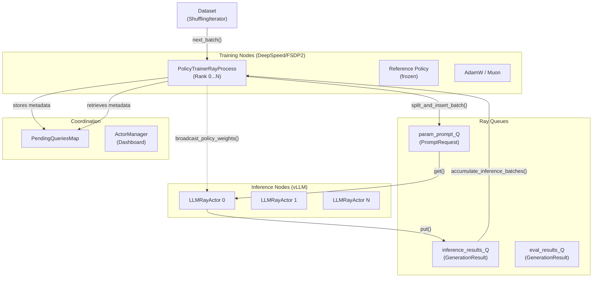
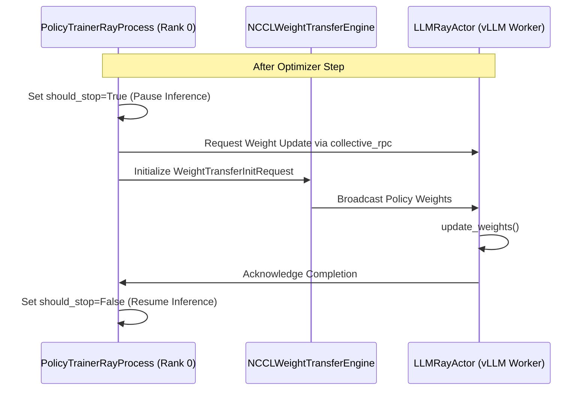

<!-- source: DeepWiki mcp.deepwiki.com · repo allenai/open-instruct · extra page GRPO Implementation · fetched 2026-10-26 -->

# GRPO Implementation

Relevant source files

The following files were used as context for generating this wiki page:

- [.gitignore](.gitignore)
- [CHANGELOG.md](CHANGELOG.md)
- [open_instruct/benchmark_generators.py](open_instruct/benchmark_generators.py)
- [open_instruct/data_loader.py](open_instruct/data_loader.py)
- [open_instruct/data_types.py](open_instruct/data_types.py)
- [open_instruct/dpo.py](open_instruct/dpo.py)
- [open_instruct/dpo_utils.py](open_instruct/dpo_utils.py)
- [open_instruct/grpo.py](open_instruct/grpo.py)
- [open_instruct/grpo_callbacks.py](open_instruct/grpo_callbacks.py)
- [open_instruct/grpo_fast.py](open_instruct/grpo_fast.py)
- [open_instruct/grpo_fast_resource_plan.py](open_instruct/grpo_fast_resource_plan.py)
- [open_instruct/grpo_olmo_core_actor.py](open_instruct/grpo_olmo_core_actor.py)
- [open_instruct/grpo_utils.py](open_instruct/grpo_utils.py)
- [open_instruct/olmo_core_train_modules.py](open_instruct/olmo_core_train_modules.py)
- [open_instruct/olmo_core_utils.py](open_instruct/olmo_core_utils.py)
- [open_instruct/test_grpo_fast.py](open_instruct/test_grpo_fast.py)
- [open_instruct/test_grpo_fast_resource_plan.py](open_instruct/test_grpo_fast_resource_plan.py)
- [open_instruct/test_olmo_core_train_modules.py](open_instruct/test_olmo_core_train_modules.py)
- [open_instruct/test_vllm_utils.py](open_instruct/test_vllm_utils.py)
- [open_instruct/test_vllm_utils_gpu.py](open_instruct/test_vllm_utils_gpu.py)
- [open_instruct/vllm_utils.py](open_instruct/vllm_utils.py)
- [scripts/train/debug/envs/wordle_8gpu.sh](scripts/train/debug/envs/wordle_8gpu.sh)
- [scripts/train/debug/envs/wordle_sandbox_lm_8gpu.sh](scripts/train/debug/envs/wordle_sandbox_lm_8gpu.sh)
- [scripts/train/debug/grpo.sh](scripts/train/debug/grpo.sh)
- [scripts/train/debug/grpo_fast.sh](scripts/train/debug/grpo_fast.sh)
- [scripts/train/debug/large_test_script.sh](scripts/train/debug/large_test_script.sh)
- [scripts/train/debug/multi_node_grpo.sh](scripts/train/debug/multi_node_grpo.sh)
- [scripts/train/debug/qwen35_4b_dapo_math.sh](scripts/train/debug/qwen35_4b_dapo_math.sh)
- [scripts/train/debug/single_gpu_on_beaker.sh](scripts/train/debug/single_gpu_on_beaker.sh)
- [scripts/train/qwen/qwen3_4b_dapo_math_32k.sh](scripts/train/qwen/qwen3_4b_dapo_math_32k.sh)
- [scripts/train/qwen/qwen3_4b_dapo_math_oc.sh](scripts/train/qwen/qwen3_4b_dapo_math_oc.sh)

## Purpose and Scope

This page provides a technical deep dive into the GRPO (Group Relative Policy Optimization) implementation in `grpo_fast.py`. GRPO is a variant of REINFORCE that optimizes policies by comparing multiple samples from the same prompt, making it particularly effective for tasks with verifiable rewards like math and coding.

This document covers:
- Queue-based architecture for decoupling generation from training.
- Ray distributed training with `PolicyTrainerRayProcess`.
- vLLM integration for fast inference and tool execution.
- Weight synchronization between training and inference engines.
- Inflight updates for pausing/resuming generation.
- Resource planning and allocation via `grpo_fast_resource_plan.py`.
- The OLMo-core GRPO variant (`grpo_olmo_core_actor.py`) with FSDP2 support.

**Sources:** [open_instruct/grpo_fast.py:1-48](), [open_instruct/grpo_olmo_core_actor.py:1-20]()

## Architecture Overview

GRPO uses a queue-based architecture to decouple policy training from response generation. This design enables asynchronous training where generation can run ahead of training by `async_steps`.

### System Component Diagram

**Key Design Decisions:**

1.  **Individual Prompt Batching**: Each prompt is sent as a separate `PromptRequest` [open_instruct/data_types.py:100-112]() rather than batching prompts. This allows vLLM to handle variable-length sequences efficiently.
2.  **Dataset Index Tracking**: Each prompt retains its original dataset index via `PendingQueriesMap` [open_instruct/grpo_fast.py:583-611](), enabling correct reassembly even when processed out-of-order.
3.  **Inflight Updates**: Supports immediate pausing of generation for weight synchronization via `inflight_updates` flag [open_instruct/grpo_fast.py:253]().
4.  **Weight Transfer**: Migrated to vLLM 0.16.0's native `NCCLWeightTransferEngine` for trainer-to-vLLM weight sync [CHANGELOG.md:36]().

**Sources:** [open_instruct/grpo_fast.py:613-787](), [open_instruct/data_types.py:100-112](), [open_instruct/vllm_utils.py:468-505](), [CHANGELOG.md:36]()

## Configuration: ExperimentConfig

The `GRPOExperimentConfig` dataclass in `grpo_utils.py` defines the hyperparameters and algorithmic switches.

| Parameter | Type | Default | Description |
| :--- | :--- | :--- | :--- |
| `beta` | `float` | 0.05 | KL coefficient for regularization [open_instruct/grpo_utils.py:104](). |
| `clip_higher` | `float` | 0.272 | Upper clip range [open_instruct/grpo_utils.py:108](). |
| `use_rho_correction` | `bool` | `True` | Master switch for the train/infer ratio $\rho$ correction [open_instruct/grpo_utils.py:110](). |
| `rho_mask_tv_divergence`| `bool` | `False` | Applies TV divergence masking from VACO [open_instruct/grpo_utils.py:129](). |
| `loss_fn` | `GRPOLossType` | `dapo` | Choice between `dapo` or `cispo` [open_instruct/grpo_utils.py:150](). |
| `alpha` | `float` | 0.6 | Polyak update value for reference policy updates [open_instruct/grpo_utils.py:141](). |

**Sources:** [open_instruct/grpo_utils.py:75-156](), [CHANGELOG.md:8](), [CHANGELOG.md:20]()

## Core Components

### PolicyTrainerRayProcess

`PolicyTrainerRayProcess` is a Ray actor running on training GPUs. It manages the trainable policy and the reference policy.

*   **Initialization**: Loads models and prepares DeepSpeed configurations [open_instruct/grpo_fast.py:139-178]().
*   **Token Counting**: Aggregates prompt/response lengths across all DP ranks, deduplicating SP groups for accurate utilization metrics [CHANGELOG.md:25]().
*   **Loss Computation**: Returns the final policy loss and clip fraction directly from `compute_grpo_loss` [CHANGELOG.md:10]().
*   **Weight Sync**: Orchestrates weight broadcasting to vLLM workers using the `NCCLWeightTransferEngine` [open_instruct/grpo_fast.py:80-81]().

**Sources:** [open_instruct/grpo_fast.py:139-178](), [CHANGELOG.md:10](), [CHANGELOG.md:25](), [CHANGELOG.md:36]()

### vLLM Integration (`LLMRayActor`)

The `LLMRayActor` in `vllm_utils.py` wraps the vLLM engine to handle generation and tool calls.

*   **Async Processing**: Uses `process_request_async` to handle multi-turn tool interactions [open_instruct/vllm_utils.py:507-550]().
*   **Weight Transfer**: Uses `NCCLWeightTransferEngine` or `IPCWeightTransferEngine` for receiving policy updates from the trainer [open_instruct/vllm_utils.py:45-48]().
*   **Model Dims**: Extracts model architecture metadata via `model_dims_from_vllm_config` [open_instruct/vllm_utils.py:100-123]().

**Sources:** [open_instruct/vllm_utils.py:100-123](), [open_instruct/vllm_utils.py:507-550](), [CHANGELOG.md:36]()

## Resource Planning

The `grpo_fast_resource_plan.py` module handles the complex logic of allocating Ray resources (CPUs, GPUs, and memory) for the various actors.

*   **Planning Logic**: Calculates the number of trainer actors, vLLM actors, and data preparation actors based on the cluster resource snapshot [open_instruct/grpo_fast_resource_plan.py:1-50]().
*   **Resource Tracking**: Monitors Ray cluster and available resources to ensure the experiment fits within the allocation [open_instruct/grpo_fast.py:175-187]().

**Sources:** [open_instruct/grpo_fast_resource_plan.py:1-50](), [open_instruct/grpo_fast.py:175-187]()

## Weight Synchronization

Weight synchronization ensures the inference engine generates samples using the most recent policy parameters.

**Sources:** [open_instruct/grpo_fast.py:1100-1150](), [open_instruct/vllm_utils.py:666-693](), [CHANGELOG.md:36]()

## OLMo-core GRPO Actor

The `PolicyTrainerOLMoCoreProcess` in `grpo_olmo_core_actor.py` provides an alternative training path using OLMo-core and FSDP2.

*   **Feature Parity**: Brought to parity with `grpo_fast.py`, including `EvalCallback`, `ConstantWithWarmup` scheduler, and `StepTimingCallback` [CHANGELOG.md:11]().
*   **Checkpointing**: Wired with `CheckpointerCallback` and `DataPreparationActorCheckpointCallback` for resumable Beaker jobs [CHANGELOG.md:17]().
*   **FSDP2 Integration**: Uses `GRPOTrainModule` which inherits from `TransformerTrainModule` for native OLMo-core training [open_instruct/olmo_core_train_modules.py:103-157]().

**Sources:** [open_instruct/grpo_olmo_core_actor.py:48-161](), [open_instruct/olmo_core_train_modules.py:103-157](), [CHANGELOG.md:11](), [CHANGELOG.md:17]()

## Data Flow and Queues

The system relies on several queues and data structures to manage the flow of prompts and results.

| Entity | Role | Location |
| :--- | :--- | :--- |
| `param_prompt_Q` | Holds `PromptRequest` objects for vLLM workers. | [open_instruct/grpo_fast.py:75]() |
| `inference_results_Q` | Holds `GenerationResult` objects for the trainer. | [open_instruct/grpo_fast.py:75]() |
| `PendingQueriesMap` | Thread-safe map for prompt metadata (ground truth, raw query). | [open_instruct/grpo_fast.py:583]() |
| `DataPreparationActor` | Resamples on filtered batches to unify consumer paths and prevent empty batches. | [CHANGELOG.md:21]() |

**Sources:** [open_instruct/grpo_fast.py:75-611](), [CHANGELOG.md:21]()

## Loss Computation and Metrics

GRPO computes advantages relative to the group mean of rewards.

1.  **Reward Computation**: Verifiable rewards are applied based on the `apply_verifiable_reward` flag [open_instruct/grpo_fast.py:270]().
2.  **Advantage Normalization**: Advantages are normalized within the sample group [open_instruct/grpo_utils.py:34-66]().
3.  **Rho Correction**: Implements a unified interface for clamping and masking $\rho$ to handle train/infer engine mismatch [CHANGELOG.md:20]().
4.  **Logging**: Per-Group generation timing (`time/group_generation_mean`) and filtered prompt statistics (`batch/filtered_prompts_pct`) are logged to wandb [CHANGELOG.md:15](), [CHANGELOG.md:24]().

**Sources:** [open_instruct/grpo_utils.py:34-66](), [CHANGELOG.md:15](), [CHANGELOG.md:20](), [CHANGELOG.md:24]()

---

