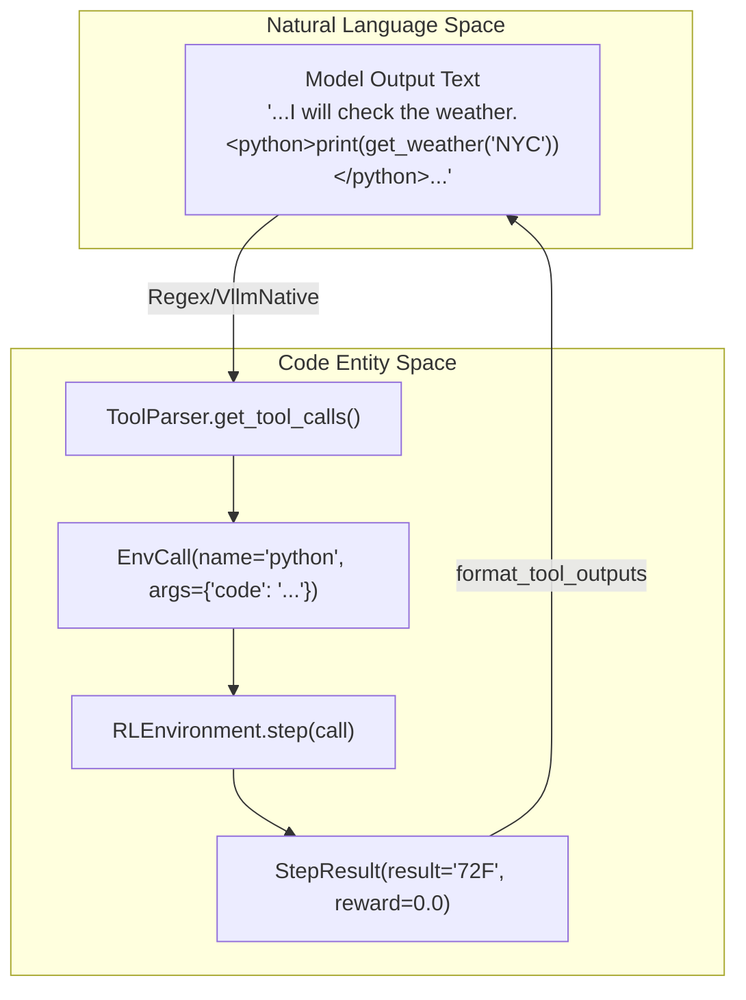
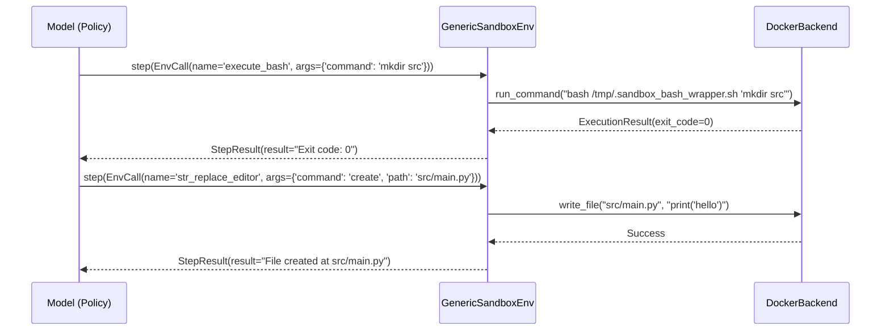

<!-- source: DeepWiki mcp.deepwiki.com · repo allenai/open-instruct · extra page Tool-Augmented Training · fetched 2026-10-26 -->

# Tool-Augmented Training

Relevant source files

The following files were used as context for generating this wiki page:

- [docs/algorithms/grpo/wordle_curves.png](docs/algorithms/grpo/wordle_curves.png)
- [docs/algorithms/tool_training.md](docs/algorithms/tool_training.md)
- [open_instruct/environments/__init__.py](open_instruct/environments/__init__.py)
- [open_instruct/environments/base.py](open_instruct/environments/base.py)
- [open_instruct/environments/examples.py](open_instruct/environments/examples.py)
- [open_instruct/environments/pool.py](open_instruct/environments/pool.py)
- [open_instruct/environments/tools/parsers.py](open_instruct/environments/tools/parsers.py)
- [open_instruct/environments/tools/tests/test_parsers.py](open_instruct/environments/tools/tests/test_parsers.py)
- [open_instruct/environments/tools/tools.py](open_instruct/environments/tools/tools.py)
- [open_instruct/environments/tools/utils.py](open_instruct/environments/tools/utils.py)
- [scripts/data/create_test_env_datasets.py](scripts/data/create_test_env_datasets.py)
- [scripts/train/debug/envs/guess_number_1gpu.sh](scripts/train/debug/envs/guess_number_1gpu.sh)
- [scripts/train/debug/envs/guess_number_beaker.sh](scripts/train/debug/envs/guess_number_beaker.sh)
- [scripts/train/debug/envs/sandbox_lm_8gpu.sh](scripts/train/debug/envs/sandbox_lm_8gpu.sh)
- [scripts/train/debug/tools/dr_tulu_parser_debug.sh](scripts/train/debug/tools/dr_tulu_parser_debug.sh)
- [scripts/train/debug/tools/legacy_parser_debug.sh](scripts/train/debug/tools/legacy_parser_debug.sh)
- [scripts/train/debug/tools/mcp_weather_debug.sh](scripts/train/debug/tools/mcp_weather_debug.sh)
- [scripts/train/debug/tools/olmo_3_parser_multigpu.sh](scripts/train/debug/tools/olmo_3_parser_multigpu.sh)
- [scripts/train/debug/tools/qwen3_vllm_hermes_parser_debug.sh](scripts/train/debug/tools/qwen3_vllm_hermes_parser_debug.sh)
- [scripts/train/debug/tools/tool_regression_beaker.sh](scripts/train/debug/tools/tool_regression_beaker.sh)
- [scripts/train/dr-tulu/dr_tulu_adjusted.txt](scripts/train/dr-tulu/dr_tulu_adjusted.txt)
- [scripts/train/dr-tulu/dr_tulu_qwen35.sh](scripts/train/dr-tulu/dr_tulu_qwen35.sh)
- [tests/test_generic_sandbox.py](tests/test_generic_sandbox.py)

## Purpose and Scope

Tool-augmented training enables language models to interact with external systems—such as Python interpreters, search engines, or specialized RL environments—during the reinforcement learning (GRPO) rollout phase. The framework supports both stateless tools (e.g., a search API) and stateful environments (e.g., a Wordle game or a Docker sandbox). This integration allows models to learn complex reasoning paths where intermediate steps are verified or augmented by external data.

---

## RL Environments Framework

The core of tool integration lies in the `open_instruct.environments` module, which provides a unified interface for different interaction paradigms.

### Environment Types

| Class | Description | Usage |
|-------|-------------|-------|
| `Tool` | A stateless environment that performs a single action. | Python execution, web search, API calls. [open_instruct/environments/tools/utils.py:17-18]() |
| `RLEnvironment` | Abstract base class for stateful interactions requiring `reset` and `step`. | Games (Wordle, GuessNumber), Sandboxes. [open_instruct/environments/base.py:43-49]() |
| `TextRLEnvironment` | A stateful environment that receives the model's raw text instead of parsed arguments. | Simulated users, chat-based games. [open_instruct/environments/base.py:85-98]() |

**Sources:** [open_instruct/environments/base.py:43-121](), [open_instruct/environments/tools/utils.py:17-18]()

### Environment Configuration (`EnvsConfig`)

Tool and environment settings are managed via the `EnvsConfig` dataclass, which maps command-line arguments to internal environment instances.

| Parameter | Code Entity | Description |
|-----------|-------------|-------------|
| `--tools` | `self.tools` | List of environment/tool names (e.g., `python`, `jina_browse`). [open_instruct/environments/tools/utils.py:38-39]() |
| `--tool_call_names` | `self.tool_call_names` | The XML tag names the model uses (e.g., `<code>`, `<search>`). [open_instruct/environments/tools/utils.py:41-43]() |
| `--tool_configs` | `self.tool_configs` | JSON strings for per-tool settings (API keys, endpoints). [open_instruct/environments/tools/utils.py:45-46]() |
| `--max_steps` | `self.max_steps` | Maximum interaction turns per rollout (default: 5). [open_instruct/environments/tools/utils.py:51-52]() |
| `--tool_parser_type` | `self.tool_parser_type` | Parser strategy (e.g., `legacy`, `vllm_hermes`). [open_instruct/environments/tools/utils.py:48-49]() |

**Sources:** [open_instruct/environments/tools/utils.py:35-108]()

---

## Tool Parsers

Parsers are responsible for extracting `EnvCall` objects from model-generated text and formatting tool outputs back into the conversation.

### Parser Implementations

1.  **`OpenInstructLegacyToolParser`**: Uses regex to find `<tool_name>content</tool_name>` tags. It maps the content to the first required parameter of the tool definition. [open_instruct/environments/tools/parsers.py:64-125]()
2.  **`VllmToolParser`**: Wraps vLLM's native parsers (Hermes, Llama3, Qwen) to support standard JSON-based function calling. [open_instruct/environments/tools/parsers.py:127-182]()
3.  **`DRTuluToolParser`**: Specifically designed for the `<call_tool name="...">query</call_tool>` format. [open_instruct/environments/tools/parsers.py:8-9]()

**Sources:** [open_instruct/environments/tools/parsers.py:31-182](), [open_instruct/environments/base.py:13-26]()

---

## Supported Tool APIs

### Code Execution API
The `PythonCodeTool` executes code by sending a POST request to a FastAPI endpoint. It returns the combined standard output and error. [open_instruct/environments/tools/tools.py:42-93]()
- **Config**: `PythonCodeToolConfig` [open_instruct/environments/tools/tools.py:95-105]()
- **Default Timeout**: 3 seconds.

**Sources:** [open_instruct/environments/tools/tools.py:42-106]()

### Search and Browsing APIs
- **`JinaBrowseTool`**: Uses the Jina Reader API to convert URLs into clean markdown. [open_instruct/environments/tools/tools.py:107-184]()
- **`S2SearchTool`**: Queries Semantic Scholar for academic papers. [open_instruct/environments/tools/tools.py:197-202]()
- **`DrAgent` Integration**: Supports `google_search`, `massive_serve`, and `crawl4ai` through the `dr_agent` package. [open_instruct/environments/tools/tools.py:22-40]()

**Sources:** [open_instruct/environments/tools/tools.py:107-184](), [open_instruct/environments/tools/tools.py:22-40]()

### MCP (Model Context Protocol) Integration
The `GenericMCPTool` allows the model to interact with any MCP-compliant server. This enables a standardized way to plug in local or remote tools without writing custom environment wrappers.

**Sources:** [open_instruct/environments/tools/tools.py:16-17](), [docs/algorithms/tool_training.md:19-23]()

---

## Sandbox Environments

For complex, stateful tasks, the `GenericSandboxEnv` provides a persistent environment using either `DockerBackend` or `SandboxBackend`. [open_instruct/environments/generic_sandbox.py:5-21]()

### Tools Provided:
1.  **`execute_bash`**: A stateful bash shell where environment variables and the current working directory persist across tool calls.
2.  **`str_replace_editor`**: A file manipulation tool supporting `view`, `create`, `str_replace`, and `insert` commands.

**Sources:** [open_instruct/environments/generic_sandbox.py:5-21](), [open_instruct/environments/backends.py:3-19]()

---

## Training and Data Flow

### Multi-turn Rollouts
During GRPO rollouts, the system enters a loop:
1.  **Generate**: The model generates a turn.
2.  **Parse**: `ToolParser` checks for tool calls.
3.  **Execute**: The `EnvironmentPool` dispatches the call to a worker actor. [open_instruct/environments/pool.py:6-15]()
4.  **Feedback**: `StepResult.result` is formatted and appended to the conversation history. [docs/algorithms/tool_training.md:49-50]()
5.  **Repeat**: Continues until `max_steps` is reached or the environment returns `done=True`. [docs/algorithms/tool_training.md:50]()

**Sources:** [docs/algorithms/tool_training.md:41-54](), [open_instruct/environments/pool.py:6-15]()

### Tool Output Masking
To prevent the model from learning to predict the deterministic outputs of tools (like bash results or search snippets), these tokens are masked during loss calculation.
- **Model tokens**: Mask set to `1` (Loss applied).
- **Tool tokens**: Mask set to `0` (Loss ignored).

This is enforced in `vllm_utils.py` by tracking token origins during the generation loop and passed to the trainer as a `masks` tensor.

**Sources:** [open_instruct/vllm_utils.py:148-151](), [open_instruct/vllm_utils.py:186-190](), [open_instruct/grpo_fast.py:523-529]()

### Reward Aggregation
Per-step rewards from the environment (e.g., a penalty for a failed bash command or a reward for a correct Wordle guess) are combined using the `--reward_aggregator`.
- **`sum`**: Adds all intermediate rewards to the final verifier reward.
- **`last`**: Only uses the reward from the final interaction step.

**Sources:** [docs/algorithms/tool_training.md:39-40](), [open_instruct/environments/base.py:21-26]()

---

