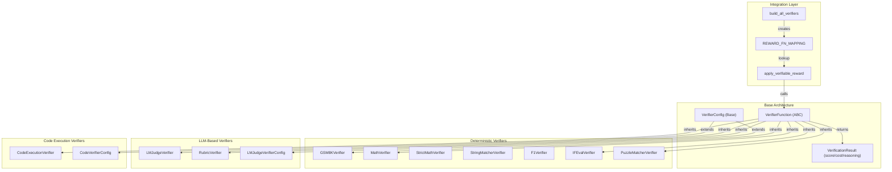
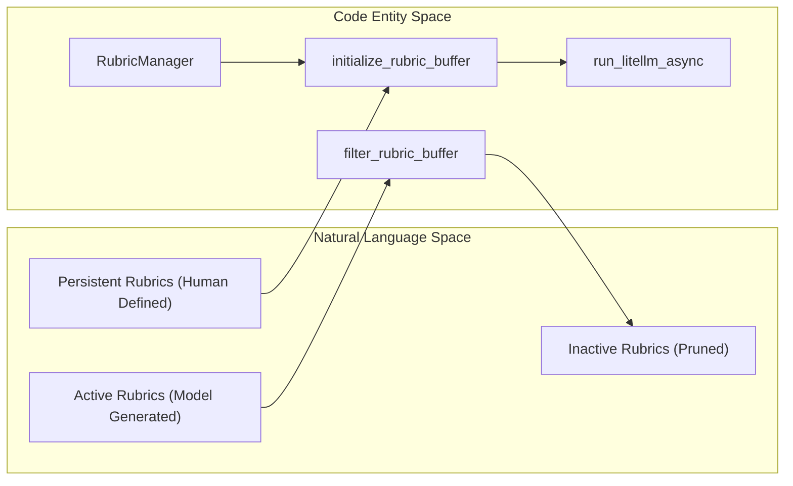

<!-- source: DeepWiki mcp.deepwiki.com · repo allenai/open-instruct · extra page Verifiable Rewards and Ground Truth · fetched 2026-10-26 -->

# Verifiable Rewards and Ground Truth

<details>
<summary>Relevant source files</summary>

The following files were used as context for generating this wiki page:

- [open_instruct/context_window_checker.py](open_instruct/context_window_checker.py)
- [open_instruct/environments/generic_sandbox.py](open_instruct/environments/generic_sandbox.py)
- [open_instruct/environments/tools/servers/python_server/tool_server.py](open_instruct/environments/tools/servers/python_server/tool_server.py)
- [open_instruct/ground_truth_utils.py](open_instruct/ground_truth_utils.py)
- [open_instruct/if_functions.py](open_instruct/if_functions.py)
- [open_instruct/judge_utils.py](open_instruct/judge_utils.py)
- [open_instruct/math_utils.py](open_instruct/math_utils.py)
- [open_instruct/olmo_adapter/__init__.py](open_instruct/olmo_adapter/__init__.py)
- [open_instruct/rejection_sampling/synthetic_preference_dataset.py](open_instruct/rejection_sampling/synthetic_preference_dataset.py)
- [open_instruct/reward_modeling_eval.py](open_instruct/reward_modeling_eval.py)
- [open_instruct/rubrics/__init__.py](open_instruct/rubrics/__init__.py)
- [open_instruct/rubrics/evolving_rubric_step.py](open_instruct/rubrics/evolving_rubric_step.py)
- [open_instruct/rubrics/metrics.py](open_instruct/rubrics/metrics.py)
- [open_instruct/rubrics/prompts.py](open_instruct/rubrics/prompts.py)
- [open_instruct/rubrics/rubric_utils.py](open_instruct/rubrics/rubric_utils.py)
- [open_instruct/rubrics/run_utils.py](open_instruct/rubrics/run_utils.py)
- [open_instruct/rubrics/test_rubrics.py](open_instruct/rubrics/test_rubrics.py)
- [open_instruct/test_ground_truth_utils.py](open_instruct/test_ground_truth_utils.py)
- [open_instruct/test_if_functions.py](open_instruct/test_if_functions.py)
- [open_instruct/test_math_utils.py](open_instruct/test_math_utils.py)
- [scripts/train/debug/evolving_rubric_mini_test.sh](scripts/train/debug/evolving_rubric_mini_test.sh)
- [scripts/train/debug/judge.sh](scripts/train/debug/judge.sh)

</details>


## Purpose and Scope

This document describes the **verifiable reward system** used in reinforcement learning training (specifically GRPO, as PPO scripts have been removed) to provide automated, objective feedback signals for model outputs. Verifiable rewards enable training on tasks with programmatically checkable correctness, such as math problems, code generation, instruction following, and criteria-based evaluation.

The system is primarily implemented in [open_instruct/ground_truth_utils.py:1-1150](), with integration into the RL training loop via [open_instruct/model_utils.py:261-342]() and specialized rubric logic in the `open_instruct/rubrics/` directory.

## System Architecture

The verifiable reward system follows a plugin-based architecture where different verifier types inherit from a common base class and are automatically registered for use during training.

### Core Components Diagram


**Sources:** [open_instruct/ground_truth_utils.py:108-152](), [open_instruct/ground_truth_utils.py:53-101](), [open_instruct/model_utils.py:261-342]()

### VerifierFunction Base Class

All verifiers implement the `VerifierFunction` abstract base class, which defines the contract for evaluation functions.

```python
class VerifierFunction(ABC):
    def __init__(self, name: str, weight: float = 1.0, verifier_config: VerifierConfig | None = None)
    
    @abstractmethod
    def __call__(self, tokenized_prediction: list[int], prediction: str, label: Any, query: str | None = None, rollout_state: dict | None = None) -> VerificationResult
    
    async def async_call(self, tokenized_prediction: list[int], prediction: str, label: Any, query: str | None = None, rollout_state: dict | None = None) -> VerificationResult
```

Key features:
- **Synchronous `__call__`**: Main evaluation method, must be implemented by subclasses. [open_instruct/ground_truth_utils.py:131-152]()
- **Asynchronous `async_call`**: Default implementation runs `__call__` in a thread pool to avoid blocking the event loop. [open_instruct/ground_truth_utils.py:154-180]()
- **Rollout State**: Supports passing state from environments for tool-augmented verifiers. [open_instruct/ground_truth_utils.py:148-149]()

**Sources:** [open_instruct/ground_truth_utils.py:108-181]()

## Deterministic Verifiers

Deterministic verifiers use rule-based or programmatic checks to evaluate correctness. They execute locally with no external API costs.

### Math Verifiers

#### GSM8KVerifier
Designed for grade-school math. Extracts the last number from the prediction and compares it to the label. It handles signed numbers, decimals, and normalized whitespace. [open_instruct/ground_truth_utils.py:199-242]()

#### MathVerifier
For competition-level math problems. It uses multiple extraction strategies:
1. **Boxed extraction**: Finds `\boxed{answer}` using `last_boxed_only_string`. [open_instruct/math_utils.py:13-37]()
2. **Minerva normalization**: Uses `normalize_final_answer` to strip units, LaTeX formatting, and shorthand TeX. [open_instruct/math_utils.py:123-158]()
3. **Equivalence checking**: Uses `sympy` to check if two LaTeX expressions are mathematically identical. [open_instruct/math_utils.py:177-209]()

**Sources:** [open_instruct/ground_truth_utils.py:245-296](), [open_instruct/math_utils.py:1-209]()

### String and Text Verifiers

| Verifier | Extraction/Logic | Key Function |
|----------|-------------------|--------------|
| `StringMatcherVerifier` | Extracts text between `<answer>` tags. | `extract_final_answer` [open_instruct/utils.py]() |
| `F1Verifier` | Token-level overlap (Precision/Recall). | `F1Verifier.__call__` [open_instruct/ground_truth_utils.py:488-513]() |
| `PuzzleMatcherVerifier` | Removes thinking tags, normalizes whitespace/punctuation, and removes articles. | `PuzzleMatcherVerifier.__call__` [open_instruct/ground_truth_utils.py:516-532]() |
| `IFEvalVerifier` | Checks 25 instruction-following constraints (e.g., word count, keywords). | `IF_FUNCTIONS_MAP` [open_instruct/if_functions.py:1-220]() |

**Sources:** [open_instruct/ground_truth_utils.py:415-532](), [open_instruct/if_functions.py:1-220]()

## LLM-Based Verifiers

LLM judges use models (e.g., GPT-4o) to evaluate open-ended responses where programmatic checking is insufficient.

### LMJudgeVerifier
Uses the `LiteLLM` library to call external APIs. It maps task types (factuality, creative writing, etc.) to specific prompt templates defined in `judge_utils.py`. [open_instruct/ground_truth_utils.py:699-813]()

**Context Window Management:**
Before calling the API, the system checks the token count of the prompt against the model's limit using `context_window_checker`. If the prompt is too long, it truncates the user message while preserving system instructions. [open_instruct/context_window_checker.py:75-127]()

### Evolving Rubrics System
The `RubricVerifier` implements a more sophisticated "evolving" reward system. Instead of static labels, it can use rubrics generated dynamically or stored in a buffer. [open_instruct/ground_truth_utils.py:1012-1046]()

**Rubric Data Flow:**

**Sources:** [open_instruct/rubrics/rubric_utils.py](), [open_instruct/rubrics/metrics.py:79-149](), [open_instruct/rubrics/run_utils.py:122-178]()

**Rubric Filtering:**
To prevent reward hacking, the system prunes the rubric buffer by deactivating "zero-variance" rubrics (those that give the same score to all responses in a group) and capping the number of active rubrics per query. [open_instruct/rubrics/metrics.py:85-144]()

## Code Execution Verifiers

### CodeExecutionVerifier
Evaluates code by sending it to a sandboxed execution API. It parses the model's output to find code blocks and runs them against provided test cases. [open_instruct/ground_truth_utils.py:916-1009]()

**Reward Calculation:**
- **Pass Rate**: `passed_tests / total_tests`. [open_instruct/ground_truth_utils.py:968-969]()
- **Threshold**: Only provides reward if the pass rate exceeds `code_pass_rate_reward_threshold`. [open_instruct/ground_truth_utils.py:972-973]()
- **Performance Penalty**: Optionally reduces reward if the code execution is slow via `code_apply_perf_penalty`. [open_instruct/ground_truth_utils.py:976-981]()

**Sources:** [open_instruct/ground_truth_utils.py:916-1009](), [open_instruct/ground_truth_utils.py:89-94]()

## Integration with Training

### apply_verifiable_reward
This function is called during the RL rollout phase. It orchestrates the parallel execution of verifiers across a batch of responses. [open_instruct/model_utils.py:261-342]()

**Execution Logic:**
1. **Mapping**: Identifies the correct `VerifierFunction` for each sample based on the dataset name or a remap dictionary. [open_instruct/model_utils.py:277-285]()
2. **Async Gathering**: Creates a list of `async_call` tasks for the entire batch and executes them using `asyncio.gather`. [open_instruct/model_utils.py:302-315]()
3. **Aggregation**: Sums the weighted scores from multiple verifiers if an instance has more than one reward signal. [open_instruct/model_utils.py:317-328]()

**Sources:** [open_instruct/model_utils.py:261-342](), [open_instruct/grpo_fast.py:72-117]()

### Configuration via CLI
Training scripts configure these rewards using flags like `--apply_verifiable_reward true` and `--remap_verifier`.

```bash
uv run python open_instruct/grpo_fast.py \
    --apply_verifiable_reward true \
    --remap_verifier general_rubric=rubric \
    --apply_evolving_rubric_reward true
```
**Sources:** [scripts/train/debug/evolving_rubric_mini_test.sh:72-117](), [open_instruct/ground_truth_utils.py:1075-1137]()

---

