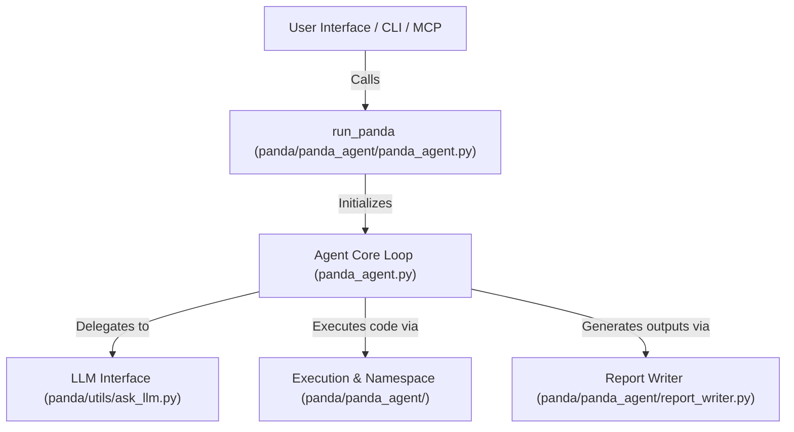

<!-- source: DeepWiki mcp.deepwiki.com · repo allenai/panda · page 1 Overview · fetched 2026-11-09 -->

# Overview

Relevant source files

The following files were used as context for generating this wiki page:

- [README.md](README.md)
- [panda/__init__.py](panda/__init__.py)
- [panda/panda_agent/__init__.py](panda/panda_agent/__init__.py)
- [panda/utils/file_utils.py](panda/utils/file_utils.py)
- [setup.py](setup.py)

Panda is an autonomous scientific research agent that implements an outer loop of planning and a dynamic inner loop that iterates through action and reflection over each step of the research plan [README.md:1-5]. It combines large language model (LLM) reasoning with an execution environment capable of running Python code, analyzing data, and synthesizing scientific reports.

The codebase is packaged as `panda` [setup.py:4-6] and provides multiple integration surfaces including a command-line interface [setup.py:25-29], a programmatic Python API [panda/__init__.py:4-9], and a Model Context Protocol (MCP) server interface [README.md:110-112].

*Sources: [setup.py:25-29](), [README.md:1-112](), [panda/__init__.py:4-9]()*

---

## Getting Started & Installation

Panda can be installed locally via `pip` or managed globally using `uv` [README.md:25-37]. It requires setting appropriate API keys for the underlying LLMs (such as Anthropic, OpenAI, or Together AI) depending on the active configuration [README.md:13-16]. 

For detailed instructions on environment setup, dependencies defined in `setup.py`, and executing your first research task, see [Getting Started & Installation](#1.1).

*Sources: [setup.py:1-30](), [README.md:9-131]()*

---

## Package Structure & Public API

The `panda` package exposes a clean public API through its top-level initialization files (`panda/__init__.py` and `panda/panda_agent/__init__.py`) [panda/__init__.py:1-11, panda/panda_agent/__init__.py:1-7]. Consumers can import core agent functions like `run_panda`, utility functions like `call_llm` and `read_file_contents`, and report-generation routines directly from the package [panda/__init__.py:4-9, panda/panda_agent/__init__.py:2-6].

For a comprehensive catalog of re-exported symbols, modules, and import guidelines, see [Package Structure & Public API](#1.2).

*Sources: [panda/__init__.py:1-11](), [panda/panda_agent/__init__.py:1-6]() *

---

