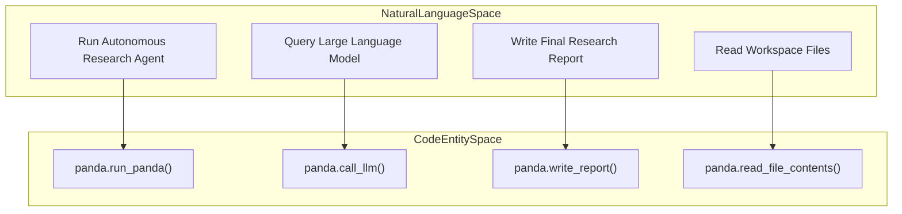
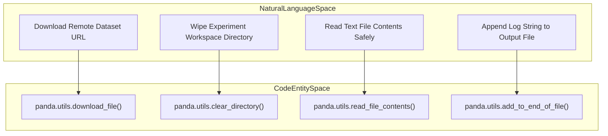

<!-- source: DeepWiki mcp.deepwiki.com · repo allenai/panda · page 1.2 Package Structure & Public API · fetched 2026-11-09 -->

# Package Structure & Public API

Relevant source files

The following files were used as context for generating this wiki page:

- [panda/__init__.py](panda/__init__.py)
- [panda/panda_agent/__init__.py](panda/panda_agent/__init__.py)
- [panda/utils/__init__.py](panda/utils/__init__.py)
- [panda/utils/file_utils.py](panda/utils/file_utils.py)

## Purpose and Scope
This page details the public API surface and internal modular organization of the `panda` codebase. It outlines what consumers and dependent modules can import directly from the package roots (`panda/__init__.py` [panda/__init__.py:1-18] and `panda_agent/__init__.py` [panda/panda_agent/__init__.py:1-7]), and documents the utility subsystems exposed via `panda/utils/__init__.py` [panda/utils/__init__.py:1-24].

---

## 1. Root Public API (`panda/__init__.py`)

The top-level package namespace acts as the primary entry point for consumers embedding Panda as a library. By importing from `panda`, developers gain direct access to core agent execution loops, debugging utilities, and fundamental LLM interfaces without needing to dig into internal submodules.

### Core Re-Exports
The root `__init__.py` performs relative imports from `.panda_agent` and `.utils` to expose the following public symbols:
*   `run_panda`: Main agent execution loop entry point [panda/__init__.py:4-4].
*   `restart`: Resets or resumes agent state [panda/__init__.py:4-4].
*   `py`: Python code execution helper [panda/__init__.py:4-4].
*   `test_panda`: Test suite runner for agent sanity checks [panda/__init__.py:4-4].
*   `write_report`: Generates final markdown/HTML reports [panda/__init__.py:4-4].
*   `build_system_prompt`: Constructs prompt structures for the LLM [panda/__init__.py:4-4].
*   `call_llm`, `call_llm_json`: LLM querying utilities [panda/__init__.py:9-9].
*   `jprint`: Pretty-printing utility for JSON structures [panda/__init__.py:9-9].
*   `read_file_contents`: File reading helper [panda/__init__.py:9-9].

### Diagram: Natural Language to Code Entity Space (Root API)

*Sources: [panda/__init__.py:1-17]()*

---

## 2. Agent Subpackage API (`panda_agent/__init__.py`)

The `panda_agent` subpackage isolates agent-specific orchestration logic, distinguishing it from general utilities. Its initializer module exposes routines required to drive the research loop and persist outputs.

### Exposed Symbols
*   `run_panda`: Initiates the plan-act-reflect cycle [panda/panda_agent/__init__.py:2-2].
*   `py`: Evaluates generated snippets [panda/panda_agent/__init__.py:2-2].
*   `restart`: State reset mechanism [panda/panda_agent/__init__.py:2-2].
*   `test_panda`: Verification helper [panda/panda_agent/__init__.py:2-2].
*   `build_system_prompt`: System prompt assembler [panda/panda_agent/__init__.py:2-2].
*   `write_report`: Compiles experiment outcomes into artifacts [panda/panda_agent/__init__.py:6-6].
*   `save_dialog`: Persists conversation/dialogue states [panda/panda_agent/__init__.py:6-6].
*   `get_dataframes`: Extracts tabular artifacts from execution context [panda/panda_agent/__init__.py:6-6].

*Sources: [panda/panda_agent/__init__.py:1-6]()*

---

## 3. Utilities Subpackage API (`panda/utils/__init__.py`)

The `panda/utils` package groups auxiliary libraries covering file I/O, string manipulation, LLM interaction wrappers, code parsing, and dataframe mapping.

### Subsystem Modules & Exports

| Submodule | Key Functions / Classes | Description |
| :--- | :--- | :--- |
| `file_utils.py` | `read_file_contents`, `file_exists`, `delete_file`, `download_file`, `copy_file`, `clear_directory`, `add_to_end_of_file` | Workspace file management, remote downloads, and cleanups [panda/utils/file_utils.py:15-126] |
| `utils.py` | `remove_html_markup`, `multiline_input`, `extract_html_from_string`, `extract_json_from_string`, `replace_special_chars_with_ascii` | Text normalization, HTML/JSON parsing helpers [panda/utils/__init__.py:5-7] |
| `mapping.py` | `llm_list`, `llm_list_json`, `map_dataframe`, `map_dataframe_json` | LLM-powered batch mapping over sequences and DataFrames [panda/utils/__init__.py:9-9] |
| `pyparser.py` | `parse_code`, `code_asks_for_user_input` | Abstract syntax tree analysis and safety checks on generated code [panda/utils/__init__.py:11-11] |
| `ask_llm.py` | `call_llm`, `call_llm_json`, `call_llm_multiple_choice`, `reset_token_counts`, `get_token_counts` | Core LLM routing layer with token tracking [panda/utils/__init__.py:13-13] |
| `logger.py` | `logger` | Centralized logging mechanism [panda/utils/__init__.py:15-15] |

### Diagram: Natural Language to Code Entity Space (File & Utility Operations)

*Sources: [panda/utils/__init__.py:1-23](), [panda/utils/file_utils.py:1-127]()*

---

