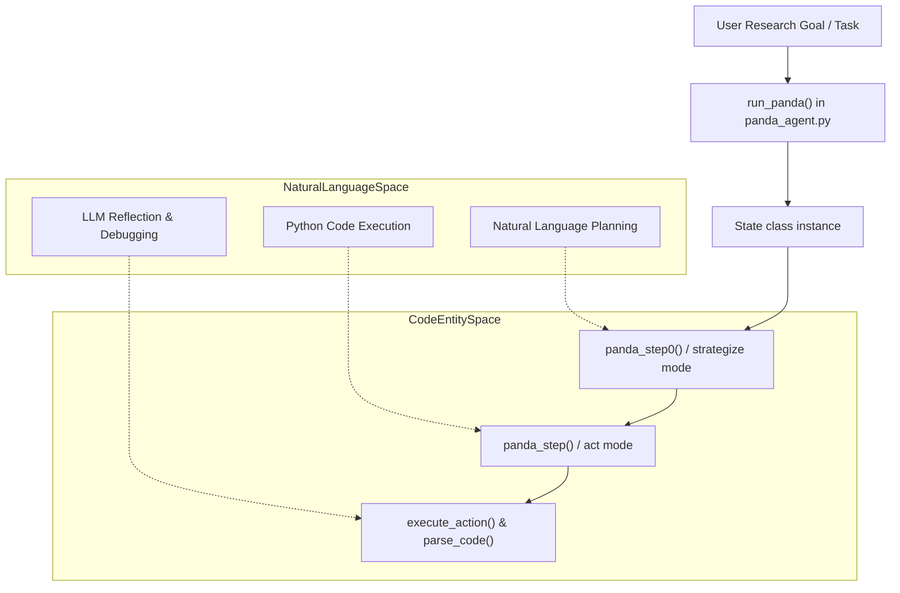
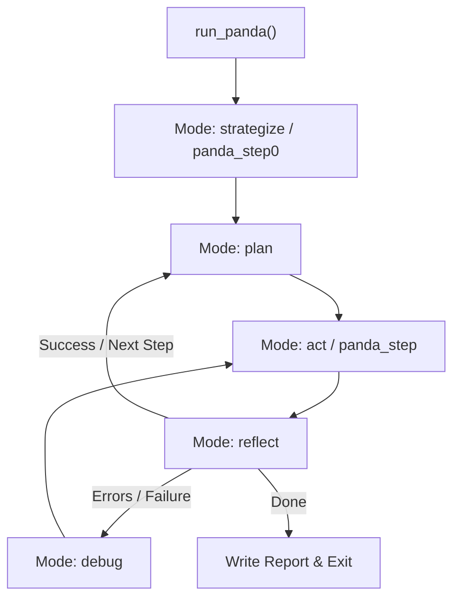

<!-- source: DeepWiki mcp.deepwiki.com · repo allenai/panda · page 2 Agent Core · fetched 2026-11-09 -->

# Agent Core

Relevant source files

The following files were used as context for generating this wiki page:

- [README.md](README.md)
- [panda/panda_agent/panda_agent.py](panda/panda_agent/panda_agent.py)

The Agent Core subsystem forms the operational heart of Panda, implementing a hybrid control structure: an outer loop of planning and execution combined with an inner loop that iterates through action, reflection, and debugging for each step of a research plan. This module coordinates state management, prompt assembly, secure code execution, and experiment reporting.

For detailed breakdowns, refer to the child pages:
- Execution Loop and State Machine: [Execution Loop and State Machine](#2.1)
- Prompts and Subprompts: [Prompts and Subprompts](#2.2)
- Report Writing and Templates: [Report Writing and Templates](#2.3)
- Configuration: [Configuration](#2.4)

Sources: `[panda/panda_agent/panda_agent.py:1-161]()`, `[README.md:1-131]()`

---

## High-Level Architecture: Natural Language Space to Code Entity Space

The agent translates natural language user research goals into structured computational routines by cycling through distinct operational modes. The diagram below bridges the natural language conceptual space with the underlying codebase entities in `panda/panda_agent/panda_agent.py`.

Sources: `[panda/panda_agent/panda_agent.py:7-11]`, `[panda/panda_agent/panda_agent.py:150-155]()`

---

## 2.1 Execution Loop and State Machine

The core execution engine coordinates task progression across multiple operational modes: `strategize`, `plan`, `act`, `reflect`, and `debug`. State variables, namespace scopes, and iteration guards are encapsulated within the `State` class defined at `[panda/panda_agent/panda_agent.py:150-155]()`.

For full technical specifications on execution loops, guards, code safety filters, and logging systems, see [Execution Loop and State Machine](#2.1).

### Operational State Machine

Sources: `[panda/panda_agent/panda_agent.py:150-155]()`

---

## 2.2 Prompts and Subprompts

Panda constructs dynamic LLM system prompts at runtime by combining a core system instruction template (`panda_agent_prompt.txt`) with specialized subprompts tailored to the agent's current operating mode. Additional contextual guidance can be optionally injected via `advice.txt`.

For details on prompt string interpolation, mode-specific subprompt assembly, and guidelines, see [Prompts and Subprompts](#2.2).

Sources: `[panda/panda_agent/panda_agent.py:48-48]`, `[panda/panda_agent/panda_agent.py:67-67]()`

---

## 2.3 Report Writing and Templates

Upon completion or abortion of a research run, `report_writer.py` aggregates execution traces, intermediate variables, dataframes, and generated code into structured artifacts. It renders final summaries into both HTML and plain text formats using internal templates.

For information on report layout, dataframe/dataset formatting helpers, and artifact persistence, see [Report Writing and Templates](#2.3).

Sources: `[panda/panda_agent/panda_agent.py:74-74]`, `[panda/panda_agent/panda_agent.py:85-85]()`

---

## 2.4 Configuration

Global constants governing LLM endpoint selection, model identifiers, execution timeouts, and retry policies are centralized in configuration modules. These parameters dictate fallback behaviors and resource limits across agent operations.

For a complete inventory of configuration variables, default LLM selections, and environment headers, see [Configuration](#2.4).

Sources: `[panda/panda_agent/panda_agent.py:64-64]()`

---

