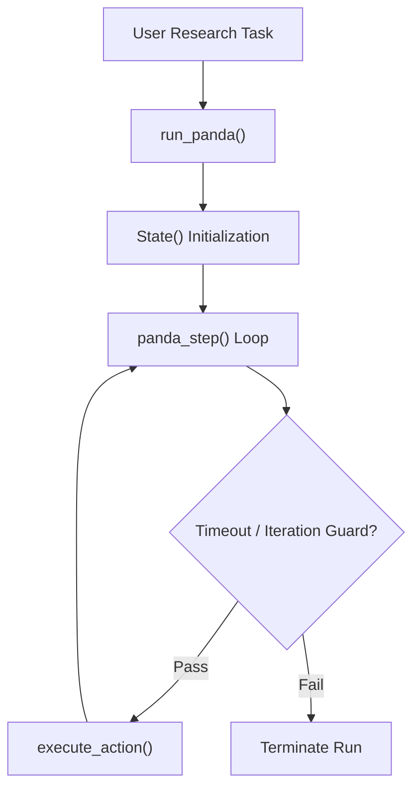
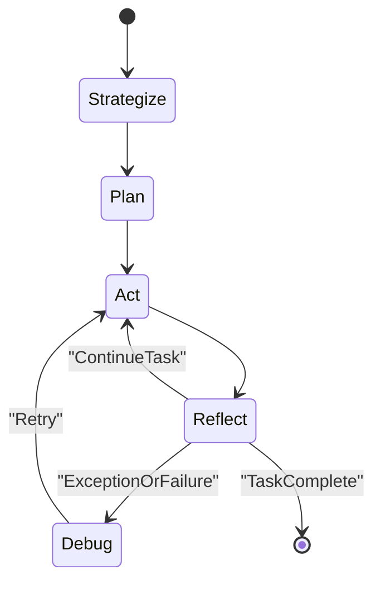

<!-- source: DeepWiki mcp.deepwiki.com · repo allenai/panda · page 2.1 Execution Loop and State Machine · fetched 2026-11-09 -->

# Execution Loop and State Machine

<details>
<summary>Relevant source files</summary>

The following files were used as context for generating this wiki page:

- [panda/panda_agent/my_globals.py](panda/panda_agent/my_globals.py)
- [panda/panda_agent/panda_agent.py](panda/panda_agent/panda_agent.py)

</details>


## Purpose and Scope
This page provides a high-level overview of Panda's core execution loop, state management, and operating modes. The agent orchestrates autonomous research tasks by cycling through reasoning, planning, code execution, reflection, and debugging phases. 

For deep technical details on safe code sandboxing, namespaces, and security checks, see [Code Execution & Safety](#2.1.1). For details on stream redirection, trace generation, and UI integrations, see [Logging, Traces & NORA Output](#2.1.2).

---

## Core Loop and Functions

The entry point for executing research tasks is `run_panda()`, which initializes the runtime environment, sets up output directories, and invokes the iterative step function [panda/panda_agent/panda_agent.py:7-37](). The execution loop relies on step handlers such as `panda_step()` and initialization helpers like `panda_step0()` to drive the agent forward.


*Figure 1: Natural language tasks mapped to core Python execution entities.*

Sources: [panda/panda_agent/panda_agent.py:7-155]()

---

## Operating Modes

Panda dynamically shifts between several operating modes depending on the current phase of research. These modes dictate prompt assembly and expected agent behavior:

* **Strategize**: High-level formulation of research questions and investigation pathways.
* **Plan**: Decomposing research goals into structured, ordered steps.
* **Act**: Writing and executing Python code blocks within the persistent namespace.
* **Reflect**: Evaluating intermediate observations, tool outputs, and statistical results.
* **Debug**: Handling runtime exceptions, parse errors, or logic failures during execution.


*Figure 2: State transitions across Panda agent modes.*

Sources: [panda/panda_agent/panda_agent.py:1-161]()

---

## The State Class

State management across iterations is handled by the `State` class [panda/panda_agent/panda_agent.py:150-155](). It maintains iteration counters, observation history, and the shared execution namespace where generated variables and pandas DataFrames reside.

```python
class State:
    def __init__(self, iteration=0, observations="", namespace=None):
        self.iteration = iteration
        self.observations = observations
        self.namespace = namespace or {}
```
*Code snippet: The `State` class definition [panda/panda_agent/panda_agent.py:150-155]().*

Sources: [panda/panda_agent/panda_agent.py:150-155](), [panda/panda_agent/my_globals.py:1-17]()

---

## Iteration and Timeout Guards

To prevent infinite loops or runaway processes during autonomous research, the execution loop enforces strict iteration limits and function timeouts. Using utilities like `func_timeout` [panda/panda_agent/panda_agent.py:47](), individual agent steps and code executions are constrained by configured time limits, triggering fallback or debugging paths when thresholds are exceeded.

Sources: [panda/panda_agent/panda_agent.py:47-155]()

---

## Related Child Pages

- [Code Execution & Safety](#2.1.1) — Details on `execute_action`, namespace execution, `parse_code`, dangerous pattern blocklists, and timeouts.
- [Logging, Traces & NORA Output](#2.1.2) — Details on `LoggerTee` stream redirection, trace files, and UI integration.

---

