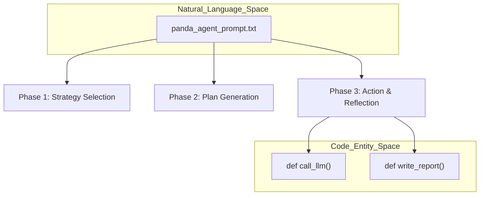
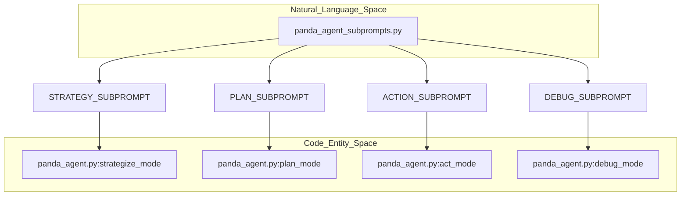

<!-- source: DeepWiki mcp.deepwiki.com · repo allenai/panda · page 2.2 Prompts and Subprompts · fetched 2026-11-09 -->

# Prompts and Subprompts

<details>
<summary>Relevant source files</summary>

The following files were used as context for generating this wiki page:

- [panda/panda_agent/advice.txt](panda/panda_agent/advice.txt)
- [panda/panda_agent/panda_agent_prompt.txt](panda/panda_agent/panda_agent_prompt.txt)
- [panda/panda_agent/panda_agent_subprompts.py](panda/panda_agent/panda_agent_subprompts.py)

</details>


## Purpose and Scope
This page details the prompt engineering and prompt management infrastructure of the Panda agent. It covers the master system prompt (`panda_agent_prompt.txt`), the modular subprompts assembled per execution mode (`panda_agent_subprompts.py`), and the domain-specific heuristic injections from `advice.txt`. These components bridge natural language instructions with underlying Python execution loops and tool functions.

Sources: `panda/panda_agent/panda_agent_prompt.txt:1-110`, `panda/panda_agent/panda_agent_subprompts.py:1-138`, `panda/panda_agent/advice.txt:1-14`

---

## 1. Master System Prompt (`panda_agent_prompt.txt`)

The core personality, high-level workflow, and built-in Python tool signatures are defined in `panda/panda_agent/panda_agent_prompt.txt`. This prompt establishes the agent as an autonomous research scientist capable of selecting strategies (`do` vs `plan`), breaking down tasks, generating Python code, and invoking built-in runtime utilities.

### Key Sections of the Master Prompt
1. **Persona & Strategy Selection**: Directs the agent to evaluate the task complexity and choose between a direct 1-step execution (`do`) or a multi-step structured approach (`plan`) [panda/panda_agent/panda_agent_prompt.txt:6-35]().
2. **Plan Generation & Execution**: Establishes JSON contracts for generating step-by-step plans and executing them through alternating ACTION-REFLECTION cycles [panda/panda_agent/panda_agent_prompt.txt:37-65]().
3. **Exposed Runtime Functions**: Documents built-in Python functions available inside the agent's execution namespace, notably `call_llm()` for recursive LLM querying and `write_report()` for artifact compilation [panda/panda_agent/panda_agent_prompt.txt:67-105]().


*Figure 1: Mapping natural language prompt instructions in `panda_agent_prompt.txt` to corresponding execution handlers.*

Sources: `panda/panda_agent/panda_agent_prompt.txt:1-110`

---

## 2. Subprompt Assembly per Mode (`panda_agent_subprompts.py`)

During the agent's state machine iterations, specific subprompts are dynamically appended to prompt the LLM for the exact JSON structure or action required by the current mode. These subprompts are stored as constants in `panda/panda_agent/panda_agent_subprompts.py`.

### Subprompt Constants & Mappings
- `STRATEGY_SUBPROMPT`: Instructs the agent to output a JSON payload choosing between `"do"` or `"plan"` [panda/panda_agent/panda_agent_subprompts.py:7-15]().
- `PLAN_SUBPROMPT`: Requests a JSON-structured list of natural language plan steps [panda/panda_agent/panda_agent_subprompts.py:83-88]().
- `REPLAN_SUBPROMPT`: Triggered upon reflection failure; forces the agent to generate a non-repeating revised plan from the current state [panda/panda_agent/panda_agent_subprompts.py:94-106]().
- `ACTION_SUBPROMPT`: Asks for Python code and a reasoning `thought` block encapsulated in JSON [panda/panda_agent/panda_agent_subprompts.py:112-117]().
- `CONTINUE_SUBPROMPT`: Used when a step is only partially completed, instructing the agent to write supplementary code [panda/panda_agent/panda_agent_subprompts.py:123-129]().
- `DEBUG_SUBPROMPT`: Injected when code execution encounters a software/runtime error, prompting the LLM to patch the code [panda/panda_agent/panda_agent_subprompts.py:135-138]().


*Figure 2: Subprompt constants mapped to their respective agent execution mode functions.*

Sources: `panda/panda_agent/panda_agent_subprompts.py:1-138`

---

## 3. Heuristic Guidance (`advice.txt`)

The `advice.txt` file provides static domain advice injected into the agent's context to guide research behaviors, such as sample size thresholds for literature reviews [panda/panda_agent/advice.txt:1-13]().

```mermaid
graph TD
    AdviceFile["advice.txt"] --> Content["Ensure at least 10 papers collected"]
    Content --> AgentContext["Injected into System Context"]

    Sources: panda/panda_agent/advice.txt:1-14
```

Sources: `panda/panda_agent/advice.txt:1-14`

---

