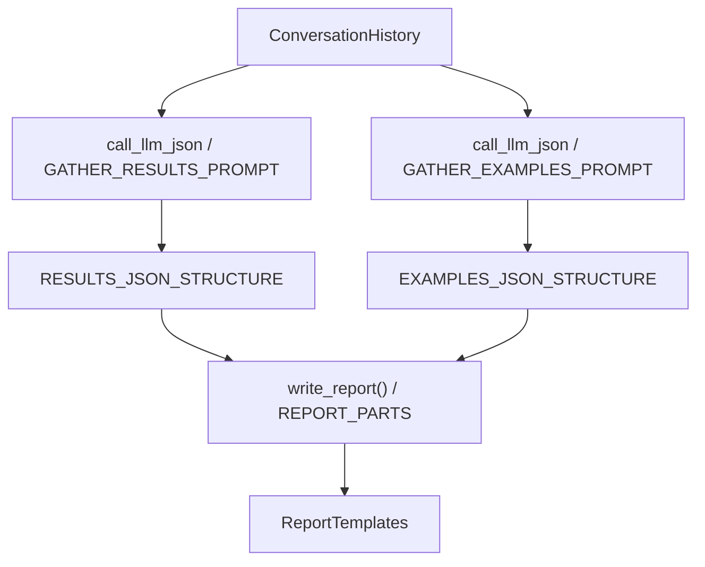
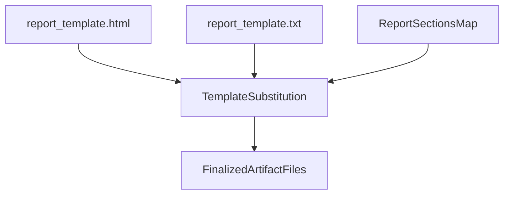
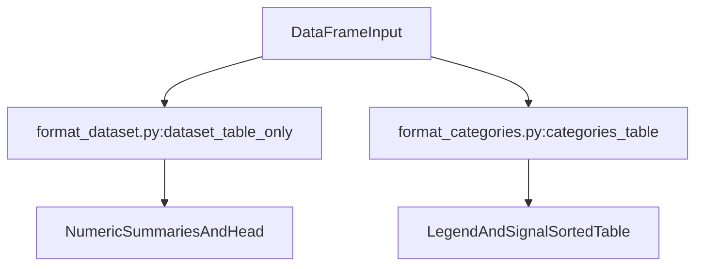
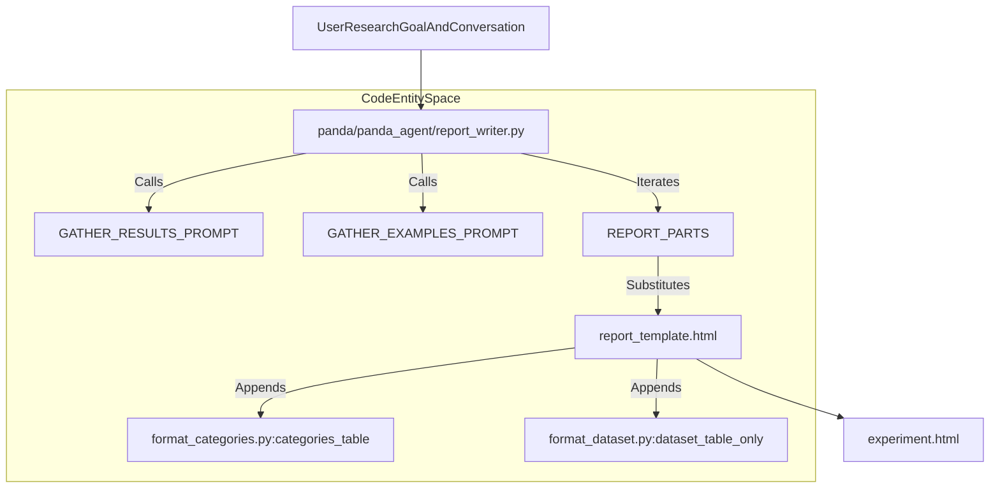

<!-- source: DeepWiki mcp.deepwiki.com · repo allenai/panda · page 2.3 Report Writing and Templates · fetched 2026-11-09 -->

# Report Writing and Templates

Relevant source files

The following files were used as context for generating this wiki page:

- [panda/panda_agent/format_categories.py](panda/panda_agent/format_categories.py)
- [panda/panda_agent/format_dataset.py](panda/panda_agent/format_dataset.py)
- [panda/panda_agent/report_template.html](panda/panda_agent/report_template.html)
- [panda/panda_agent/report_template.txt](panda/panda_agent/report_template.txt)
- [panda/panda_agent/report_writer.py](panda/panda_agent/report_writer.py)
- [panda/utils/config.py](panda/utils/config.py)

## Purpose and Scope
This page details the report writing and artifact formatting subsystem in Panda, centered around `panda/panda_agent/report_writer.py` [panda/panda_agent/report_writer.py:1-486](), HTML/text templates (`report_template.html` [panda/panda_agent/report_template.html:1-97]() and `report_template.txt` [panda/panda_agent/report_template.txt:1-45]()), and dataset/category formatting helpers (`format_dataset.py` [panda/panda_agent/format_dataset.py:1-53]() and `format_categories.py` [panda/panda_agent/format_categories.py:1-116]()). This subsystem gathers conversation history, prompts the LLM section-by-section to synthesize experimental findings, formats numerical and categorical dataframes, and produces the final polished research report.

---

## 1. Report Generation Architecture and `report_writer.py`

The report writing pipeline is orchestrated by `write_report()` within `panda/panda_agent/report_writer.py` [panda/panda_agent/report_writer.py:104-108](). The agent reviews the conversation history to compile results and examples into structured JSON blocks using `GATHER_RESULTS_PROMPT` and `GATHER_EXAMPLES_PROMPT` [panda/panda_agent/report_writer.py:39-44](). 

It then walks through the mandatory report sections defined in `REPORT_PARTS`:
* `title`: Generates the report title [panda/panda_agent/report_writer.py:64-64]().
* `abstract`: Synthesizes goal, approach, findings, and significance, guarded by `CAUTION` instructions [panda/panda_agent/report_writer.py:65-65]().
* `introduction`: Describes motivation, overview, and main findings [panda/panda_agent/report_writer.py:66-66]().
* `approach`: Details the methodology used [panda/panda_agent/report_writer.py:67-67]().
* `results`: Summarizes experimental outcomes using the generated `RESULTS_JSON_STRUCTURE` [panda/panda_agent/report_writer.py:68-70]().
* `analysis`: Discusses results using `EXAMPLES_JSON_STRUCTURE` for concrete illustrations [panda/panda_agent/report_writer.py:74-75]().
* `conclusion`: Summarizes final takeaways under conservative constraints [panda/panda_agent/report_writer.py:89-89]().

*Sources: [panda/panda_agent/report_writer.py:39-89]()*

---

## 2. Template System and Substitution

Templates are loaded upon initialization in `panda/panda_agent/report_writer.py` using Python's `string.Template` [panda/panda_agent/report_writer.py:8-33](). Two primary templates exist:
1. `report_template.html`: An HTML structure containing CSS styling, header metadata, semantic `<section>` tags for each report part, and slots for dataframes (`${html_all_dataframes}`) and notes (`${notes}`) [panda/panda_agent/report_template.html:1-97]().
2. `report_template.txt`: A plain-text layout providing structured headers and underlined section titles [panda/panda_agent/report_template.txt:1-45]().

*Sources: [panda/panda_agent/report_writer.py:27-33](), [panda/panda_agent/report_template.html:1-97](), [panda/panda_agent/report_template.txt:1-45]()*

---

## 3. Dataset and Category Formatting Helpers

To embed structured experimental data into reports, Panda utilizes specialized formatting modules:

### Dataset Formatting (`format_dataset.py`)
The `dataset_table_only()` function inspects numeric columns via `get_numeric_columns()` to compute summary statistics (min, max, mean, variance) and renders the first five rows of a DataFrame [panda/panda_agent/format_dataset.py:22-53]().

### Categories Formatting (`format_categories.py`)
The `categories_table()` function wraps `categories_table_only()` and prepends a legend (`categories_table_legend()`) explaining category scores, adjusted Laplace scores, and signals [panda/panda_agent/format_categories.py:9-50](). It handles color-coded indicators for green (above average) and red (below average) categories [panda/panda_agent/format_categories.py:35-36]().

*Sources: [panda/panda_agent/format_dataset.py:22-53](), [panda/panda_agent/format_categories.py:9-50]()*

---

## 4. End-to-End Report Generation Data Flow

The diagram below bridges natural language requirements with code execution entities across the report generation pipeline.

*Sources: [panda/panda_agent/report_writer.py:39-89](), [panda/panda_agent/report_template.html:1-97](), [panda/panda_agent/format_categories.py:9-50](), [panda/panda_agent/format_dataset.py:22-44]()*

---

