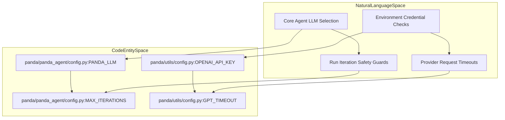
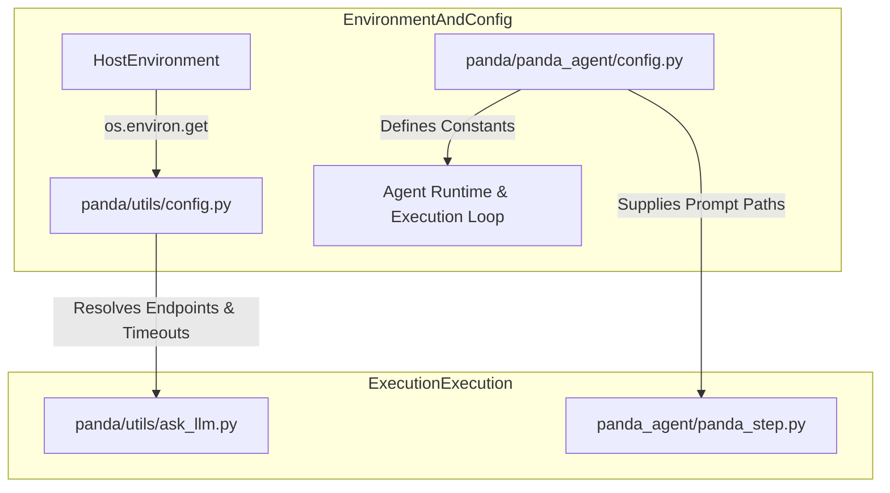

<!-- source: DeepWiki mcp.deepwiki.com · repo allenai/panda · page 2.4 Configuration · fetched 2026-11-09 -->

# Configuration

Relevant source files

The following files were used as context for generating this wiki page:

- [panda/panda_agent/config.py](panda/panda_agent/config.py)
- [panda/panda_agent/report_writer.py](panda/panda_agent/report_writer.py)
- [panda/utils/config.py](panda/utils/config.py)

## Purpose and Scope
This page details the configuration parameters, environment variables, model choices, execution timeouts, and text formatting constants defined across `panda_agent/config.py` and `panda/utils/config.py`. These configuration files establish the runtime boundaries for autonomous agent loops, select underlying Large Language Models (LLMs) via LiteLLM and native endpoints, define safety retry limits, and handle environment credential resolution.

---

## 1. Agent Configuration (`panda_agent/config.py`)

The agent configuration module sets default operational parameters specifically tailored for the Panda agent execution loop, defining active LLM identifiers, system prompt file paths, iteration boundaries, and text display banners.

### LLM Choices and Role Aliases
Panda maps specific agent roles to modular LLM constants, defaulting primarily to Anthropic's Claude models [panda/panda_agent/config.py:4-13]():
- `PANDA_LLM`: The core model used by the main agent loop (`"claude-sonnet-4-6"`) [panda/panda_agent/config.py:5]().
- `REPORT_WRITER_LLM`: Configured to inherit `PANDA_LLM` for report generation tasks [panda/panda_agent/config.py:6]().
- `REPORT_TRANSLATOR_LLM`: Designed for HTML-to-text conversion pipelines [panda/panda_agent/config.py:7]().
- `SUPERPANDA_LLM`, `SUPERPANDA_REPORT_WRITER_LLM`, `ITERPANDA_LLM`, and `STEPPANDA_LLM`: Specialized variant entrypoints that default to `PANDA_LLM` [panda/panda_agent/config.py:9-13]().

### File Paths and Metadata
- `MODULE_DIR`: Resolves the absolute directory path containing `config.py` (`panda/panda_agent`) [panda/panda_agent/config.py:16]().
- `SYSTEM_PROMPT_FILE`: Points to the static system prompt definition file `panda_agent_prompt.txt` [panda/panda_agent/config.py:32]().
- `ADVICE_FILE`: Points to `advice.txt` for supplemental agent coaching [panda/panda_agent/config.py:34]().
- `VERSION`: Dynamically extracted from installed package metadata using `importlib.metadata.version('panda')` [panda/panda_agent/config.py:38-39]().

### Execution Limits and Guards
To prevent infinite agent loops and handle long-running experimental routines, `panda_agent/config.py` defines strict threshold constants [panda/panda_agent/config.py:43-50]():
- `MAX_RETRIES = 2`: Maximum retry attempts for standard operations [panda/panda_agent/config.py:44]().
- `MAX_EARLIER_STEP_RETRIES = 2`: Maximum retry depth when re-evaluating earlier execution steps [panda/panda_agent/config.py:45]().
- `MAX_ITERATIONS = 200`: Hard iteration cap on the plan-act-reflect loop to prevent runaway behavior [panda/panda_agent/config.py:46]().
- `EXPERIMENT_TIMEOUT = 40000`: Extended timeout threshold allocated for comprehensive experimental runs [panda/panda_agent/config.py:50]().

### Formatting Banners and Stream Markers
The module exposes static string markers used by logging and output streams to section off execution artifacts [panda/panda_agent/config.py:52-57]():
- `PANDA_HEADER`: Top-level execution wrapper divider [panda/panda_agent/config.py:52]().
- `SYSTEM_PROMPT_HEADER`: Delimits system prompt injection blocks [panda/panda_agent/config.py:53]().
- `GPT_HEADER`: Format string template for model interaction frames [panda/panda_agent/config.py:54]().
- `CODING_START`, `PYTHON_START`, `CODING_END`: Markers denoting execution blocks for dynamically evaluated Python interpreter environments [panda/panda_agent/config.py:55-57]().

Sources: [panda/panda_agent/config.py:1-58]()

---

## 2. Utility and Provider Configuration (`panda/utils/config.py`)

The utility configuration layer manages low-level provider API keys, fallback endpoints, model capability whitelists, and model-specific timeout thresholds.

### Environment Credentials
The module reads required and optional API keys directly from host environment variables, printing warnings to `sys.stderr` if missing keys restrict specific provider choices [panda/utils/config.py:7-25]():
- `OPENAI_API_KEY`: Required for OpenAI model execution [panda/utils/config.py:7]().
- `TOGETHER_API_KEY`: Required for Together AI hosted models (Mistral, Llama) [panda/utils/config.py:9]().
- `ANTHROPIC_API_KEY`: Required for Anthropic Claude integration [panda/utils/config.py:10]().
- `INFERD_TOKEN`: Authentication token for AI2 Inferd internal endpoints [panda/utils/config.py:13]().

### Model Names and Capability Whitelists
- `MODEL_NAMES`: Array of supported architecture keys including `'gpt4'`, `'gpt-4.1'`, `'llama'`, `'mistral'`, `'claude-3.5'`, and reasoning models like `'o1-mini'`, `'o3-mini'` [panda/utils/config.py:15]().
- `JSON_CAPABLE_MODEL_NAMES`: Subset whitelist of models verified for structured JSON generation [panda/utils/config.py:16]().

### API Endpoints and Model Mappings
- `OAI_ENDPOINT`: OpenAI chat completions URL (`https://api.openai.com/v1/chat/completions`) [panda/utils/config.py:28]().
- `OLMO_ENDPOINT`: AI2 Cirrascale endpoint for OLMo evaluation [panda/utils/config.py:32]().
- `TOGETHER_ENDPOINT`: Together AI completions endpoint [panda/utils/config.py:36]().
- Default model pointers: `DEFAULT_GPT4_MODEL` (`'gpt-4.1'`), `DEFAULT_GPT45_MODEL` (`'gpt-4.5-preview-2025-02-27'`), and `DEFAULT_CLAUDE_MODEL` (`'claude-sonnet-4-5-20250929'`) [panda/utils/config.py:49-54]().

### Retry Attempts and Timeouts
Provider request robustness is governed by explicit attempt limits and request timeouts [panda/utils/config.py:56-65]():
- `MAX_GPT_ATTEMPTS = 3`, `MAX_OLMO_ATTEMPTS = 3`, `MAX_LITELLM_ATTEMPTS = 3` [panda/utils/config.py:56-59]()
- `MAX_TOGETHER_ATTEMPTS = 6`: Compensates for higher flakiness on Together-hosted Llama models [panda/utils/config.py:58]()
- `TOGETHER_TIMEOUT = 30`, `OLMO_TIMEOUT = 60`, `GPT_TIMEOUT = 300`, `GPT45_TIMEOUT = 300`, `GPT_REASONING_TIMEOUT = 600` [panda/utils/config.py:61-65]()

Sources: [panda/utils/config.py:1-66]()

---

## 3. Configuration Architecture Diagrams

The following diagrams bridge the natural language design concepts of the Panda configuration layer to their concrete code entities.

Sources: [panda/panda_agent/config.py:4-46](), [panda/utils/config.py:7-65]()

Sources: [panda/panda_agent/config.py:15-34](), [panda/utils/config.py:7-36]()

---

