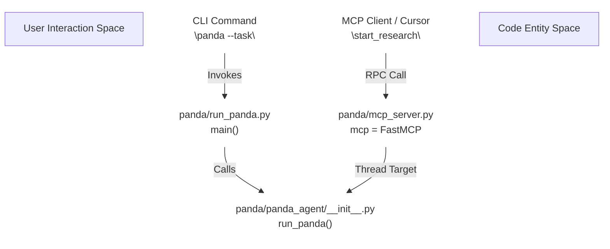

<!-- source: DeepWiki mcp.deepwiki.com · repo allenai/panda · page 3 Entrypoints and Integrations · fetched 2026-11-09 -->

# Entrypoints and Integrations

Relevant source files

The following files were used as context for generating this wiki page:

- [panda/mcp_server.py](panda/mcp_server.py)
- [panda/run_panda.py](panda/run_panda.py)

Panda provides multiple integration surfaces to trigger and monitor autonomous research tasks. Whether operating in automated pipelines via shell commands, embedding research capabilities into Python applications, or interacting through IDE extensions via the Model Context Protocol (MCP), Panda exposes uniform entrypoints that delegate directly to the core agent loop.

Sources: [panda/run_panda.py:21-54](), [panda/mcp_server.py:42-80]()

---

## 3.1. Command-Line Interface

The Command-Line Interface (CLI) serves as the primary mechanism for shell-based execution, batch job dispatching, and containerized deployments. Implemented via Python's `argparse`, the CLI script parses flags representing task instructions, background knowledge files, model selection paths, and output destinations, then delegates execution to the core package.

For full technical specifications regarding argument flags, file inputs, output structures, and result persistence, see [Command-Line Interface](#3.1).

Sources: [panda/run_panda.py:21-54]()

---

## 3.2. MCP Server

The Model Context Protocol (MCP) server integration exposes Panda as a set of remote-callable tools for AI-assisted development environments such as Cursor. Built on top of `FastMCP`, the server manages asynchronous execution threads, tracks job statuses in an in-memory dictionary, and streams log resources back to the client interface.

For details regarding tool definitions, threading models, status polling intervals, and client configuration via `mcp.json`, see [MCP Server](#3.2).

Sources: [panda/mcp_server.py:30-173]()

---

