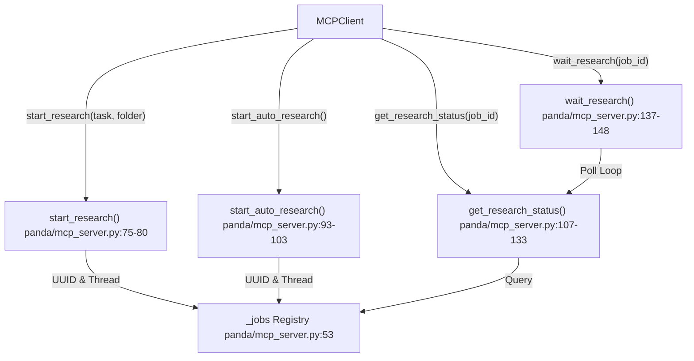
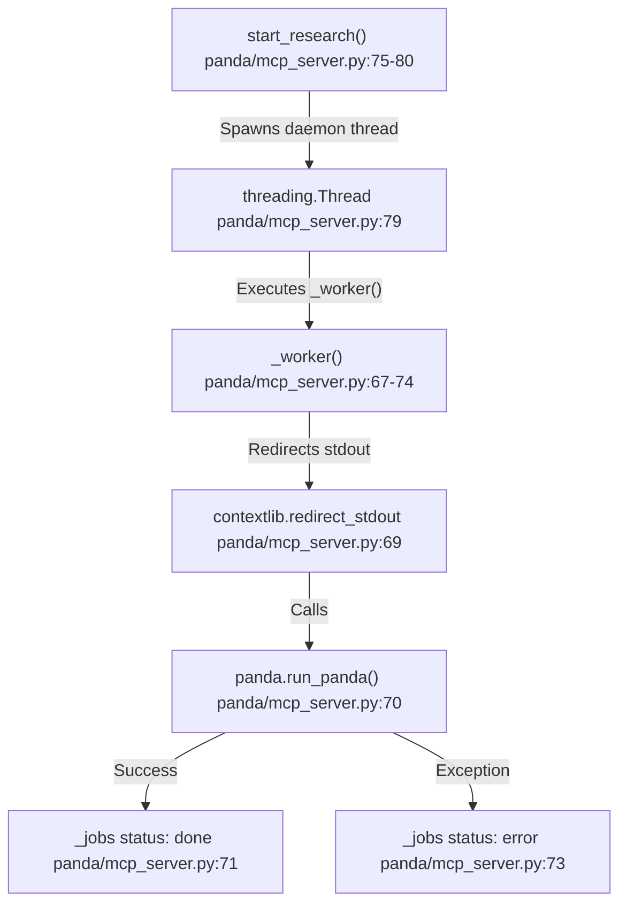
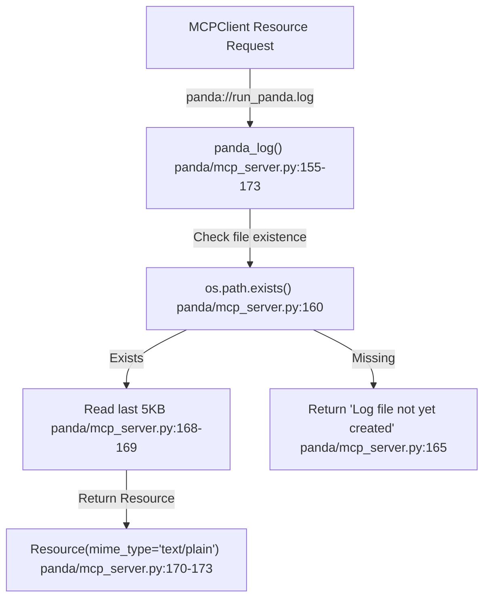

<!-- source: DeepWiki mcp.deepwiki.com · repo allenai/panda · page 3.2 MCP Server · fetched 2026-11-09 -->

# MCP Server

<details>
<summary>Relevant source files</summary>

The following files were used as context for generating this wiki page:

- [mcp.json](mcp.json)
- [panda/mcp_server.py](panda/mcp_server.py)

</details>


## Purpose and Scope
The Model Context Protocol (MCP) server integration (`panda/mcp_server.py`) provides a standardized bridge between external LLM clients (such as Cursor or other MCP-compatible agents) and Panda's autonomous research capabilities. It exposes asynchronous research execution tools, job status polling, blocking wait mechanisms, log streaming resources, and a client configuration template (`mcp.json`).

Sources: [panda/mcp_server.py:1-43](), [mcp.json:1-17]()

---

## FastMCP Tools Architecture

The server is built on top of the `FastMCP` framework (`panda/mcp_server.py`), initializing an MCP server named `"panda"`. It registers several tool decorators and resources to manage research tasks.

### Core Tool Definitions

1. **`start_research(task: str, folder: str = CURSOR_EXPT_FOLDER) -> dict`**: Generates a unique UUID job identifier, marks the job as `running` in the global `_jobs` registry, and spawns a daemon thread running `_worker`. Returns the `job_id` immediately.
2. **`start_auto_research() -> dict`**: Automatically initiates a cursor-oriented research task using the workspace folder defined in the `WORKSPACE_FOLDER` environment variable (falling back to `"."` if unset). Spawns a background thread running `_worker2`.
3. **`get_research_status(job_id: str) -> dict`**: Queries the `_jobs` registry for the current state of a given job. Returns status flags (`running`, `done`, `error`, `not_found`), along with error messages or result summaries if available.
4. **`wait_research(job_id: str, poll_interval_s: int = 2, timeout_s: int = 1800) -> dict`**: A blocking polling loop that checks job progress every `poll_interval_s` until completion, error, or expiration of `timeout_s`.


Sources: [panda/mcp_server.py:30-149]()

---

## Job Threading and Concurrency Model

Because MCP tool calls must respond promptly while Panda research tasks can run for extended periods, the server decouples invocation from execution using background worker threads and a global job state store.

### Global Job Registry and Workers
State is tracked via an in-memory dictionary `_jobs` mapping job IDs to payloads. Standard output from LiteLLM and Panda internal routines is redirected using `contextlib.redirect_stdout` inside worker threads to prevent polluting the MCP JSON-RPC transport stream.

```python
_jobs = {}  # job_id -> {"status": "...", "result": {...} or None, "error": str|None}
```

* **`_worker(job_id, task, folder)`**: Executes `panda.run_panda(task=task, force_report=True, outputs_dir=folder)` inside a stdout redirection context, updating `_jobs[job_id]` upon completion or exception.
* **`_worker2(job_id, workspace_folder)`**: Executes `panda.run_cursor_panda(workspace_folder=workspace_folder)` similarly.


Sources: [panda/mcp_server.py:53-103]()

---

## MCP Logging Resource

The server also exposes an MCP resource for streaming logs directly into the agent interface:

* **`panda://run_panda.log`**: Reads up to the last ~5 KB of `RUN_PATH` (default `run_panda.log`) to provide lightweight tailing of agent activity inside client windows.


Sources: [panda/mcp_server.py:155-173]()

---

## Client Configuration (`mcp.json`)

Clients configure the Panda MCP server by declaring command execution paths, arguments, and required environment variables in an `mcp.json` file.

| Parameter | Configuration Value | Description |
| :--- | :--- | :--- |
| **Command** | `C:\...\python.exe` | Absolute path to the python interpreter in the `panda` virtual environment. |
| **Arguments** | `["-X", "dev", "-m", "panda.mcp_server"]` | Runs python in dev mode, executing the MCP server module. |
| **`AGENT_MODE`** | `async` | Sets agent execution mode. |
| **`PYTHONPATH`** | Repository root path | Ensures `panda` package is importable. |
| **API Keys** | `${env:OPENAI_API_KEY}`, etc. | Forwards required LLM provider keys from the host environment. |
| **`WORKSPACE_FOLDER`** | `${workspaceFolder}` | Sets the current workspace context for automated research runs. |

Sources: [mcp.json:1-17]()

---

