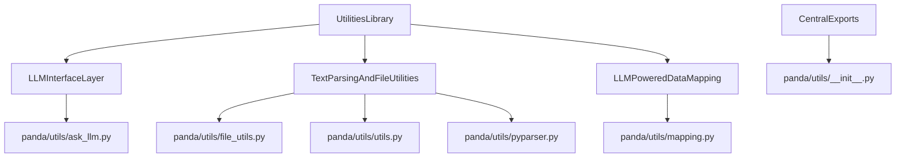
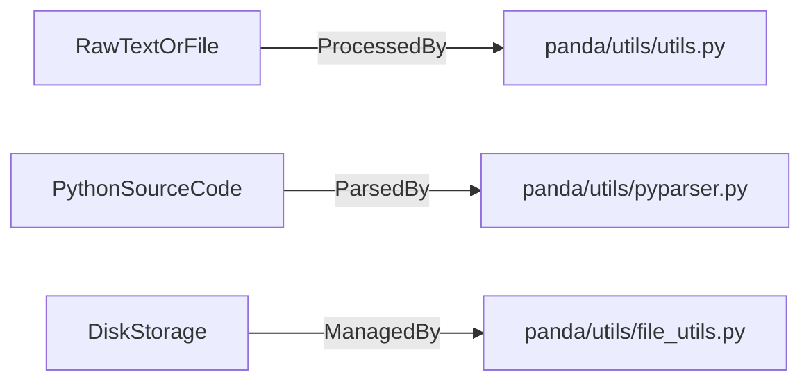

<!-- source: DeepWiki mcp.deepwiki.com · repo allenai/panda · page 4 Utilities Library · fetched 2026-11-09 -->

# Utilities Library

Relevant source files

The following files were used as context for generating this wiki page:

- [panda/utils/__init__.py](panda/utils/__init__.py)

The `panda/utils` package is a foundational library providing core subsystems for LLM communication, file I/O, text extraction, code parsing, logging, configuration, and LLM-powered data mapping [panda/utils/__init__.py:1-18](). These utility functions are consumed across the Panda agent framework to handle low-level tasks, interface with language models via litellm/openai, and process tabular data or code artifacts.

This parent page provides a high-level overview of the utility modules. For specific technical details, please refer to the child pages:
- [LLM Interface Layer](#4.1)
- [Text, Parsing and File Utilities](#4.2)
- [LLM-Powered Data Mapping](#4.3)

*Sources: [panda/utils/__init__.py:1-18]*

---

## 4.1 LLM Interface Layer

The LLM Interface Layer handles all interactions with language models, abstracting away provider-specific routing, caching, response formatting, token tracking, and payload truncation. It acts as the primary conduit for prompts sent by the Panda agent core.

For deep technical details, implementation specifics, and configuration parameters, see [LLM Interface Layer](#4.1).

*Sources: [panda/utils/__init__.py:13]*

---

## 4.2 Text, Parsing and File Utilities

This subsystem encompasses three distinct utility modules:
1. **`file_utils.py`**: Manages file I/O operations such as reading, checking existence, deletion, downloading, copying, directory clearing, and file appending [panda/utils/__init__.py:2-3]().
2. **`utils.py`**: Provides text cleaning, string extraction (JSON/HTML), similarity checks, and CLI helpers like multiline input [panda/utils/__init__.py:5-7]().
3. **`pyparser.py`**: Analyzes Python source code strings to detect syntax structures or check if code is attempting to block on user input [panda/utils/__init__.py:11]().

For deep technical details, implementation specifics, and configuration parameters, see [Text, Parsing and File Utilities](#4.2).

*Sources: [panda/utils/__init__.py:2-11]*

---

## 4.3 LLM-Powered Data Mapping

The data mapping subsystem bridges language models with tabular data structures (such as pandas DataFrames). It exposes high-level functions to apply LLMs iteratively over lists or dataframe columns—supporting both text outputs and structured JSON payloads or multiple-choice questions [panda/utils/__init__.py:9]().

For deep technical details, implementation specifics, and configuration parameters, see [LLM-Powered Data Mapping](#4.3).

*Sources: [panda/utils/__init__.py:9]*

---

