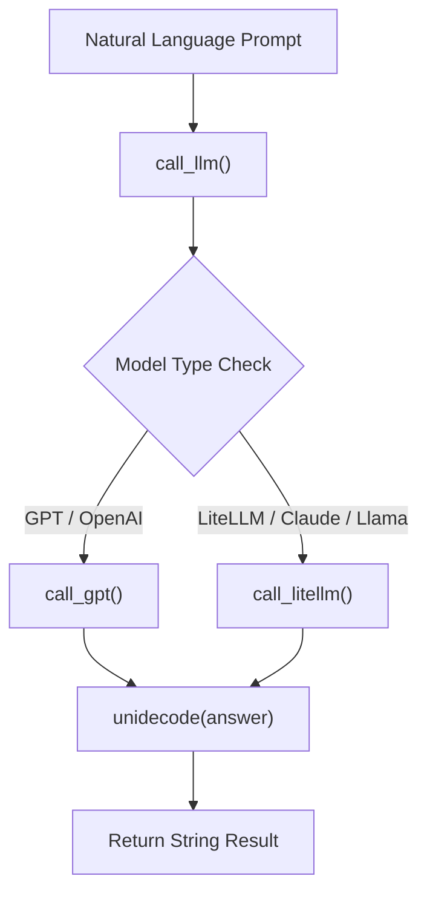
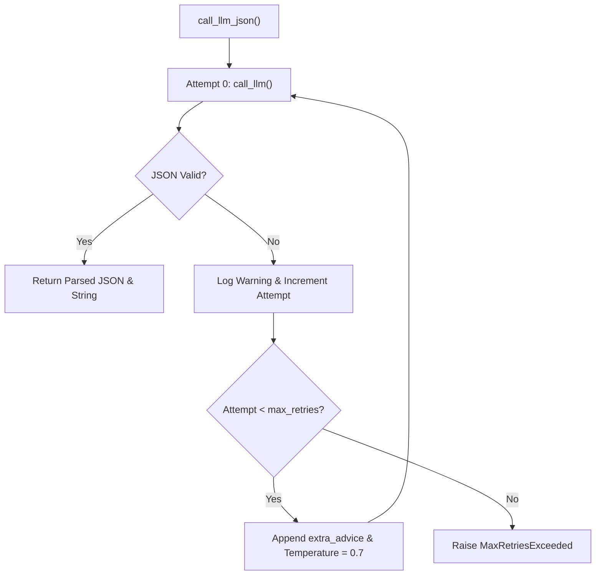

<!-- source: DeepWiki mcp.deepwiki.com · repo allenai/panda · page 4.1 LLM Interface Layer · fetched 2026-11-09 -->

# LLM Interface Layer

Relevant source files

The following files were used as context for generating this wiki page:

- [panda/utils/ask_llm.py](panda/utils/ask_llm.py)

## Purpose and Scope
The LLM Interface Layer, implemented in `panda/utils/ask_llm.py`, provides a unified abstraction for querying various Large Language Models (LLMs) within the Panda codebase [panda/utils/ask_llm.py:1-150]. It handles model routing between native OpenAI APIs and LiteLLM-supported models (such as Claude, Llama, and Mistral), token counting, JSON output parsing, multiple-choice resolution, retries, and string normalization [panda/utils/ask_llm.py:15-100].

Sources: [panda/utils/ask_llm.py:1-150]()

---

## Core Functions and Public API

The primary entry points exposed by the LLM interface layer handle text generation, structured JSON parsing, and constrained multiple-choice selections [panda/utils/ask_llm.py:55-150].

### `call_llm`
`call_llm(prompt, response_format={"type":"text"}, model=agent_config.PANDA_LLM, temperature=0, quiet=True)` serves as the foundational wrapper for sending prompts to configured LLMs [panda/utils/ask_llm.py:69]. It accepts text or message lists, applies model-specific routing, normalizes the output text using `unidecode`, and returns a plain string [panda/utils/ask_llm.py:69-100].

### `call_llm_json`
`call_llm_json(prompt, response_format={"type":"json_object"}, temperature=0, max_retries=3, model=agent_config.PANDA_LLM)` queries the LLM expecting a structured JSON payload [panda/utils/ask_llm.py:120]. It wraps `call_llm`, catches parsing exceptions, applies progressive retry strategies with fallback temperature adjustments, and extracts JSON structures using `extract_json_from_string` [panda/utils/ask_llm.py:120-136]. If max retries are exhausted, it raises `MaxRetriesExceeded` [panda/utils/ask_llm.py:136].

### `call_llm_multiple_choice`
`call_llm_multiple_choice(prompt, options, max_retries=3, model=agent_config.PANDA_LLM, quiet=True)` appends allowed answer options to the prompt and queries the model, handling formatting validation and unconstrained fallback parsing for non-GPT models [panda/utils/ask_llm.py:145-150].

*Figure 1: Natural Language Space to Code Entity Space mapping for `call_llm` execution flow.*

Sources: [panda/utils/ask_llm.py:55-150]()

---

## Routing and Model Dispatch

The interface inspects the `model` string parameter to determine whether to route requests to the OpenAI client or to LiteLLM's `completion` function [panda/utils/ask_llm.py:69-96]. 

| Model Identifier / Prefix | Target Dispatch Function / Backend | Code Reference |
| :--- | :--- | :--- |
| `gpt4`, `gpt4.5`, `gpt*`, `o1`, `o3`, `o4` | OpenAI Client (`call_gpt`) | [panda/utils/ask_llm.py:76-82]() |
| `llama`, `meta` | LiteLLM (`call_litellm`) | [panda/utils/ask_llm.py:83-92]() |
| `mistral` | LiteLLM (`call_litellm`) | [panda/utils/ask_llm.py:85-92]() |
| `claude`, `claude-3.5` | LiteLLM (`call_litellm`) | [panda/utils/ask_llm.py:87-92]() |

If an unrecognized model string is passed, `call_llm` logs an error via `logger.error` and returns an error message string [panda/utils/ask_llm.py:93-95].

Sources: [panda/utils/ask_llm.py:69-96]()

---

## Token Tracking and Retry Mechanics

### Token Counts
Global token utilization statistics are tracked across LLM calls using the `token_counts` list, which records dictionary entries containing model names, prompt tokens, completion tokens, and total tokens [panda/utils/ask_llm.py:33-42]. This state can be reset using `reset_token_counts()` or queried via `get_token_counts()` [panda/utils/ask_llm.py:36-42].

### Error Handling & Retries
Both `call_llm_json` and `call_llm_multiple_choice` implement robust retry loops bounded by `max_retries` [panda/utils/ask_llm.py:120-136, 145-150]. 

*Figure 2: State machine and data flow for `call_llm_json` error recovery and retry execution.*

Sources: [panda/utils/ask_llm.py:33-46, 120-136, 145-150]()

---

