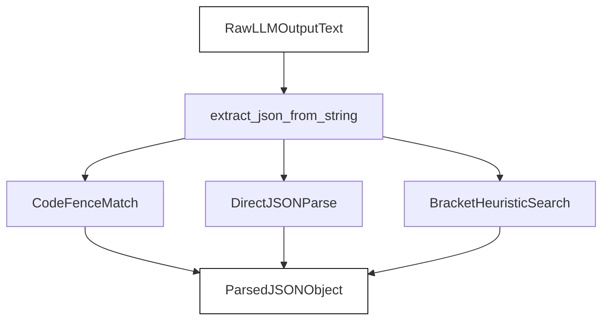
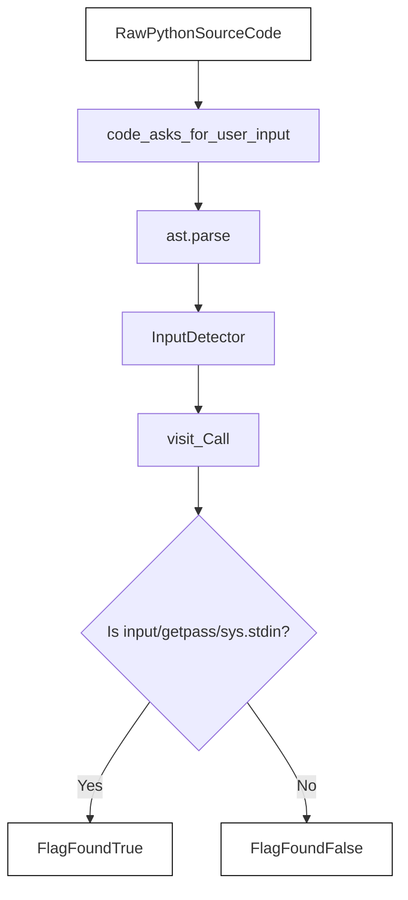

<!-- source: DeepWiki mcp.deepwiki.com · repo allenai/panda · page 4.2 Text, Parsing and File Utilities · fetched 2026-11-09 -->

# Text, Parsing and File Utilities

<details>
<summary>Relevant source files</summary>

The following files were used as context for generating this wiki page:

- [panda/__init__.py](panda/__init__.py)
- [panda/panda_agent/__init__.py](panda/panda_agent/__init__.py)
- [panda/utils/file_utils.py](panda/utils/file_utils.py)
- [panda/utils/pyparser.py](panda/utils/pyparser.py)
- [panda/utils/utils.py](panda/utils/utils.py)

</details>


## Purpose and Scope
This page details the core utility subsystems located under `panda/utils/`. These components provide foundational support for robustness across the agent framework: parsing unstructured Large Language Model (LLM) responses (handling markdown code fences, embedded JSON, and text formatting), executing AST-driven Python code parsing and safety inspection (`pyparser.py`), and performing reliable file system operations, remote resource downloading, and workspace management (`file_utils.py`).

---

## 1. Text Extraction and Normalization Utilities (`utils.py`)

The module `panda/utils/utils.py` contains utility functions designed to extract structured data (such as JSON, HTML, and code blocks) from raw LLM text outputs, clean markup, normalize line breaks, and sanitize special unicode characters [panda/utils/utils.py:9-200]().

### LLM Output Parsing and Extraction
LLMs frequently wrap JSON responses, HTML documents, or python code blocks in markdown fences. `utils.py` implements multi-strategy extraction helpers:
- `extract_json_from_string(text: str)`: [panda/utils/utils.py:9-51]() tries multiple extraction passes: scanning for explicit ```json ... ``` code fences [panda/utils/utils.py:22-32](), attempting direct `json.loads()` on the raw string [panda/utils/utils.py:34-38](), and applying a heuristic search for the outermost `{...}` or `[...]` boundaries [panda/utils/utils.py:40-49]().
- `extract_html_from_string(text)` [panda/utils/utils.py:55-63]() and `extract_txt_from_string(text)` [panda/utils/utils.py:66-77]() isolate ```html``` and ```text```/```txt``` blocks respectively.
- `extract_first_code_block(text)` [panda/utils/utils.py:82-96]() and `extract_code_blocks(text)` [panda/utils/utils.py:100-116]() use regular expressions (`r"```(?:\w*\n)?(.*?)```"`) to retrieve single or multiple code blocks.


*Diagram 1: Text extraction pipeline mapping unstructured LLM text to parsed JSON data structures via `extract_json_from_string`.*

Sources: [panda/utils/utils.py:9-116]()

### Markup Stripping and Character Normalization
To clean text containing HTML elements or typographical anomalies:
- `remove_html_markup(html)`: Subclasses `html.parser.HTMLParser` via `HTMLStripper` [panda/utils/utils.py:120-133]() to extract visible text data and passes it through `normalize_newlines()` [panda/utils/utils.py:134-138]().
- `normalize_newlines(text)`: Collapses multiple consecutive blank lines down to a double newline using `re.sub(r'(\n\s*\n)+', '\n\n', text.strip())` [panda/utils/utils.py:142-144]().
- `replace_special_chars_with_ascii(text)`: Translates smart quotes, em dashes, and en dashes defined in `CUSTOM_REPLACEMENTS` [panda/utils/utils.py:175-184]() and normalizes remaining unicode characters using `unicodedata.normalize('NFKD', char)` [panda/utils/utils.py:186-200]().

Sources: [panda/utils/utils.py:120-200]()

---

## 2. Code Parsing and Safety Analysis (`pyparser.py`)

The module `panda/utils/pyparser.py` provides AST-based utilities to slice Python source code into logical execution blocks and inspect code for dangerous or interactive patterns (such as user-input requests) prior to execution in the agent loop [panda/utils/pyparser.py:8-162]().

### AST-Based Code Chunking (`parse_code`)
- `get_end_lineno(node)`: [panda/utils/pyparser.py:8-14]() recursively traverses child AST nodes to locate the maximum line number spanned by a compound statement.
- `parse_code(x)`: [panda/utils/pyparser.py:16-32]() parses raw python strings into an Abstract Syntax Tree using `ast.parse(x)` [panda/utils/pyparser.py:19](), iterating over top-level module bodies to extract discrete code blocks bounded by statement line numbers [panda/utils/pyparser.py:22-30]().

Sources: [panda/utils/pyparser.py:8-32]()

### Autonomous Safety Guards (`InputDetector`)
Because Panda operates as an autonomous background agent, executing code that blocks for user input causes deadlocks. `code_asks_for_user_input(code)` instantiates an `InputDetector` `ast.NodeVisitor` to detect input prompts [panda/utils/pyparser.py:40-162]().

- `InputDetector` tracks import aliases for `sys` and `getpass`, as well as file handle assignments (`open(...)`) [panda/utils/pyparser.py:49-106]().
- `visit_Call(node)` flags built-in calls to `input()`, `raw_input()`, `getpass()` functions, and `sys.stdin.read()` / `sys.stdin.readline()` calls while safely ignoring legitimate file handle reads [panda/utils/pyparser.py:139-162]().


*Diagram 2: AST safety check mapping raw Python source code through `code_asks_for_user_input` and `InputDetector` to block interactive execution.*

Sources: [panda/utils/pyparser.py:40-162]()

---

## 3. File System and I/O Operations (`file_utils.py`)

The module `panda/utils/file_utils.py` handles local and remote file input/output, directory cleanup, and safe file copying [panda/utils/file_utils.py:1-127]().

### File Reading, Writing, and Copying
- `read_file_contents(filename)`: Opens text files using UTF-8 encoding (`encoding="utf-8"`) and returns their string contents, logging an error via `logger.error` if a `FileNotFoundError` occurs [panda/utils/file_utils.py:15-31]().
- `file_exists(path)` and `delete_file(filepath)`: Wrap standard OS path checks and deletion operations [panda/utils/file_utils.py:44-50]().
- `copy_file(source_path, destination_path)`: Uses `shutil.copy2` to duplicate files while preserving metadata, with exception handling for permissions and missing files [panda/utils/file_utils.py:104-121]().
- `add_to_end_of_file(string, file)`: Appends text data to a target file with UTF-8 encoding [panda/utils/file_utils.py:124-127]().

Sources: [panda/utils/file_utils.py:15-50, 104-127]()

### Remote Downloads and Directory Management
- `download_file(url, filepath)`: Issues an HTTP GET request via `requests.get(url)`, checks response status codes with `response.raise_for_status()`, and writes binary content to `filepath` [panda/utils/file_utils.py:55-76]().
- `clear_directory(directory_path)`: Iterates over a target directory and removes all constituent files using `os.remove()`, logging actions or handling missing directories gracefully [panda/utils/file_utils.py:82-99]().

Sources: [panda/utils/file_utils.py:55-99]()

---

