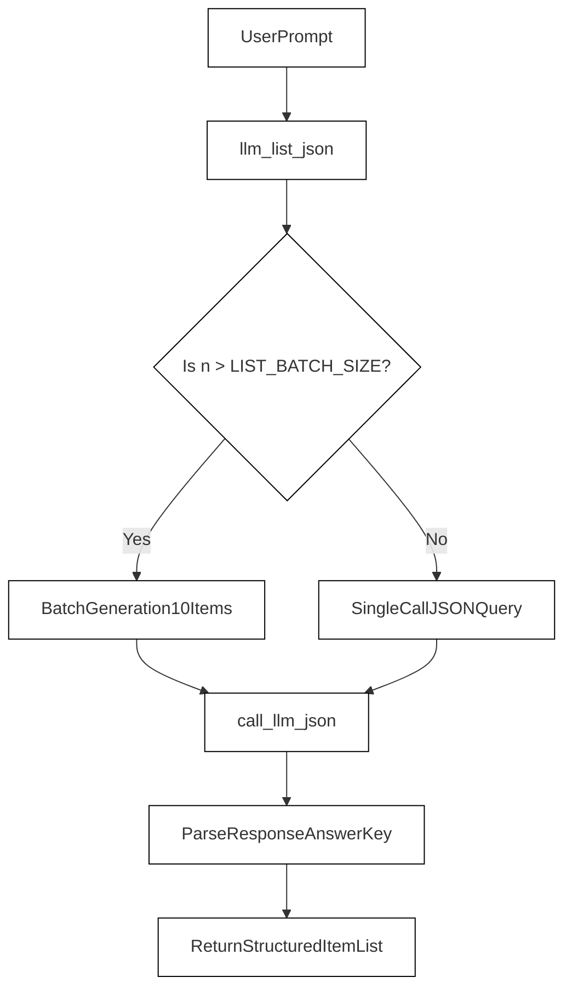
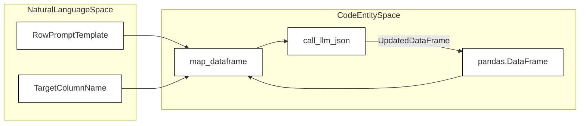

<!-- source: DeepWiki mcp.deepwiki.com · repo allenai/panda · page 4.3 LLM-Powered Data Mapping · fetched 2026-11-09 -->

# LLM-Powered Data Mapping

Relevant source files

The following files were used as context for generating this wiki page:

- [panda/utils/mapping.py](panda/utils/mapping.py)

Purpose and scope: This section details `panda/utils/mapping.py`, which provides utilities for leveraging Large Language Models (LLMs) to generate structured lists, handle batching for large result sets, and map transformations over pandas DataFrames [panda/utils/mapping.py:1-133]().

---

## 1. Core Functions Overview

The mapping module acts as a bridge between high-level natural language queries and structured data containers (lists and pandas DataFrames). The primary entrypoints exposed by `panda/utils/mapping.py` include:

* `llm_list(prompt, temperature, quiet, n, model)`: Queries an LLM to retrieve a flat list of string items [panda/utils/mapping.py:13-38]().
* `llm_list_json(prompt, json_template, temperature, quiet, n, model)`: Queries an LLM to retrieve a structured list of JSON objects, automatically handling chunked batching for large requests [panda/utils/mapping.py:43-118]().
* `map_dataframe(...)`: Applies prompt templates over every row of a pandas DataFrame, storing results in a designated output column [panda/utils/mapping.py:123-133]().

Sources: `panda/utils/mapping.py`

---

## 2. List Generation and Batching Mechanics (`llm_list` & `llm_list_json`)

When generating lists via `llm_list`, the function delegates to `llm_list_json` using a predefined element schema (`{"number": INTEGER, "item": ITEM}`) [panda/utils/mapping.py:29-38](). 

`llm_list_json` implements a robust batching strategy controlled by `LIST_BATCH_SIZE = 10` [panda/utils/mapping.py:10,63-118](). If the requested number of items `n` exceeds this batch size, the system breaks the generation down into manageable iterative prompts, appending responses and catching potential JSON parsing or key errors gracefully to return partial results if necessary [panda/utils/mapping.py:70-118]().

### Natural Language to Code Mapping: List Generation Flow

Sources: `panda/utils/mapping.py`

---

## 3. Dataframe Mapping Architecture

The `map_dataframe` utility (extending through the module) is designed to operate destructively or non-destructively over tabular datasets (`pandas.DataFrame`), executing localized prompts per row and populating target columns [panda/utils/mapping.py:123-133]().

### Natural Language to Code Mapping: DataFrame Transformation Space

Sources: `panda/utils/mapping.py`

---

## Summary of Configuration Constants

| Constant / Parameter | Default Value | Description |
|----------------------|---------------|-------------|
| `LIST_BATCH_SIZE` | `10` | Maximum number of items requested per LLM batch call in `llm_list_json` [panda/utils/mapping.py:10]() |
| `temperature` | `0` | Default generation temperature for deterministic output [panda/utils/mapping.py:29,63]() |
| `model` | `agent_config.PANDA_LLM` | The underlying LLM model identifier used across mapping utilities [panda/utils/mapping.py:29,63]() |

Sources: `panda/utils/mapping.py`

---

