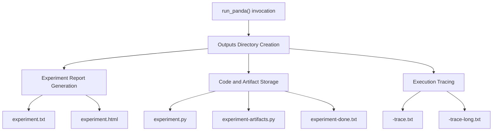

<!-- source: DeepWiki mcp.deepwiki.com · repo allenai/panda · page 5 Experiment Outputs · fetched 2026-11-09 -->

# Experiment Outputs

<details>
<summary>Relevant source files</summary>

The following files were used as context for generating this wiki page:

- [README.md](README.md)
- [output_demo/experiment-20260210-143138/experiment.txt](output_demo/experiment-20260210-143138/experiment.txt)

</details>


## Purpose and Scope

This page provides a high-level overview of the artifact layout and execution traces produced by autonomous research runs in `panda`. When an execution completes, Panda organizes all generated reports, Python source code, intermediate state data, and debugging traces into a structured, timestamped experiment directory. 

For deep technical details regarding specific file semantics and walkthroughs of bundled demo traces, refer to the child pages:
- [Artifact Types and Directory Layout](#5.1)
- [Reading Traces: output_demo Walkthrough](#5.2)

Sources: [README.md:96-108]()

---

## Experiment Output Architecture

When `run_panda()` is invoked, it sets up an output directory path based on the configured `outputs_dir` [README.md:108]() and the current system timestamp. Inside this directory, the agent writes various artifacts reflecting its reasoning process, executed code, and final research report.


*Sources: [README.md:96-108]()*

---

## Bridging Natural Language Space to Code Entity Space

To connect user-facing research concepts with the underlying codebase entities that generate them, the diagram below maps natural language output categories to their corresponding Python modules and file generation routines.

```mermaid
graph TD
    NL_Report[""Research Report (HTML/Text)""] --> Code_Report[""panda_agent/report_writer.py""]
    NL_Trace[""Execution Trace Logs""] --> Code_Trace[""panda/utils/logger.py""]
    NL_Artifacts[""Generated Artifacts & Code""] --> Code_Artifacts[""panda_agent/panda_agent.py""]
    NL_Done[""Completion Status Flag""] --> Code_Done[""panda/run_panda.py""]
```
*Sources: [README.md:96-108]()*

---

## Overview of Child Pages

### 5.1 Artifact Types and Directory Layout
For details on individual file semantics, see [Artifact Types and Directory Layout](#5.1). This child page outlines the precise contents and generation conditions for:
- `experiment.txt` and `experiment.html`: The final synthesized research documents.
- `experiment.py`: The self-contained Python script executed by the agent during the run.
- `experiment-artifacts.py`: Serialized intermediate outputs, dataframes, or figures.
- `experiment-done.txt`: A sentinel flag indicating successful completion of the agent loop.

Sources: [README.md:96-108]()

### 5.2 Reading Traces: output_demo Walkthrough
For a step-by-step trace walkthrough, see [Reading Traces: output_demo Walkthrough](#5.2). This page inspects the bundled `output_demo/` directory to demonstrate how the agent transitions between modes (`strategize`, `plan`, `act`, `reflect`, `debug`) across execution iterations.

Sources: [README.md:7-8](), [output_demo/experiment-20260210-143138/experiment.txt:1-90]()

---

