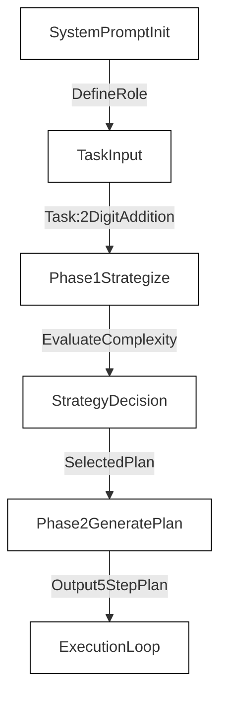
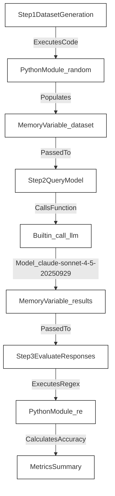

<!-- source: DeepWiki mcp.deepwiki.com · repo allenai/panda · page 5.2 Reading Traces: output_demo Walkthrough · fetched 2026-11-09 -->

# Reading Traces: output_demo Walkthrough

<details>
<summary>Relevant source files</summary>

The following files were used as context for generating this wiki page:

- [output_demo/experiment-20260210-143138/experiment-trace-long.txt](output_demo/experiment-20260210-143138/experiment-trace-long.txt)
- [output_demo/experiment-20260210-143138/experiment-trace.txt](output_demo/experiment-20260210-143138/experiment-trace.txt)
- [output_demo/experiment-20260210-143138/experiment.txt](output_demo/experiment-20260210-143138/experiment.txt)

</details>


## Purpose and Scope

This page provides a technical walkthrough of the bundled demo run located in `output_demo/experiment-20260210-143138/`. By analyzing the trace logs (`experiment-trace-long.txt`, `experiment-trace.txt`) and final output (`experiment.txt`), this page illustrates the end-to-end execution of the Panda autonomous agent—from prompt initialization and strategy selection to Python code generation, interactive execution, evaluation, and report synthesis.

Sources: [output_demo/experiment-20260210-143138/experiment-trace-long.txt:1-139](), [output_demo/experiment-20260210-143138/experiment-trace.txt:1-228](), [output_demo/experiment-20260210-143138/experiment.txt:1-90]()

---

## 1. System Prompt and Strategy Initialization

The agent session initiates by loading a detailed system prompt that defines the autonomous research scientist persona, the execution phases, and available runtime utilities [output_demo/experiment-20260210-143138/experiment-trace-long.txt:1-118]. 

The top-level research task provided in the demo is:
> "How good is Claude at 2-digit addition? Use a dataset of 5 examples." [output_demo/experiment-20260210-143138/experiment-trace-long.txt:116-118]

During **Phase 1 (Pick a Strategy)**, the agent reflects on the task complexity and chooses between a `'do'` strategy (for single-step tasks) or a `'plan'` strategy (for multi-step structured research) [output_demo/experiment-20260210-143138/experiment-trace-long.txt:19-28]. For this task, the agent selects the `'plan'` strategy because evaluating model performance requires dataset generation, querying, and evaluation [output_demo/experiment-20260210-143138/experiment-trace.txt:1-10].

### Diagram: Strategy Initialization and Planning Flow


Sources: [output_demo/experiment-20260210-143138/experiment-trace-long.txt:1-118](), [output_demo/experiment-20260210-143138/experiment-trace.txt:1-10]()

---

## 2. Plan Generation and Execution Workflow

Once the `'plan'` strategy is chosen, the agent generates a structured 5-step research plan [output_demo/experiment-20260210-143138/experiment-trace.txt:4-9]:

1. Generate a dataset of 5 two-digit addition problems with their correct answers [output_demo/experiment-20260210-143138/experiment-trace.txt:5]
2. Query Claude with each addition problem and collect its responses [output_demo/experiment-20260210-143138/experiment-trace.txt:6]
3. Evaluate Claude's responses by comparing them to the correct answers and calculate accuracy [output_demo/experiment-20260210-143138/experiment-trace.txt:7]
4. Display the results showing each problem, Claude's answer, correct answer, and overall accuracy statistics [output_demo/experiment-20260210-143138/experiment-trace.txt:8]
5. Write a report summarizing the findings [output_demo/experiment-20260210-143138/experiment-trace.txt:9]

Sources: [output_demo/experiment-20260210-143138/experiment-trace.txt:4-9]()

---

## 3. Code Execution and Environment Interaction

The execution phase alternates between generating Python code blocks (`Coding...`) and reflecting on the outputs (`Reflecting...`). 

### Step 1: Dataset Generation
The agent uses Python's `random` module with a fixed seed (`seed=42`) to generate two-digit operands ranging from 10 to 99, computing the ground-truth integer sums [output_demo/experiment-20260210-143138/experiment-trace.txt:17-33].

```python
import random
random.seed(42)
dataset = []
for i in range(5):
    num1 = random.randint(10, 99)
    num2 = random.randint(10, 99)
    correct_answer = num1 + num2
    dataset.append({
        'problem_id': i + 1,
        'num1': num1,
        'num2': num2,
        'problem': f"{num1} + {num2}",
        'correct_answer': correct_answer
    })
```
*Cited from: [output_demo/experiment-20260210-143138/experiment-trace.txt:17-33]()*

### Step 2: Querying the LLM via `call_llm`
In Step 2, the agent loops through the dataset and invokes the built-in `call_llm()` utility to query the specified model (`claude-sonnet-4-5-20250929`) at `temperature=0` [output_demo/experiment-20260210-143138/experiment-trace.txt:80-83].

```python
response = call_llm(prompt, model='claude-sonnet-4-5-20250929', temperature=0)
```
*Cited from: [output_demo/experiment-20260210-143138/experiment-trace.txt:83]()*

### Step 3: Response Evaluation via Regular Expressions
The agent parses Claude's text output using regular expressions (`re.findall(r'-?\d+', claude_response)`) to extract the numerical answer, comparing it against the stored `correct_answer` [output_demo/experiment-20260210-143138/experiment-trace.txt:149-159].

### Diagram: Natural Language Plan Steps to Python Entities


Sources: [output_demo/experiment-20260210-143138/experiment-trace.txt:17-160]()

---

## 4. Final Report Synthesis

After completing all execution steps, the agent invokes `write_report()` to compile conversational history and execution metrics into structured research reports (`experiment.txt` and `experiment.html`) [output_demo/experiment-20260210-143138/experiment-trace-long.txt:90-99].

The generated report contains:
- **Abstract**: High-level summary of the methodology, model evaluated, and 100% accuracy result [output_demo/experiment-20260210-143138/experiment.txt:13-17].
- **Introduction**: Contextualization of arithmetic evaluations in LLMs [output_demo/experiment-20260210-143138/experiment.txt:20-28].
- **Approach**: Details on dataset generation, prompt structuring, and evaluation parsing [output_demo/experiment-20260210-143138/experiment.txt:30-58].
- **Results**: Overall performance tables (Table 1) and granular problem-by-problem breakdowns (Table 2) [output_demo/experiment-20260210-143138/experiment.txt:60-90].

Sources: [output_demo/experiment-20260210-143138/experiment-trace-long.txt:90-99](), [output_demo/experiment-20260210-143138/experiment.txt:1-90]()

---

