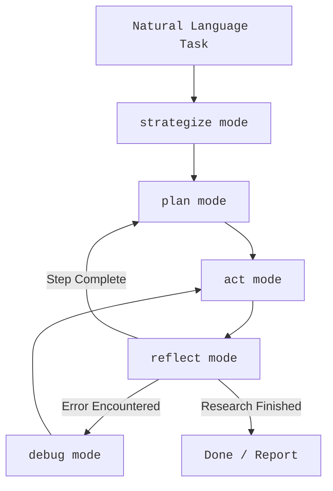
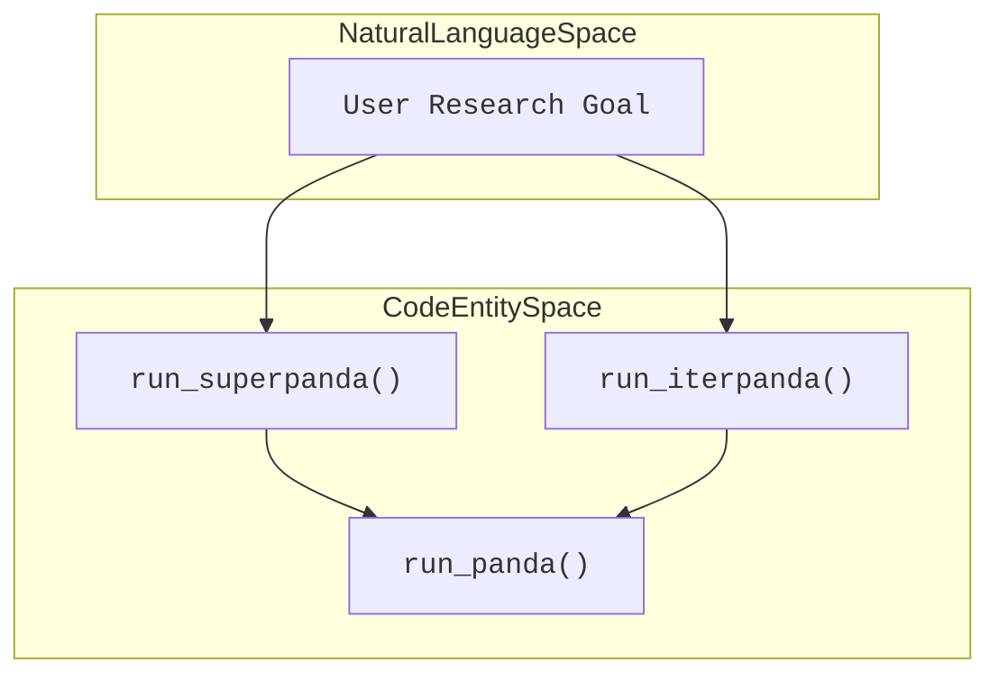

<!-- source: DeepWiki mcp.deepwiki.com · repo allenai/panda · page 6 Glossary · fetched 2026-11-09 -->

# Glossary

<details>
<summary>Relevant source files</summary>

The following files were used as context for generating this wiki page:

- [README.md](README.md)
- [panda/panda_agent/config.py](panda/panda_agent/config.py)
- [panda/panda_agent/panda_agent.py](panda/panda_agent/panda_agent.py)
- [panda/utils/ask_llm.py](panda/utils/ask_llm.py)

</details>


## Purpose and Scope
This page defines Panda-specific terminology, core data structures, execution modes, result flags, and architectural components. It serves as a technical reference linking natural language concepts to concrete code entities within the codebase.

---

## 1. Execution Modes
Panda operates through distinct reasoning and execution phases within its control loop. These modes dictate prompt construction, agent behavior, and the transition of state.

- **`strategize`**: The initial assessment phase where Panda analyzes the task, background knowledge, and outlines high-level research objectives.
- **`plan`**: The phase where Panda generates or updates a sequential list of concrete steps (Python actions) to accomplish the research goal.
- **`act`**: The execution phase where generated Python code snippets are parsed and evaluated within the shared agent namespace.
- **`reflect`**: The evaluation phase where Panda reviews the output, standard error, and dataframes resulting from the `act` phase to determine if progress was made.
- **`debug`**: A corrective phase entered when code execution fails or encounters exceptions, allowing Panda to inspect stack traces and modify code.


*Diagram 1: Natural Language to Code Entity Space mapping for agent execution modes.*

**Sources:** `[panda/panda_agent/panda_agent.py:1-161](), [README.md:1-131]()`

---

## 2. Result Flags
When `run_panda()` completes execution, it returns a status indicator dictating the outcome of the research run.

| Result Flag | Code Representation | Description |
| :--- | :--- | :--- |
| `done` | `"done"` | The research task completed successfully, and all planned objectives (including report generation) were achieved. |
| `abort` | `"abort"` | The agent encountered unrecoverable errors, exceeded maximum retries, or hit iteration limits without fulfilling the task. |
| `shortcut` | `"shortcut"` | The agent took an unapproved or truncated shortcut path (requires `allow_shortcuts=True` to avoid immediate abortion). |

**Sources:** `[README.md:88-96]()`

---

## 3. Advanced Agent Variants: SuperPanda & IterPanda
While standard Panda executes a linear plan-act-reflect loop, the codebase references advanced wrapper architectures for multi-agent coordination and iterative refinement:

- **`SuperPanda`**: An outer orchestration layer (referenced in optional extensions) that manages multiple Panda runs, aggregates independent research hypotheses, or synthesizes cross-experiment findings.
- **`IterPanda`**: An iterative variant designed to repeatedly refine research code or prompts over multiple outer-loop iterations based on quantitative scoring or evaluation feedback.


*Diagram 2: Mapping high-level agent paradigms to underlying Python execution functions.*

**Sources:** `[panda/panda_agent/panda_agent.py:90-95](), [panda/panda_agent/config.py:9-13]()`

---

## 4. Core Runtime Concepts

### Namespace
The `namespace` is a persistent Python dictionary (`dict`) encapsulated within the `State` class that stores all variables, functions, imported modules, and dataframes created during code execution steps. It is passed directly into Python's built-in `exec()` function across steps.

```python
class State:
    def __init__(self, iteration=0, observations="", namespace=None):
        self.iteration = iteration
        self.observations = observations
        self.namespace = namespace or {}
```
*Defined at `[panda/panda_agent/panda_agent.py:150-155]()`.*

### LoggerTee
`LoggerTee` is a stream redirection utility that duplicates standard output and standard error streams, writing them simultaneously to the active terminal and persistent log files (`experiment-trace.txt` and `experiment-trace-long.txt`).

### report_pathstem
The `report_pathstem` is the base file path (e.g., `output/experiment-20251111-095236/experiment`) used to generate all run artifacts, including `experiment.txt`, `experiment.html`, `experiment.py`, and `experiment-artifacts.py`.

**Sources:** `[panda/panda_agent/panda_agent.py:28-36](), [panda/panda_agent/panda_agent.py:150-155](), [README.md:88-96]()`