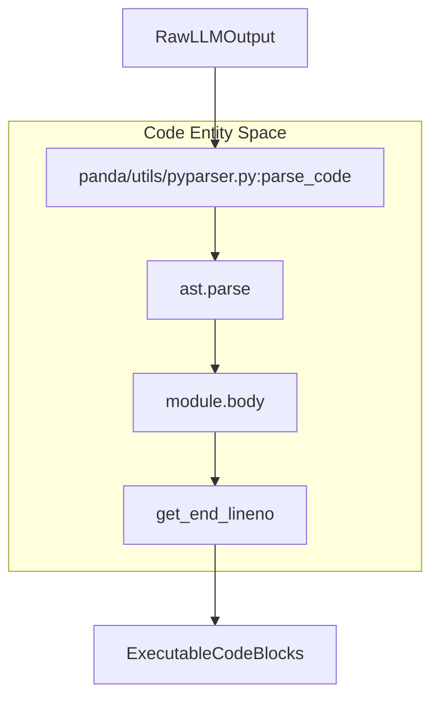
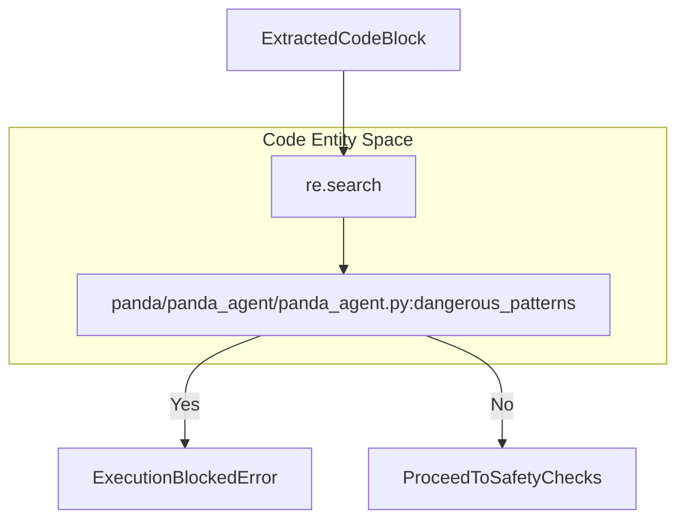
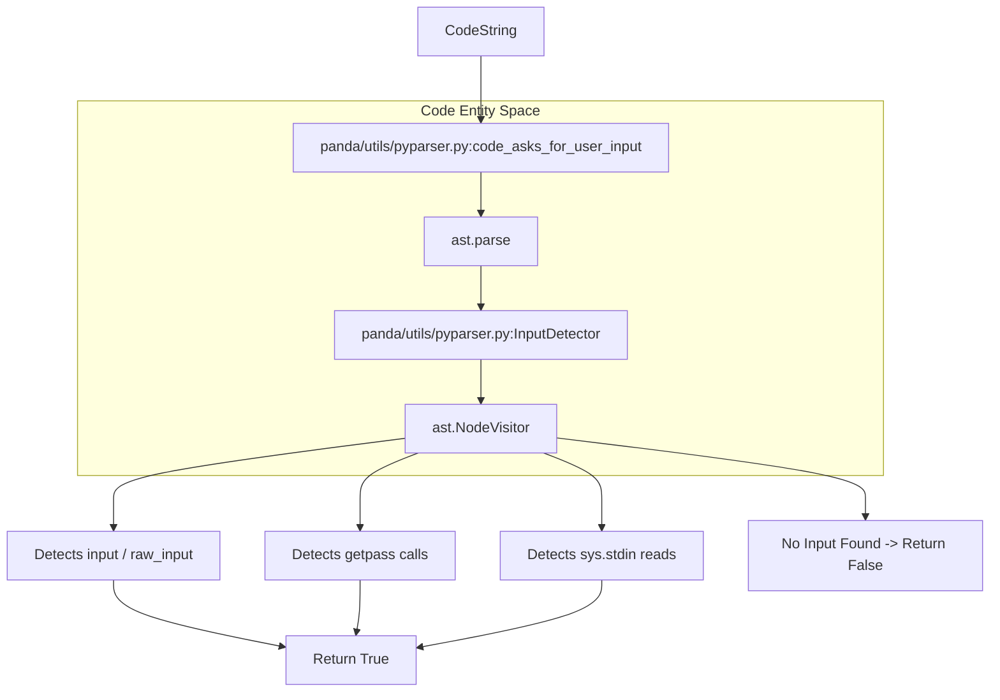
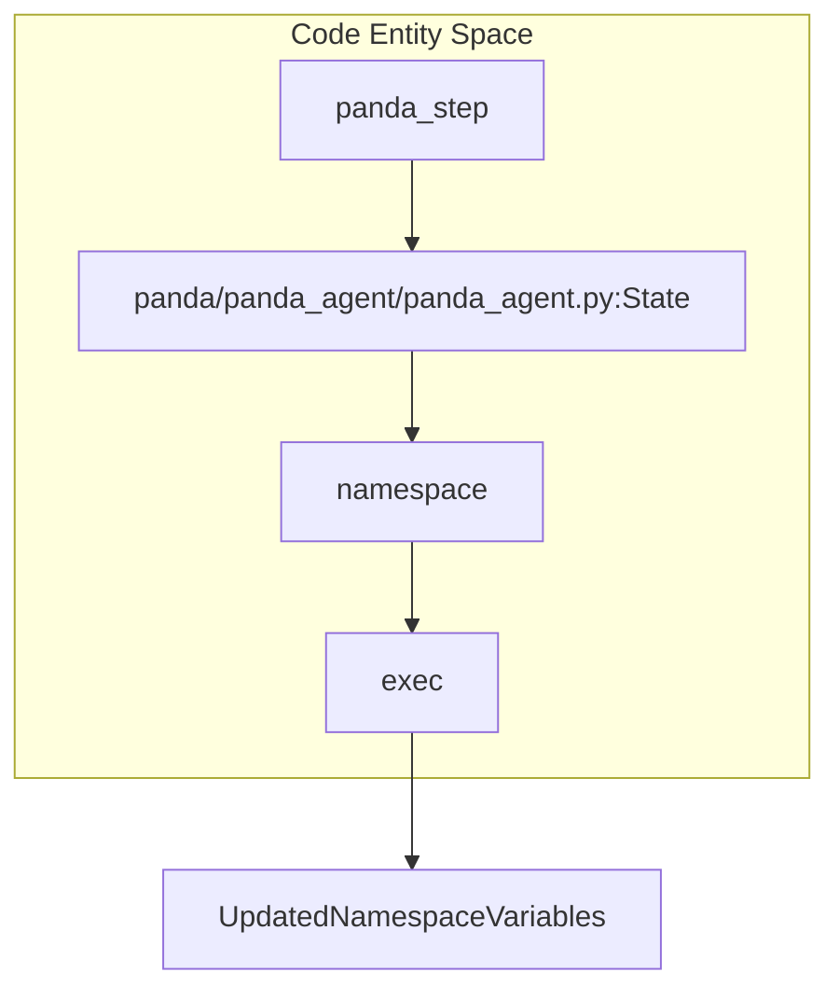

<!-- source: DeepWiki mcp.deepwiki.com · repo allenai/panda · extra page Code Execution & Safety · fetched 2026-11-09 -->

# Code Execution & Safety

<details>
<summary>Relevant source files</summary>

The following files were used as context for generating this wiki page:

- [panda/panda_agent/panda_agent.py](panda/panda_agent/panda_agent.py)
- [panda/utils/pyparser.py](panda/utils/pyparser.py)

</details>


This section covers the core mechanics of executing generated code within the Panda autonomous research agent. It details how code blocks are parsed, vetted against safety constraints and blocklists, checked for forbidden interactive user inputs, scoped within execution namespaces, and constrained by time limits.

---

## 1. Code Parsing and Extraction

Generated responses from Large Language Models often contain markdown code blocks or raw script sections. Panda uses an Abstract Syntax Tree (AST)-based parser to extract and segment executable code blocks cleanly before evaluation.

The primary parsing function is `parse_code(x)`, located in `panda/utils/pyparser.py`. It reads a string `x`, parses it into an AST module using `ast.parse(x)`, and traverses top-level statements to isolate discrete blocks based on starting and ending line numbers.


*Diagram: Natural language execution payload parsing flow mapping to code entities.*

**Sources:** `[panda/utils/pyparser.py:16-32]()`

---

## 2. Dangerous Pattern Blocklist

To prevent the agent from executing destructive, recursive, or resource-exhausting filesystem operations (such as infinite zipping or directory duplication loops), Panda evaluates code against a set of regex-based `dangerous_patterns`.

The blocklist explicitly prohibits:
- `shutil.make_archive`: Prevents recursive self-archiving loops common in certain LLM outputs.
- `zipfile.ZipFile`: Prevents manual archive generation that can inflate file system storage.
- `tarfile.open`: Prevents tar/gzip bundle creation.

```python
dangerous_patterns = [
    r"shutil\.make_archive",
    r"zipfile.ZipFile",
    r"tarfile\.open",
]
```


*Diagram: Safety verification flow checking dangerous patterns.*

**Sources:** `[panda/panda_agent/panda_agent.py:98-103]()`

---

## 3. User-Input Detection

Because Panda runs as a fully autonomous agent, any code that attempts to halt execution and wait for user prompts (`input()`, `getpass()`, or `sys.stdin.read()`) will cause the execution thread to hang. Panda detects and intercepts these patterns statically prior to running the code.

The check is implemented via `code_asks_for_user_input(code)` and the `InputDetector` visitor class in `panda/utils/pyparser.py`.


*Diagram: Static analysis data flow for user-input detection.*

`InputDetector` tracks:
- Module aliases (e.g., `import sys as s`, `import getpass`)
- Function names imported from `getpass`
- File handles defined by `open(...)` or `with open(...)` to ensure legitimate file reads are not flagged as `sys.stdin` reads.

**Sources:** `[panda/utils/pyparser.py:40-162]()`

---

## 4. Execution Namespace and State

Code execution takes place within a shared execution `State` object that persists variables and dataframes across iteration steps. The `State` class is defined in `panda/panda_agent/panda_agent.py`.

```python
class State:
    def __init__(self, iteration=0, observations="", namespace=None):
        self.iteration = iteration
        self.observations = observations
        self.namespace = namespace or {}
```

The `namespace` dictionary acts as the globals/locals scope passed directly into Python's built-in `exec()` function during action execution. This allows variables created in step $N$ (such as pandas DataFrames or trained models) to be accessed natively in step $N+1$.


*Diagram: State variable propagation through execution cycles.*

**Sources:** `[panda/panda_agent/panda_agent.py:150-155]()`

---

## 5. Timeouts and Guardrails

To prevent infinite loops or long-hanging external library calls during action execution, Panda wraps code execution in timeout guards using `func_timeout`.

If a generated action block exceeds its allotted execution window, a `FunctionTimedOut` exception is raised, caught by the agent loop, and fed back to the LLM as an observation error so it can self-debug or adjust its approach in subsequent iterations.

**Sources:** `[panda/panda_agent/panda_agent.py:47]()`, `[panda/panda_agent/panda_agent.py:116-122]()`

---

