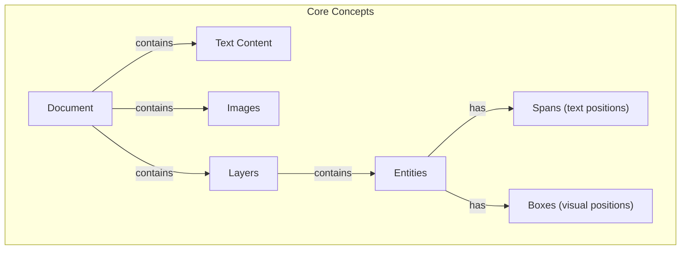
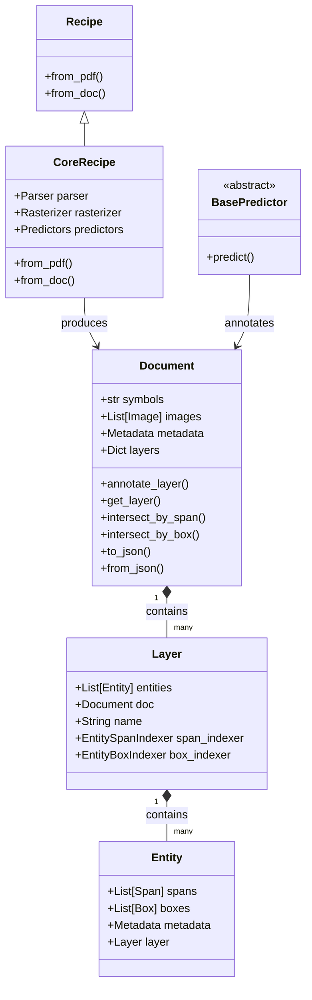
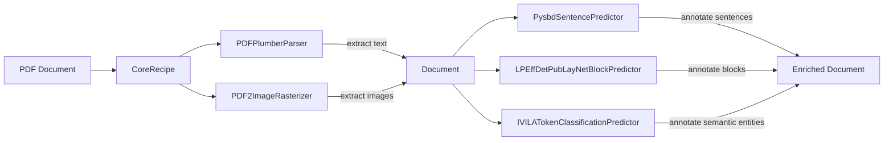
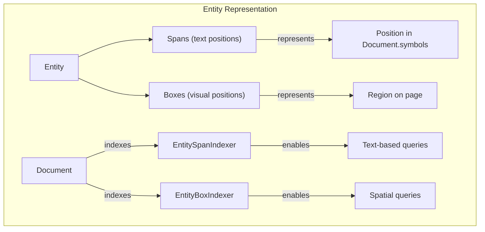

<!-- source: DeepWiki mcp.deepwiki.com · repo allenai/papermage · page 1 Overview · fetched 2026-10-26 -->

# Overview

<details>
<summary>Relevant source files</summary>

The following files were used as context for generating this wiki page:

- [README.md](README.md)
- [papermage/magelib/__init__.py](papermage/magelib/__init__.py)
- [papermage/magelib/document.py](papermage/magelib/document.py)
- [papermage/magelib/names.py](papermage/magelib/names.py)
- [papermage/recipes/core_recipe.py](papermage/recipes/core_recipe.py)
- [pyproject.toml](pyproject.toml)
- [tests/fixtures/2020.acl-main.447.pdf](tests/fixtures/2020.acl-main.447.pdf)

</details>


Papermage is a unified toolkit for processing, representing, and manipulating scientific PDFs. It provides a structured framework for extracting, analyzing, and annotating content from academic papers, enabling advanced document understanding and manipulation.

This overview introduces the key concepts, architecture, and workflow of the Papermage library. For more detailed information on specific components, please refer to the corresponding sections in this wiki.

## Core Concepts

Papermage is built around three fundamental concepts:

1. **Document**: The central data structure that represents a scientific paper, containing both text and visual elements.

2. **Entity**: Represents a segment of document content (e.g., a sentence, paragraph, or figure) with both textual and spatial properties.

3. **Layer**: A collection of entities of the same type (e.g., all sentences, all figures) within a document.



Sources: [papermage/magelib/document.py:33-174](), [papermage/magelib/__init__.py:9-86]()

## System Architecture

Papermage is organized into several key components that work together to process and represent scientific documents:



Sources: [papermage/magelib/document.py:33-196](), [papermage/recipes/core_recipe.py:77-152]()

## Document Processing Workflow

The Papermage workflow follows these general steps:

1. **Parsing**: Extract text and structural information from PDFs
2. **Rasterization**: Convert PDF pages to images
3. **Prediction**: Apply models to identify and classify document elements
4. **Annotation**: Add structured information to the document



Sources: [papermage/recipes/core_recipe.py:77-152]()

## Layer Types and Entity Classification

Papermage provides support for a wide range of document elements organized as layers:

| Layer Type | Description | Example Use |
|------------|-------------|-------------|
| Tokens | Basic text units | Tokenization, word analysis |
| Sentences | Text segments ending with punctuation | NLP analysis, content extraction |
| Blocks | Visual layout blocks | Layout analysis |
| Figures | Image elements in the document | Figure extraction, visual analysis |
| Tables | Tabular data in the document | Data extraction |
| Sections | Logical document sections | Document structure analysis |
| Paragraphs | Text paragraphs | Content extraction |
| Titles | Document and section titles | Metadata extraction |
| Abstracts | Paper abstracts | Content summarization |
| Equations | Mathematical formulas | Formula extraction |

Sources: [papermage/magelib/names.py:1-38](), [papermage/recipes/core_recipe.py:57-74]()

## Usage Example

The typical usage pattern for Papermage involves creating a Document from a PDF, then accessing its structured content:

```python
# Create a Document from a PDF
from papermage.recipes import CoreRecipe

recipe = CoreRecipe()
doc = recipe.from_pdf("path/to/paper.pdf")

# Access document content through layers
for page in doc.pages:
    for section in page.sections:
        print(f"Section: {section.text}")
        
        for paragraph in section.paragraphs:
            print(f"  Paragraph: {paragraph.text}")
            
            for sentence in paragraph.sentences:
                print(f"    Sentence: {sentence.text}")
```

Sources: [README.md:47-52](), [README.md:84-97]()

## Entity Representation and Indexing

Each Entity in Papermage has two key positional representations:

1. **Spans**: Text positions within the document's symbols string
2. **Boxes**: Visual positions on the document pages

These representations allow for both textual and spatial querying within the document:



Sources: [README.md:148-158](), [papermage/magelib/document.py:190-196]()

## Document Serialization

Papermage allows documents to be serialized to JSON and reconstructed later:

```python
# Save document to JSON
with open('document.json', 'w') as f_out:
    json.dump(doc.to_json(), f_out, indent=4)

# Load document from JSON
with open('document.json') as f_in:
    doc_dict = json.load(f_in)
    doc = Document.from_json(doc_dict)
```

Sources: [README.md:174-204](), [papermage/magelib/document.py:128-171]()

## Core Dependencies

Papermage builds upon several key libraries to provide its functionality:

| Component | Main Dependencies |
|-----------|------------------|
| Parsing | pdfplumber |
| Rasterization | pdf2image |
| Layout Analysis | layoutparser, effdet |
| Text Processing | pysbd, transformers |
| Visual Layout Analysis | villa, ivila |

Sources: [pyproject.toml:8-38](), [pyproject.toml:114-134]()

---

