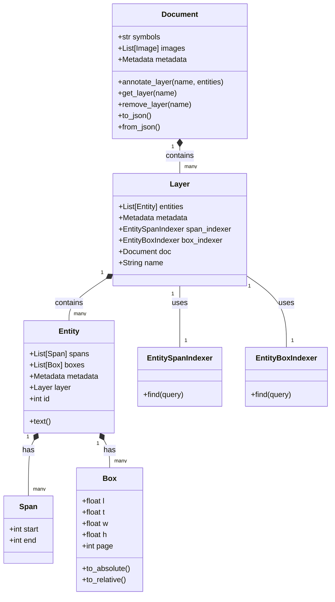
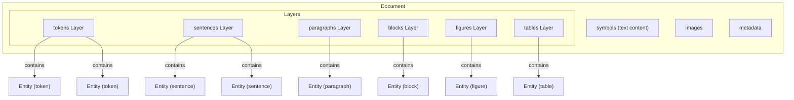
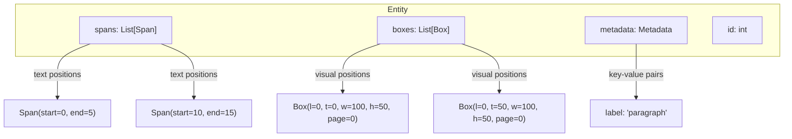
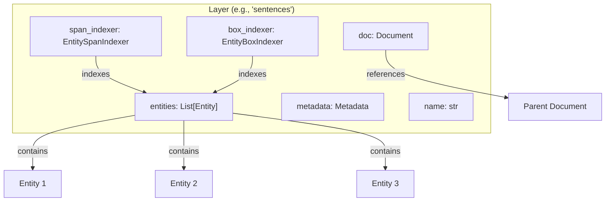
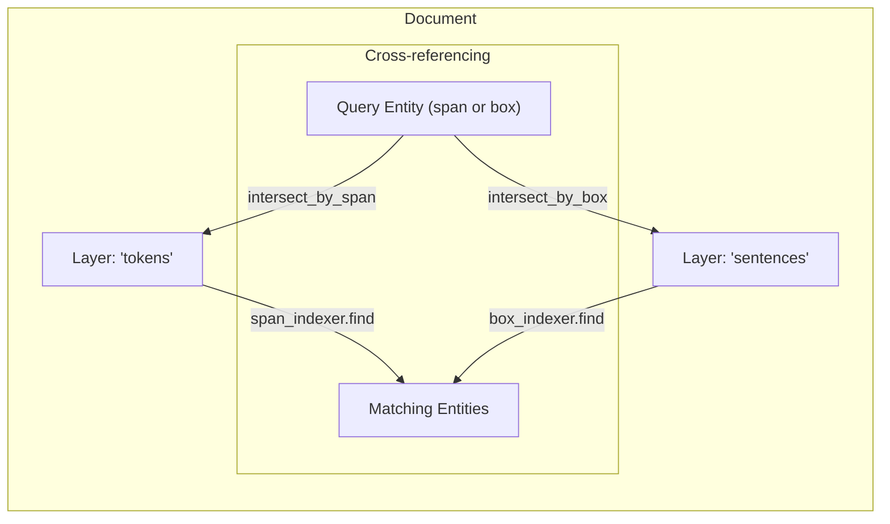
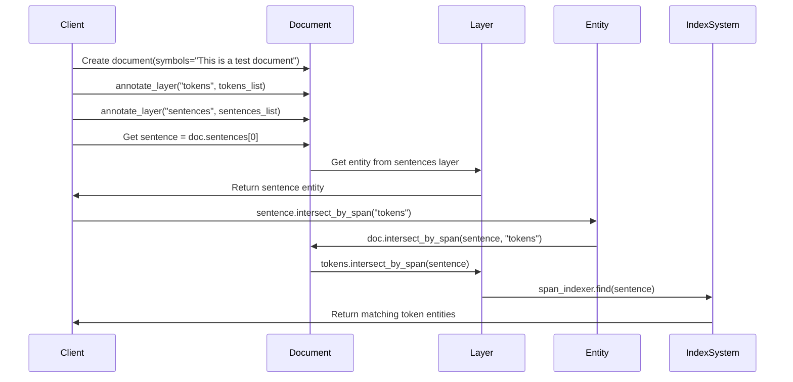

<!-- source: DeepWiki mcp.deepwiki.com · repo allenai/papermage · page 2 Core Data Model · fetched 2026-10-26 -->

# Core Data Model

<details>
<summary>Relevant source files</summary>

The following files were used as context for generating this wiki page:

- [papermage/magelib/__init__.py](papermage/magelib/__init__.py)
- [papermage/magelib/document.py](papermage/magelib/document.py)
- [papermage/magelib/entity.py](papermage/magelib/entity.py)
- [papermage/magelib/layer.py](papermage/magelib/layer.py)
- [papermage/magelib/names.py](papermage/magelib/names.py)
- [papermage/predictors/vila_predictors.py](papermage/predictors/vila_predictors.py)
- [tests/test_magelib/test_document.py](tests/test_magelib/test_document.py)
- [tests/test_magelib/test_indexer.py](tests/test_magelib/test_indexer.py)

</details>


The Core Data Model in Papermage defines the fundamental data structures that represent documents and their content. This foundation enables the extraction, annotation, and manipulation of document information through a flexible and hierarchical representation system. This page explains the key components of this model and how they relate to each other.

For information about how documents are processed using these structures, see [Document Processing Pipeline](#3).

## Overview

Papermage's Core Data Model is designed around a Document-Entity-Layer architecture. This system allows representation of both textual and visual content while maintaining the relationships between different document elements.



Sources: [papermage/magelib/document.py:33-196](), [papermage/magelib/entity.py:20-199](), [papermage/magelib/layer.py:22-123]()

## Document Structure

The `Document` class is the central data structure in Papermage. It represents a complete document with its content and structural annotations.

### Key Properties

| Property | Type | Description |
|----------|------|-------------|
| `symbols` | `str` | The raw text content of the document |
| `images` | `List[Image]` | Images extracted from the document |
| `metadata` | `Metadata` | Additional document metadata |
| `layers` | `List[str]` | Names of all available layers |

Sources: [papermage/magelib/document.py:44-51](), [papermage/magelib/document.py:57-59]()

### Layer Management

A Document contains multiple layers of annotations. Each layer represents a specific type of document element (e.g., tokens, sentences, paragraphs) and contains a collection of entities of that type.



The Document class provides methods to annotate, retrieve, and remove layers:

- `annotate_layer(name, entities)`: Adds a new layer with the given name and entities
- `get_layer(name)`: Retrieves a layer by name
- `remove_layer(name)`: Removes a layer by name

Sources: [papermage/magelib/document.py:69-99](), [papermage/magelib/names.py:7-37]()

### Document Serialization

Document objects can be serialized to and from JSON format:

- `to_json()`: Converts the document to a JSON-serializable dictionary
- `from_json()`: Creates a Document object from a JSON dictionary

Sources: [papermage/magelib/document.py:128-171]()

## Entity and Layer System

### Entities

An `Entity` represents an annotated unit in a document, such as a token, sentence, paragraph, or figure. Entities are positioned using spans (text positions) and/or boxes (visual positions).



Key features of an Entity:

- Can have both text positions (spans) and visual positions (boxes)
- Has metadata containing additional information
- Can extract its text content from the document
- References its parent layer and has a unique ID within that layer

Sources: [papermage/magelib/entity.py:20-199]()

### Layers

A `Layer` is a collection of entities of the same type. It provides methods for accessing and managing these entities, as well as indexing for efficient retrieval.



Layers act as both collections and indexers:

- Support standard list operations (indexing, iteration, length)
- Maintain span and box indexers for efficient entity retrieval
- Reference their parent document for cross-layer querying

Sources: [papermage/magelib/layer.py:22-123]()

## Span and Box Representations

### Spans

A `Span` represents a text position in the document's symbols:

- `start`: The starting character index
- `end`: The ending character index (exclusive)

Spans are used to extract text content from the document:

```python
document.symbols[span.start:span.end]  # Gets the text content for this span
```

### Boxes

A `Box` represents a visual position on a page:

- `l`: Left coordinate (x-position)
- `t`: Top coordinate (y-position)
- `w`: Width
- `h`: Height
- `page`: Page number

Boxes use normalized coordinates (0-1) relative to the page dimensions, but can be converted to absolute pixel coordinates using:

```python
box.to_absolute(page_width=width, page_height=height)
```

Sources: [papermage/magelib/entity.py:138-185]()

## Indexing and Retrieval

The Papermage data model includes specialized indexers for efficient entity retrieval based on text or visual position overlap.

### Entity Indexers

- `EntitySpanIndexer`: Indexes entities based on their text spans
- `EntityBoxIndexer`: Indexes entities based on their visual boxes

These indexers are used to find entities that overlap with a query entity:



### Cross-Layer Referencing

The Document provides methods for cross-referencing entities between layers:

- `intersect_by_span(query, name)`: Finds entities in the named layer that intersect with the query entity's spans
- `intersect_by_box(query, name)`: Finds entities in the named layer that intersect with the query entity's boxes

This allows for rich queries such as finding all tokens within a paragraph, or all figures overlapping with a specific text region.

Sources: [papermage/magelib/document.py:176-196](), [tests/test_magelib/test_document.py:93-211](), [tests/test_magelib/test_indexer.py:19-126]()

## Practical Example

Here's a practical example of how these components work together:



This example demonstrates:
1. Creating a document with text content
2. Annotating it with token and sentence layers
3. Retrieving a sentence entity
4. Finding all tokens that overlap with the sentence

Sources: [tests/test_magelib/test_document.py:20-45](), [tests/test_magelib/test_document.py:93-152]()

## Conclusion

The Core Data Model in Papermage provides a flexible and powerful representation system for document content. Through its Document-Entity-Layer architecture, it supports both textual and visual annotations, efficient cross-referencing, and rich querying capabilities. This foundation enables the sophisticated document processing pipelines and analysis tools built on top of it.

---

