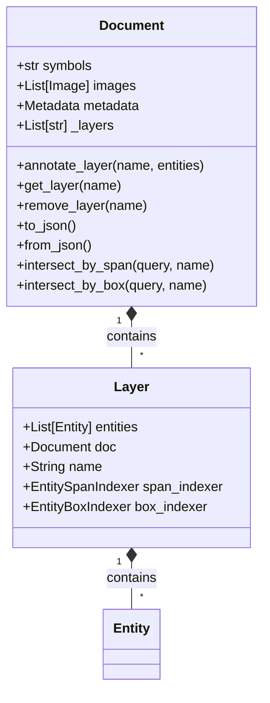
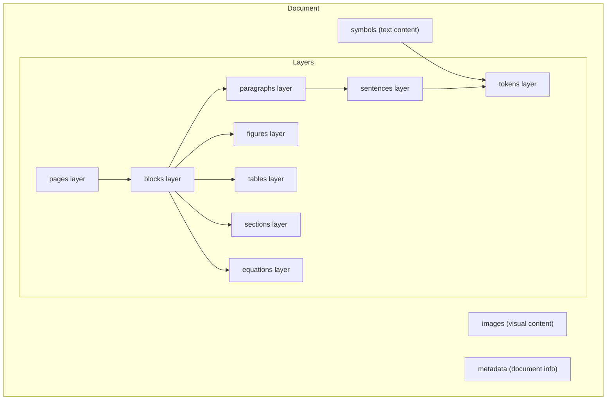
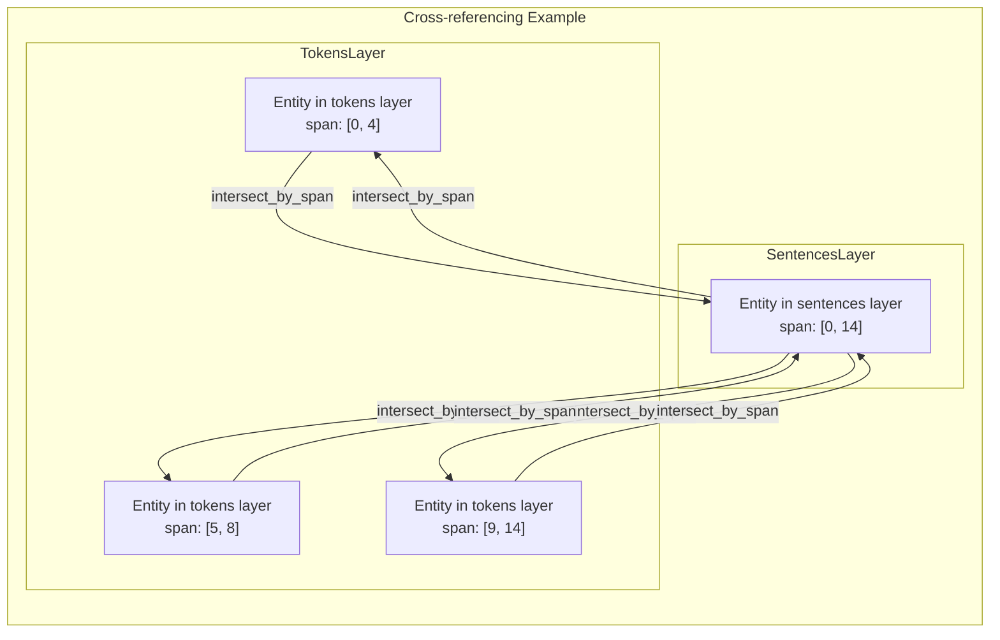

<!-- source: DeepWiki mcp.deepwiki.com · repo allenai/papermage · page 2.1 Document Structure · fetched 2026-10-26 -->

# Document Structure

<details>
<summary>Relevant source files</summary>

The following files were used as context for generating this wiki page:

- [papermage/magelib/__init__.py](papermage/magelib/__init__.py)
- [papermage/magelib/document.py](papermage/magelib/document.py)
- [papermage/magelib/names.py](papermage/magelib/names.py)
- [tests/test_magelib/test_document.py](tests/test_magelib/test_document.py)
- [tests/test_magelib/test_indexer.py](tests/test_magelib/test_indexer.py)

</details>


## Purpose and Scope

This document explains the core `Document` class in Papermage, which serves as the central data structure for representing document content and annotations. The Document acts as a container that holds both the textual content and visual elements of a document, along with structured annotations organized in layers.

For information about the Entity and Layer system that powers annotations, see [Entity and Layer System](#2.2). For details on how spans and boxes represent positions within documents, see [Span and Box Representations](#2.3).

## Document Class Overview

The `Document` class is defined in the Papermage library as the foundational data structure that represents processed documents. It contains text content, images, metadata, and layers of annotations that represent different aspects of document structure.



Sources: 
- [papermage/magelib/document.py:33-174]()
- [papermage/magelib/__init__.py:9-10]()

## Document Initialization

A `Document` object must be initialized with at least one of the following:
- `symbols`: A string containing the document's text content
- `images`: A list of `Image` objects representing the document's visual content

```python
# Create a document with text content
doc = Document(symbols="This is a test document")

# Create a document with both text and images
doc = Document(symbols="Text content", images=[image1, image2])
```

If neither `symbols` nor `images` is provided, the constructor will raise a `ValueError`.

Sources:
- [papermage/magelib/document.py:44-55]()
- [tests/test_magelib/test_document.py:21-23]()

## Document Structure Hierarchy

The Document structure can be visualized as a hierarchical organization of content, with layers representing different levels of document structure:



Sources:
- [papermage/magelib/document.py:33-41]()
- [papermage/magelib/names.py:7-37]()

## Layer Management

The Document class provides methods for adding, accessing, and removing layers of annotations.

### Adding Layers

Layers are added using the `annotate_layer` method, which takes a name and a list of entities:

```python
# Create some token entities
tokens = [Entity(spans=[(0, 4)]), Entity(spans=[(5, 9)])]

# Add the tokens layer to the document
doc.annotate_layer(name="tokens", entities=tokens)
```

The method validates the layer name, creates a new Layer object, and adds it to the document.

### Accessing Layers

Layers can be accessed either as attributes or using the `get_layer` method:

```python
# Access as attribute
tokens = doc.tokens

# Access using get_layer
tokens = doc.get_layer(name="tokens")
```

### Removing Layers

Layers can be removed using the `remove_layer` method:

```python
doc.remove_layer(name="tokens")
```

Sources:
- [papermage/magelib/document.py:69-99]()
- [tests/test_magelib/test_document.py:31-43]()

## Standard Layer Types

Papermage defines standard names for common types of document elements, which are used as layer names:

| Layer Name | Description |
|------------|-------------|
| `pages` | Document pages |
| `tokens` | Individual tokens (words or characters) |
| `rows` | Rows of text |
| `blocks` | Text blocks or regions |
| `sentences` | Sentences in the document |
| `paragraphs` | Paragraphs in the document |
| `titles` | Document and section titles |
| `authors` | Author information |
| `abstracts` | Document abstracts |
| `sections` | Document sections |
| `figures` | Figures and diagrams |
| `tables` | Tables in the document |
| `equations` | Mathematical equations |
| `bibliographies` | Bibliography entries |

Sources:
- [papermage/magelib/names.py:7-37]()
- [papermage/magelib/document.py:34-41]()

## Entity Cross-referencing

One of the most powerful features of the Document model is entity cross-referencing, which allows querying relationships between entities in different layers.



Cross-referencing can be performed in two ways:

1. Using entity attribute access (implicitly uses spans for intersection):
```python
# Get all tokens that intersect with a sentence
tokens_in_sentence = sentence.tokens

# Get all sentences that contain a token
sentences_with_token = token.sentences
```

2. Using explicit intersection methods:
```python
# Find entities by span intersection
tokens_in_sentence = doc.intersect_by_span(query=sentence, name="tokens")

# Find entities by box (visual) intersection
tokens_in_sentence = doc.intersect_by_box(query=sentence, name="tokens")
```

Sources:
- [papermage/magelib/document.py:176-196]()
- [tests/test_magelib/test_document.py:93-152]()

## Serialization

Documents can be serialized to and from JSON for storage and exchange.

### To JSON

```python
# Serialize the entire document
doc_json = doc.to_json()

# Serialize specific layers
doc_json = doc.to_json(layers=["tokens", "sentences"])

# Include images in serialization
doc_json = doc.to_json(with_images=True)
```

The JSON output follows this structure:
```json
{
    "symbols": "document text content",
    "metadata": {"key": "value"},
    "entities": {
        "tokens": [{"spans": [[0, 4]], "boxes": [[0, 0, 1, 1, 0]]}, ...],
        "sentences": [{"spans": [[0, 23]], "boxes": [[0, 0, 10, 1, 0]]}, ...],
        ...
    },
    "relations": {}
}
```

### From JSON

```python
# Deserialize a document
doc = Document.from_json(doc_json)
```

Sources:
- [papermage/magelib/document.py:128-171]()
- [tests/test_magelib/test_document.py:51-91]()

## Layer Name Validation

When adding a layer, the Document class validates that the layer name:
- Is not one of the special fields (symbols, images, metadata)
- Does not already exist in the document
- Does not clash with Document class properties

```python
def validate_layer_name_availability(self, name: str) -> None:
    if name in self.layers:
        raise AssertionError(f"{name} not allowed Document.SPECIAL_FIELDS.")
    if name in self.layers:
        raise AssertionError(f'{name} already exists. Try `doc.remove_layer("{name}")` first.')
    if name in dir(self):
        raise AssertionError(f"{name} clashes with Document class properties.")
```

Sources:
- [papermage/magelib/document.py:61-67]()

## Cross-referencing with Missing Fields

When cross-referencing entities that are missing spans or boxes, the system handles these cases gracefully:

- If searching by span but entities don't have spans, empty results are returned
- If searching by box but entities don't have boxes, empty results are returned

```python
# If chunks have boxes but no spans:
doc.intersect_by_span(query=doc.chunks[0], name="tokens")  # Returns []

# If tokens have spans but no boxes:
doc.intersect_by_box(query=doc.tokens[0], name="chunks")  # Returns []
```

Sources:
- [tests/test_magelib/test_document.py:180-212]()

## Indexing System

The Document uses specialized indexers for efficient entity lookup:

1. `EntitySpanIndexer`: Indexes entities by their text spans
2. `EntityBoxIndexer`: Indexes entities by their visual boxes

These indexers are automatically created for each layer and enable fast cross-referencing operations.

Sources:
- [tests/test_magelib/test_indexer.py:19-127]()
- [papermage/magelib/__init__.py:13]()

## Document Properties and Methods

| Property/Method | Description |
|-----------------|-------------|
| `symbols` | Text content of the document |
| `images` | List of images in the document |
| `metadata` | Document metadata dictionary |
| `layers` | List of all layer names |
| `annotate_layer(name, entities)` | Adds a new layer |
| `get_layer(name)` | Gets a layer by name |
| `remove_layer(name)` | Removes a layer |
| `to_json()` | Serializes to JSON |
| `from_json()` | Deserializes from JSON |
| `intersect_by_span(query, name)` | Finds entities by span intersection |
| `intersect_by_box(query, name)` | Finds entities by box intersection |

Sources:
- [papermage/magelib/document.py:33-196]()

---

