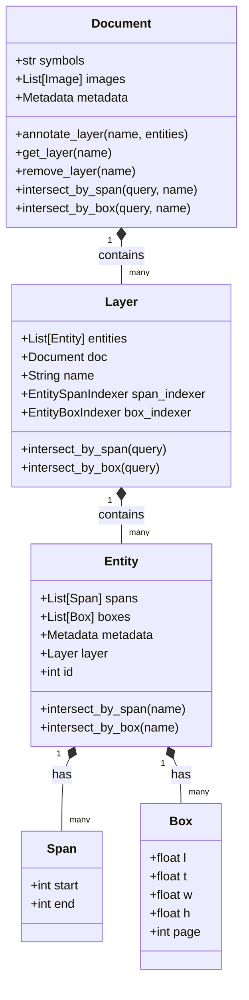
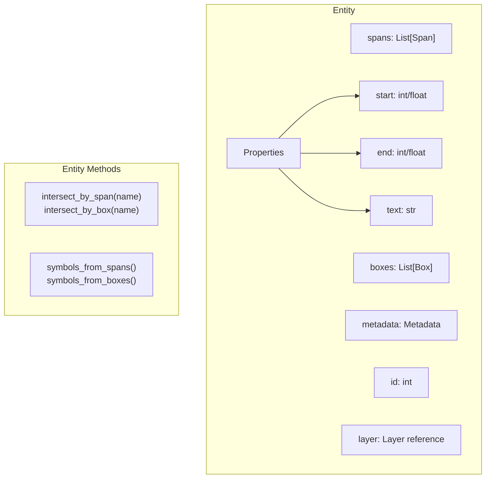
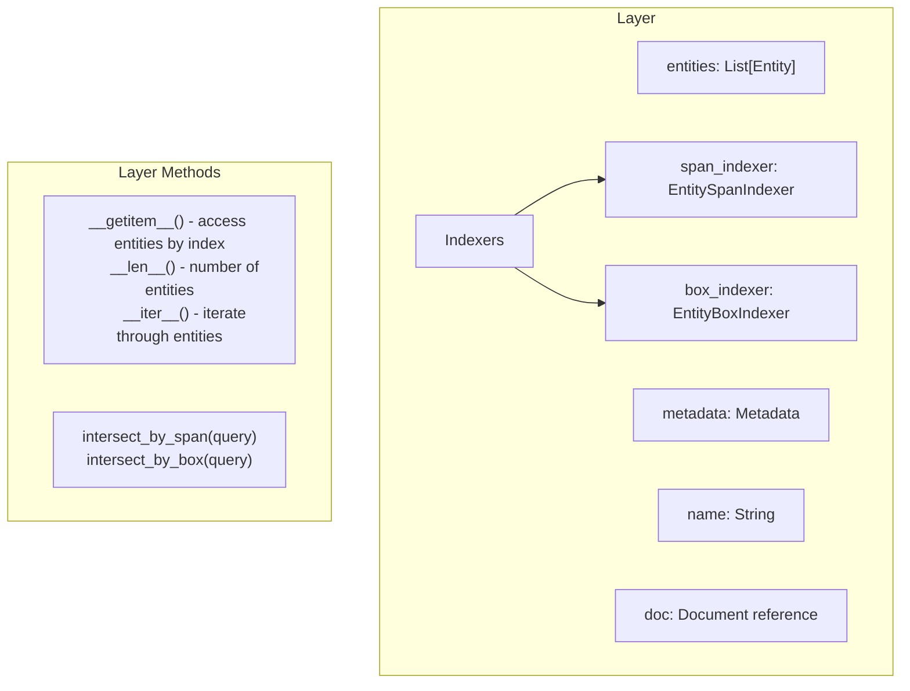
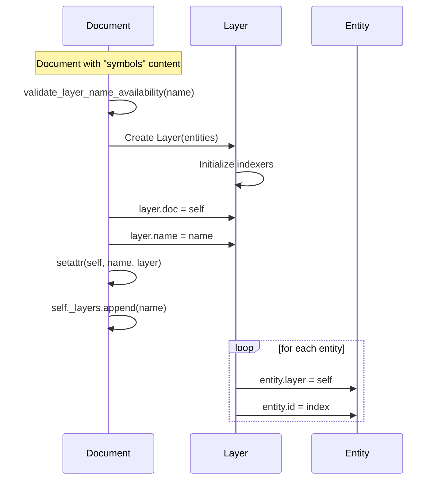
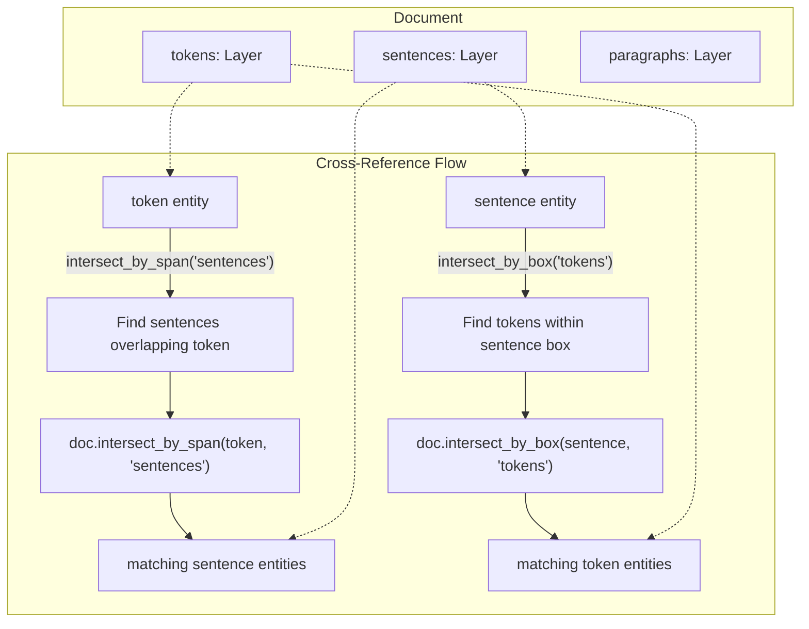
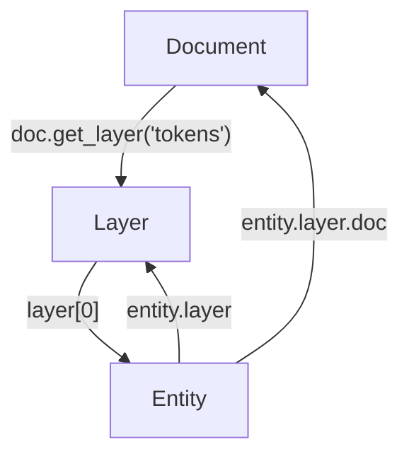

<!-- source: DeepWiki mcp.deepwiki.com · repo allenai/papermage · page 2.2 Entity and Layer System · fetched 2026-10-26 -->

# Entity and Layer System

<details>
<summary>Relevant source files</summary>

The following files were used as context for generating this wiki page:

- [papermage/magelib/__init__.py](papermage/magelib/__init__.py)
- [papermage/magelib/document.py](papermage/magelib/document.py)
- [papermage/magelib/entity.py](papermage/magelib/entity.py)
- [papermage/magelib/layer.py](papermage/magelib/layer.py)
- [papermage/magelib/names.py](papermage/magelib/names.py)
- [papermage/predictors/vila_predictors.py](papermage/predictors/vila_predictors.py)
- [tests/test_magelib/test_document.py](tests/test_magelib/test_document.py)
- [tests/test_magelib/test_indexer.py](tests/test_magelib/test_indexer.py)

</details>


## Purpose and Overview

The Entity and Layer System is the core annotation framework in Papermage that enables representing, managing, and querying structured information extracted from documents. This system provides a flexible way to organize various types of document annotations (such as tokens, sentences, paragraphs, etc.) into logical groupings called Layers, which contain individual annotation units called Entities.

This page explains the structure and functionality of the Entity and Layer classes, how they interact with Documents, and the mechanisms for cross-referencing and searching annotations.

For information about how entities are located in a document, see [Span and Box Representations](#2.3). For information about efficient entity lookup, see [Indexing and Retrieval](#2.4).

## Core Concepts and Relationships

The Entity and Layer System follows a structured hierarchy to organize annotations:



Sources: [papermage/magelib/document.py:33-72](). [papermage/magelib/layer.py:22-37](). [papermage/magelib/entity.py:20-41]().

## Entity Class

An Entity is an individual annotation unit within a document, representing a specific element like a token, sentence, paragraph, or any other documentable unit.

### Key Features of Entity

- Requires at least one of spans (text positions) or boxes (visual bounding boxes)
- Can contain metadata about the entity (e.g., text, label, type)
- References its parent Layer to enable cross-document queries
- Has a unique ID within its layer, establishing a reading order
- Provides methods to access related entities in other layers
- Can be serialized to and from JSON

### Entity Structure and Properties



Sources: [papermage/magelib/entity.py:20-98](). [papermage/magelib/entity.py:137-188]().

### Creating and Using Entities

Entities are typically created with spans (text positions) and/or boxes (visual positions):

```python
# Create an entity with spans
entity = Entity(spans=[Span(0, 10)])

# Create an entity with both spans and boxes
entity = Entity(
    spans=[Span(0, 10)], 
    boxes=[Box(10, 20, 100, 30, page=0)],
    metadata=Metadata(label="paragraph")
)
```

An entity can access its text content through several mechanisms:

1. From the `metadata` if explicitly set
2. From the document's `symbols` using spans
3. From intersecting tokens using boxes

Sources: [papermage/magelib/entity.py:137-188](). [tests/test_magelib/test_document.py:94-153]().

## Layer Class

A Layer is a collection of related Entities that represents a specific type of annotation on a document (e.g., tokens, sentences, paragraphs).

### Key Features of Layer

- Contains a list of entities of the same type
- Manages entity indexing and retrieval
- Provides efficient lookup via span and box indexers
- Enables cross-referencing between different layers
- Can be serialized to and from JSON
- Has a name that identifies the type of annotations it contains

### Layer Structure 



Sources: [papermage/magelib/layer.py:22-110](). [papermage/magelib/document.py:73-92]().

## Document-Entity-Layer Integration

The integration between Documents, Layers, and Entities enables a powerful cross-referencing system where entities in one layer can be used to find related entities in other layers.

### Layer Annotation Process



Sources: [papermage/magelib/document.py:73-99](). [papermage/magelib/layer.py:28-37]().

### Cross-Referencing Between Layers

One of the most powerful features of the Entity and Layer system is the ability to cross-reference entities across different layers. This allows for queries like "find all sentences that contain this token" or "find all paragraphs that overlap with this box."



Sources: [papermage/magelib/entity.py:99-135](). [tests/test_magelib/test_document.py:93-152]().

## Standard Layer Types

Papermage defines a set of standard layer names for common document elements:

| Layer Name | Description | Layer Name | Description |
|------------|-------------|------------|-------------|
| tokens | Individual tokens/words | paragraphs | Paragraph blocks |
| rows | Horizontal text rows | pages | Document pages |
| blocks | Visual layout blocks | titles | Document titles |
| words | Word units | authors | Author information |
| sentences | Sentence units | abstracts | Abstract sections |
| sections | Document sections | figures | Figure elements |
| tables | Table elements | captions | Figure/table captions |

Sources: [papermage/magelib/names.py:1-38](). [papermage/magelib/__init__.py:47-86]().

## Practical Example

The following example demonstrates how to use the Entity and Layer system to create and query document annotations:

```python
# Create a document
doc = Document("This is a test document!")

# Create token entities with spans and boxes
tokens = [
    Entity(spans=[Span(0, 4)], boxes=[Box(0, 0, 0.5, 0.5, page=0)]),
    Entity(spans=[Span(5, 7)], boxes=[Box(1, 1, 0.5, 0.5, page=0)]),
    Entity(spans=[Span(8, 9)], boxes=[Box(2, 2, 0.5, 0.5, page=0)]),
    # ...
]

# Create sentence entities 
sentences = [
    Entity(spans=[Span(0, 9)], boxes=[Box(0, 0, 2.01, 2.01, page=0)]),
    Entity(spans=[Span(10, 24)], boxes=[Box(3.0, 3.0, 4.0, 4.0, page=0)]),
]

# Annotate the document with layers
doc.annotate_layer(name="tokens", entities=tokens)
doc.annotate_layer(name="sentences", entities=sentences)

# Find tokens that intersect with the first sentence (by span)
tokens_in_sentence = doc.intersect_by_span(query=sentences[0], name="tokens")

# Find sentences that intersect with a specific token (by box)
sentences_with_token = doc.intersect_by_box(query=tokens[0], name="sentences")

# Entity can directly access related entities in other layers
first_sentence = sentences[0]
tokens_in_first_sentence = first_sentence.intersect_by_span(name="tokens")
```

Sources: [tests/test_magelib/test_document.py:20-152]().

## Entity and Layer Serialization

Both Entities and Layers can be serialized to and from JSON for storage or transmission:

```mermaid
graph TD
    subgraph "Entity Serialization"
        E["Entity"] -->|"to_json()"| EJSON["JSON representation
        {
          spans: [[start, end], ...],
          boxes: [[l, t, w, h, page], ...],
          metadata: {...}
        }"]
        
        EJSON -->|"Entity.from_json()"| E
    end
    
    subgraph "Document Serialization"
        D["Document"] -->|"to_json()"| DJSON["JSON representation
        {
          symbols: \"...\",
          metadata: {...},
          entities: {
            layer1: [{...}, {...}],
            layer2: [{...}, {...}]
          }
        }"]
        
        DJSON -->|"Document.from_json()"| D
    end
```

Sources: [papermage/magelib/entity.py:47-62](). [papermage/magelib/document.py:128-171]().

## Implementation Details

### Entity Reference Management

Entities maintain references to their parent Layer, and Layers maintain references to their parent Document. This bidirectional relationship enables efficient navigation up and down the hierarchy:



When attaching entities to layers, each entity gets a unique ID that represents its position within the layer:

```python
# When initializing a Layer with entities
for i, entity in enumerate(entities):
    entity.layer = self
    entity.id = i
```

Sources: [papermage/magelib/layer.py:28-37](). [papermage/magelib/entity.py:64-93]().

## Conclusion

The Entity and Layer System provides a flexible and powerful approach to representing and accessing document annotations in Papermage. By organizing annotations into layers of entities, each with spans and/or boxes, the system enables efficient cross-referencing between different types of annotations, making it possible to build complex document understanding applications.

The clear separation of concerns between Documents (containing the raw content), Layers (organizing related annotations), and Entities (representing individual annotations) creates a maintainable and extensible architecture for document processing.

---

