<!-- source: DeepWiki mcp.deepwiki.com · repo allenai/papermage · page 2.3 Span and Box Representations · fetched 2026-10-26 -->

# Span and Box Representations

Relevant source files

The following files were used as context for generating this wiki page:

- [papermage/magelib/box.py](papermage/magelib/box.py)
- [papermage/magelib/entity.py](papermage/magelib/entity.py)
- [papermage/magelib/image.py](papermage/magelib/image.py)
- [papermage/magelib/layer.py](papermage/magelib/layer.py)
- [papermage/magelib/span.py](papermage/magelib/span.py)
- [papermage/predictors/vila_predictors.py](papermage/predictors/vila_predictors.py)

This page covers the fundamental position representations used in the papermage library: Spans for textual positions and Boxes for visual positions. These building blocks are essential for understanding how document elements are represented in the system. For information about how these are used in Entities and Layers, see [Entity and Layer System](#2.2). For details on how they support indexing and retrieval operations, see [Indexing and Retrieval](#2.4).

## Overview

Papermage uses two primary position representations that serve different but complementary purposes:

1. **Spans**: Text-based intervals that reference positions within the document's text (symbols)
2. **Boxes**: Visual regions that reference areas on the document's pages

These representations allow the system to connect textual and visual elements, enabling sophisticated document understanding capabilities.

## Span Representation

The `Span` class represents a text interval with start and end positions that reference locations within a document's text content.

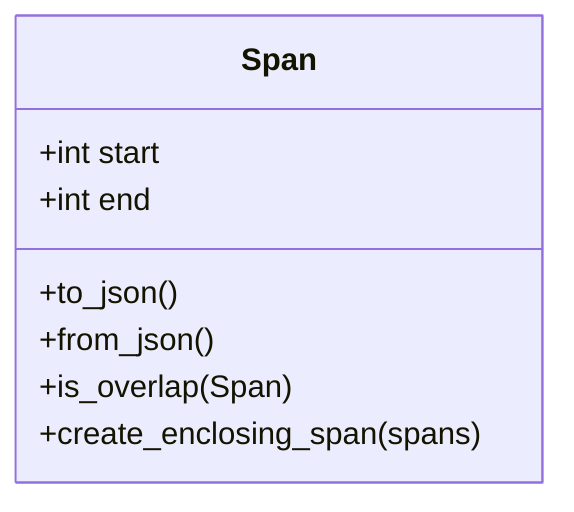

Sources: [papermage/magelib/span.py:1-65]()

### Core Attributes

- **start**: An integer representing the starting position in the document's text
- **end**: An integer representing the ending position in the document's text

### Key Functionality

- **JSON Serialization**: `to_json()` and `from_json()` methods for serialization
- **Overlap Detection**: The `is_overlap()` method determines if two spans overlap
- **Span Creation**: Static method `create_enclosing_span()` creates a span that encloses multiple spans

### Overlap Logic

The `is_overlap()` method determines if two spans overlap using the following logic:

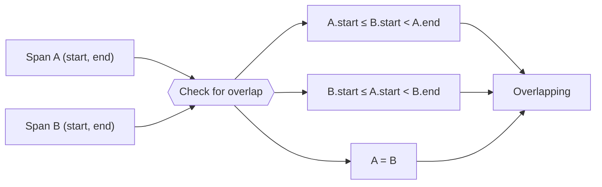

Sources: [papermage/magelib/span.py:48-50]()

## Box Representation

The `Box` class represents a rectangular region on a document page, defined by position, dimensions, and page number.

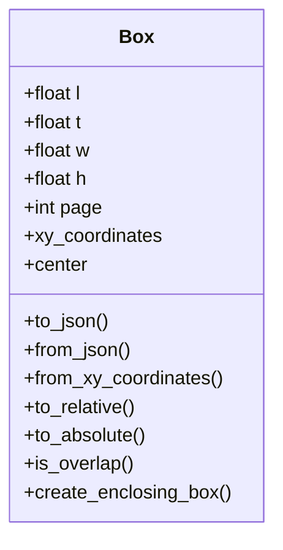

Sources: [papermage/magelib/box.py:1-156]()

### Core Attributes

- **l**: Left position (x-coordinate)
- **t**: Top position (y-coordinate) 
- **w**: Width of the box
- **h**: Height of the box
- **page**: Page number where the box is located

### Coordinate Systems

Boxes can work with both absolute coordinates (in pixels) and relative coordinates (normalized to page dimensions):

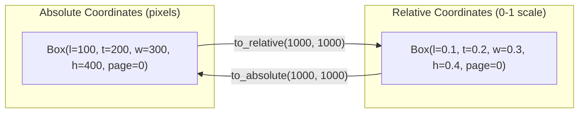

Sources: [papermage/magelib/box.py:96-114]()

### Key Functionality

- **Coordinate Conversion**: 
  - `to_relative()`: Converts absolute coordinates to relative (0-1 range)
  - `to_absolute()`: Converts relative coordinates to absolute (pixel values)
- **Coordinate Access**:
  - `xy_coordinates`: Returns (x1, y1, x2, y2) tuple
  - `center`: Returns the center point of the box
- **Box Creation**:
  - `from_xy_coordinates()`: Creates a box from (x1, y1, x2, y2) coordinates
  - `create_enclosing_box()`: Creates a box that encloses multiple boxes

### Overlap Detection

Box overlap detection works by checking overlap on both x and y axes:

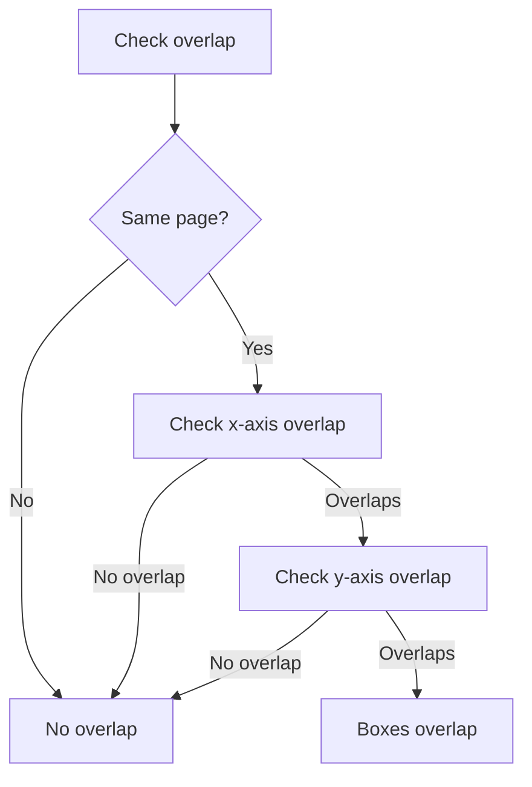

Sources: [papermage/magelib/box.py:120-141]()

## Entities with Spans and Boxes

The `Entity` class combines both Span and Box representations, allowing it to reference both textual and visual elements in a document.

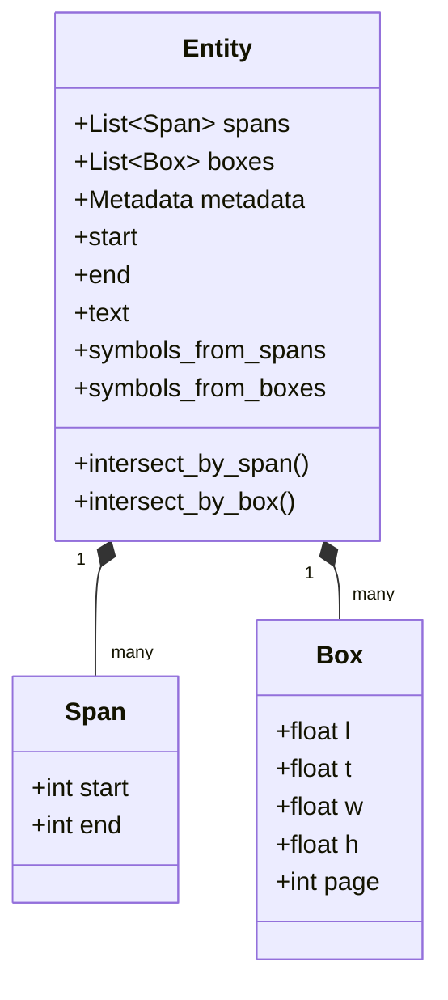

Sources: [papermage/magelib/entity.py:1-198]()

### Entity Requirements

An Entity must have at least one Span or one Box:

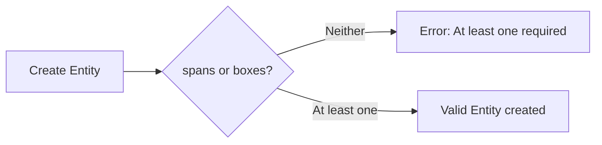

Sources: [papermage/magelib/entity.py:23-35]()

### Text Access Methods

Entities can access their text content in multiple ways:

1. **From Metadata**: Pre-stored text in metadata
2. **From Spans**: Text derived from spans and document symbols
3. **From Boxes**: Text derived from boxes by finding intersecting tokens

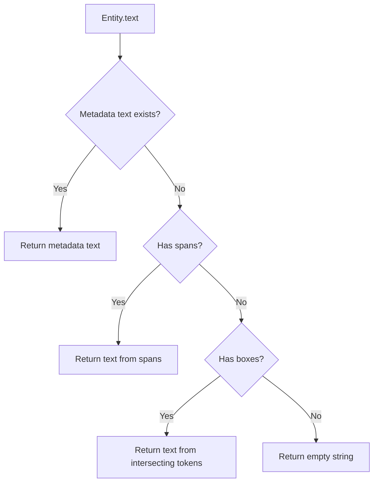

Sources: [papermage/magelib/entity.py:173-184]()

## Using Spans and Boxes in Document Processing

Spans and Boxes play critical roles in document processing within the papermage system:

### In Tokenization and Content Analysis

Spans are primarily used for text-based operations:
- Identifying token boundaries
- Representing sentences and paragraphs
- Processing content sequentially

### In Layout Analysis

Boxes are used for visual layout understanding:
- Representing physical positions of elements
- Detecting visual blocks
- Working with images and figures

### Coordinate Normalization for Model Input

When preparing visual layout analysis, box coordinates are normalized to a standard size:

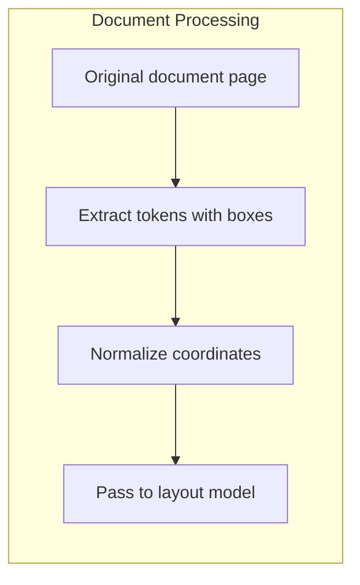

Sources: [papermage/predictors/vila_predictors.py:71-92]()

## Practical Usage Examples

### Converting Document Page to Model Input

The VILA predictor shows how Boxes are used to prepare document layout for machine learning models:

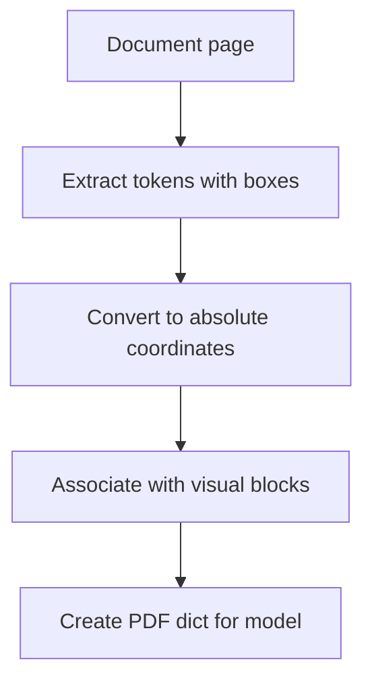

Sources: [papermage/predictors/vila_predictors.py:122-173]()

### Determining Text from Visual Positions

Entities can extract text content from visual positions by:
1. Finding tokens that intersect with the Entity's boxes
2. Extracting the text content from those tokens

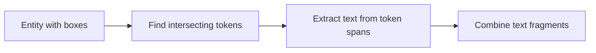

Sources: [papermage/magelib/entity.py:158-170]()

## Best Practices

When working with Spans and Boxes in papermage:

1. **Use Spans** when working with textual content or when sequential order matters
2. **Use Boxes** when working with visual layout or when spatial relationships matter
3. **Use Both** in entities that need to connect textual and visual representations
4. **Consider Coordinate Systems**:
   - Relative coordinates (0-1) are better for storage and portability
   - Absolute coordinates (pixels) are needed for visualization and some processing tasks

| Representation | Best For | Key Methods | Common Use Cases |
|----------------|----------|-------------|------------------|
| Span | Text positions | `is_overlap()`, `create_enclosing_span()` | Tokens, sentences, paragraphs |
| Box | Visual regions | `is_overlap()`, `to_relative()`, `to_absolute()` | Blocks, figures, tables, layout elements |

Sources: [papermage/magelib/span.py:1-65](), [papermage/magelib/box.py:1-156]()

## Summary

Span and Box representations form the foundation of the papermage document model:

- **Spans** provide text-based positioning with start and end indices
- **Boxes** provide visual positioning with coordinates, dimensions, and page numbers
- **Entities** can combine both representations to create a comprehensive document model
- The system provides efficient methods for working with both types of positions
- These representations enable sophisticated document understanding by connecting textual content with visual layout

---

