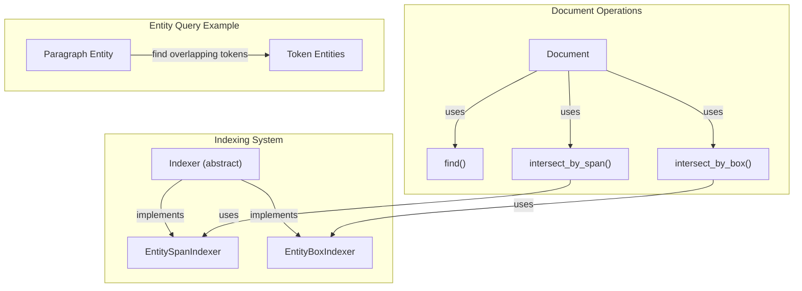
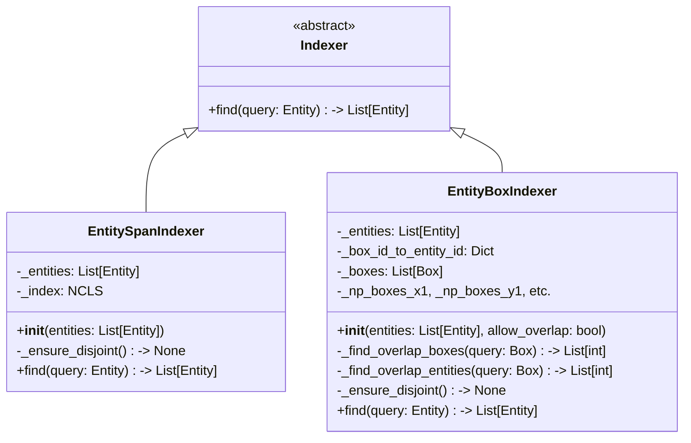
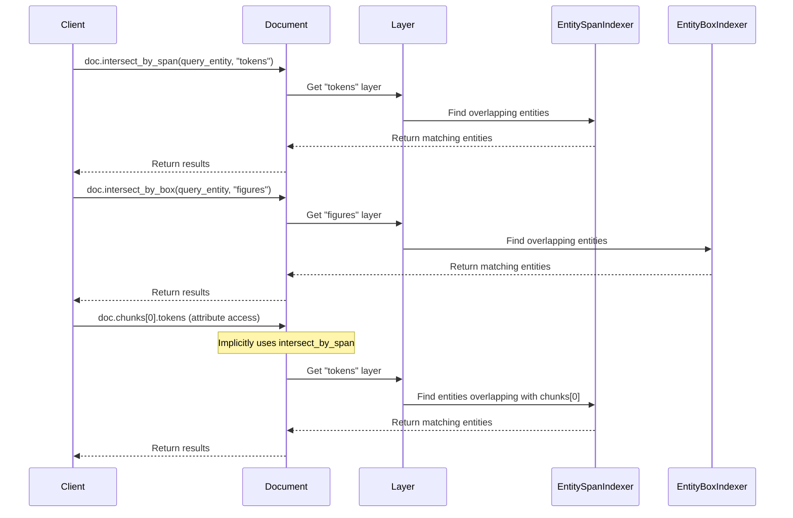
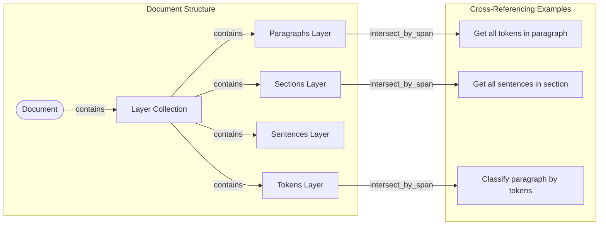

<!-- source: DeepWiki mcp.deepwiki.com · repo allenai/papermage · page 2.4 Indexing and Retrieval · fetched 2026-10-26 -->

# Indexing and Retrieval

<details>
<summary>Relevant source files</summary>

The following files were used as context for generating this wiki page:

- [papermage/magelib/indexer.py](papermage/magelib/indexer.py)
- [papermage/utils/annotate.py](papermage/utils/annotate.py)
- [tests/fixtures/2304.02623v1.json](tests/fixtures/2304.02623v1.json)
- [tests/fixtures/preprocessed_training_docs_tiny.pt](tests/fixtures/preprocessed_training_docs_tiny.pt)
- [tests/test_magelib/test_document.py](tests/test_magelib/test_document.py)
- [tests/test_magelib/test_indexer.py](tests/test_magelib/test_indexer.py)

</details>


This page describes the indexing system used within the papermage library for efficient entity search and cross-referencing between different layers in documents. The indexing and retrieval capabilities enable fast lookups of entities based on their span or spatial positions, facilitating powerful cross-document analysis.

For details about the underlying Span and Box representations used by the indexing system, see [Span and Box Representations](#2.3).

## Overview

The indexing system in papermage enables efficient lookup of entities based on either text spans or visual position (boxes). This is a critical component that powers cross-referencing between different annotation layers, such as finding all tokens within a paragraph, or all figures within a section.



Sources: [papermage/magelib/indexer.py:19-26](), [tests/test_magelib/test_document.py:93-151]()

## Core Indexer Classes

The indexing system is built around two primary indexer implementations that share a common interface but use different search criteria:

### Indexer Interface

All indexers in papermage share a common abstract base class that defines the core functionality:



Sources: [papermage/magelib/indexer.py:19-26]()

### EntitySpanIndexer

`EntitySpanIndexer` provides efficient lookup of entities based on text span overlap. It uses a Nested Containment List (NCLS) data structure for fast intersection queries.

```python
# Example usage of EntitySpanIndexer
entities_to_index = [
    Entity(spans=[Span(0, 5), Span(5, 8)]),
    Entity(spans=[Span(9, 10)]),
    Entity(spans=[Span(100, 105)])
]

index = EntitySpanIndexer(entities_to_index)

# Query with an entity that has overlapping spans
query = Entity(spans=[Span(1, 7), Span(9, 20)])
matches = index.find(query)  # Will find entities that overlap with query spans
```

Key features:
- Requires indexed entities to have non-overlapping spans
- Built on the NCLS data structure for O(log n) lookup time
- Used for text-based entity retrieval

Sources: [papermage/magelib/indexer.py:29-99](), [tests/test_magelib/test_indexer.py:19-70]()

### EntityBoxIndexer

`EntityBoxIndexer` enables efficient lookup of entities based on visual box overlap. It uses NumPy arrays and vectorized operations for fast spatial queries.

```python
# Example usage of EntityBoxIndexer
entities_to_index = [
    Entity(boxes=[Box(0, 0, 1, 1, page=0), Box(2, 2, 1, 1, page=0)]),
    Entity(boxes=[Box(4, 4, 1, 1, page=0)]),
    Entity(boxes=[Box(100, 100, 1, 1, page=0)])
]

index = EntityBoxIndexer(entities_to_index)

# Query with an entity that has overlapping boxes
query = Entity(boxes=[Box(1, 1, 5, 5, page=0)])
matches = index.find(query)  # Will find entities with boxes that overlap with query boxes
```

Key features:
- Can optionally allow indexed entities to have overlapping boxes
- Uses NumPy for vectorized computation of spatial overlaps
- Accounts for page numbers when determining overlaps
- Used for visual/spatial entity retrieval

Sources: [papermage/magelib/indexer.py:102-172](), [tests/test_magelib/test_indexer.py:72-126]()

## Cross-Referencing in Documents

The Document class provides several methods for cross-referencing entities across different layers, all powered by the indexing system.



Sources: [tests/test_magelib/test_document.py:93-151]()

### Cross-Reference Methods

The Document class provides three main methods for cross-referencing:

1. `intersect_by_span(query, name)`: Finds entities in the specified layer that have spans overlapping with the query entity's spans.

2. `intersect_by_box(query, name)`: Finds entities in the specified layer that have boxes overlapping with the query entity's boxes.

3. `find(query, name)`: A unified method that accepts either a Span or Box as query and delegates to the appropriate intersection method.

Sources: [tests/test_magelib/test_document.py:231-247]()

### Attribute-Based Access

In addition to the explicit methods, Document also supports a convenient attribute-based access pattern for cross-referencing:

```python
# Get all tokens that overlap with the first chunk (by span)
tokens_in_chunk = doc.chunks[0].tokens

# Equivalent to:
tokens_in_chunk = doc.intersect_by_span(query=doc.chunks[0], name="tokens")
```

This works because the Document class implements a dynamic `__getattr__` method that performs the appropriate intersection based on the entity's available spans or boxes.

Sources: [tests/test_magelib/test_document.py:114-126]()

## Handling Edge Cases

The indexing system is designed to handle various edge cases gracefully:

### Missing Spans or Boxes

When entities are missing either spans or boxes, the cross-referencing methods return empty results:

```python
# Entities with spans but no boxes
tokens = [Entity(spans=[[0, 4]]) for _ in range(6)]
# Entities with boxes but no spans
chunks = [Entity(boxes=[[0, 0, 2.01, 2.01, 0]]) for _ in range(3)]

doc.annotate_layer(name="tokens", entities=tokens)
doc.annotate_layer(name="chunks", entities=chunks)

# Box-based intersection will return empty results
doc.intersect_by_box(query=doc.tokens[0], name="chunks")  # Returns []
```

Sources: [tests/test_magelib/test_document.py:180-211]()

### Disjoint Entity Constraints

By default, `EntitySpanIndexer` requires all indexed entities to have non-overlapping spans. This constraint can be verified using the `_ensure_disjoint` method. The `EntityBoxIndexer` can optionally allow overlapping boxes with the `allow_overlap` parameter.

```python
# This will raise a ValueError due to overlapping spans
entities = [Entity(spans=[Span(0, 5), Span(4, 7)])]
indexer = EntitySpanIndexer(entities=entities)  # Raises ValueError

# This will also raise a ValueError
entities = [
    Entity(spans=[Span(0, 5), Span(5, 8)]), 
    Entity(spans=[Span(6, 10)])
]
indexer = EntitySpanIndexer(entities)  # Raises ValueError
```

Sources: [papermage/magelib/indexer.py:62-78](), [tests/test_magelib/test_indexer.py:23-33]()

## Practical Applications

The indexing and retrieval system enables many practical document processing use cases:

1. **Hierarchical Access**: Easily navigate between different granularities of document representation (e.g., from paragraphs to sentences to tokens).

2. **Spatial Analysis**: Find entities based on their visual position in the document, such as identifying all elements within a specific region.

3. **Cross-Modal Alignment**: Connect textual entities with visual elements by finding overlaps between text spans and visual boxes.

4. **Annotation Enrichment**: Create new layers of annotations based on existing ones by finding and processing intersecting entities.



Sources: [tests/test_magelib/test_document.py:93-151]()

## Performance Considerations

The indexing system is designed for efficient entity lookup, but there are important performance considerations:

1. **Indexing Cost**: Building indexes can be expensive for documents with many entities. Indexes are built lazily when needed.

2. **Query Complexity**: The performance of queries depends on the number of spans or boxes in both the query entity and the indexed entities.

3. **Disjoint Constraint**: Enforcing the disjoint constraint requires O(n²) time for `EntitySpanIndexer` during initialization, which could be slow for large entity collections.

4. **Page-Aware Box Operations**: Box intersection operations account for page numbers, which means entities on different pages won't intersect regardless of their spatial overlap.

5. **Order Preservation**: The `find` method returns entities in their original document order to maintain semantic coherence.

Sources: [papermage/magelib/indexer.py:95-98](), [papermage/magelib/indexer.py:134-140]()

## Summary

The papermage indexing and retrieval system provides powerful tools for efficient entity lookup and cross-referencing. Through the combination of text-based span indexing and spatial box indexing, it enables complex document analysis tasks with a simple, consistent interface. This system is a core part of the document processing pipeline and supports many of the library's higher-level features.

---

