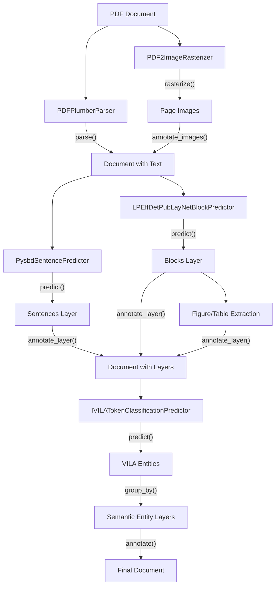
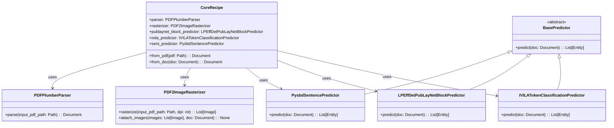
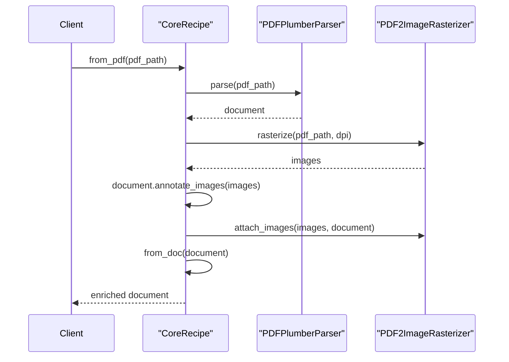

<!-- source: DeepWiki mcp.deepwiki.com · repo allenai/papermage · page 3 Document Processing Pipeline · fetched 2026-10-26 -->

# Document Processing Pipeline

<details>
<summary>Relevant source files</summary>

The following files were used as context for generating this wiki page:

- [papermage/recipes/core_recipe.py](papermage/recipes/core_recipe.py)
- [scripts/get_thumbnails_for_papers.py](scripts/get_thumbnails_for_papers.py)
- [tests/fixtures/2302.07302v1.pdf](tests/fixtures/2302.07302v1.pdf)
- [tests/test_predictors/test_vila_predictor.py](tests/test_predictors/test_vila_predictor.py)
- [tests/test_recipes/test_core_recipe.py](tests/test_recipes/test_core_recipe.py)

</details>


## Purpose and Scope

This document explains the document processing pipeline in the papermage library, focusing on the conversion of PDFs into structured Document objects with multiple layers of annotations. The pipeline incorporates PDF parsing, rasterization, and the application of various predictors to identify and annotate different types of entities within documents.

For information about the underlying data structures that represent documents and their content, see the [Core Data Model](#2) documentation.

## Pipeline Overview

The document processing pipeline is primarily implemented through the `CoreRecipe` class, which orchestrates the entire conversion process from PDF to an enriched Document object.

### Pipeline Workflow Diagram



Sources: [papermage/recipes/core_recipe.py:78-152]()

## Key Components

### CoreRecipe

The `CoreRecipe` class is the central orchestrator of the document processing pipeline, initializing all necessary components and providing methods to process PDFs.



Sources: [papermage/recipes/core_recipe.py:77-99]()

### Pipeline Components

The pipeline consists of several specialized components that work together:

#### 1. PDF Parser

The `PDFPlumberParser` extracts text and layout information from the PDF document, creating the initial Document object with text content.

Sources: [papermage/recipes/core_recipe.py:89](), [papermage/parsers/pdfplumber_parser.py]()

#### 2. PDF Rasterizer

The `PDF2ImageRasterizer` converts each PDF page into images, which are then attached to the Document object, enabling visual processing.

Sources: [papermage/recipes/core_recipe.py:90](), [papermage/rasterizers/rasterizer.py]()

#### 3. Predictors

Various predictors analyze the document and identify different types of entities:

- **PysbdSentencePredictor**: Identifies sentence boundaries within the document text
- **LPEffDetPubLayNetBlockPredictor**: Detects visual blocks like figures, tables, and text regions
- **IVILATokenClassificationPredictor**: Classifies document components using Visual Layout Analysis

Sources: [papermage/recipes/core_recipe.py:96-98]()

## Processing Steps

### 1. Recipe Initialization

When a `CoreRecipe` is created, it initializes all the necessary components:

```python
def __init__(
    self,
    ivila_predictor_path: str = "allenai/ivila-row-layoutlm-finetuned-s2vl-v2",
    bio_roberta_predictor_path: str = "allenai/vila-roberta-large-s2vl-internal",
    svm_word_predictor_path: str = "...",
    dpi: int = 72,
):
    # Initialize components
    self.parser = PDFPlumberParser()
    self.rasterizer = PDF2ImageRasterizer()
    self.publaynet_block_predictor = LPEffDetPubLayNetBlockPredictor.from_pretrained()
    self.ivila_predictor = IVILATokenClassificationPredictor.from_pretrained(ivila_predictor_path)
    self.sent_predictor = PysbdSentencePredictor()
```

Sources: [papermage/recipes/core_recipe.py:78-99]()

### 2. PDF Processing

The `from_pdf` method handles the initial processing of a PDF file:



Sources: [papermage/recipes/core_recipe.py:101-109]()

### 3. Entity Prediction and Annotation

The `from_doc` method applies various predictors to identify entities and annotate the document:

#### 3.1. Sentence Prediction

Identify and annotate sentences in the document:

```python
sentences = self.sent_predictor.predict(doc=doc)
doc.annotate_layer(name=SentencesFieldName, entities=sentences)
```

Sources: [papermage/recipes/core_recipe.py:116-118]()

#### 3.2. Block Prediction

Identify and annotate layout blocks in the document:

```python
blocks = self.publaynet_block_predictor.predict(doc=doc)
doc.annotate_layer(name=BlocksFieldName, entities=blocks)
```

Sources: [papermage/recipes/core_recipe.py:120-124]()

#### 3.3. Figure and Table Extraction

Extract figures and tables from the predicted blocks:

```python
for block in blocks:
    if block.metadata.type == "Figure":
        figure = Entity(boxes=block.boxes)
        figures.append(figure)
    elif block.metadata.type == "Table":
        table = Entity(boxes=block.boxes)
        tables.append(table)
doc.annotate_layer(name=FiguresFieldName, entities=figures)
doc.annotate_layer(name=TablesFieldName, entities=tables)
```

Sources: [papermage/recipes/core_recipe.py:126-137]()

#### 3.4. VILA Entity Prediction

Predict and annotate semantic entities using the VILA predictor:

```python
vila_entities = self.ivila_predictor.predict(doc=doc)
doc.annotate_layer(name="vila_entities", entities=vila_entities)

# Process VILA entities
for entity in vila_entities:
    entity.boxes = [
        Box.create_enclosing_box(
            [b for t in doc.intersect_by_span(entity, name=TokensFieldName) for b in t.boxes]
        )
    ]
    
# Group entities by type
preds = group_by(entities=vila_entities, metadata_field="label", metadata_values_map=VILA_LABELS_MAP)
doc.annotate(*preds)
```

Sources: [papermage/recipes/core_recipe.py:140-152]()

## Entity Types

The pipeline identifies and annotates various types of document entities. The VILA predictor, in particular, identifies a wide range of semantic components mapped as follows:

| VILA Label      | Entity Type in papermage     |
|-----------------|------------------------------|
| Title           | TitlesFieldName              |
| Paragraph       | ParagraphsFieldName          |
| Author          | AuthorsFieldName             |
| Abstract        | AbstractsFieldName           |
| Keywords        | KeywordsFieldName            |
| Section         | SectionsFieldName            |
| List            | ListsFieldName               |
| Bibliography    | BibliographiesFieldName      |
| Equation        | EquationsFieldName           |
| Algorithm       | AlgorithmsFieldName          |
| Caption         | CaptionsFieldName            |
| Header          | HeadersFieldName             |
| Footer          | FootersFieldName             |
| Footnote        | FootnotesFieldName           |

Sources: [papermage/recipes/core_recipe.py:57-74]()

## Using the Pipeline

Here's a basic example of using the CoreRecipe to process a PDF:

```python
from papermage.recipes import CoreRecipe
from pathlib import Path

# Create a CoreRecipe instance
recipe = CoreRecipe()

# Process a PDF file
pdf_path = Path("sample.pdf")
doc = recipe.from_pdf(pdf=pdf_path)

# Access annotated entities
sentences = doc.get_layer("sentences")
blocks = doc.get_layer("blocks")
figures = doc.get_layer("figures")
tables = doc.get_layer("tables")
titles = doc.get_layer("titles")
paragraphs = doc.get_layer("paragraphs")
```

Sources: [tests/test_recipes/test_core_recipe.py:13-34]()

## Applications

The document processing pipeline enables a wide range of applications:

1. **Document Structure Analysis**: Extract the logical structure of documents
2. **Content Extraction**: Isolate specific content types (figures, tables, equations)
3. **Semantic Analysis**: Identify and analyze document components by type
4. **Layout Understanding**: Extract layout information for downstream tasks
5. **Information Retrieval**: Enable targeted search within specific document components

## Conclusion

The document processing pipeline provides a comprehensive framework for converting PDFs into richly annotated Document objects. By applying a sequence of specialized processors, it progressively builds layers of annotations that capture both the visual layout and semantic structure of the document.

This pipeline serves as the foundation for document understanding tasks within the papermage library, enabling applications that require detailed analysis of document content and structure.

For more details on specific components of the pipeline, see the [Parsers](#3.2) documentation and the [Predictors](#4) section.

---

