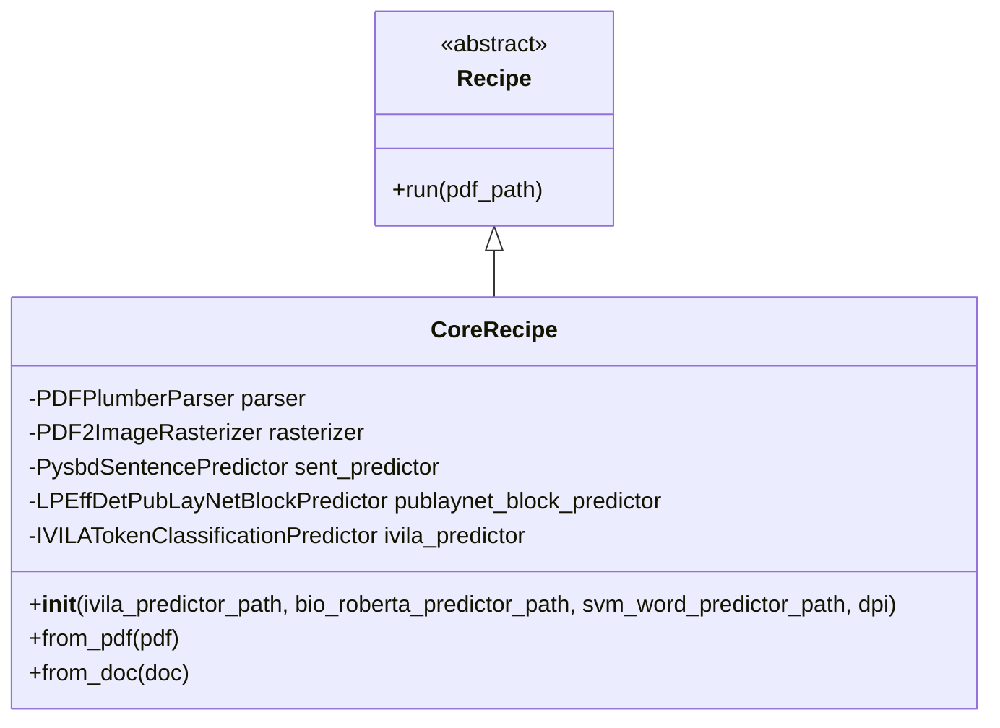
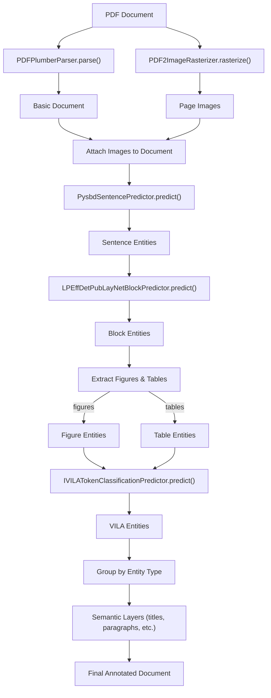
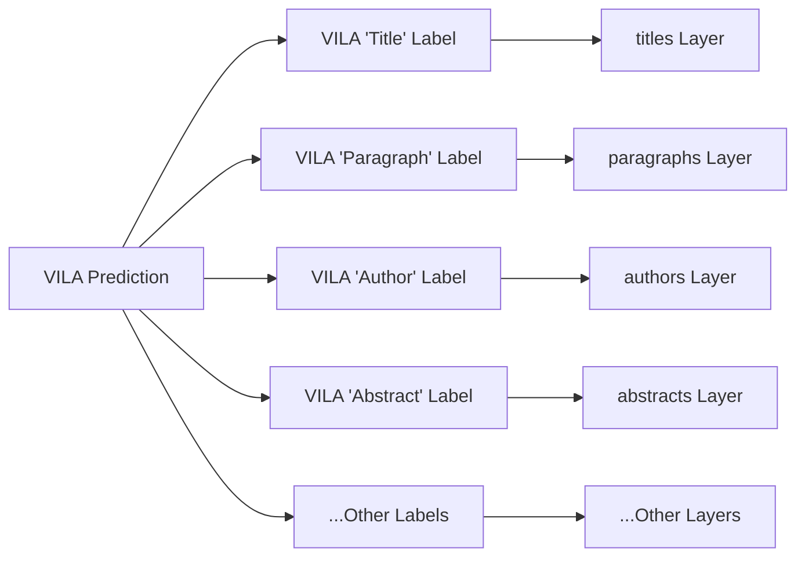
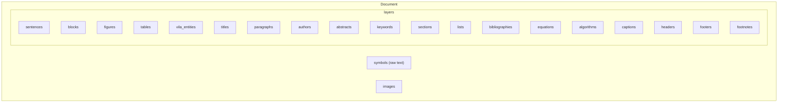

<!-- source: DeepWiki mcp.deepwiki.com · repo allenai/papermage · page 3.1 CoreRecipe · fetched 2026-10-26 -->

# CoreRecipe

<details>
<summary>Relevant source files</summary>

The following files were used as context for generating this wiki page:

- [README.md](README.md)
- [papermage/recipes/core_recipe.py](papermage/recipes/core_recipe.py)
- [pyproject.toml](pyproject.toml)
- [scripts/get_thumbnails_for_papers.py](scripts/get_thumbnails_for_papers.py)
- [tests/fixtures/2020.acl-main.447.pdf](tests/fixtures/2020.acl-main.447.pdf)
- [tests/fixtures/2302.07302v1.pdf](tests/fixtures/2302.07302v1.pdf)
- [tests/test_predictors/test_vila_predictor.py](tests/test_predictors/test_vila_predictor.py)
- [tests/test_recipes/test_core_recipe.py](tests/test_recipes/test_core_recipe.py)

</details>


CoreRecipe is the primary document processing pipeline in papermage, responsible for converting PDF scientific papers into structured Document objects with various layers of annotations. It serves as the standard recipe for processing scientific PDFs, incorporating parsers, rasterizers, and predictors to extract and annotate document content.

This page details the implementation, components, and processing flow of CoreRecipe. For information about simpler recipes with fewer features, see [Minimal Recipes](#3.3).

## Architecture and Components

CoreRecipe builds on the Recipe base class, implementing a full pipeline for PDF processing:



Sources: [papermage/recipes/core_recipe.py:77-101]()

CoreRecipe integrates the following components:

| Component | Class | Purpose |
|-----------|-------|---------|
| Parser | `PDFPlumberParser` | Extracts text content from PDFs |
| Rasterizer | `PDF2ImageRasterizer` | Converts PDF pages to images |
| Sentence Predictor | `PysbdSentencePredictor` | Segments text into sentences |
| Block Predictor | `LPEffDetPubLayNetBlockPredictor` | Identifies layout blocks (figures, tables) |
| Entity Predictor | `IVILATokenClassificationPredictor` | Classifies text regions into semantic entities |

The initialization of CoreRecipe instantiates these components with configurable paths to pre-trained models:

```python
def __init__(
    self,
    ivila_predictor_path: str = "allenai/ivila-row-layoutlm-finetuned-s2vl-v2",
    bio_roberta_predictor_path: str = "allenai/vila-roberta-large-s2vl-internal",
    svm_word_predictor_path: str = "https://ai2-s2-research-public.s3.us-west-2.amazonaws.com/mmda/models/svm_word_predictor.tar.gz",
    dpi: int = 72,
):
```

Sources: [papermage/recipes/core_recipe.py:78-99]()

## Processing Pipeline

CoreRecipe implements a multi-stage processing pipeline converting PDFs to structured documents:



Sources: [papermage/recipes/core_recipe.py:101-152]()

### from_pdf Method

The `from_pdf` method takes a PDF file path and processes it:

1. Parse the PDF using `PDFPlumberParser` to extract text
2. Rasterize the PDF using `PDF2ImageRasterizer` to convert pages to images
3. Attach rasterized images to the document
4. Call `from_doc` to complete the processing

```python
def from_pdf(self, pdf: Path) -> Document:
    self.logger.info("Parsing document...")
    doc = self.parser.parse(input_pdf_path=pdf)
    
    self.logger.info("Rasterizing document...")
    images = self.rasterizer.rasterize(input_pdf_path=pdf, dpi=self.dpi)
    doc.annotate_images(images=list(images))
    self.rasterizer.attach_images(images=images, doc=doc)
    return self.from_doc(doc=doc)
```

Sources: [papermage/recipes/core_recipe.py:101-109]()

### from_doc Method

The `from_doc` method takes a Document object and enriches it with predicted layers:

1. Predict sentences using `PysbdSentencePredictor`
2. Predict layout blocks using `LPEffDetPubLayNetBlockPredictor`
3. Extract figures and tables from blocks based on block type
4. Predict VILA entities using `IVILATokenClassificationPredictor`
5. Create enclosing boxes for VILA entities
6. Group entities into document layers using `group_by` utility

```python
def from_doc(self, doc: Document) -> Document:
    self.logger.info("Predicting sentences...")
    sentences = self.sent_predictor.predict(doc=doc)
    doc.annotate_layer(name=SentencesFieldName, entities=sentences)
    
    self.logger.info("Predicting blocks...")
    blocks = self.publaynet_block_predictor.predict(doc=doc)
    doc.annotate_layer(name=BlocksFieldName, entities=blocks)
    
    # Extract figures and tables
    # Predict VILA entities
    # Group entities into layers
    
    return doc
```

Sources: [papermage/recipes/core_recipe.py:111-152]()

## VILA Entity Mapping

CoreRecipe maps VILA entity labels to document layer names using a predefined mapping:



The mapping is defined in the `VILA_LABELS_MAP` constant:

| VILA Label | Document Field Name Constant |
|------------|------------------------------|
| "Title" | TitlesFieldName |
| "Paragraph" | ParagraphsFieldName |
| "Author" | AuthorsFieldName |
| "Abstract" | AbstractsFieldName |
| "Keywords" | KeywordsFieldName |
| "Section" | SectionsFieldName |
| "List" | ListsFieldName |
| "Bibliography" | BibliographiesFieldName |
| "Equation" | EquationsFieldName |
| "Algorithm" | AlgorithmsFieldName |
| "Caption" | CaptionsFieldName |
| "Header" | HeadersFieldName |
| "Footer" | FootersFieldName |
| "Footnote" | FootnotesFieldName |

Sources: [papermage/recipes/core_recipe.py:57-74]()

## Output Document Structure

CoreRecipe produces a Document object with the following entity layers:



Sources: [papermage/recipes/core_recipe.py:143-151](), [README.md:102-130]()

## Usage Examples

### Basic Usage

```python
from papermage.recipes import CoreRecipe
from pathlib import Path

# Initialize CoreRecipe
recipe = CoreRecipe()

# Process a PDF file
pdf_path = Path("path/to/paper.pdf")
doc = recipe.from_pdf(pdf=pdf_path)
```

### Accessing Document Layers

Once processed, you can access the various entity layers:

```python
# Access sentences
for sentence in doc.sentences:
    print(f"Sentence: {sentence.text}")

# Access figures
for figure in doc.figures:
    print(f"Figure on page {figure.boxes[0].page}")

# Access semantic entities
for title in doc.titles:
    print(f"Title: {title.text}")

for section in doc.sections:
    print(f"Section: {section.text}")
```

### Saving and Loading Documents

```python
# Save processed document
import json
with open('document.json', 'w') as f:
    json.dump(doc.to_json(), f, indent=2)

# Load document
from papermage.magelib import Document
with open('document.json', 'r') as f:
    loaded_doc = Document.from_json(json.load(f))
```

Sources: [README.md:44-209](), [papermage/recipes/core_recipe.py:155-167]()

## Command-Line Interface

CoreRecipe provides a command-line interface for processing PDF files:

```
python -m papermage.recipes.core_recipe --pdf path/to/paper.pdf --output output.json
```

This will process the PDF and save the resulting document as a JSON file.

Sources: [papermage/recipes/core_recipe.py:155-167]()

---

