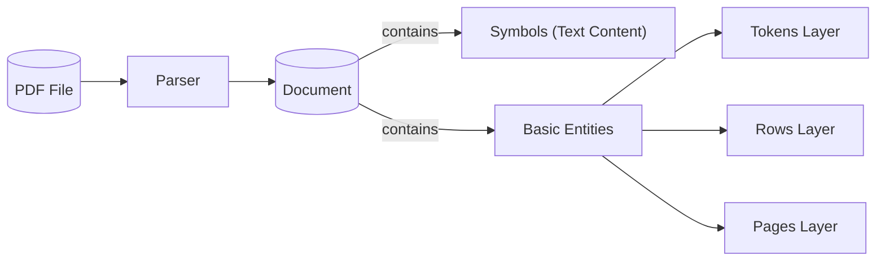
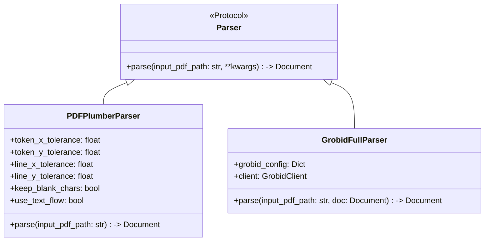
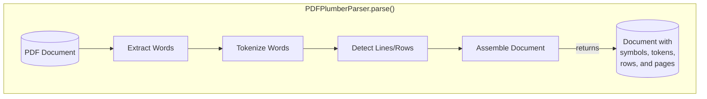
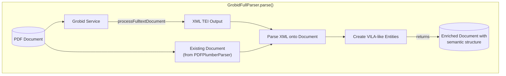
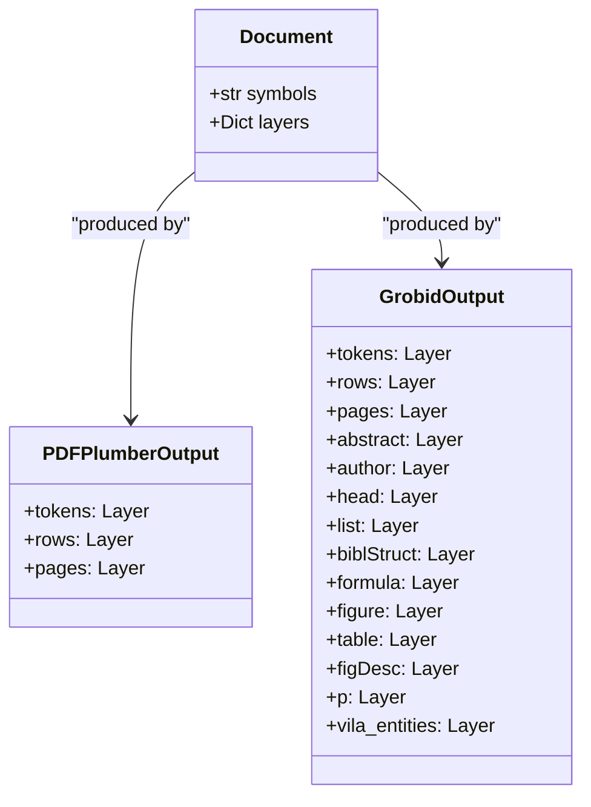

<!-- source: DeepWiki mcp.deepwiki.com · repo allenai/papermage · page 3.2 Parsers · fetched 2026-10-26 -->

# Parsers

<details>
<summary>Relevant source files</summary>

The following files were used as context for generating this wiki page:

- [papermage/parsers/__init__.py](papermage/parsers/__init__.py)
- [papermage/parsers/grobid_parser.py](papermage/parsers/grobid_parser.py)
- [papermage/parsers/parser.py](papermage/parsers/parser.py)
- [papermage/parsers/pdfplumber_parser.py](papermage/parsers/pdfplumber_parser.py)
- [papermage/utils/text.py](papermage/utils/text.py)
- [scripts/evaluation.py](scripts/evaluation.py)

</details>


This document explains the parsers in the papermage library, which are responsible for extracting content from PDF documents and creating the initial Document object. For information about how parsers are used within the overall document processing workflow, see [CoreRecipe](#3.1).

## Overview of Parsers

Parsers are the entry point for document processing in papermage. They take a PDF file as input and extract its content (text, layout, structure) into a structured Document object that serves as the foundation for all subsequent processing. The Document object includes the raw text content (`symbols`) as well as basic structural elements like tokens, rows, and pages.



Sources: [papermage/parsers/parser.py:15-26](), [papermage/parsers/pdfplumber_parser.py:81-153]()

## Parser Interface

All parsers in papermage implement the `Parser` protocol defined in `parser.py`, which requires a single `parse` method:



Sources: [papermage/parsers/parser.py:15-26]()

## Available Parsers

### PDFPlumberParser

The `PDFPlumberParser` is the primary parser in papermage and is exported directly from the `papermage.parsers` module. It uses the pdfplumber library to extract text and layout information from PDFs.



Key features:
- Extracts text content while preserving whitespace and line breaks
- Identifies tokens (words) with their positions (boxes)
- Groups tokens into rows and pages
- Captures font information for tokens (name, size)
- Handles document layout and positioning

Configuration options:
- `token_x_tolerance` and `token_y_tolerance`: Control how characters are grouped into tokens
- `line_x_tolerance` and `line_y_tolerance`: Control how tokens are grouped into lines
- `keep_blank_chars`: Whether to keep blank characters as part of tokens
- `use_text_flow`: Whether to use PDF's text flow for ordering
- `split_at_punctuation`: Whether to split tokens at punctuation marks

Sources: [papermage/parsers/pdfplumber_parser.py:81-166](), [papermage/parsers/__init__.py:1-5]()

### GrobidFullParser

The `GrobidFullParser` enhances an existing Document (typically created by PDFPlumberParser) with additional semantic structure extracted by the Grobid service. Grobid is specialized for academic and scientific publications.



Key features:
- Requires a running Grobid server
- Extracts semantic elements like sections, paragraphs, figures, tables, bibliographies, etc.
- Maps Grobid's XML TEI output to papermage's Entity model
- Creates VILA-like entities for semantic elements
- Enhances an existing Document rather than creating a new one

Requirements:
- A running Grobid server (typically Docker-based)
- A pre-existing Document object with at least the following layers: pages, rows, tokens

Sources: [papermage/parsers/grobid_parser.py:88-352]()

## Parser Output Structure

Both parsers produce a Document object, but with different levels of enrichment:



Sources: [papermage/parsers/pdfplumber_parser.py:255-359](), [papermage/parsers/grobid_parser.py:283-296](), [papermage/parsers/grobid_parser.py:197-281]()

## Using Parsers

Parsers are typically used as components within a CoreRecipe, but they can also be used directly:

### PDFPlumberParser Usage

```python
from papermage.parsers import PDFPlumberParser

parser = PDFPlumberParser()
document = parser.parse("path/to/document.pdf")
```

### GrobidFullParser Usage

```python
from papermage.parsers import PDFPlumberParser
from papermage.parsers.grobid_parser import GrobidFullParser

# First parse with PDFPlumberParser
base_parser = PDFPlumberParser()
document = base_parser.parse("path/to/document.pdf")

# Then enhance with GrobidFullParser
grobid_parser = GrobidFullParser(grobid_server="http://localhost:8070")
enriched_document = grobid_parser.parse(input_pdf_path="path/to/document.pdf", doc=document)
```

Sources: [papermage/parsers/grobid_parser.py:355-368]()

## Comparison of Parsers

| Feature | PDFPlumberParser | GrobidFullParser |
|---------|------------------|------------------|
| **Dependency** | pdfplumber library | Grobid service |
| **Input** | PDF file | PDF file + existing Document |
| **Processing** | Simple text extraction | Semantic structure extraction |
| **Layers Created** | tokens, rows, pages | All semantic layers (sections, paragraphs, etc.) |
| **Best For** | General PDFs, Basic extraction | Academic papers, Scientific documents |
| **Speed** | Fast | Slower (requires external service) |
| **Setup Complexity** | Low (Python library) | Higher (requires Grobid server) |

Sources: [papermage/parsers/pdfplumber_parser.py:81-166](), [papermage/parsers/grobid_parser.py:88-352]()

## Extending the Parser System

To create a custom parser, implement the Parser protocol:

```python
from papermage.parsers.parser import Parser
from papermage.magelib import Document

class CustomParser(Parser):
    def parse(self, input_pdf_path: str, **kwargs) -> Document:
        # Your parsing logic here
        # ...
        return document
```

Custom parsers can be integrated into a CoreRecipe the same way as the built-in parsers.

Sources: [papermage/parsers/parser.py:15-26]()

---

