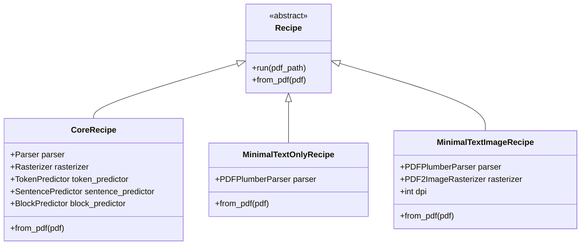
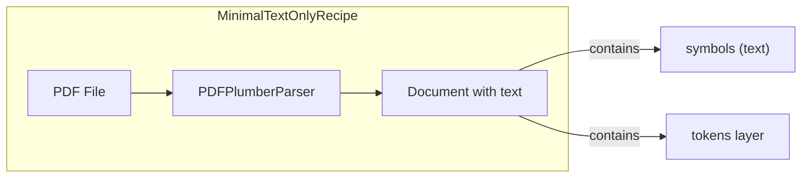
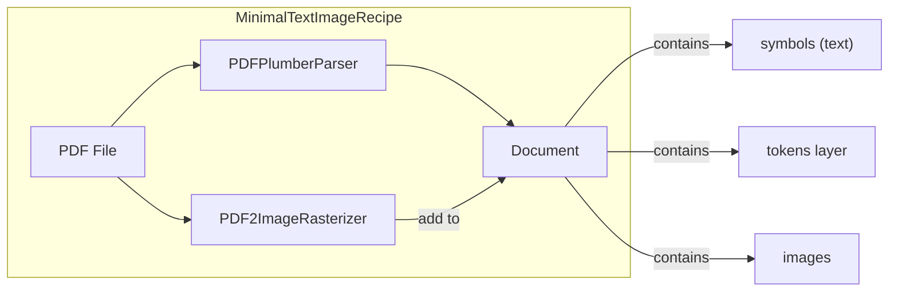
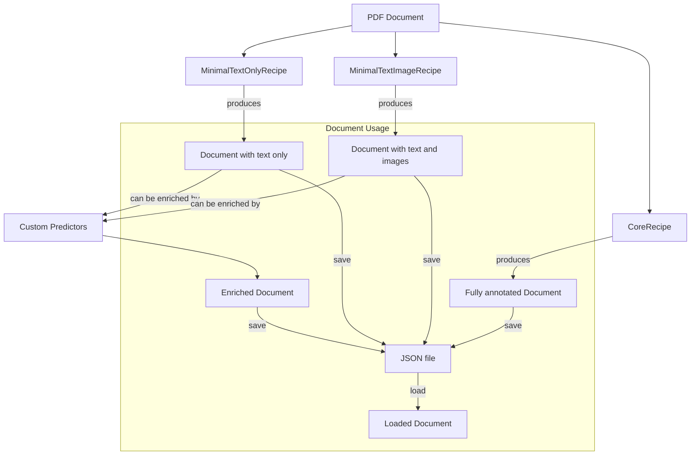

<!-- source: DeepWiki mcp.deepwiki.com · repo allenai/papermage · page 3.3 Minimal Recipes · fetched 2026-10-26 -->

# Minimal Recipes

<details>
<summary>Relevant source files</summary>

The following files were used as context for generating this wiki page:

- [README.md](README.md)
- [papermage/recipes/__init__.py](papermage/recipes/__init__.py)
- [papermage/recipes/minimal_pdf_recipe.py](papermage/recipes/minimal_pdf_recipe.py)
- [pyproject.toml](pyproject.toml)
- [tests/fixtures/2020.acl-main.447.pdf](tests/fixtures/2020.acl-main.447.pdf)
- [tests/test_recipes/test_minimal_pdf_recipe.py](tests/test_recipes/test_minimal_pdf_recipe.py)

</details>


## Purpose and Scope

This document describes the minimal recipes available in Papermage for basic document processing. These recipes provide streamlined alternatives to the more comprehensive [CoreRecipe](#3.1) when only basic text extraction or text and image extraction from PDFs are needed. Minimal recipes focus on extracting essential content while omitting more complex entity recognition and annotation steps.

Sources: [papermage/recipes/__init__.py:1-9](), [papermage/recipes/minimal_pdf_recipe.py:1-7]()

## Overview of Minimal Recipes

Papermage offers two minimal recipes:

1. **MinimalTextOnlyRecipe**: Extracts text from a PDF document using PDFPlumberParser
2. **MinimalTextImageRecipe**: Extracts both text and rasterized images from a PDF document

These recipes serve as lightweight alternatives when you don't need the full document processing capabilities of the [CoreRecipe](#3.1), which includes additional annotation layers such as sentence detection, block detection, and entity classification.

Sources: [papermage/recipes/minimal_pdf_recipe.py:1-80]()

### Recipe Hierarchy



Sources: [papermage/recipes/__init__.py:1-9](), [papermage/recipes/minimal_pdf_recipe.py:17-55]()

## MinimalTextOnlyRecipe

### Description

`MinimalTextOnlyRecipe` is the simplest recipe in Papermage, providing a lightweight way to extract text content from PDF documents. It uses only the `PDFPlumberParser` to extract text and create a basic Document object with tokens.

### Process Flow



Sources: [papermage/recipes/minimal_pdf_recipe.py:43-55](), [tests/test_recipes/test_minimal_pdf_recipe.py:13-22]()

### Implementation Details

The `MinimalTextOnlyRecipe` class:

1. Initializes a `PDFPlumberParser` instance
2. Implements the `from_pdf()` method that:
   - Takes a PDF file path as input
   - Uses the parser to extract text content
   - Returns a Document object containing the extracted text and automatically created tokens

The resulting Document contains:
- The full text content in the `.symbols` attribute
- A basic tokenization in the `.tokens` layer

Sources: [papermage/recipes/minimal_pdf_recipe.py:43-55]()

## MinimalTextImageRecipe

### Description

`MinimalTextImageRecipe` extends the functionality of `MinimalTextOnlyRecipe` by adding image extraction. It uses both `PDFPlumberParser` for text extraction and `PDF2ImageRasterizer` for converting PDF pages into images at a specified resolution.

### Process Flow



Sources: [papermage/recipes/minimal_pdf_recipe.py:20-40](), [tests/test_recipes/test_minimal_pdf_recipe.py:24-44]()

### Implementation Details

The `MinimalTextImageRecipe` class:

1. Initializes a `PDFPlumberParser` and a `PDF2ImageRasterizer` instance
2. Allows configuration of the image resolution via the `dpi` parameter (default: 300)
3. Implements the `from_pdf()` method that:
   - Takes a PDF file path as input
   - Uses the parser to extract text content
   - Uses the rasterizer to convert PDF pages to images
   - Annotates the Document with the extracted images
   - Attaches the images to the Document
   - Returns the Document with both text and images

The resulting Document contains:
- The full text content in the `.symbols` attribute
- A basic tokenization in the `.tokens` layer
- Rasterized page images in the `.images` list

Sources: [papermage/recipes/minimal_pdf_recipe.py:20-40](), [tests/test_recipes/test_minimal_pdf_recipe.py:24-44]()

## Comparison with CoreRecipe

The following table highlights the key differences between the minimal recipes and the full CoreRecipe:

| Feature | MinimalTextOnlyRecipe | MinimalTextImageRecipe | CoreRecipe |
|---------|----------------------|------------------------|------------|
| Text extraction | ✓ | ✓ | ✓ |
| Image extraction | ✗ | ✓ | ✓ |
| Tokens | Basic | Basic | Enhanced |
| Sentences | ✗ | ✗ | ✓ |
| Blocks | ✗ | ✗ | ✓ |
| Layout analysis | ✗ | ✗ | ✓ |
| Entity classification | ✗ | ✗ | ✓ |
| Processing speed | Fast | Medium | Slow |
| Memory usage | Low | Medium | High |

Sources: [papermage/recipes/minimal_pdf_recipe.py:1-80](), [papermage/recipes/__init__.py:1-9]()

## Usage Examples

### Basic Text Extraction

```python
from papermage.recipes import MinimalTextOnlyRecipe

# Create recipe
recipe = MinimalTextOnlyRecipe()

# Process a PDF file
doc = recipe.run("path/to/your/document.pdf")

# Access the text content
print(doc.symbols[:100])  # Print the first 100 characters

# Access tokens
for token in doc.tokens[:10]:
    print(token.text)
```

### Text and Image Extraction

```python
from papermage.recipes import MinimalTextImageRecipe

# Create recipe with custom DPI
recipe = MinimalTextImageRecipe(dpi=150)  # Lower DPI for faster processing

# Process a PDF file
doc = recipe.run("path/to/your/document.pdf")

# Access the text content
print(doc.symbols[:100])  # Print the first 100 characters

# Access the images
print(f"Number of pages: {len(doc.images)}")
print(f"First page dimensions: {doc.images[0].pilimage.width}x{doc.images[0].pilimage.height}")
```

### Command Line Usage

The minimal recipes can also be used from the command line:

```bash
python -m papermage.recipes.minimal_pdf_recipe --pdf path/to/document.pdf --output output.json --recipe text_only
```

or

```bash
python -m papermage.recipes.minimal_pdf_recipe --pdf path/to/document.pdf --output output.json --recipe text_image --dpi 150
```

Sources: [papermage/recipes/minimal_pdf_recipe.py:58-80](), [tests/test_recipes/test_minimal_pdf_recipe.py:13-44]()

## Integration with Document Pipeline



Sources: [papermage/recipes/minimal_pdf_recipe.py:1-80](), [README.md:44-208]()

## When to Use Minimal Recipes

Use minimal recipes when:

1. **Speed is critical**: When you need fast extraction of basic content from PDFs
2. **Resource constraints**: When working with limited memory or CPU resources
3. **Simple needs**: When you only need text or basic text and images without advanced entity recognition
4. **Custom pipeline**: When you want to build your own custom processing pipeline starting from a minimal foundation
5. **Batch processing**: When processing large volumes of documents where the full CoreRecipe would be too resource-intensive

The minimal recipes are particularly useful for:
- Initial exploration of PDF content
- Document conversion workflows
- Creating custom processing pipelines
- Scenarios where only text or basic image content is needed

Sources: [papermage/recipes/minimal_pdf_recipe.py:1-7](), [tests/test_recipes/test_minimal_pdf_recipe.py:13-44]()

---

