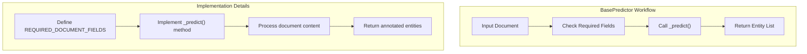
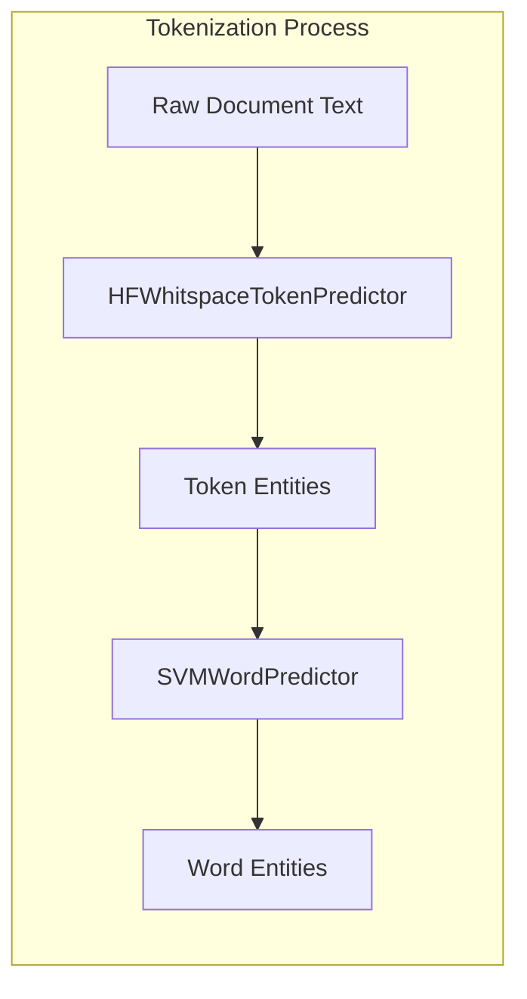
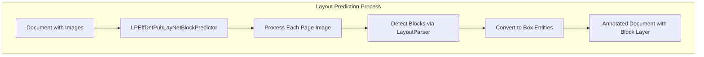
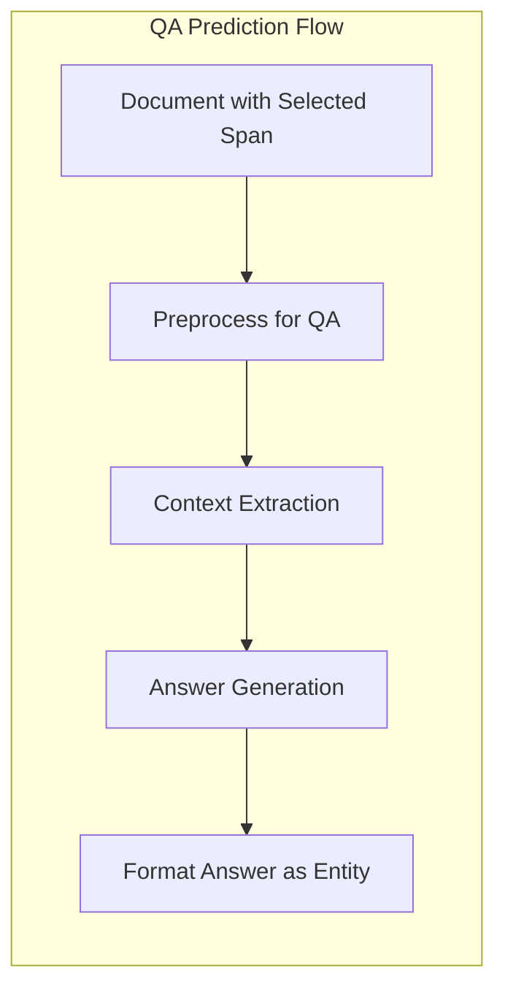

<!-- source: DeepWiki mcp.deepwiki.com · repo allenai/papermage · page 4 Predictors · fetched 2026-10-26 -->

# Predictors

<details>
<summary>Relevant source files</summary>

The following files were used as context for generating this wiki page:

- [papermage/predictors/__init__.py](papermage/predictors/__init__.py)
- [papermage/predictors/base_predictors/base_predictor.py](papermage/predictors/base_predictors/base_predictor.py)
- [papermage/predictors/base_predictors/lp_predictors.py](papermage/predictors/base_predictors/lp_predictors.py)
- [papermage/predictors/span_qa_predictors.py](papermage/predictors/span_qa_predictors.py)
- [papermage/predictors/word_predictors.py](papermage/predictors/word_predictors.py)
- [tests/fixtures/entity_classification_predictor_test_doc_papermage.json](tests/fixtures/entity_classification_predictor_test_doc_papermage.json)
- [tests/test_predictors/test_whitespace_predictor.py](tests/test_predictors/test_whitespace_predictor.py)

</details>


Predictors are a core component in the Papermage document processing pipeline that annotate documents with various types of information. They transform raw document content into structured semantic entities that can be used for further analysis and extraction. This page explains the Predictor system architecture, the base interface, and the various specialized predictors available in Papermage.

For information about how Predictors fit into the overall document processing workflow, see [Document Processing Pipeline](#3) and [CoreRecipe](#3.1). For information about training Predictors, see [Training System](#5).

## Predictor System Architecture

Predictors follow a consistent architecture pattern in Papermage. Each predictor:
1. Takes a `Document` object as input
2. Processes the document content (text, images, or both)
3. Returns a list of `Entity` objects that are used to annotate the document

```mermaid
classDiagram
    class "BasePredictor" {
        +REQUIRED_DOCUMENT_FIELDS: List[str]
        +predict(doc: Document): List[Entity]
        #_predict(doc: Document): List[Entity]
        #_doc_field_checker(doc: Document): None
    }

    class "HFBIOTaggerPredictor" {
        +from_pretrained()
        +preprocess(doc: Document)
        +_predict(doc: Document): List[Entity]
    }

    class "IVILATokenClassificationPredictor" {
        +from_pretrained()
        +_predict(doc: Document): List[Entity]
    }

    class "LPPredictor" {
        +from_pretrained()
        +postprocess(model_outputs, page_index, image)
        +_predict(doc: Document): List[Entity]
    }

    class "SVMWordPredictor" {
        +from_path()
        +from_directory()
        +_predict(doc: Document): List[Entity]
    }

    class "PysbdSentencePredictor" {
        +_predict(doc: Document): List[Entity]
    }

    class "APISpanQAPredictor" {
        +preprocess(doc: Document)
        +_predict(doc: Document): List[Entity]
    }

    "BasePredictor" <|-- "HFBIOTaggerPredictor"
    "BasePredictor" <|-- "IVILATokenClassificationPredictor"
    "BasePredictor" <|-- "LPPredictor"
    "BasePredictor" <|-- "SVMWordPredictor" 
    "BasePredictor" <|-- "PysbdSentencePredictor"
    "BasePredictor" <|-- "APISpanQAPredictor"
    
    "LPPredictor" <|-- "LPEffDetPubLayNetBlockPredictor"
    "LPPredictor" <|-- "LPEffDetFormulaPredictor"
```

Sources: [papermage/predictors/__init__.py:1-22](), [papermage/predictors/base_predictors/base_predictor.py:9-43](), [papermage/predictors/base_predictors/lp_predictors.py:27-121]()

## Base Predictor Interface

All predictors in Papermage extend the `BasePredictor` abstract class, which provides a standardized interface and common functionality:



The `BasePredictor` defines:

1. A standardized `predict()` method that checks document requirements before calling the specialized implementation
2. An abstract `_predict()` method that must be implemented by subclasses
3. A `REQUIRED_DOCUMENT_FIELDS` property that specifies which document fields must be present

Code example of the `BasePredictor` interface:

```python
class BasePredictor:
    @property
    @abstractmethod
    def REQUIRED_DOCUMENT_FIELDS(self) -> List[str]:
        """Specify required fields in the document"""
        raise NotImplementedError
        
    def predict(self, doc: Document) -> List[Entity]:
        """Public interface for prediction"""
        self._doc_field_checker(doc)
        return self._predict(doc=doc)
        
    @abstractmethod
    def _predict(self, doc: Document) -> List[Entity]:
        """Implementation-specific prediction logic"""
        raise NotImplementedError
```

Sources: [papermage/predictors/base_predictors/base_predictor.py:15-43]()

## Types of Predictors

Papermage includes several specialized predictors for different document analysis tasks:

| Predictor Type | Purpose | Required Document Fields |
|----------------|---------|--------------------------|
| Token Predictors | Identify token boundaries in text | `symbols` |
| Word Predictors | Group tokens into words | `tokens` |
| Sentence Predictors | Identify sentence boundaries | `tokens` or `symbols` |
| Block Predictors | Detect layout blocks (e.g., paragraphs, titles) | `pages`, `images` |
| Formula Predictors | Detect mathematical formulas | `pages`, `images` |
| VILA Predictors | Visual Layout Analysis for document structure | Task-specific |
| QA Predictors | Answer questions about document content | Task-specific |

Sources: [papermage/predictors/__init__.py:1-22]()

### Token and Word Predictors

Token predictors identify the basic token units in document text, while word predictors aggregate tokens into meaningful words (especially important for handling hyphenation).



The `SVMWordPredictor` is particularly sophisticated, using a machine learning approach to determine when hyphenated text should be joined or kept separate. It follows a multi-step process:

1. Apply whitespace tokenization as initial boundary detection
2. Keep specific punctuation as separate tokens
3. Identify hyphenated word candidates
4. Use an SVM classifier to decide if hyphenated segments should be joined
5. Create word entities from the results

Sources: [papermage/predictors/token_predictors.py](), [papermage/predictors/word_predictors.py:209-537](), [tests/test_predictors/test_whitespace_predictor.py:14-70]()

### Layout and Block Predictors

Layout predictors identify visual structure within documents, primarily working with document images rather than text. The `LPPredictor` class serves as a base for layout parser-based predictors:



Layout predictors typically:
1. Process each page image
2. Apply a pre-trained detection model
3. Convert detected regions to relative Box coordinates
4. Create entities with appropriate metadata

Sources: [papermage/predictors/base_predictors/lp_predictors.py:27-121]()

### Question Answering Predictors

QA predictors enable extracting answers to specific questions from document content. The `APISpanQAPredictor` allows querying information about specific spans:



The QA predictor:
1. Takes a document with a user-selected span
2. Extracts relevant context around the span
3. Processes the question against this context
4. Formats and returns the answer as entities with metadata

Sources: [papermage/predictors/span_qa_predictors.py:24-105]()

## Using Predictors

Predictors are typically used as part of a document processing pipeline, often orchestrated by a Recipe. They can also be used individually for specific annotation tasks. Most predictors follow a similar usage pattern:

```python
# Initialize the predictor
predictor = SomePredictor.from_pretrained(...)

# Apply to a document
entities = predictor.predict(document)

# Annotate the document with the results
document.annotate_layer("layer_name", entities)
```

For more complex scenarios, such as training new predictors or customizing existing ones, refer to the [Training System](#5) page.

## Common Predictor Interfaces

Most predictors provide additional convenience methods beyond the base interface:

| Method | Purpose |
|--------|---------|
| `from_pretrained()` | Initialize a predictor with pre-trained models |
| `from_path()` | Load a predictor from a file path |
| `preprocess()` | Prepare document data for prediction |
| `postprocess()` | Convert raw model outputs to entities |

Sources: [papermage/predictors/word_predictors.py:226-236](), [papermage/predictors/base_predictors/lp_predictors.py:35-59]()

## Implementation Best Practices

When implementing custom predictors, follow these guidelines:

1. Clearly define `REQUIRED_DOCUMENT_FIELDS` to fail early if prerequisites are missing
2. Implement robust preprocessing for your specific task
3. Return properly constructed `Entity` objects with appropriate spans/boxes
4. Include relevant metadata in entities for downstream processing
5. Handle edge cases gracefully with appropriate error messages

For more detailed information about specific predictors:
- For BIO tagging predictors, see [BIO Tagging Predictors](#4.1)
- For visual layout analysis, see [VILA Predictors](#4.2)
- For basic text segmentation, see [Sentence and Word Predictors](#4.3)
- For question answering, see [QA Predictors](#4.4)

---

