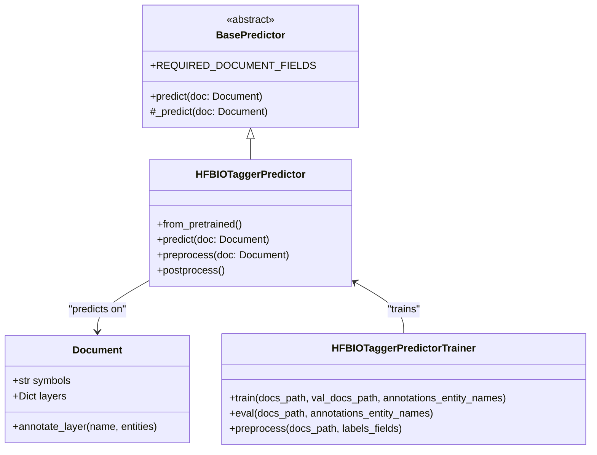
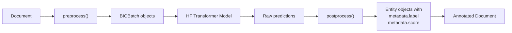
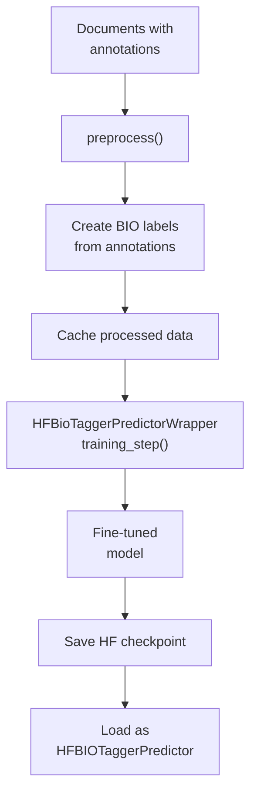

<!-- source: DeepWiki mcp.deepwiki.com · repo allenai/papermage · page 4.1 BIO Tagging Predictors · fetched 2026-10-26 -->

# BIO Tagging Predictors

<details>
<summary>Relevant source files</summary>

The following files were used as context for generating this wiki page:

- [papermage/trainers/bio_tagger_predictor_trainer.py](papermage/trainers/bio_tagger_predictor_trainer.py)
- [tests/test_predictors/test_bio_tagger_predictor.py](tests/test_predictors/test_bio_tagger_predictor.py)
- [tests/test_trainers/test_entity_classification_predictor_trainer.py](tests/test_trainers/test_entity_classification_predictor_trainer.py)

</details>


## Purpose and Scope

This document describes the BIO Tagging Predictors in the PaperMage system, which are used for sequence labeling tasks on document text. These predictors implement the Beginning-Inside-Outside (BIO) tagging scheme, a standard approach for detecting and classifying spans of text into semantic categories. The system allows for both using pre-trained models for prediction and training new models on custom data.

For information about other predictors such as the Visual Layout Analysis (VILA) predictors, see [VILA Predictors](#4.2).

## What is BIO Tagging?

BIO tagging is a sequence labeling approach where:
- **B-** (Beginning): Marks the start of an entity
- **I-** (Inside): Marks tokens that are inside an entity
- **O** (Outside): Marks tokens that don't belong to any entity

This approach allows for precise entity boundary detection and classification in text.

## BIO Tagger Architecture

### BIO Tagger in the PaperMage System

Below is a diagram showing where the BIO Tagger fits in the system architecture:

**BIO Tagger in System Context**


Sources: [papermage/trainers/bio_tagger_predictor_trainer.py:16-24](), [papermage/trainers/bio_tagger_predictor_trainer.py:101-105]()

### BIO Prediction Workflow

**BIO Tagger Prediction Process**


Sources: [papermage/predictors/base_predictors/hf_predictors.py](), [tests/test_predictors/test_bio_tagger_predictor.py:65-79]()

## HFBIOTaggerPredictor

The `HFBIOTaggerPredictor` is the main implementation of the BIO tagging approach in PaperMage. It leverages Hugging Face transformer models to perform token classification with BIO labels.

### Key Properties and Parameters

| Property | Description |
|----------|-------------|
| `entity_name` | The layer of the document to use as the unit of prediction (e.g., "tokens") |
| `context_name` | The layer of the document to use as the context for prediction (e.g., "pages" or "sents") |
| `model` | The underlying Hugging Face transformer model |
| `tokenizer` | The tokenizer for the transformer model |
| `id2label` | Mapping from label IDs to label names |
| `label2id` | Mapping from label names to label IDs |

Sources: [tests/test_predictors/test_bio_tagger_predictor.py:36-44](), [tests/test_trainers/test_entity_classification_predictor_trainer.py:36-43]()

### Prediction Process

1. **Preprocessing**: Converts Document entities into input batches for the model
   - Creates `BIOBatch` objects containing tokenized inputs
   - Maps document entities to tokenized subwords
   - Handles token alignment between document tokens and model tokens

2. **Prediction**: Runs the model on the preprocessed batches
   - Produces `BIOPrediction` objects with entity labels and confidence scores
   - Handles masking of subword tokens to ensure proper labeling

3. **Postprocessing**: Converts raw predictions into Document entities
   - Creates Entity objects with label and score metadata
   - Optionally merges adjacent tokens with the same label

Sources: [tests/test_predictors/test_bio_tagger_predictor.py:46-64](), [tests/test_predictors/test_bio_tagger_predictor.py:65-79]()

### Example Usage

To use a pre-trained BIO tagger:

```python
predictor = HFBIOTaggerPredictor.from_pretrained(
    model_name_or_path="allenai/scibert_scivocab_uncased",  # or path to saved model
    entity_name="tokens",                                    # what to classify
    context_name="pages",                                    # context to use
    num_labels=3,
    id2label={0: "O", 1: "B-Title", 2: "I-Title"},
    label2id={"O": 0, "B-Title": 1, "I-Title": 2}
)

# Predict on a document
entities = predictor.predict(doc)
doc.annotate_layer(name="titles", entities=entities)
```

Sources: [tests/test_trainers/test_entity_classification_predictor_trainer.py:36-43](), [tests/test_predictors/test_bio_tagger_predictor.py:36-44](), [tests/test_predictors/test_bio_tagger_predictor.py:72-79]()

## HFBIOTaggerPredictorTrainer

The trainer component allows you to train or fine-tune BIO taggers on your own data.

**BIO Tagger Training Process**


Sources: [papermage/trainers/bio_tagger_predictor_trainer.py:101-105](), [papermage/trainers/bio_tagger_predictor_trainer.py:295-316]()

### Training Configuration

The `HFBIOTaggerPredictorTrainConfig` class contains all configuration options for training, including:

| Parameter | Description | Default |
|-----------|-------------|---------|
| `data_path` | Path to training data (JSONL) | Required |
| `label_field` | Field containing the entities to predict | Required |
| `val_data_path` | Path to validation data | None |
| `entity_name` | Entity layer to classify | "tokens" |
| `context_name` | Context layer to use | "pages" |
| `model_name_or_path` | Base model to fine-tune | "allenai/scibert_scivocab_uncased" |
| `learning_rate` | Training learning rate | 5e-4 |
| `max_epochs` | Number of training epochs | 5 |
| `seed` | Random seed for reproducibility | 470 |

Sources: [papermage/trainers/bio_tagger_predictor_trainer.py:429-462]()

### Label Processing

The trainer converts document annotations into BIO labels by:

1. Identifying entity boundaries in the document
2. Assigning B- tags to the first token of each entity
3. Assigning I- tags to subsequent tokens of each entity
4. Assigning O tags to tokens outside any entity

This process supports multiple entity types simultaneously (e.g., "Title", "Author", etc.), creating a unified label space.

Sources: [papermage/trainers/bio_tagger_predictor_trainer.py:178-237]()

### Data Caching

For efficiency, the trainer caches preprocessed data to avoid repeating tokenization and label processing on each run:

```
CACHE_PATH = Path(os.environ.get("PAPERMAGE_CACHE_DIR", Path.home() / ".cache/papermage"))
```

Sources: [papermage/trainers/bio_tagger_predictor_trainer.py:102-106](), [papermage/trainers/bio_tagger_predictor_trainer.py:268-293]()

### Evaluation

The trainer includes evaluation functionality that:
1. Computes precision, recall, and F1 scores
2. Reports both token-level and span-level metrics
3. Saves detailed results for error analysis

Sources: [papermage/trainers/bio_tagger_predictor_trainer.py:327-426]()

### Example Training Usage

```python
from papermage.predictors import HFBIOTaggerPredictor
from papermage.trainers.bio_tagger_predictor_trainer import (
    HFBIOTaggerPredictorTrainConfig,
    HFBIOTaggerPredictorTrainer,
)

# Create a predictor with the desired label structure
predictor = HFBIOTaggerPredictor.from_pretrained(
    model_name_or_path="allenai/scibert_scivocab_uncased",
    entity_name="tokens",
    context_name="pages",
    num_labels=3,
    id2label={0: "O", 1: "B-MyEntityType", 2: "I-MyEntityType"},
    label2id={"O": 0, "B-MyEntityType": 1, "I-MyEntityType": 2},
)

# Configure the trainer
config = HFBIOTaggerPredictorTrainConfig(
    data_path="path/to/training_data.jsonl",
    label_field="my_entity_type",
    val_data_path="path/to/validation_data.jsonl",
    max_epochs=3
)

# Create and run the trainer
trainer = HFBIOTaggerPredictorTrainer(predictor=predictor, config=config)
trainer.train(
    docs_path=config.data_path,
    val_docs_path=config.val_data_path,
    annotations_entity_names=["my_entity_type"]
)
```

Sources: [tests/test_trainers/test_entity_classification_predictor_trainer.py:57-60](), [tests/test_trainers/test_entity_classification_predictor_trainer.py:72-76]()

## Advanced Features

### Multiple Entity Types

The BIO tagger can handle multiple entity types simultaneously by extending the label space:

```python
id2label = {
    0: "O",
    1: "B-Title", 2: "I-Title",
    3: "B-Author", 4: "I-Author",
    5: "B-Abstract", 6: "I-Abstract"
}
label2id = {label: idx for idx, label in id2label.items()}
```

Sources: [papermage/trainers/bio_tagger_predictor_trainer.py:135-145](), [papermage/trainers/bio_tagger_predictor_trainer.py:473-476]()

### Integration with Document Structure

The BIO tagger utilizes the Document-Entity-Layer system of PaperMage:
- Works with any entity type (typically "tokens")
- Can use different contexts (pages, paragraphs, etc.)
- Creates properly formatted entities that can be directly annotated into the document

Sources: [tests/test_predictors/test_bio_tagger_predictor.py:32-34](), [tests/test_predictors/test_bio_tagger_predictor.py:75-76]()

---

