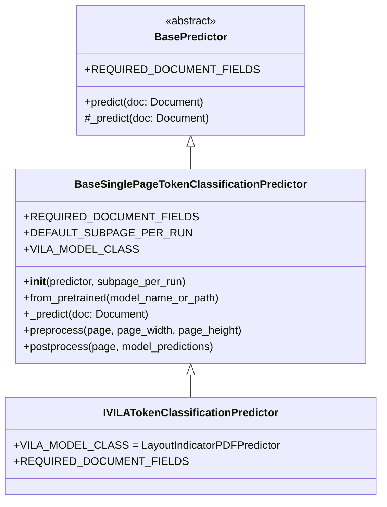
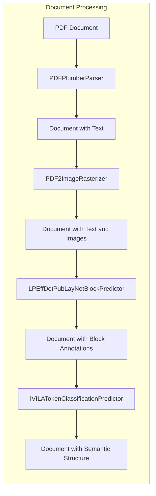
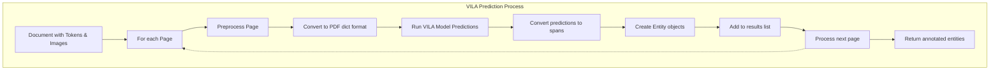
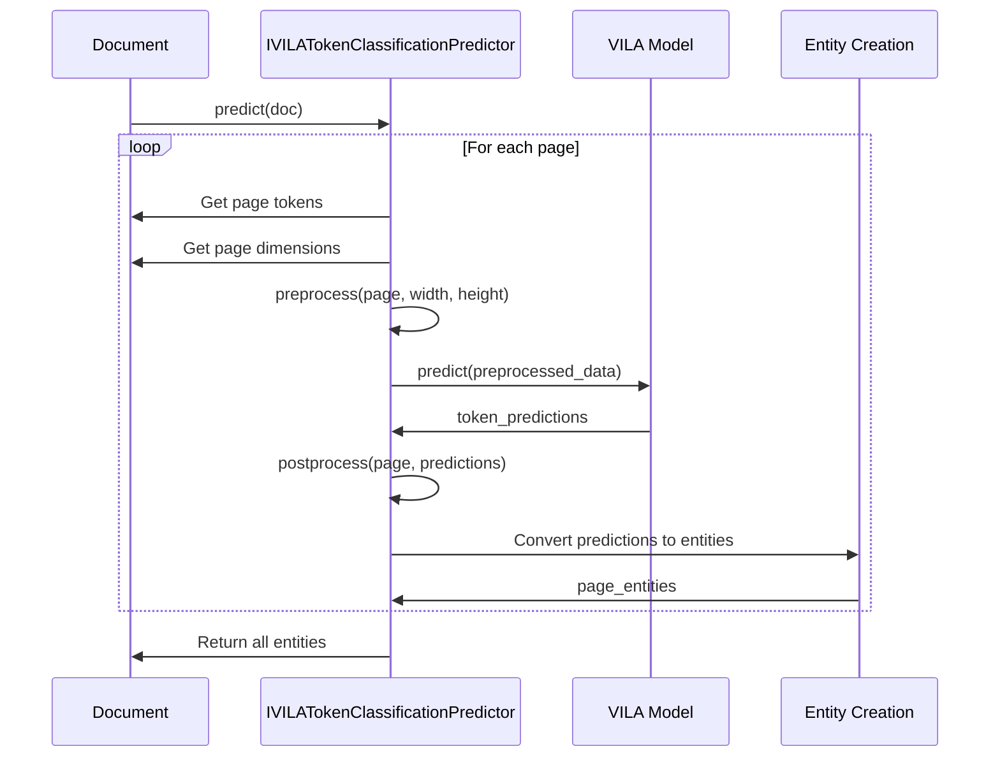
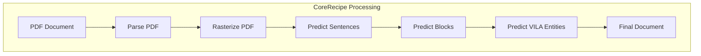
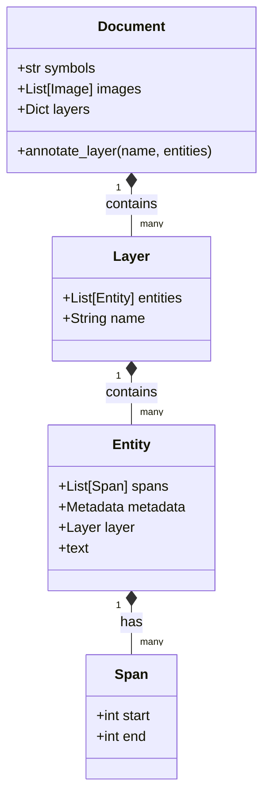

<!-- source: DeepWiki mcp.deepwiki.com · repo allenai/papermage · page 4.2 VILA Predictors · fetched 2026-10-26 -->

# VILA Predictors

<details>
<summary>Relevant source files</summary>

The following files were used as context for generating this wiki page:

- [papermage/magelib/entity.py](papermage/magelib/entity.py)
- [papermage/magelib/layer.py](papermage/magelib/layer.py)
- [papermage/predictors/vila_predictors.py](papermage/predictors/vila_predictors.py)
- [scripts/get_thumbnails_for_papers.py](scripts/get_thumbnails_for_papers.py)
- [tests/fixtures/2302.07302v1.pdf](tests/fixtures/2302.07302v1.pdf)
- [tests/test_predictors/test_vila_predictor.py](tests/test_predictors/test_vila_predictor.py)
- [tests/test_recipes/test_core_recipe.py](tests/test_recipes/test_core_recipe.py)

</details>


## Purpose and Scope

VILA (Visual Layout Analysis) Predictors in papermage are specialized components that analyze document layout and structure by classifying textual elements based on their visual positions, contexts, and content. These predictors are responsible for identifying document elements such as titles, paragraphs, figures, tables, and other semantic structural components in PDF documents.

The VILA Predictors build upon the capabilities of the VILA package but are adapted specifically for integration within the papermage document processing pipeline. They operate at the token level, analyzing both the textual content and spatial information to determine the role of each element in the document.

For information about more general prediction systems, see [Predictors](#4). For token-specific predictors that don't use visual layout, see [BIO Tagging Predictors](#4.1).

## Architecture

### VILA Predictor Class Hierarchy



Sources: [papermage/predictors/vila_predictors.py:199-285]()

### Integration with Document Processing Pipeline



Sources: [tests/test_predictors/test_vila_predictor.py:66-87](), [tests/test_recipes/test_core_recipe.py:1-35]()

## VILA Prediction Process

### Prediction Workflow



Sources: [papermage/predictors/vila_predictors.py:235-261]()

### Page Processing Detail



Sources: [papermage/predictors/vila_predictors.py:235-280]()

## Key VILA Predictor Components

### IVILATokenClassificationPredictor

This is the primary VILA predictor implementation in papermage, built on top of the `BaseSinglePageTokenClassificationPredictor`. It uses the `LayoutIndicatorPDFPredictor` from the VILA package to perform token classification based on their visual layout.

**Key Features:**
- Works at both block and row levels, depending on the configured aggregation level
- Uses a pre-trained model to classify document elements
- Supports batch processing for efficiency
- Creates semantic document structure as Entity objects

**Required Document Fields:**
- `pages`: Document pages
- `tokens`: Text tokens
- `rows` or `blocks`: Depending on the aggregation level

Sources: [papermage/predictors/vila_predictors.py:283-293]()

### Preprocessing

The preprocessing stage converts document page data into a format suitable for the VILA model:

1. Extracts tokens from the page
2. Converts token boxes to absolute coordinates based on page dimensions
3. Assigns row and block IDs to each token
4. Creates a dictionary with words, bounding boxes, block IDs, and line IDs

```
{
    'words': ['word1', 'word2', ...],
    'bbox': [[x1, y1, x2, y2], [x1, y1, x2, y2], ...],
    'block_ids': [0, 0, 0, 1 ...],
    'line_ids': [0, 1, 1, 2 ...],
    'labels': [null, null, ...], # empty for prediction
}
```

Sources: [papermage/predictors/vila_predictors.py:122-173](), [papermage/predictors/vila_predictors.py:263-267]()

### Postprocessing

After model prediction, the postprocessing stage:

1. Converts the token-level predictions into spans of consecutive same predictions
2. For each span, creates an Entity with the appropriate Span object
3. Assigns the predicted label to the Entity's metadata
4. Returns a list of Entity objects representing semantic elements

Sources: [papermage/predictors/vila_predictors.py:269-280](), [papermage/predictors/vila_predictors.py:177-196]()

## Available Semantic Labels

VILA predictors can identify various document elements based on their pretrained models. The standard set of labels includes:

| Label ID | Semantic Element |
|----------|------------------|
| Title    | Document or section titles |
| Author   | Author information |
| Abstract | Document abstract |
| Keywords | Document keywords |
| Section  | Section headings |
| Paragraph | Text paragraphs |
| List     | Bulleted or numbered lists |
| Bibliography | References and citations |
| Equation | Mathematical equations |
| Algorithm | Algorithm blocks |
| Figure   | Figures and illustrations |
| Table    | Data tables |
| Caption  | Figure or table captions |
| Header   | Page headers |
| Footer   | Page footers |
| Footnote | Page footnotes |

Sources: [papermage/predictors/vila_predictors.py:43-60](), [tests/test_predictors/test_vila_predictor.py:28-64]()

## Usage Example

Here's how VILA predictors are typically used in a document processing workflow:

1. Parse the PDF to extract text using a parser like `PDFPlumberParser`
2. Rasterize the PDF to extract images using `PDF2ImageRasterizer`
3. Apply a block predictor to segment the document into blocks
4. Apply the VILA predictor to classify the document elements
5. Use the resulting entities for downstream tasks

```python
# Simplified example based on test code
parser = PDFPlumberParser()
rasterizer = PDF2ImageRasterizer()

# Parse and rasterize document
doc = parser.parse(input_pdf_path="document.pdf")
images = rasterizer.rasterize(input_pdf_path="document.pdf", dpi=72)
doc.annotate_images(images)

# Add block annotations first
block_predictor = LPEffDetPubLayNetBlockPredictor.from_pretrained()
blocks = block_predictor.predict(doc)
doc.annotate_layer(name="blocks", entities=blocks)

# Apply VILA predictor
vila_predictor = IVILATokenClassificationPredictor.from_pretrained(
    "allenai/ivila-block-layoutlm-finetuned-docbank"
)
semantic_elements = vila_predictor.predict(doc=doc)
doc.annotate_layer(name="semantic_elements", entities=semantic_elements)
```

Sources: [tests/test_predictors/test_vila_predictor.py:66-87]()

## Integration with CoreRecipe

VILA predictors are integrated into the `CoreRecipe` class, which provides a comprehensive document processing pipeline. The recipe takes care of properly sequencing the various processing steps, including VILA prediction.



Sources: [tests/test_recipes/test_core_recipe.py:10-34]()

## Entity Integration

VILA predictions are converted into Entity objects with spans, which are then added to the Document as a layer. Each Entity represents a semantic element (like a title, paragraph, etc.) and has:

1. One or more Spans marking the text range
2. Metadata containing the semantic label
3. References to its parent Layer and Document

These Entity objects can then be used for document analysis, extraction, or further processing.



Sources: [papermage/magelib/entity.py:20-198](), [papermage/magelib/layer.py:22-110]()

## Technical Limitations and Considerations

When using VILA predictors, consider the following technical aspects:

1. **Page size constraints**: The predictors normalize page dimensions to fit within `MAX_PAGE_WIDTH` and `MAX_PAGE_HEIGHT` (both set to 1000 pixels)
2. **Batch processing**: Prediction is done in batches, controlled by the `subpage_per_run` parameter
3. **Dependencies**: Requires tokens, pages, and depending on the model, either rows or blocks
4. **Model selection**: Different pretrained models are available for different document types and layouts
5. **Token alignment**: Predictions must align with the token boundaries in the document

Sources: [papermage/predictors/vila_predictors.py:36-40](), [papermage/predictors/vila_predictors.py:204]()

---

