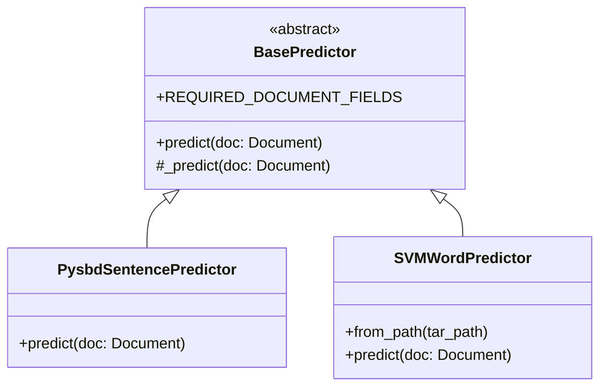
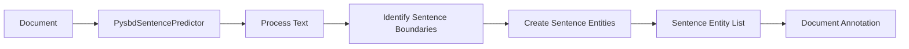
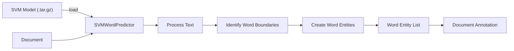
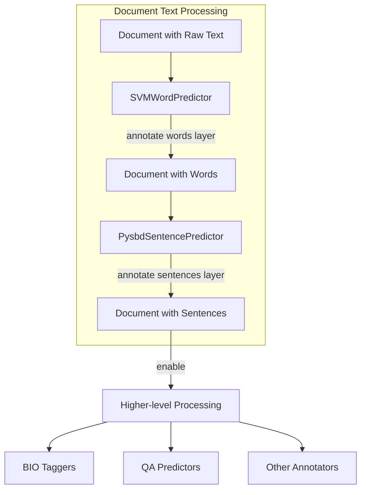
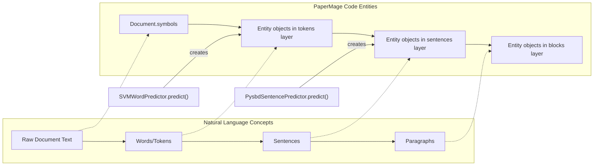
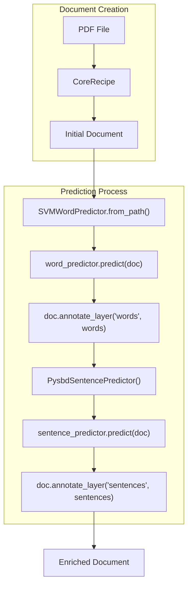

<!-- source: DeepWiki mcp.deepwiki.com · repo allenai/papermage · page 4.3 Sentence and Word Predictors · fetched 2026-10-26 -->

# Sentence and Word Predictors

<details>
<summary>Relevant source files</summary>

The following files were used as context for generating this wiki page:

- [tests/test_predictors/test_sentence_predictor.py](tests/test_predictors/test_sentence_predictor.py)

</details>


## Purpose and Scope

This document details the sentence and word prediction components within the PaperMage library. These predictors handle basic text segmentation, providing foundational annotations that many downstream tasks rely on. 

Sentence and word predictors create essential layers of text structure in your documents, breaking down raw text into meaningful units for further processing. While this page focuses on segmentation predictors, for information about higher-level entity extraction, see [BIO Tagging Predictors](#4.1) or [VILA Predictors](#4.2).

## Architecture Overview

Sentence and word predictors implement the BasePredictor interface, following the standard prediction pattern in PaperMage:



Sources: [tests/test_predictors/test_sentence_predictor.py:14-15]()

## Sentence Prediction

### PysbdSentencePredictor

The `PysbdSentencePredictor` identifies sentence boundaries in document text. It relies on the pysbd library (Python Sentence Boundary Disambiguation) to determine where sentences begin and end.

#### Implementation Details

The PysbdSentencePredictor:
1. Takes a Document object as input
2. Processes the document text
3. Creates Entity objects for each identified sentence
4. Returns a list of sentence entities



Sources: [tests/test_predictors/test_sentence_predictor.py:17-68]()

#### Usage Example

Here's how to use the PysbdSentencePredictor:

```python
from papermage.magelib import Document
from papermage.predictors import PysbdSentencePredictor

# Create a document
doc = Document(symbols="This is a test. This is another test.")

# Optionally, you might want to have tokens in your document first
# doc.annotate_layer(name="tokens", entities=tokens)

# Create and run the predictor
predictor = PysbdSentencePredictor()
sentences = predictor.predict(doc)

# Annotate the document with the predicted sentences
doc.annotate_layer(name="sentences", entities=sentences)

# Access sentences
print(f"Found {len(doc.sentences)} sentences")
print(f"First sentence: {doc.sentences[0].text}")
```

Sources: [tests/test_predictors/test_sentence_predictor.py:30-50]()

#### Performance Characteristics

The PysbdSentencePredictor handles academic text well, correctly identifying sentence boundaries even when formatting might introduce challenges like line breaks within sentences. As seen in testing, the predictor successfully processes complex academic papers, identifying hundreds of sentences with proper boundaries.

Sources: [tests/test_predictors/test_sentence_predictor.py:52-68]()

## Word Prediction

### SVMWordPredictor

The `SVMWordPredictor` segments text into word tokens. It uses a Support Vector Machine (SVM) model to identify word boundaries.

#### Implementation Details

The SVMWordPredictor:
1. Loads a pre-trained SVM model from a tar file
2. Processes document text
3. Creates Entity objects for each identified word
4. Returns a list of word entities



Sources: [tests/test_predictors/test_sentence_predictor.py:23-28]()

#### Loading Pre-trained Models

The SVMWordPredictor can be initialized from a pre-trained model:

```python
from papermage.predictors import SVMWordPredictor

# Load from a pre-trained model file
word_predictor = SVMWordPredictor.from_path(
    tar_path="path/to/svm_word_predictor.tar.gz"
)
```

Sources: [tests/test_predictors/test_sentence_predictor.py:23-26]()

## Integration in Document Processing Pipeline

Sentence and word predictors play a crucial role in the document processing pipeline. They create foundational annotations that many downstream tasks rely on.



### Predictor Interdependencies

There's evidence that the sentence prediction quality may improve when word annotations are already present in the document. This suggests a potential order dependency:

1. Apply word prediction first
2. Apply sentence prediction on the document with word annotations

Sources: [tests/test_predictors/test_sentence_predictor.py:22-28]()

## Natural Language to Code Entity Mapping

The following diagram shows how text segmentation concepts map to code entities in PaperMage:



Sources: [tests/test_predictors/test_sentence_predictor.py:14-68]()

## Data Flow Through Predictors

This diagram illustrates the data flow from document creation through the prediction process to the final annotated document:



Sources: [tests/test_predictors/test_sentence_predictor.py:14-68]()

## Limitations and Best Practices

- **Enhancing Sentence Prediction**: There is evidence that having word annotations improves sentence prediction quality.
- **Academic Text**: The sentence predictor is tested and optimized for academic texts, handling common challenges in scholarly writing.
- **Line Breaks**: The sentence predictor correctly handles text with line breaks within sentences, which is common in PDF-extracted text.

Sources: [tests/test_predictors/test_sentence_predictor.py:22-23](), [tests/test_predictors/test_sentence_predictor.py:52-68]()

---

