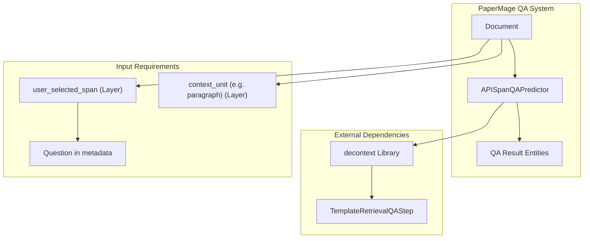
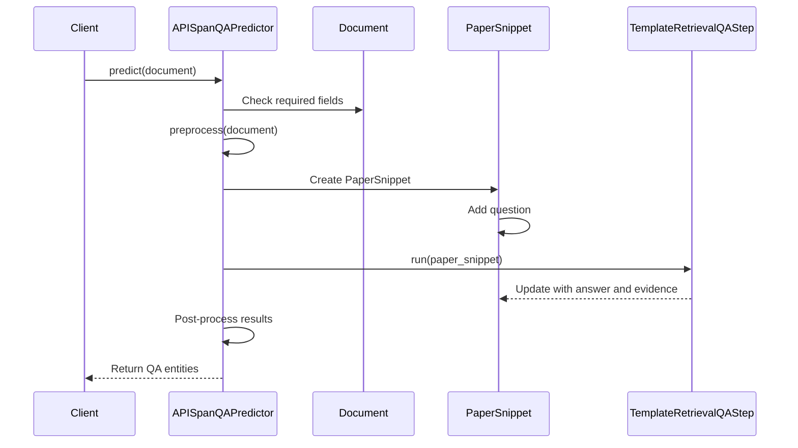
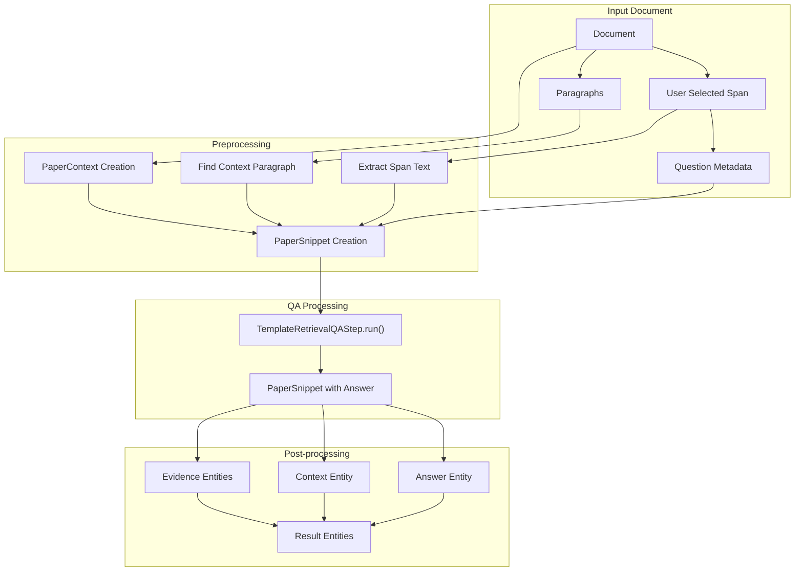

<!-- source: DeepWiki mcp.deepwiki.com · repo allenai/papermage · page 4.4 QA Predictors · fetched 2026-10-26 -->

# QA Predictors

<details>
<summary>Relevant source files</summary>

The following files were used as context for generating this wiki page:

- [examples/quick_start_demo.ipynb](examples/quick_start_demo.ipynb)
- [papermage/predictors/base_predictors/base_predictor.py](papermage/predictors/base_predictors/base_predictor.py)
- [papermage/predictors/base_predictors/lp_predictors.py](papermage/predictors/base_predictors/lp_predictors.py)
- [papermage/predictors/span_qa_predictors.py](papermage/predictors/span_qa_predictors.py)
- [papermage/predictors/word_predictors.py](papermage/predictors/word_predictors.py)

</details>


The QA (Question Answering) Predictors in PaperMage are specialized predictors that enable question answering capabilities over document content. These predictors allow users to ask questions about specific spans of text and receive answers backed by evidence from the document. This page documents the QA prediction system, its architecture, and usage patterns.

## Overview

QA Predictors are designed to answer questions about selected spans of text within a document. They work by leveraging the decontext library's question answering capabilities and integrating them with PaperMage's document model.



Sources: [papermage/predictors/span_qa_predictors.py:1-106]()

## Architecture

The QA prediction system in PaperMage is built on top of the base predictor architecture and integrates with the decontext library for actual question answering capabilities.



Sources: [papermage/predictors/span_qa_predictors.py:1-106](), [papermage/predictors/base_predictors/base_predictor.py:1-44]()

## APISpanQAPredictor

The main QA predictor in PaperMage is the `APISpanQAPredictor` class. This predictor takes a document with a user-selected span (containing a question in its metadata) and produces entities containing the answer and supporting evidence.

### Initialization and Configuration

```python
APISpanQAPredictor(context_unit_name="paragraph", span_name="user_selected_span")
```

Parameters:
- `context_unit_name`: Name of the layer containing context units (default: "paragraph")
- `span_name`: Name of the layer containing the user-selected span (default: "user_selected_span")

Sources: [papermage/predictors/span_qa_predictors.py:24-29]()

### Required Document Fields

The `APISpanQAPredictor` requires the following document fields:
- The context unit layer (e.g., "paragraph")
- The user-selected span layer (e.g., "user_selected_span")

The user-selected span is expected to have a question in its metadata.

Sources: [papermage/predictors/span_qa_predictors.py:31-33]()

### Prediction Process

The prediction process involves three main steps:

1. **Preprocessing**:
   - Convert the PaperMage document to a PaperSnippet format required by decontext
   - Extract paper context (title, abstract, full text)
   - Find the context (paragraph) containing the user-selected span
   - Create a PaperSnippet with the span text, context, and question

2. **QA Processing**:
   - Run the decontext TemplateRetrievalQAStep on the PaperSnippet
   - This step performs the actual question answering

3. **Post-processing**:
   - Create entities containing the answer and evidence
   - The result includes:
     - The user-selected span with question and answer in metadata
     - The context entity containing the span
     - Evidence entities supporting the answer



Sources: [papermage/predictors/span_qa_predictors.py:35-105]()

## Data Types

The QA system uses several data types from both PaperMage and the decontext library:

| PaperMage Types | Description |
|-----------------|-------------|
| `Document` | The main document container |
| `Entity` | Container for spans and boxes with metadata |
| `Metadata` | Key-value store for entity attributes |

| decontext Types | Description |
|-----------------|-------------|
| `PaperContext` | Container for paper metadata and content |
| `PaperSnippet` | Container for a text snippet with context |
| `EvidenceParagraph` | A paragraph providing evidence for an answer |
| `QuestionAnswerEvidence` | Container for a question, answer, and evidence |

Sources: [papermage/predictors/span_qa_predictors.py:9-18]()

## Implementation Details

### Preprocessing

The `preprocess` method converts a PaperMage document to a PaperSnippet format required by decontext:

```python
def preprocess(self, doc: Document) -> PaperSnippet:
    # Create paper context
    paper_context = PaperContext.parse_raw(...)
    
    # Get context containing the span
    context = getattr(getattr(doc, self.span_name)[0], self.context_unit_name)[0]
    
    # Create paper snippet
    paper_snippet = PaperSnippet(
        snippet=getattr(doc, self.span_name)[0].text,
        context=paper_context,
        qae=[],
        paragraph_with_snippet=EvidenceParagraph(...)
    )
    
    # Add question
    paper_snippet.add_question(getattr(doc, self.span_name)[0].metadata["question"])
    
    return paper_snippet
```

Sources: [papermage/predictors/span_qa_predictors.py:35-71]()

### Prediction

The `_predict` method performs the actual QA prediction:

```python
def _predict(self, doc: Document) -> List[Entity]:
    # Preprocess document
    paper_snippet = self.preprocess(doc)
    
    # Run QA step
    self.retrieval_qa_step.run(paper_snippet)
    
    # Postprocess results
    entities = []
    
    # Add user-selected span with answer
    new_user_selected_span = Entity.from_json(...)
    new_user_selected_span.metadata["type"] = "answer"
    new_user_selected_span.metadata["question"] = paper_snippet.qae[0].question
    new_user_selected_span.metadata["answer"] = paper_snippet.qae[0].answer
    entities.append(new_user_selected_span)
    
    # Add context entity
    new_context_with_span = Entity.from_json(...)
    new_context_with_span.metadata["type"] = "context_with_span"
    entities.append(new_context_with_span)
    
    # Add evidence entities
    for evidence in paper_snippet.qae[0].evidence:
        entity = doc.get_layer(self.context_unit_name)[evidence.index]
        new_entity = Entity.from_json(entity.to_json())
        new_entity.metadata["type"] = "evidence"
        entities.append(new_entity)
    
    return entities
```

Sources: [papermage/predictors/span_qa_predictors.py:73-105]()

## Usage Example

To use the QA predictor in a recipe or application:

1. Prepare a document with paragraphs and a user-selected span with a question
2. Initialize the QA predictor
3. Run the predictor on the document
4. Process the resulting entities

```python
# Initialize the predictor
qa_predictor = APISpanQAPredictor(
    context_unit_name="paragraph",
    span_name="user_selected_span"
)

# Assume document has paragraphs and a user-selected span with a question
# Run prediction
qa_entities = qa_predictor.predict(document)

# Process the results
answer_entity = next(e for e in qa_entities if e.metadata.get("type") == "answer")
answer = answer_entity.metadata["answer"]
```

## Integration with Other Components

The QA predictor integrates with other components of the PaperMage system:

1. It inherits from `BasePredictor`, following the same interface as other predictors
2. It interacts with the document model, operating on entities and layers
3. It can be used in recipes alongside other predictors

Sources: [papermage/predictors/base_predictors/base_predictor.py:15-44]()

In a typical workflow, the QA predictor would be used after other predictors have processed the document to identify paragraphs, sentences, and other structures. A user would select a span of text, ask a question about it, and the QA predictor would provide an answer based on the document's content.

---

