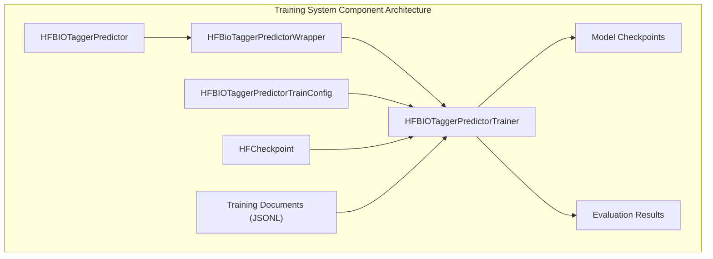
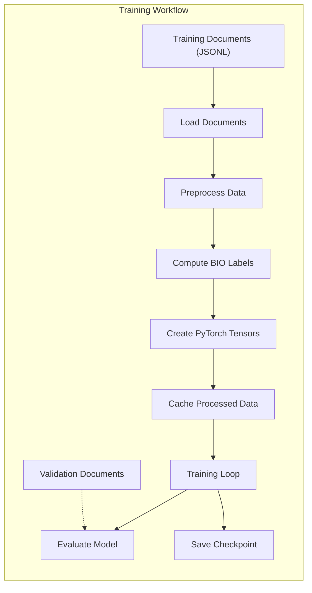
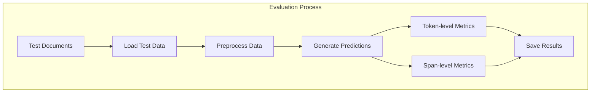

<!-- source: DeepWiki mcp.deepwiki.com · repo allenai/papermage · page 5 Training System · fetched 2026-10-26 -->

# Training System

<details>
<summary>Relevant source files</summary>

The following files were used as context for generating this wiki page:

- [papermage/trainers/bio_tagger_predictor_trainer.py](papermage/trainers/bio_tagger_predictor_trainer.py)
- [tests/test_predictors/test_bio_tagger_predictor.py](tests/test_predictors/test_bio_tagger_predictor.py)
- [tests/test_trainers/test_entity_classification_predictor_trainer.py](tests/test_trainers/test_entity_classification_predictor_trainer.py)

</details>


The Training System in Papermage provides infrastructure for training machine learning models that power document analysis pipelines. This system primarily focuses on training BIO (Beginning-Inside-Outside) tagging models for entity classification tasks such as detecting titles, authors, and other semantic elements in scientific documents. For information about using pre-trained predictors in a document processing pipeline, see [Predictors](#4).

## System Architecture

The Training System integrates with Hugging Face Transformers and PyTorch Lightning to handle model training efficiently.



Sources: [papermage/trainers/bio_tagger_predictor_trainer.py:27-76](), [papermage/trainers/bio_tagger_predictor_trainer.py:101-187]()

## Core Components

### HFBIOTaggerPredictorTrainer

The main training class that orchestrates the entire training process, including data preprocessing, model training, and evaluation.

### HFBioTaggerPredictorWrapper

A PyTorch Lightning wrapper around the `HFBIOTaggerPredictor` that implements the training loop interface for integration with PyTorch Lightning.

### HFCheckpoint

A callback that handles saving model checkpoints in the Hugging Face format, making trained models easily loadable for inference.

### HFBIOTaggerPredictorTrainConfig

A configuration dataclass that defines all the parameters for training, including data paths, model parameters, and training hyperparameters.

Sources: [papermage/trainers/bio_tagger_predictor_trainer.py:429-462]()

## Training Process

The training workflow consists of several key steps:



Sources: [papermage/trainers/bio_tagger_predictor_trainer.py:239-266](), [papermage/trainers/bio_tagger_predictor_trainer.py:295-326]()

### Data Preprocessing

Data preprocessing converts document annotations into the BIO tagging format required for training:

1. **Document Loading**: Documents are loaded from JSONL files where each line contains a serialized `Document` object
2. **Label Computation**: Entity annotations are converted to BIO tags
   - B (Beginning): Marks the first token of an entity
   - I (Inside): Marks subsequent tokens within the same entity
   - O (Outside): Marks tokens not part of any entity
3. **Tokenization**: Text is tokenized using the model's tokenizer
4. **Tensor Creation**: Inputs are converted to PyTorch tensors
5. **Caching**: Processed data is cached to disk for efficiency in repeated training runs

Sources: [papermage/trainers/bio_tagger_predictor_trainer.py:178-237](), [papermage/trainers/bio_tagger_predictor_trainer.py:268-293]()

### Training Configuration

The `HFBIOTaggerPredictorTrainConfig` provides extensive configuration options:

| Parameter | Type | Default | Description |
|-----------|------|---------|-------------|
| data_path | Path | Required | Path to training data in JSONL format |
| label_field | str | Required | Entity field(s) to predict |
| val_data_path | Path | None | Path to validation data |
| entity_name | str | "tokens" | Entity type to classify |
| context_name | str | "pages" | Context scope for classification |
| model_name_or_path | str | "allenai/scibert_scivocab_uncased" | Pretrained model identifier |
| learning_rate | float | 5e-4 | Learning rate |
| warmup_steps | float | 0.0 | Proportion of steps for warmup |
| seed | int | 470 | Random seed |
| max_epochs | int | 5 | Maximum training epochs |

Sources: [papermage/trainers/bio_tagger_predictor_trainer.py:429-462]()

### Evaluation

The evaluation process produces comprehensive metrics to assess model performance:

1. **Token-level metrics**: Precision, recall, and F1 score for individual token classifications
2. **Span-level metrics**: Evaluates whether entire entity spans are correctly identified
3. **Result storage**: Results are saved to JSON files for further analysis



Sources: [papermage/trainers/bio_tagger_predictor_trainer.py:327-426]()

## Usage Examples

### Training a Model

```python
from papermage.predictors import HFBIOTaggerPredictor
from papermage.trainers.bio_tagger_predictor_trainer import (
    HFBIOTaggerPredictorTrainConfig,
    HFBIOTaggerPredictorTrainer,
)
import springs

# Create configuration
config = springs.from_dataclass(HFBIOTaggerPredictorTrainConfig)
config = springs.merge(
    config,
    springs.from_dict({
        "data_path": "path/to/training_data.jsonl",
        "label_field": "title",
        "max_epochs": 3,
        "seed": 42,
    }),
)

# Initialize predictor with label schema
predictor = HFBIOTaggerPredictor.from_pretrained(
    model_name_or_path="allenai/scibert_scivocab_uncased",
    entity_name="tokens",
    context_name="pages",
    num_labels=3,
    id2label={0: "O", 1: "B-title", 2: "I-title"},
    label2id={"O": 0, "B-title": 1, "I-title": 2},
)

# Initialize trainer
trainer = HFBIOTaggerPredictorTrainer(
    predictor=predictor,
    config=config,
)

# Train the model
trainer.train(
    docs_path=config.data_path,
    val_docs_path=None,
    annotations_entity_names=["title"],
)
```

Sources: [tests/test_trainers/test_entity_classification_predictor_trainer.py:45-76]()

### Evaluating a Model

```python
# Evaluate on test data
trainer.eval(
    docs_path="path/to/test_data.jsonl",
    annotations_entity_names=["title"],
)
```

Sources: [tests/test_trainers/test_entity_classification_predictor_trainer.py:156-187]()

### Using a Trained Model

```python
from papermage.predictors import HFBIOTaggerPredictor

# Load the trained model
predictor = HFBIOTaggerPredictor.from_pretrained(
    model_name_or_path="path/to/trained/checkpoint",
    entity_name="tokens",
    context_name="pages",
    id2label={0: "O", 1: "B-title", 2: "I-title"},
    label2id={"O": 0, "B-title": 1, "I-title": 2},
)

# Run prediction on a document
entities = predictor.predict(doc=document)

# Annotate document with predictions
document.annotate_layer(name="predicted_titles", entities=entities)
```

Sources: [tests/test_trainers/test_entity_classification_predictor_trainer.py:82-91]()

## Command Line Interface

The training system can be used directly from the command line:

```bash
python -m papermage.trainers.bio_tagger_predictor_trainer \
    data_path=path/to/training_data.jsonl \
    label_field=title \
    val_data_path=path/to/validation_data.jsonl \
    model_name_or_path=allenai/scibert_scivocab_uncased \
    max_epochs=5 \
    mode=train
```

Sources: [papermage/trainers/bio_tagger_predictor_trainer.py:464-503]()

---

