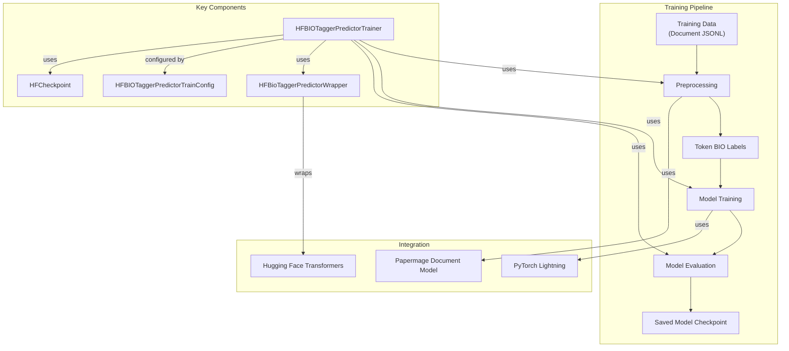
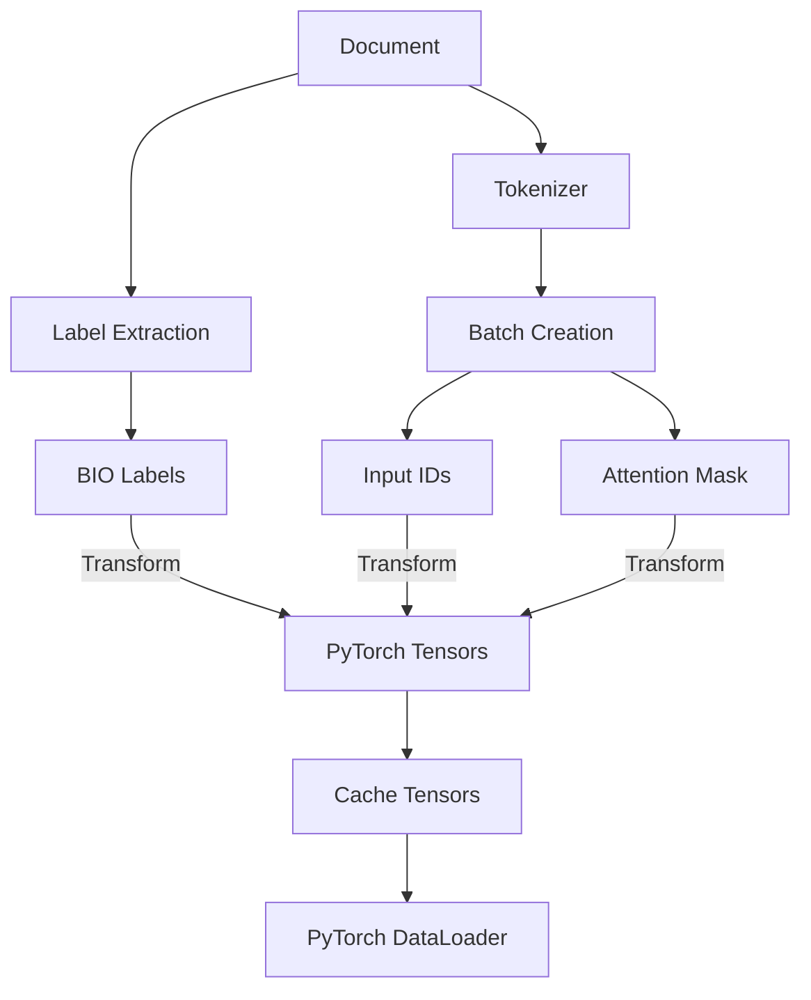
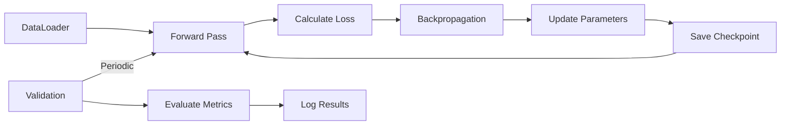
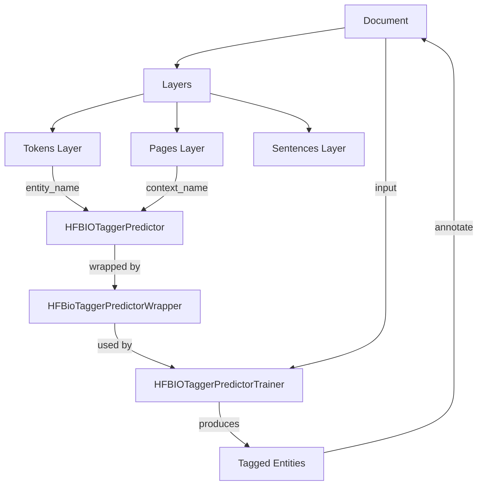

<!-- source: DeepWiki mcp.deepwiki.com · repo allenai/papermage · page 5.1 BIO Tagger Trainer · fetched 2026-10-26 -->

# BIO Tagger Trainer

<details>
<summary>Relevant source files</summary>

The following files were used as context for generating this wiki page:

- [papermage/trainers/bio_tagger_predictor_trainer.py](papermage/trainers/bio_tagger_predictor_trainer.py)
- [tests/test_predictors/test_bio_tagger_predictor.py](tests/test_predictors/test_bio_tagger_predictor.py)
- [tests/test_trainers/test_entity_classification_predictor_trainer.py](tests/test_trainers/test_entity_classification_predictor_trainer.py)

</details>


## Purpose and Scope

This document describes the BIO Tagger Trainer system in the Papermage library, which enables training of sequence labeling models for token classification tasks using the BIO (Beginning, Inside, Outside) tagging scheme. The trainer works with the `HFBIOTaggerPredictor` to train models that can identify and classify entities in documents.

For information about the BIO Tagging Predictor itself, see [BIO Tagging Predictors](#4.1).

Sources: [papermage/trainers/bio_tagger_predictor_trainer.py:101-427]()

## System Overview

The BIO Tagger Trainer provides infrastructure for training sequence labeling models based on Hugging Face Transformers. It handles data preprocessing, training, evaluation, and model checkpointing, enabling users to train custom entity recognition models on document data.

### BIO Tagging Architecture



Sources: [papermage/trainers/bio_tagger_predictor_trainer.py:27-180](), [papermage/trainers/bio_tagger_predictor_trainer.py:429-462]()

## Key Components

### Core Classes

```mermaid
classDiagram
    class HFBIOTaggerPredictorTrainer {
        -HFBioTaggerPredictorWrapper predictor
        -DictConfig config
        -String data_id
        -String model_id
        -pl.Trainer trainer
        +compute_labels_from_entities()
        +preprocess()
        +load_docs_from_path()
        +train()
        +_train()
        +eval()
    }

    class HFBioTaggerPredictorWrapper {
        -HFBIOTaggerPredictor predictor
        -float learning_rate
        -float warmup_steps
        -int num_training_steps
        +training_step()
        +validation_step()
        +configure_optimizers()
        +preprocess()
    }

    class HFCheckpoint {
        -String save_dir
        +on_save_checkpoint()
    }

    class HFBIOTaggerPredictorTrainConfig {
        +Path data_path
        +String label_field
        +Path val_data_path
        +String entity_name
        +String context_name
        +String model_name_or_path
        +float learning_rate
        +float warmup_steps
        +String mode
        +int seed
        +bool wandb
        +String accelerator
        +int max_epochs
        +int max_steps
    }

    HFBIOTaggerPredictorTrainer --> HFBioTaggerPredictorWrapper: contains
    HFBIOTaggerPredictorTrainer --> HFBIOTaggerPredictorTrainConfig: uses
    HFBioTaggerPredictorWrapper --> "HFBIOTaggerPredictor": wraps
    pl.Trainer --|> HFBIOTaggerPredictorTrainer: used by
    HFCheckpoint --|> HFBIOTaggerPredictorTrainer: used by
```

Sources: [papermage/trainers/bio_tagger_predictor_trainer.py:27-100](), [papermage/trainers/bio_tagger_predictor_trainer.py:101-427](), [papermage/trainers/bio_tagger_predictor_trainer.py:429-462]()

### HFBIOTaggerPredictorTrainer

The main trainer class that handles the entire training process. Key responsibilities include:

- Processing training data into a format suitable for the model
- Training the model using PyTorch Lightning
- Evaluating model performance
- Saving model checkpoints

Sources: [papermage/trainers/bio_tagger_predictor_trainer.py:101-427]()

### HFBioTaggerPredictorWrapper

A wrapper class that adapts the `HFBIOTaggerPredictor` to the PyTorch Lightning module interface, enabling training with the Lightning framework. This handles:

- Forward pass and loss calculation during training
- Validation steps
- Optimizer and learning rate scheduler configuration

Sources: [papermage/trainers/bio_tagger_predictor_trainer.py:27-63]()

### HFCheckpoint

A PyTorch Lightning callback that handles saving the model in HuggingFace format, making it easy to load for prediction later.

Sources: [papermage/trainers/bio_tagger_predictor_trainer.py:78-98]()

### HFBIOTaggerPredictorTrainConfig

A dataclass that holds all configuration parameters for training, including:

- Data paths
- Model parameters
- Training hyperparameters
- Evaluation settings

Sources: [papermage/trainers/bio_tagger_predictor_trainer.py:429-462]()

## Training Process

The training process consists of several key stages:

### 1. Preprocessing



The preprocessing stage:
- Loads documents from JSONL files
- Extracts token context and labels
- Converts tokens to input IDs using the tokenizer
- Creates attention masks
- Generates BIO labels for entity spans
- Caches processed tensors for faster reuse

Sources: [papermage/trainers/bio_tagger_predictor_trainer.py:178-266](), [papermage/trainers/bio_tagger_predictor_trainer.py:268-293]()

### 2. Training Loop



Training is handled by PyTorch Lightning, which provides:
- Automatic optimization loops
- Device management (CPU/GPU)
- Gradient accumulation
- Mixed precision training
- Checkpointing
- Logging

Sources: [papermage/trainers/bio_tagger_predictor_trainer.py:295-325]()

### 3. Evaluation

The evaluation process:
- Runs the trained model on test data
- Computes precision, recall, and F1 scores at both token and span levels
- Saves detailed results for analysis

Sources: [papermage/trainers/bio_tagger_predictor_trainer.py:327-426]()

## Configuration Options

The trainer is configured through the `HFBIOTaggerPredictorTrainConfig` dataclass. Key configuration options include:

| Parameter | Description | Default |
|-----------|-------------|---------|
| `data_path` | Path to training data JSONL file | Required |
| `label_field` | Field name in document to use as labels | Required |
| `val_data_path` | Path to validation data JSONL file | None |
| `entity_name` | Entity field name for prediction unit | "tokens" |
| `context_name` | Context field name for input example | "pages" |
| `model_name_or_path` | HuggingFace model identifier or path | "allenai/scibert_scivocab_uncased" |
| `learning_rate` | Learning rate for optimizer | 5e-4 |
| `warmup_steps` | Proportion of steps for warmup | 0.0 |
| `mode` | "train" or "eval" | "train" |
| `seed` | Random seed for reproducibility | 470 |
| `wandb` | Enable Weights & Biases logging | False |
| `max_epochs` | Maximum number of training epochs | 5 |

Sources: [papermage/trainers/bio_tagger_predictor_trainer.py:429-462]()

## Usage Example

The `HFBIOTaggerPredictorTrainer` can be used either through its Python API or via a command-line interface provided by the `main` function.

### Basic Training Workflow

1. Create a predictor
2. Initialize the trainer with configuration
3. Call the `train` method with document paths

```python
# Initialize predictor
predictor = HFBIOTaggerPredictor.from_pretrained(
    model_name_or_path="allenai/scibert_scivocab_uncased",
    entity_name="tokens",
    context_name="pages",
    num_labels=3,
    id2label={0: "O", 1: "B-Title", 2: "I-Title"},
    label2id={"O": 0, "B-Title": 1, "I-Title": 2},
)

# Create configuration
config = HFBIOTaggerPredictorTrainConfig(
    data_path="path/to/training/data.jsonl",
    label_field="title",
    val_data_path="path/to/validation/data.jsonl",
    max_epochs=3,
    seed=42
)

# Initialize trainer
trainer = HFBIOTaggerPredictorTrainer(
    predictor=predictor,
    config=config
)

# Run training
trainer.train(
    docs_path=config.data_path,
    val_docs_path=config.val_data_path,
    annotations_entity_names=["title"]
)
```

Sources: [tests/test_trainers/test_entity_classification_predictor_trainer.py:35-43](), [tests/test_trainers/test_entity_classification_predictor_trainer.py:57-76]()

### Command Line Usage

The trainer can also be used via command line through the `main` function:

```bash
python -m papermage.trainers.bio_tagger_predictor_trainer \
    data_path=path/to/training/data.jsonl \
    label_field=title \
    val_data_path=path/to/validation/data.jsonl \
    max_epochs=3
```

Sources: [papermage/trainers/bio_tagger_predictor_trainer.py:464-503]()

## Caching and Performance Optimization

The trainer implements caching of preprocessed tensors to improve performance:

- Processed input data is saved to disk
- Subsequent runs with the same data avoid redundant preprocessing
- Cache paths are based on model and data configuration

The cache is stored in `~/.cache/papermage` by default, which can be overridden using the `PAPERMAGE_CACHE_DIR` environment variable.

Sources: [papermage/trainers/bio_tagger_predictor_trainer.py:102-103](), [papermage/trainers/bio_tagger_predictor_trainer.py:279-286]()

## Integration with Document Model

The trainer works with the Papermage Document model:



The trainer expects documents with these components:
- A text content field (`symbols`)
- A tokenization layer (default: `tokens`)
- A context layer (default: `pages`)
- Optional annotation layers for training labels

Sources: [papermage/trainers/bio_tagger_predictor_trainer.py:178-238](), [tests/test_trainers/test_entity_classification_predictor_trainer.py:25-35]()

## Evaluation Metrics

The trainer provides comprehensive evaluation metrics for model performance:

- **Token-level metrics**: Precision, recall, F1 score, and accuracy for token classification
- **Span-level metrics**: Metrics on entire entity spans using seqeval
- **Detailed reports**: Classification reports saved to the output directory

Results are saved in the model directory under `results/`:
- `clf_report_token.txt`: Token-level classification report
- `clf_report_span.txt`: Span-level classification report
- `results.json`: Detailed prediction results including gold and predicted labels

Sources: [papermage/trainers/bio_tagger_predictor_trainer.py:386-424]()

---

