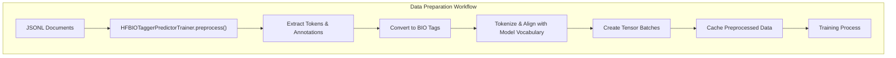
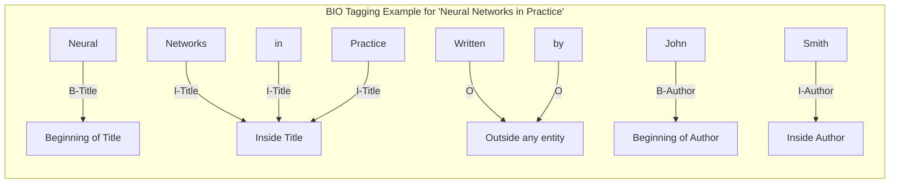
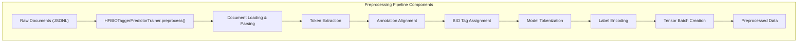
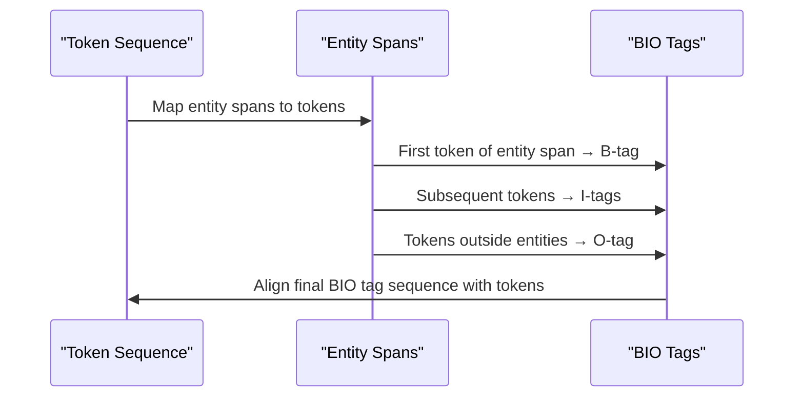
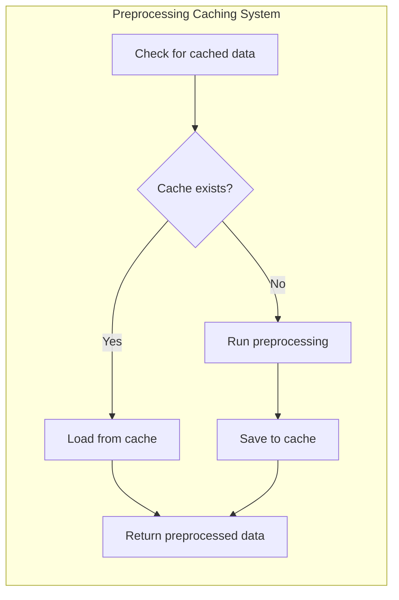
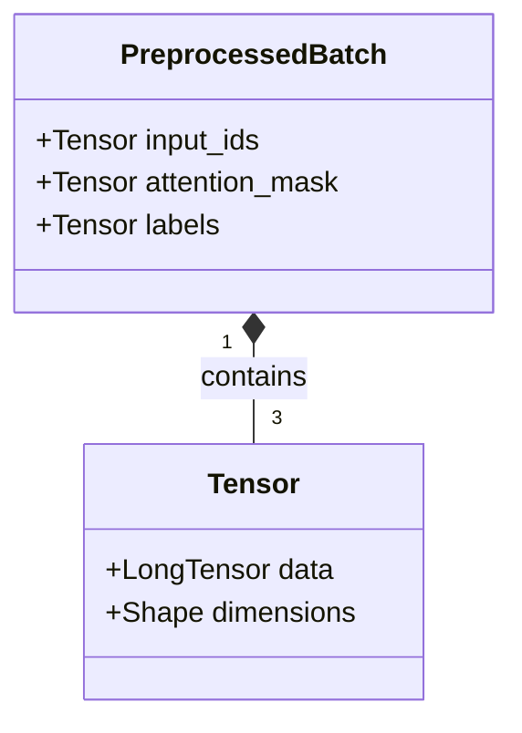
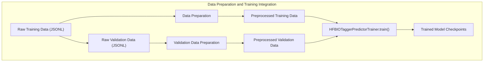

<!-- source: DeepWiki mcp.deepwiki.com · repo allenai/papermage · page 5.2 Data Preparation · fetched 2026-10-26 -->

# Data Preparation

<details>
<summary>Relevant source files</summary>

The following files were used as context for generating this wiki page:

- [tests/fixtures/eval_results.json](tests/fixtures/eval_results.json)
- [tests/fixtures/preprocessed_training_docs_tiny_multifields.pt](tests/fixtures/preprocessed_training_docs_tiny_multifields.pt)
- [tests/test_trainers/test_entity_classification_predictor_trainer.py](tests/test_trainers/test_entity_classification_predictor_trainer.py)

</details>


This document explains the data preparation process for training entity classification models in papermage. It covers the conversion of annotated documents into formats suitable for model training, particularly for BIO tagging-based entity classification. For information about the actual training process, see [BIO Tagger Trainer](#5.1).

## Overview of Data Preparation

The data preparation process converts annotated documents into tensor batches that can be used for training entity classification models. The primary component responsible for this conversion is the `HFBIOTaggerPredictorTrainer` class, which prepares data specifically for BIO (Beginning, Inside, Outside) tagging models.



Sources: [tests/test_trainers/test_entity_classification_predictor_trainer.py:94-154]()

## Input Data Format Requirements

Training data for papermage entity classification models should be provided in JSONL format, where each line represents a JSON document with annotations. The documents must contain the following components:

1. Text content (symbols)
2. Entity annotations organized in layers
3. Entity spans that define the boundaries of entities

Each document should include annotations for the entity types you wish to train the model to recognize. These annotations are provided as separate entity layers in the document.

## BIO Tagging Scheme

Papermage uses the BIO (Beginning, Inside, Outside) tagging scheme for entity classification, which is a standard approach in sequence labeling tasks:



- `B-EntityType`: Marks the beginning token of an entity
- `I-EntityType`: Marks tokens that continue an entity (inside)
- `O`: Marks tokens that are not part of any entity (outside)

Sources: [tests/test_trainers/test_entity_classification_predictor_trainer.py:94-103](), [tests/test_trainers/test_entity_classification_predictor_trainer.py:115-119]()

## Preprocessing Pipeline

The preprocessing pipeline handles the conversion of raw documents with annotations into tensor batches suitable for training. This process is managed by the `preprocess` method of the `HFBIOTaggerPredictorTrainer` class.



The preprocessing steps include:

1. Loading documents from a JSONL file
2. Extracting tokens and relevant annotations
3. Converting annotations to BIO tag sequences
4. Tokenizing text according to the model's vocabulary
5. Aligning BIO tags with tokenized input
6. Creating tensor batches containing:
   - `input_ids`: Token IDs from the model's vocabulary
   - `attention_mask`: Mask indicating valid tokens
   - `labels`: Encoded BIO tags

Sources: [tests/test_trainers/test_entity_classification_predictor_trainer.py:104-112]()

## Handling Multi-word Entities

The preprocessing system properly handles multi-word entities by converting them into sequences of B and I tags. The first token of an entity receives a B-tag, while all subsequent tokens within the same entity receive I-tags.



Sources: [tests/test_trainers/test_entity_classification_predictor_trainer.py:125-132]()

## Working with Multiple Entity Types

Papermage supports training models to recognize multiple entity types simultaneously. Each entity type has its own set of B and I tags in the label vocabulary:

```
id2label = {
    0: "O",
    1: "B-EntityType1",
    2: "I-EntityType1",
    3: "B-EntityType2",
    4: "I-EntityType2",
    ...
}
```

When preprocessing documents with multiple entity types, the system will correctly assign the appropriate B and I tags for each entity type. The entity types are specified as a list of label fields in the `preprocess` method.

Sources: [tests/test_trainers/test_entity_classification_predictor_trainer.py:135-154]()

## Caching Mechanism

To improve performance, especially when working with large datasets, the preprocessed data is cached to disk. This avoids redundant preprocessing when rerunning training with the same data.



The cached data is stored in the `CACHE_PATH` directory defined in the trainer, with a unique ID based on the data characteristics. This ID ensures that different datasets or preprocessing configurations use separate cache files.

Sources: [tests/test_trainers/test_entity_classification_predictor_trainer.py:63-64](), [tests/test_trainers/test_entity_classification_predictor_trainer.py:79]()

## Preprocessed Data Structure

The output of the preprocessing pipeline is a list of batch dictionaries, where each dictionary contains tensors for model input:



Each batch contains:
- `input_ids`: Tensor of token IDs from the model's vocabulary
- `attention_mask`: Tensor indicating which positions contain real tokens (vs. padding)
- `labels`: Tensor of encoded BIO tag IDs

Sources: [tests/test_trainers/test_entity_classification_predictor_trainer.py:108-112](), [tests/fixtures/preprocessed_training_docs_tiny_multifields.pt]()

## Integration with Training Pipeline

Once data preparation is complete, the preprocessed batches are fed into the training pipeline, which handles model training, validation, and checkpointing. The data preparation step is a prerequisite for the training process.



The trainer automatically handles both the preprocessing and training phases when the `train` method is called, making it a streamlined process for end users.

Sources: [tests/test_trainers/test_entity_classification_predictor_trainer.py:72-76]()

## Evaluation Data Preparation

When evaluating a trained model, the same preprocessing pipeline is used to prepare evaluation data. This ensures consistency between training and evaluation.

The `eval` method of the `HFBIOTaggerPredictorTrainer` class handles data preparation for evaluation, following the same preprocessing steps but storing the output in a separate cache file.

Sources: [tests/test_trainers/test_entity_classification_predictor_trainer.py:156-186]()

---

