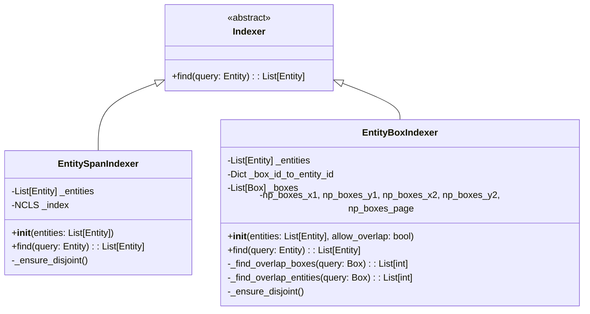
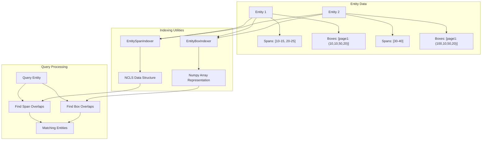
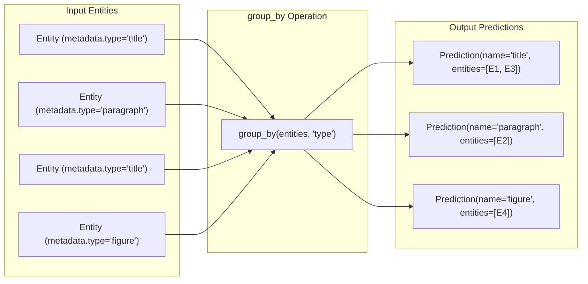
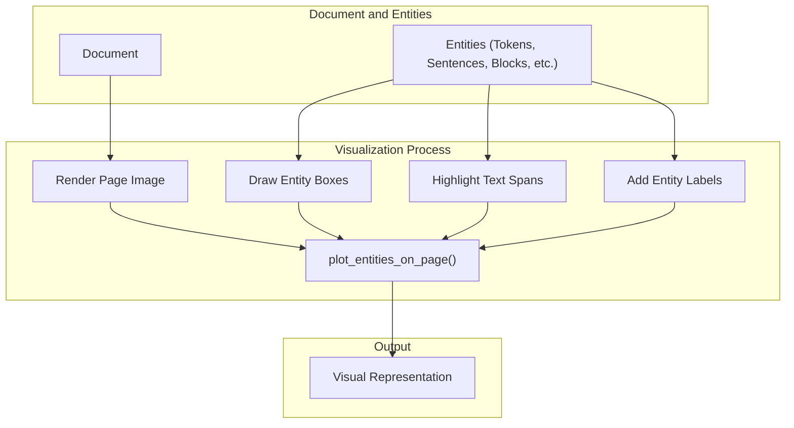
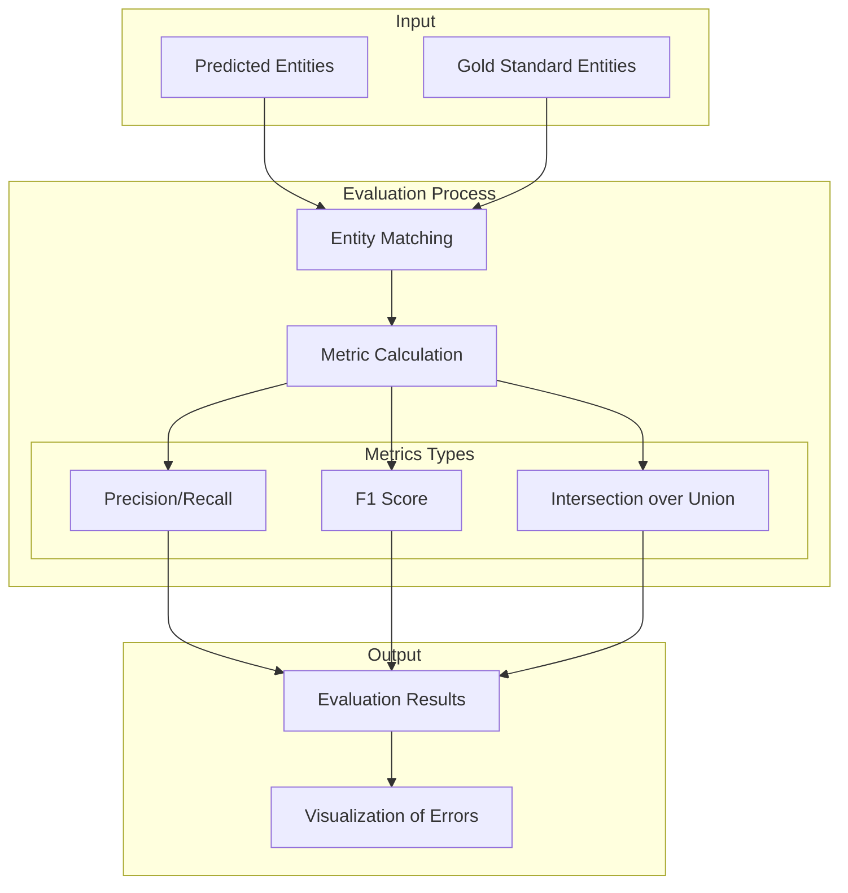
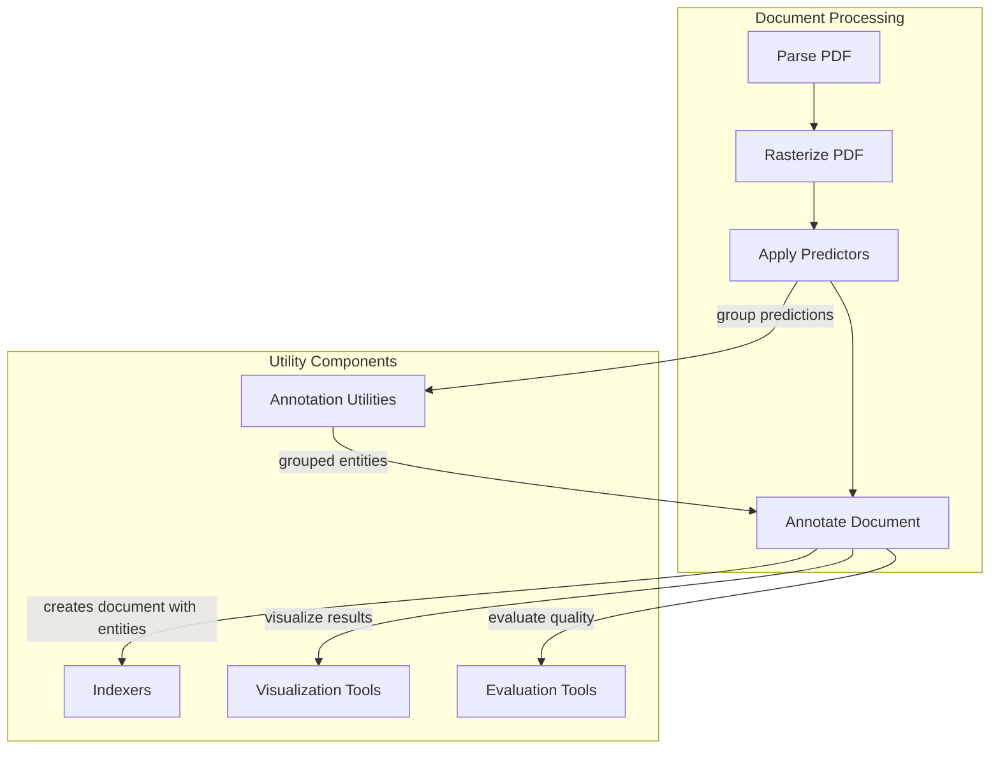

<!-- source: DeepWiki mcp.deepwiki.com · repo allenai/papermage · page 6 Utilities and Tools · fetched 2026-10-26 -->

# Utilities and Tools

<details>
<summary>Relevant source files</summary>

The following files were used as context for generating this wiki page:

- [papermage/magelib/indexer.py](papermage/magelib/indexer.py)
- [papermage/utils/annotate.py](papermage/utils/annotate.py)

</details>


This page documents the utility components and tools in the papermage library that support core functionality by providing efficient entity indexing, annotation helpers, visualization capabilities, and evaluation metrics. These utilities serve as important building blocks that enhance the usability and effectiveness of the main document processing pipeline. For information about the core document processing pipeline, see [Document Processing Pipeline](#3).

## Indexing Utilities

Papermage provides specialized indexing utilities that enable efficient entity search and intersection operations, which are critical for document analysis tasks.



The indexing utilities provide a standardized interface for finding entities that intersect with a query entity. This is particularly useful for tasks such as locating all sentences within a paragraph or finding figures that overlap with certain text regions.

### Indexer Base Class

The abstract `Indexer` class defines the basic interface for all indexing utilities in papermage. It requires implementing a `find()` method that accepts an entity query and returns matching entities.

```python
# Abstract interface for all indexers
find(query: Entity) -> List[Entity]
```

Sources: [papermage/magelib/indexer.py:19-26]()

### EntitySpanIndexer

The `EntitySpanIndexer` class provides efficient indexing for text span-based entity searching. It implements a Nested Containment List (NCL) data structure for fast interval queries.

Key features:
- Builds an NCLS index from entity spans
- Enforces disjoint spans by default (no overlaps)
- Returns entities whose spans overlap with the query entity

```python
# Usage example (not in source code)
indexer = EntitySpanIndexer(entities)
matching_entities = indexer.find(query_entity)
```

The implementation uses the NCLS library for efficient interval queries, making it suitable for tasks that require frequent text span intersection operations.

Sources: [papermage/magelib/indexer.py:29-99]()

### EntityBoxIndexer

The `EntityBoxIndexer` class provides efficient indexing for visual box-based entity searching. This is particularly useful for finding entities that overlap in the rendered document space.

Key features:
- Uses numpy arrays for efficient box overlap calculations
- Can optionally enforce disjoint boxes (no overlaps)
- Returns entities whose boxes overlap with the query entity

The implementation uses numpy vectorized operations to quickly identify box overlaps, making it efficient for visual layout analysis tasks.

Sources: [papermage/magelib/indexer.py:102-172]()

## Entity Relationship and Indexing Flow



Sources: [papermage/magelib/indexer.py:19-172]()

## Annotation Utilities

Papermage provides utilities for grouping and annotating entities based on their metadata properties. These tools help organize and categorize entities for further processing or analysis.

### Entity Grouping

The `group_by` function takes a list of entities and groups them according to a specified metadata field. This is useful for classifying entities into different categories or layers.

Key features:
- Groups entities by a specified metadata field
- Allows custom mapping of metadata values to group names
- Returns predictions that can be used to annotate a document

```python
# Example usage (not in source code)
predictions = group_by(entities, metadata_field="entity_type")
doc.annotate(predictions)
```

This utility is particularly useful for organizing entities into semantic categories that can be processed together or visualized distinctly.



Sources: [papermage/utils/annotate.py:7-45]()

## Visualization Tools

While the specific visualization files weren't provided, the project architecture overview indicates the presence of visualization utilities that help display document content and entity annotations. These tools are crucial for debugging, analysis, and results presentation.

Key visualization capabilities likely include:
- Rendering document pages with entity annotations
- Highlighting different entity types with distinct visual styles
- Visualizing spatial relationships between entities

The visualizers module contains functions like `plot_entities_on_page` that allow for visual inspection of entity annotations on document pages.



Sources: Based on system architecture overview provided

## Evaluation Tools

The evaluation tools in papermage provide metrics and methods for assessing model performance on document processing tasks. While specific implementation details weren't provided, these tools typically support standard evaluation workflows.

Common evaluation capabilities likely include:
- Computing precision, recall, and F1 scores for entity detection
- Evaluating entity classification accuracy
- Measuring spatial accuracy of detected entity boxes
- Comparing system outputs against ground truth annotations

These evaluation utilities help in benchmarking model performance, comparing different approaches, and tracking improvements during development.



Sources: Based on system architecture overview provided

## Integration with Core Components

The utilities and tools described above integrate seamlessly with the core document processing pipeline in papermage. They provide essential support functions that complement the primary document parsing and entity prediction components.



Sources: Based on system architecture overview provided

---

