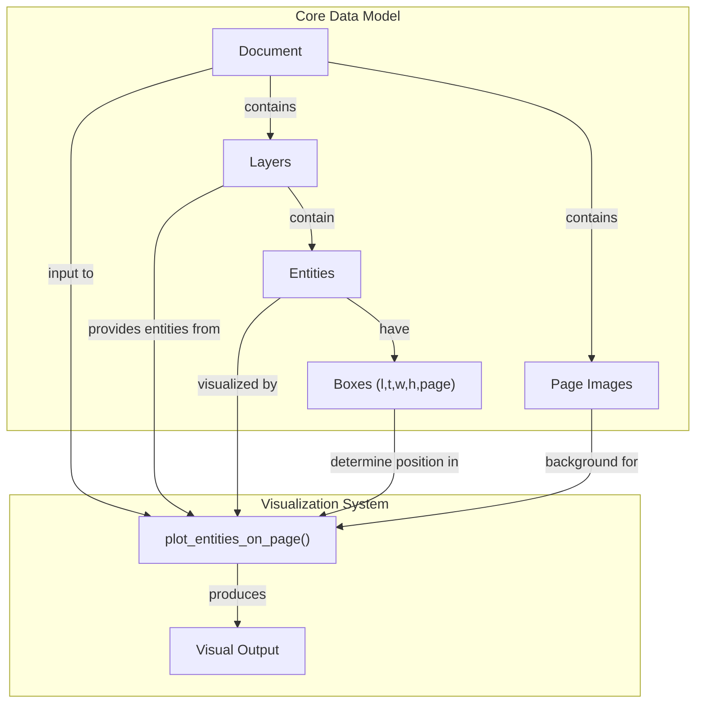
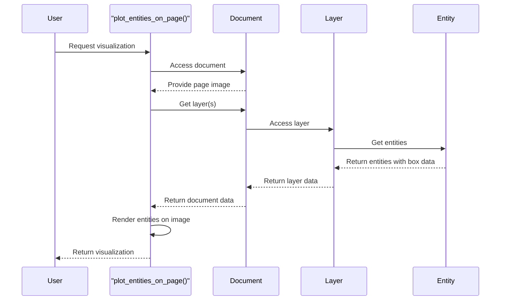
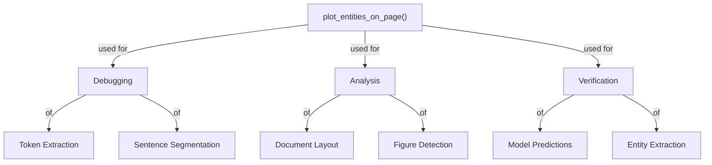

<!-- source: DeepWiki mcp.deepwiki.com · repo allenai/papermage · page 6.1 Visualization · fetched 2026-10-26 -->

# Visualization

<details>
<summary>Relevant source files</summary>

The following files were used as context for generating this wiki page:

- [examples/res/fig1.png](examples/res/fig1.png)
- [examples/res/fig3.jpg](examples/res/fig3.jpg)
- [papermage/visualizers/__init__.py](papermage/visualizers/__init__.py)
- [tests/fixtures/papermage.pdf](tests/fixtures/papermage.pdf)

</details>


The Visualization system in Papermage provides tools for visually inspecting document content and the entities extracted from documents. This page explains the visualization capabilities offered by the library, which are primarily centered around rendering entities (such as tokens, sentences, blocks, and figures) as visual overlays on document page images.

## Overview

The main functionality of the Visualization system is provided by a single function `plot_entities_on_page()`, which renders document entities as colored overlays on document page images. This visualization is essential for debugging entity extraction, verifying layout analysis, and understanding document structure.

## Visualization Architecture

The Visualization system connects directly to Papermage's core data model, using entity box coordinates to render visual overlays on document pages.



Sources: [papermage/visualizers/__init__.py](papermage/visualizers/__init__.py)

## Visualization Process

The visualization process involves taking a Document object with its entities and rendering those entities on page images based on their box coordinates.



Sources: [papermage/visualizers/__init__.py](papermage/visualizers/__init__.py)

## Main Visualization Function

The primary component of the visualization system is the `plot_entities_on_page()` function, which is exposed through the `papermage.visualizers` module:

```python
from papermage.visualizers import plot_entities_on_page
```

This function takes a Document object and likely parameters to control which entities are visualized and how they appear. The function uses the box coordinates from entities to determine where to draw visual representations on the page image.

Sources: [papermage/visualizers/__init__.py](papermage/visualizers/__init__.py)

## Integration with the Document Model

The visualization system integrates directly with Papermage's core data model:

- **Document**: Provides access to page images and layers
- **Layers**: Organize entities by type (e.g., tokens, sentences, blocks)
- **Entities**: Contain the data to be visualized
- **Boxes**: Provide coordinates (left, top, width, height, page) for visual positioning

The Box coordinates are particularly important for visualization, as they determine where each entity is drawn on the page image. Each Box has these properties:
- `l`: Left coordinate
- `t`: Top coordinate
- `w`: Width
- `h`: Height
- `page`: Page number

Sources: [papermage/visualizers/__init__.py](papermage/visualizers/__init__.py)

## Common Visualization Use Cases

The visualization system supports several important use cases in document processing:



### Use Cases in Detail

1. **Debugging Entity Extraction**
   - Viewing token boundaries
   - Inspecting sentence segmentation
   - Examining word recognition

2. **Analyzing Document Structure**
   - Understanding document layout
   - Analyzing spatial relationships
   - Examining hierarchical document organization

3. **Verifying Model Predictions**
   - Comparing extracted entities with ground truth
   - Validating layout analysis results
   - Checking for extraction errors

4. **Inspecting Processing Results**
   - Visualizing the output of predictors
   - Examining the results of parsers
   - Checking the behavior of recipes

Sources: [papermage/visualizers/__init__.py](papermage/visualizers/__init__.py)

## Entity Types and Visualization

Different types of entities can be visualized to help understand different aspects of document processing:

| Entity Type | Visual Representation | Common Use Cases |
|-------------|------------------------|-----------------|
| Tokens | Small boxes around individual words | Debugging tokenization, word recognition |
| Sentences | Boxes around complete sentences | Verifying sentence segmentation |
| Blocks | Larger boxes around text blocks | Analyzing document layout |
| Figures | Boxes around figures and tables | Verifying figure detection |
| Sections | Hierarchical groupings | Understanding document structure |

Sources: [papermage/visualizers/__init__.py](papermage/visualizers/__init__.py)

## Related Tools and Utilities

The visualization system is part of Papermage's utilities, which also include:

- **Indexers**: For efficient entity search and retrieval
- **Evaluation tools**: For assessing model performance (see [Evaluation](#6.2))

For information about evaluating model performance and comparing extraction results, see the [Evaluation](#6.2) page.

Sources: [papermage/visualizers/__init__.py](papermage/visualizers/__init__.py)

## Conclusion

The visualization system in Papermage provides essential tools for visually inspecting document processing results. By rendering entity boundaries directly on page images, it helps users debug, analyze, and verify the output of document processing pipelines. The primary function `plot_entities_on_page()` integrates with the core data model to create visual representations of document entities based on their box coordinates.

---

