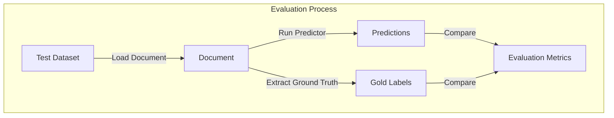
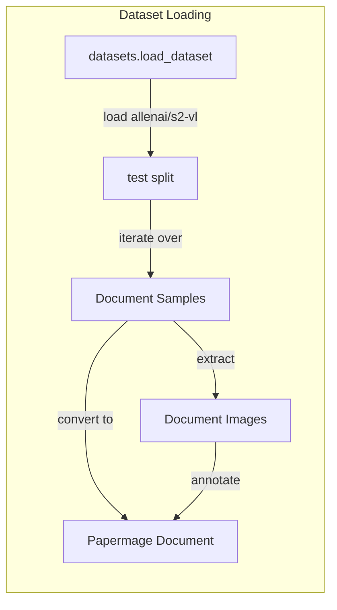
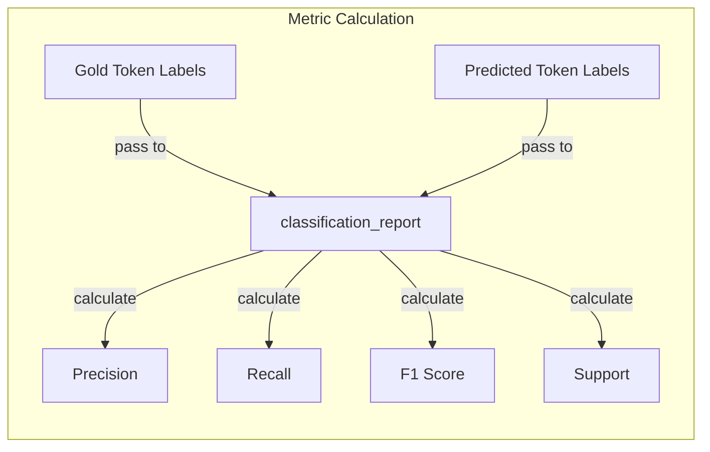
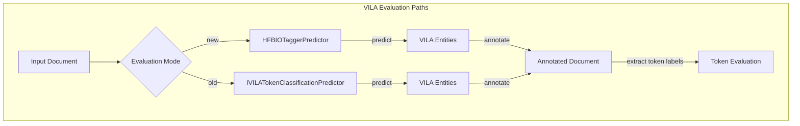
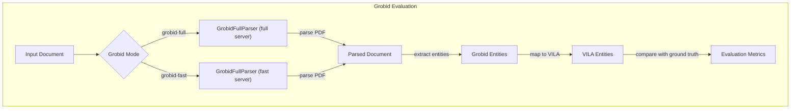
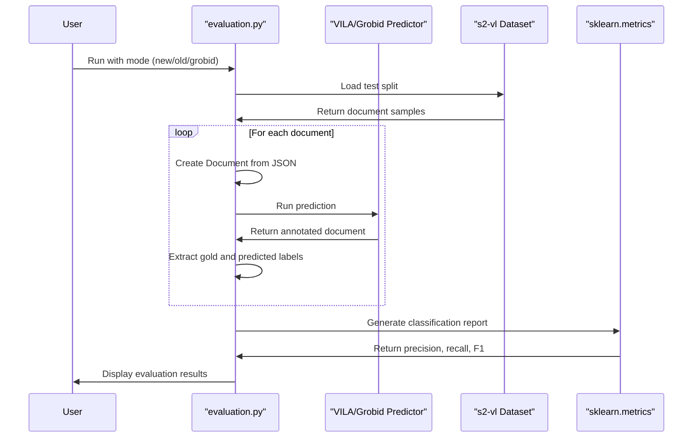
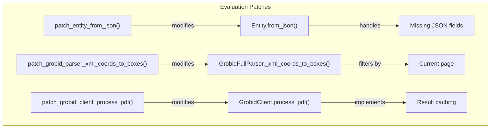
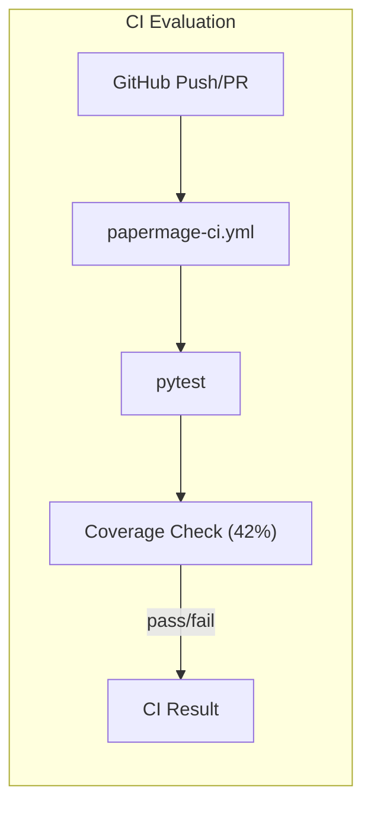

<!-- source: DeepWiki mcp.deepwiki.com · repo allenai/papermage · page 6.2 Evaluation · fetched 2026-10-26 -->

# Evaluation

Relevant source files

The following files were used as context for generating this wiki page:

- [.github/workflows/papermage-ci.yml](.github/workflows/papermage-ci.yml)
- [papermage/parsers/grobid_parser.py](papermage/parsers/grobid_parser.py)
- [scripts/evaluation.py](scripts/evaluation.py)

This document describes the evaluation system in Papermage, which is used to measure the performance of document predictors and parsers. It covers evaluation methodology, metrics, and tools for benchmarking the components that process and analyze documents. For information about model training, see [Training System](#5).

## Overview of Evaluation in Papermage

Papermage provides tools to evaluate document processing models and parsers, focusing primarily on accuracy metrics for entity extraction and document structure analysis. The evaluation system allows for:

1. Comparative analysis between different models and approaches
2. Benchmarking against standard datasets
3. Continuous quality monitoring for model improvements

Sources: [scripts/evaluation.py:87-135]()

## Evaluation Components

### Test Datasets

The evaluation script primarily uses the "allenai/s2-vl" dataset from Hugging Face Datasets, which provides document samples with labeled ground truth for benchmarking document structure analysis models.

Sources: [scripts/evaluation.py:92-125]()

### Evaluation Metrics

Papermage uses classification metrics from scikit-learn to evaluate performance, particularly:

- Precision, recall, and F1-score for each entity type
- Aggregate metrics across all categories
- Token-level evaluation

Sources: [scripts/evaluation.py:117-135]()

## Evaluating Different Components

Papermage's evaluation system supports comparison between different document processing approaches:

### VILA Predictors

The evaluation script can assess both newer HFBIOTaggerPredictor and older IVILATokenClassificationPredictor models:

Sources: [scripts/evaluation.py:89-108](), [scripts/evaluation.py:126-133]()

### Grobid Parser

The evaluation system can also assess the performance of the Grobid parser with different configurations:

Sources: [scripts/evaluation.py:108-113](), [papermage/parsers/grobid_parser.py:196-281]()

## Running Evaluations

The evaluation script offers several modes to benchmark different systems:

| Mode | System Evaluated | Description |
|------|-----------------|-------------|
| `new` | HFBIOTaggerPredictor | Evaluates the newer Hugging Face BIO tagger model |
| `old` | IVILATokenClassificationPredictor | Evaluates the older row-based LayoutLM model |
| `grobid-full` | GrobidFullParser | Evaluates the full Grobid parser with complete processing |
| `grobid-fast` | GrobidFullParser | Evaluates a faster version of the Grobid parser |

### Example Workflow

Sources: [scripts/evaluation.py:87-135]()

## Evaluation Infrastructure

### Patching for Evaluation

To facilitate evaluation, the script includes several patches to Papermage components:

1. Entity JSON parsing patch for handling potentially missing fields
2. Grobid parser patch to filter by page number and normalize page coordinates
3. Grobid client process caching to avoid redundant API calls

Sources: [scripts/evaluation.py:29-66]()

### Continuous Integration Testing

Papermage includes evaluation in its CI pipeline, ensuring that changes don't degrade performance:

Sources: [.github/workflows/papermage-ci.yml:1-44]()

## Interpreting Evaluation Results

Evaluation results are presented as a classification report showing per-class and aggregate metrics:

| Entity Type | Precision | Recall | F1-Score | Support |
|-------------|-----------|--------|----------|---------|
| Title       | x.xxx     | x.xxx  | x.xxx    | xxx     |
| Author      | x.xxx     | x.xxx  | x.xxx    | xxx     |
| Abstract    | x.xxx     | x.xxx  | x.xxx    | xxx     |
| Section     | x.xxx     | x.xxx  | x.xxx    | xxx     |
| ...         | ...       | ...    | ...      | ...     |
| **macro avg**   | x.xxx     | x.xxx  | x.xxx    | xxx     |
| **weighted avg** | x.xxx     | x.xxx  | x.xxx    | xxx     |

These metrics help identify:
- Which entity types the model handles well or poorly
- Overall model performance
- Areas for improvement in model training

Sources: [scripts/evaluation.py:135]()

---

